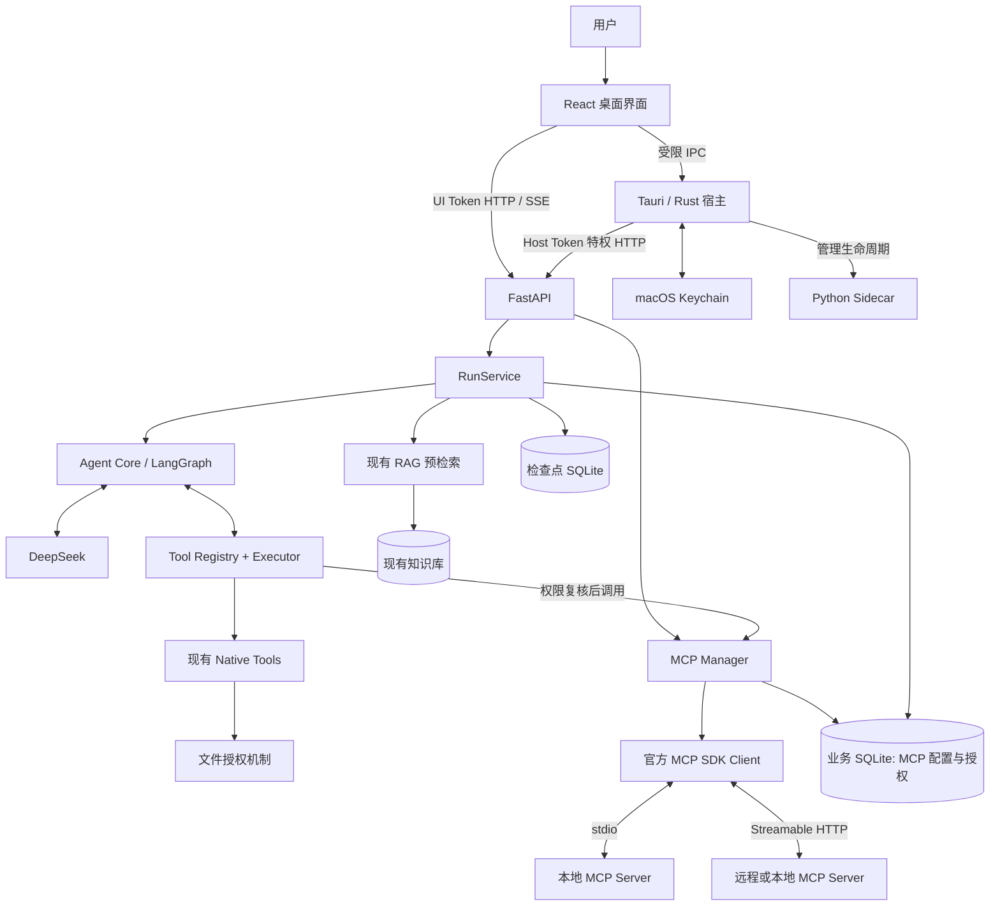
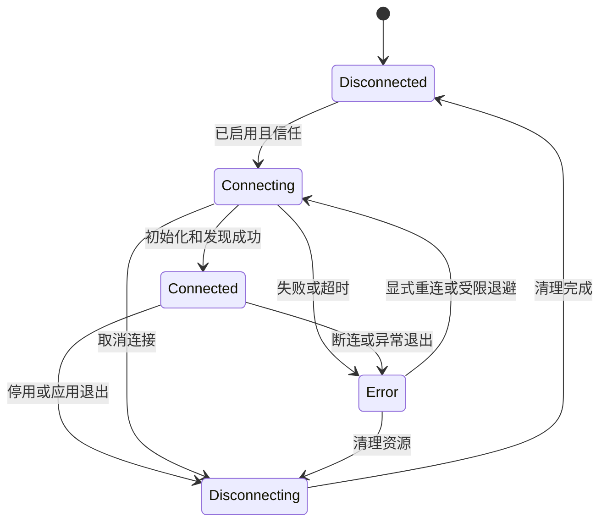
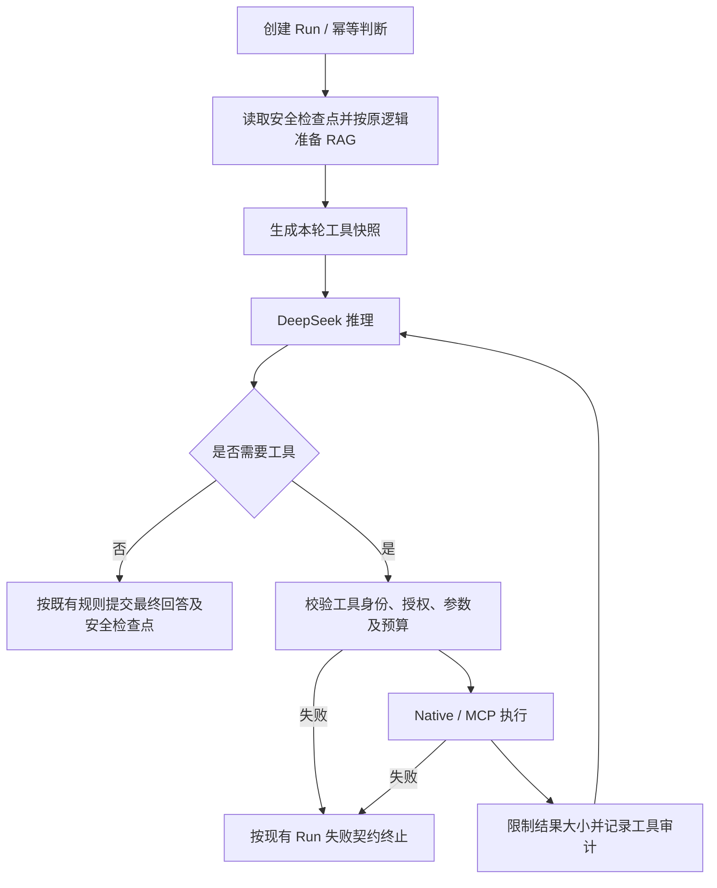

# KnowledgeAgent MCP 专项架构设计 v0.1

> 状态：设计草案，待 P6.1 源码审查后定稿  
> 项目：KnowledgeAgent（macOS Apple Silicon，本地优先 AI 桌面助手）  
> 设计基线：2026-11-24 项目交接报告，测试安装版 v0.2.4  
> 开发阶段：P6 — MCP 能力扩展  
> 本文不代表代码已实现或测试已通过；接口、字段、预算及目录均为提案，需结合实际源码确认。

## 1. 产品定位与设计目标

KnowledgeAgent 的长期方向为 **通用桌面 Agent + 专业教材知识库**。现有 RAG 已满足用户的实际使用需求，暂停主动扩展 RAG，仅维护必要缺陷。下一阶段优先通过 MCP（Model Context Protocol）接入外部工具，使 Agent 能自主选择并使用经过授权的能力，而无需每新增一种工具就修改 Agent 核心业务代码。

本阶段目标是实现可日常使用的 MCP Host，而非仅完成一次 MCP 工具调用 Demo。用户应能够在桌面界面配置服务、发现工具、管理授权、查看调用状态及历史，并在安装版中正常使用这些能力。

### 1.1 功能范围

| 能力 | P6 范围 |
|---|---|
| 多 Server 配置、启停、连接状态与工具发现 | 实现 |
| stdio / Streamable HTTP | 实现 |
| Agent 自主调用授权工具 | 实现 |
| 配置与工具授权持久化、Keychain 凭据 | 实现 |
| 统一工具执行入口、Run 审计、超时和取消 | 实现 |
| MCP 独立管理页面、JSON 导入、调用历史 | 实现 |
| 真实只读服务及 macOS 安装版验收 | 实现 |
| Resources、Prompts、旧版 HTTP+SSE、OAuth 自动授权 | 暂缓 |
| 服务市场、Agent 自动安装服务、任意命令执行 | 不实现 |
| 有外部副作用的写操作、审批流程 | 暂缓，依赖 P5 |
| RAG 工具化、长期记忆、多 Agent、Windows | 不属于本阶段 |

不新增 Redis、Docker 或远程业务数据库。保留现有 Rust/Tauri、React、Python/FastAPI、LangGraph、SQLite、DeepSeek、SiliconFlow 架构。

## 2. 现有架构基线与约束

根据交接报告（尚未独立核对源码）：

- Tauri/Rust 管理原生窗口、文件选择、钥匙串、Sidecar 生命周期及宿主特权请求；React 使用受限 IPC 与本机 HTTP/SSE。
- Python Sidecar 在动态回环端口运行 FastAPI，区分 UI Token 和 Host Token。
- `RunService` 管理运行、幂等、取消、历史及成功检查点；每个会话最多一个活动 Run。
- 普通聊天使用 LangChain `create_agent`；有文件授权时使用自定义 LangGraph 工具图；RAG 在图执行前准备证据上下文。
- `RunTools` 负责本地文件授权快照及执行期复核，原生工具包括 `list_files`、`read_text`。
- 业务、LangGraph 检查点、知识库分别持久化。业务库记录 `tool_calls`、`run_citations` 等，成功提交与安全检查点指针有明确约束。
- 当前工具图存在整轮缓冲和工具失败导致 Run 失败的机制；P6 首版不得擅自改变原有提交语义。

以上约束来自交接报告，P6.1 应重点复核 `backend/app/services/runs.py`、`agent/answer.py`、`agent/tool_graph.py`、`tools/registry.py`、`storage/business.py`、`storage/checkpoints.py`、`desktop/src/sidecar.rs`、`desktop/src/keychain.rs`、`frontend/src/Chat.tsx`、`接口.md` 及打包脚本。

## 3. 总体架构



MCP Manager 只负责外部能力的连接、发现与调用；Agent 负责选择工具；RunService 继续管理业务执行和持久化。MCP 不接管聊天、RAG 或检查点。

## 4. 技术选型与模块职责

优先选择官方 Python MCP SDK + 轻量自有工具适配层。复用 SDK 协议实现，不手写 JSON-RPC 或传输协议。对比 `langchain-mcp-adapters` 后再定稿；现有工具权限、审计和 Run 契约优先于适配器的便利性。

具体 SDK 版本必须根据 Python 3.12、`backend/pyproject.toml`、`uv.lock`、现行 LangChain/LangGraph、httpx、Pydantic、AnyIO 和 PyInstaller 的兼容性审查后锁定。v0.1 不指定未验证版本。

建议逻辑目录（允许按源码职责合并，避免空壳抽象）：

```text
backend/app/
├── agent/                  # 扩展现有工具图，不新增第三套 Agent
├── tools/
│   ├── registry.py         # 汇总授权原生及 MCP 工具
│   └── executor.py         # 统一执行入口（按需新增）
├── mcp/
│   ├── models.py           # 配置、运行状态、工具定义
│   ├── manager.py          # 多服务连接和生命周期
│   ├── client.py           # SDK Transport / Session 封装
│   ├── adapter.py          # 工具 Schema 和结果适配
│   ├── policy.py           # 信任、授权和调用策略
│   └── errors.py           # 稳定错误类型（按需）
├── storage/mcp.py          # 业务库迁移及持久化
├── api/mcp.py              # 管理和查询路由
└── services/runs.py        # 复用 Run、取消、审计及提交

desktop/src/                # 受限 IPC、Keychain、宿主授权
frontend/src/               # MCP 页面、聊天工具回显、API 类型
```

MCP Manager 逻辑接口：`connect(server_id)`、`disconnect(server_id)`、`list_tools(server_id)`、`refresh_tools(server_id)`、`call_tool(server_id, tool_name, arguments, run_context)`、`shutdown()`，均为异步操作；不暴露给模型或普通 UI 任意执行。

## 5. 连接与生命周期

### 5.1 Transport

| 项目 | stdio | Streamable HTTP |
|---|---|---|
| 位置 | 本机外部程序 | 本机或远程服务 |
| 生命周期 | 管理受信任子进程 | 管理客户端会话 |
| 配置 | command、args、受控 env、可选 cwd | URL、受控认证 Header |
| 默认安全边界 | 不使用 shell 拼接，不继承无关秘密 | HTTPS；仅明确的本机回环允许 HTTP |

不要求用户为 MVP 安装额外的全局运行时；但第三方 stdio 服务若依赖 Node、Python、uv 等，应用必须明确显示依赖和诊断，不假装所有外部服务都能独立运行。优先支持绝对可执行路径；若支持 PATH 解析，必须明确实际解析到的路径和信任策略。

### 5.2 状态机



`enabled`、信任状态属于持久配置；连接状态属于进程内运行时，不能把已启用等同于已连接。应用启动后异步恢复受信任且启用的服务，不阻塞正常聊天及就绪握手。单个 Server 故障必须隔离。

每个 Server 由专属受管任务持有 SDK session 与异步上下文，确保 AnyIO cancel scope / async context 的进入和退出在正确任务中进行；通过受控队列或等效机制调度请求，避免跨任务随意关闭上下文。连接与断开应幂等，并按连接 generation 隔离过期回调及工具缓存。

应用退出、停用、配置变更或 Sidecar 异常时，停止接收新调用，取消在途请求并关闭 session；stdio 受管进程需要验证正常退出、异常退出和超时后的回收策略，必要时终止进程组。关闭 HTTP 客户端不代表关闭远程 Server。重连不自动重放失败工具调用。

## 6. Agent 集成与工具执行

### 6.1 最小修改路径

保留当前普通聊天与工具聊天两条路径，将路由条件由“是否存在文件授权”调整为“本轮是否存在可用工具”。有授权 MCP 但无文件授权时，也应进入现有扩展后的工具图。不重构全部 Agent，不新增第三套图，不改变 RAG 预检索方式。

本轮工具快照由现有授权原生工具和已连接、已信任、已授权的 MCP 工具组成。工具快照冻结可见集合与定义；实际执行必须重新核验服务状态、授权、配置 revision、schema/定义摘要、Run 状态及预算。新工具不得在本轮未授权地自动出现。



### 6.2 工具身份与适配

内部身份为 `(server_id, original_tool_name)`，与显示名称解耦。向模型暴露稳定、符合 DeepSeek 限制且冲突检测后的别名，例如 `mcp__<server_key>__<tool_key>`；保留现有原生工具名称，避免破坏历史和检查点。

MCP inputSchema 转换为现行模型支持的 JSON Schema 子集，并保留原始定义供执行前校验；不兼容的 Schema 标记不可用，不能无提示放宽约束。限制工具名、描述、Schema 深度及总大小。所有输入都按不可信数据处理。工具返回的 `isError`、协议异常、文本与 structuredContent 需明确映射；首版仅支持受限文本/结构化 JSON，图片、二进制、资源链接等不自动读取或转发。

### 6.3 Run 与检查点兼容

- 原生与 MCP 共享每轮工具预算、取消信号及审计入口。
- 工具开始、完成、失败、取消等状态遵循当前 SSE/数据库契约，历史记录包含来源和服务名称快照。
- 保留现有“成功 Run 才更新安全检查点”的规则；失败工具不伪装为成功，不推进失败图状态。
- 首版允许工具失败终止当前 Run，但不得影响其他会话或普通聊天；可恢复工具错误机制以后独立设计。
- 核对现有上游流协议重试逻辑，禁止因为模型重试或连接恢复而重复执行已完成或结果未知的外部工具。
- 若现有工具图需要整轮缓冲，首版保持其语义；真正流式工具图改造不作为 MCP 接入的前置条件。

## 7. 持久化与迁移

建议扩展现有业务 SQLite，不增加独立 MCP 数据库。实际表名、外键、事务和迁移版本由 P6.1 核对当前 schema 后确定。

### 7.1 `mcp_servers`（建议）

| 字段 | 语义 |
|---|---|
| id | 稳定唯一 ID |
| name | 显示名称 |
| transport | stdio / streamable_http |
| command、args_json、cwd | stdio 配置 |
| url | HTTP 端点（不得夹带秘密） |
| env_json / header_config_json | 非秘密配置及秘密引用，不保存明文凭据 |
| credential_ref | Keychain 引用或引用集合 |
| enabled | 是否启用 |
| trust_state、trusted_revision | 信任状态及绑定的配置版本 |
| config_revision | 配置版本 |
| created_at、updated_at | 时间 |

两种 transport 字段互斥校验。命令、参数、地址、凭据用途等关键变更应使既有信任/授权失效并断开旧连接。新建和导入的 Server 默认停用且未信任。

### 7.2 `mcp_tools`（建议）

以 `(server_id, tool_name)` 唯一标识工具，保存 description、input_schema_json、annotations_json、definition_hash、enabled、permission_state、approved_definition_hash、discovered_at 等字段。定义摘要至少覆盖名称、描述、参数 Schema 和安全相关声明；新发现的工具默认未授权。工具移除、定义变更或服务器配置变化后不得自动沿用过期授权。工具启用与用户明确授权应具有清晰语义，不必为了字段数量重复建模。

### 7.3 调用历史

复用 `tool_calls` 表，按需扩展 source、server_id、server_name_snapshot、original_tool_name、definition_hash、耗时及脱敏摘要等字段，保留历史可读性。删除 Server 不级联抹去过去 Run 的历史记录；不存储完整秘密参数或原始响应作为审计日志。已有历史记录应继续可读。

迁移使用现有版本机制和事务，测试旧库升级、重启、禁用与配置删除。连接对象、子进程句柄及实时错误详情保存在内存，不写入持久化配置。

## 8. API / IPC / SSE 契约

以下为建议路由，最终以 `接口.md` 和实际 FastAPI/Tauri 权限设计为准。

| 方法 | 路径 | 权限与用途 |
|---|---|---|
| GET | `/api/v1/mcp/servers` | UI，脱敏配置及状态 |
| GET | `/api/v1/mcp/servers/{id}/tools` | UI，工具与授权状态 |
| POST | `/api/v1/_host/mcp/servers` | Host，新增或导入待审核配置 |
| PATCH | `/api/v1/_host/mcp/servers/{id}` | Host，修改配置、信任及启用状态 |
| DELETE | `/api/v1/_host/mcp/servers/{id}` | Host，撤销、断开、删除 |
| POST | `/api/v1/_host/mcp/servers/{id}/connect` | Host，连接或重连 |
| POST | `/api/v1/_host/mcp/servers/{id}/disconnect` | Host，断开 |
| POST | `/api/v1/_host/mcp/servers/{id}/refresh` | Host，刷新工具列表 |
| PATCH | `/api/v1/_host/mcp/servers/{id}/tools/{tool_id}` | Host，调整工具授权 |

React 通过受限 IPC 触发特权操作，Rust 校验及必要时原生确认后，通过 Host Token 访问后端。UI Token 不可访问特权路由，不可直接调用任意 MCP 工具。钥匙串读取不得通过普通 UI 接口暴露明文；Sidecar 凭据回灌复用既有信任边界。

SSE 复用现有工具事件及 `session_id`、`run_id`、`version`、`ts`、`data` 契约，增量添加 MCP 来源、服务名、状态、耗时等；前端事件校验和历史接口同步调整。服务连接状态首版可轮询，不额外增加独立 SSE 子系统。必须保留兼容旧历史与原生工具事件的处理。

## 9. 安全与权限

### 9.1 三层授权

1. Server 级：用户显式信任具体配置后才允许启动或连接；导入只生成待审核草稿。
2. Tool 级：逐工具授权，绑定定义摘要与服务配置版本；仅允许经过用户审查的低风险只读能力。
3. Run 级：本轮快照、执行期权限复核、参数校验、次数/大小/时间预算和取消状态。

MCP `readOnlyHint` 等 annotations 只是声明，不能证明服务不会写入或泄露数据。首版不支持文件修改、发信、提交代码、支付等有外部副作用的工具；无法合理确认用途的工具保持禁用，后续依赖 P5 审批设计。

### 9.2 关键边界

- MCP stdio 本质是执行外部程序，不是沙箱；进程启动本身也可能产生副作用。明确告知用户并绑定信任到具体命令/参数/配置，不允许模型自行添加、安装、执行任意命令或修改授权。
- 禁止自动拉取/执行未审核的软件包。用户配置的 `npx`、`uvx` 等可能下载并执行代码，确认界面必须明确展示，首批测试优先采用固定本地程序。
- MCP 子进程不继承模型 Key、内部 Token 或其他不必要的环境变量；采用受控环境变量白名单和专用 Keychain 凭据。
- 远程 HTTP 默认 HTTPS，明确允许回环 HTTP；禁用非 HTTP(S) URL、URL 内秘密及不受控重定向。审查本地网络访问、DNS 解析变化、重定向及凭据跨域转发风险；不允许模型修改 endpoint。
- 外部 Filesystem MCP 不受现有文件授权机制自动约束，首版不接入广泛文件访问类服务。不得宣传 MCP 已具备 OS 级隔离。
- MCP 工具描述和返回内容视为不可信数据，不能提升为系统指令或改变权限；关闭本阶段未授权的 sampling、elicitation、roots 等客户端能力。
- 不自动将本地文件、教材片段或全部历史发送给 MCP 服务。远程工具参数及结果可能外发到服务或 DeepSeek，用户界面应说明传输边界；密钥不得进入模型上下文、日志和 UI。
- 撤销或停用后拒绝新调用，尽力取消在途调用。外部执行结果未知时明确提示，不承诺回滚。

## 10. 可靠性与资源预算

建议初始值，均不是协议规定，P6.1 可根据实际实现调整。

| 预算 | 建议默认值 |
|---|---:|
| 单 Server 连接超时 | 15 s |
| 单次工具调用超时 | 60 s |
| 单轮工具调用总数（含原生工具） | 8 |
| 单次工具结果文本 | 16,000 字符 |
| 单 Server 并发调用 | 1 |
| 自动工具调用重试 | 0 |
| 单轮暴露给模型的工具数 | 32 |

另需明确全轮工具总字节、Schema 总大小、发现工具数、活跃 Server 数、连接并发与排队上限，并区分 SDK 收包边界和结果进入模型的大小限制，避免仅在收完巨大响应后才截断。具体数值待源码审查。

超过工具数时应明确提示或要求用户缩小启用范围，不静默省略；超长结果受限并标注截断；异常和错误码脱敏。

| 场景 | 处理 |
|---|---|
| Server 连接失败 | 独立标记错误，不阻塞主程序 |
| 工具参数或权限错误 | 执行前拒绝 |
| 工具超时 / 协议错误 | 记录失败，尝试取消，不重放 |
| Server 意外退出 | 清理 session，状态标记断连 |
| Run 取消 | 传播取消，禁止后续调用及成功提交 |
| 服务停用或配置变更 | 复核 revision，取消旧调用，清理旧连接 |
| 应用退出 | 有界关闭所有会话及受管子进程 |

连接退避只能用于恢复服务连接，不能自动重复外部操作。SDK 的实际取消语义、远端执行未知状态、stdio 进程回收均需通过故障测试验证。

## 11. 前端设计

在现有侧边栏新增独立「MCP 服务」页面，不重做知识库或模型设置。

```text
MCP 服务                                      [+ 添加] [导入 JSON]
----------------------------------------------------------------
Web Search           HTTP          已连接          [启用/停用]
  2 个已授权工具 / 3 个已发现工具           [刷新] [编辑] [删除]
  [✓] search_web     [✓] read_page      [ ] submit_feedback
----------------------------------------------------------------
Academic Search      stdio         已停用          [启用/停用]
  查看命令、依赖、工具列表和最近错误
```

以上服务名称为示例，不代表已接入真实服务。页面需区分配置启用、信任、连接、工具授权和运行错误，提供连接测试、刷新工具、删除确认及脱敏诊断。添加时按 transport 展示不同表单，秘密通过受限 IPC 保存。JSON 导入支持常见 `mcpServers` 格式，识别 command/args/env/url 等已支持字段，未知字段明确报错或提示；秘密进入 Keychain，导入不自动启动服务。

```json
{
  "mcpServers": {
    "example": {
      "command": "/path/to/executable",
      "args": ["server"]
    }
  }
}
```

聊天界面复用现有工具调用卡片，展示 MCP 来源、工具名、状态、耗时及脱敏摘要。展示本轮 MCP 可用状态，建议提供会话或本轮 MCP 开关，便于关闭所有 MCP 工具而不影响普通聊天或 RAG；开关的持久化语义待 P6.1 确认。

## 12. macOS 打包与运行环境

继续使用当前 Tauri + PyInstaller onedir 推荐路线。P6.1 核对官方 MCP SDK、AnyIO、HTTP 客户端等依赖是否需要 hidden imports、数据文件、证书或 hook；P6.6 用安装版实测，不以开发版成功代替。

重点检查 GUI 应用与终端的 PATH 差异、Apple Silicon 可执行程序架构、第三方工具运行时、Keychain 权限、外部子进程管理、退出后无孤儿进程、打包后的网络请求与配置恢复。已有默认 onedir 打包路径自删除问题须在安装版验收前修复或明确采用已验证的替代构建路径，不在 P6.1 擅自修复。正式 Developer ID、公证和公开发行不属于 P6 的强制前置门槛。

## 13. 开发路线与阶段验收

### P6.1 — 架构与接口审查（当前）

- 审查实际源码、工具图、Run 提交规则、事件契约、DB 迁移、宿主权限、Keychain 和打包路径。
- 检查 SDK 依赖兼容性及生命周期方案，确定最小改动，补齐未决参数与安全边界。
- 输出 `KnowledgeAgent_MCP_Architecture_v0.2.md`，说明相对 v0.1 的变更、证据、待决事项和逐项任务。
- 只允许源码只读调查及新设计文档创建；不修改业务代码、不安装依赖、不改数据库、不启动外部服务。

验收：设计与实际源码对齐；明确所有需修改模块、迁移版本、接口、失败语义和各阶段验证方式。未经用户确认不进入代码实现。

### P6.2 — MCP Client 与 Manager

- 锁定经审查的 SDK；实现 stdio 和 Streamable HTTP 的连接、初始化、分页发现、调用、断开、连接代际及受管任务。
- 使用可控本地测试 Server 验证文本与结构化结果、连接失败、超时、取消、重复连接、断连及进程清理。

验收：不依赖 Agent 就能通过两种 transport 调用测试工具；重复启停与应用关闭不泄漏受管进程或任务。

### P6.3 — 配置、信任与权限

- 实现业务库迁移、配置 CRUD、凭据引用、Keychain 集成、服务启停及工具授权。
- 实现默认拒绝、定义变更失效、配置变更重新信任、执行期复核和秘密隔离。

验收：重启后恢复配置；未信任服务不启动、未授权工具不执行；变更定义或撤销后拒绝调用；旧业务库与历史可正常读取。

### P6.4 — Agent 集成

- 扩展现有工具注册、工具图路由及执行器；统一工具预算，保持原生文件授权。
- 接入 DeepSeek 工具调用、Run 审计、SSE、历史记录和取消/安全检查点规则。
- 验证无文件授权但有 MCP、原生与 MCP 同轮调用、同名隔离、失败不重复调用。

验收：模型能自主选择 MCP 工具并根据结果回答；普通聊天、原生文件读取、RAG 与历史恢复回归通过。

### P6.5 — MCP 前端管理

- 实现独立 MCP 页面、添加/编辑/删除、导入草稿、启停、信任确认、工具列表和授权管理。
- 接入受限 IPC 和脱敏错误展示；聊天页显示调用来源、状态和历史。

验收：用户无需修改源码即可配置、连接和授权 MCP 服务；普通 UI Token 无法绕过权限。

### P6.6 — 真实服务与安装版验收

- 优先选择可审核且低风险的联网搜索、文档/学术检索服务；尽量复用现有凭据或不需要额外 API Key 的服务。具体服务、URL、工具及认证方式在实施时验证，不在设计中虚构可用性。
- 实测多服务、故障隔离、工具调用、取消、重启、历史恢复和安装版。

验收：在 macOS 安装版中从 UI 配置真实服务，Agent 自主调用并给出有效回答，应用退出后无受管进程残留，原有能力不受影响。

## 14. P6 总体验收清单

- [ ] UI 支持 Server 添加、编辑、删除、启停和连接测试。
- [ ] JSON 导入不自动执行外部程序。
- [ ] stdio 与 Streamable HTTP 均有独立实测证据。
- [ ] 多服务可共存，工具发现及同名隔离正确。
- [ ] 无文件授权的会话可自主调用已授权 MCP 工具。
- [ ] 原生文件授权不被绕过，原生工具与 MCP 共享预算。
- [ ] 未授权、撤销授权、定义变更和配置变更均按策略拒绝调用。
- [ ] 凭据不进入模型上下文、明文数据库或日志；UI Token 无特权访问。
- [ ] 超时、断连、取消、错误结果和应用退出得到正确处理。
- [ ] 外部结果未知或模型重试时不会自动重放工具调用。
- [ ] Run、SSE、工具历史及安全检查点保持一致。
- [ ] 重启后配置、信任及授权按规则恢复。
- [ ] 聊天、文件读取、RAG 和历史功能回归通过。
- [ ] 安装版真实 MCP 服务使用成功，受管进程正确清理。

每个阶段的交付报告应列出实际修改、运行命令、测试结果、未验证范围、风险及下一任务。不得把仅存在测试代码或 HTTP 200 视为业务功能已验收。

## 15. P6.1 待决事项与设计边界

1. SDK 具体版本、依赖冲突、异步 session 与取消实现，以及 PyInstaller 兼容性。
2. 现有两套图的状态 Schema、工具定义适配、Run 成功提交及失败重试是否需最小契约变更。
3. MCP 表的真实迁移版本、工具历史字段、授权 revision 和 Keychain 引用清理策略。
4. 宿主 IPC 信任确认形式、HTTP 网络策略、stdio 子进程组回收与非秘密环境变量策略。
5. 工具和连接资源预算、MCP 会话开关，以及超过预算时的 UI 反馈。
6. 第一批真实只读服务的选择及其实际依赖、认证与数据外发风险。
7. 开发版/安装版隔离、默认打包缺陷与当前源码版本基线。

P6.1 可以修正本草案中不合理或不兼容的决策，但必须给出实际源码依据及变更说明。未获得用户批准之前，不得提前实现、升级依赖或修改原有业务代码。后续 Agent Core、Context Engineering、Memory、Skills 与复杂任务编排按实际需求独立规划；不以 MCP 接入为由扩展 RAG 或提前启动 P5。
