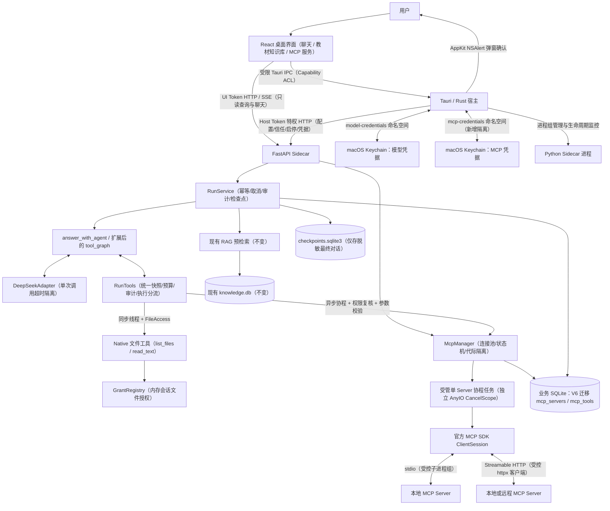
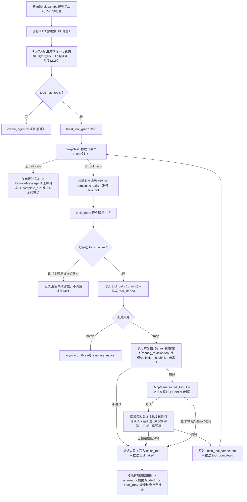
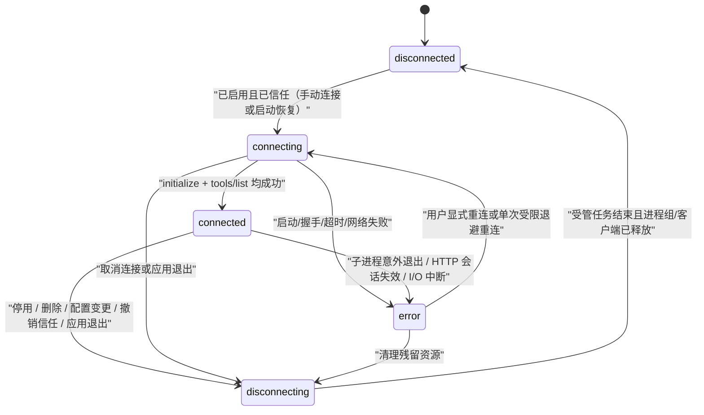

# KnowledgeAgent MCP 专项架构设计 v0.2

> **文档版本**：v0.2（P6.1 源码审查与架构定稿版，待用户审核后进入 P6.2）  
> **编写日期**：2026-11-25  
> **项目**：KnowledgeAgent（macOS Apple Silicon，本地优先 AI 桌面助手）  
> **产品长期方向**：通用桌面 Agent + 专业教材知识库（RAG 当前已满足使用需求，本阶段暂停 RAG 功能扩展）  
> **开发阶段**：P6 — MCP（Model Context Protocol）能力扩展  
> **审查基线**：基于 `<PROJECT_ROOT>` 实际源码只读审查完成；**未修改业务代码、未安装或升级依赖、未修改数据库、未启动外部 MCP 服务**。凡需依赖安装、运行态实测或打包验证的结论，均在文中明确标注为「待验证（Unverified）」。

---

## 0. 执行摘要与源码审查核心结论

本次 P6.1 全面核对了 `backend/`、`desktop/`、`frontend/` 实际源码及 `backend/uv.lock` 锁定依赖，对照《KnowledgeAgent MCP 专项架构设计 v0.1》确认了总体方向可行，并发现 **8 项必须修正的源码冲突或关键缺口**（详见第 17 章）：

| 编号 | 审查发现 | 源码证据 | v0.2 定稿方案 |
|---|---|---|---|
| **C1** | `DeepSeekAdapter.model()` 的外层 `asyncio.timeout(120)` 包裹整个 Agent 执行周期（含全部工具调用），并捕获所有 `TimeoutError`/`Exception` 改写为 `MODEL_TIMEOUT`/`MODEL_UPSTREAM_ERROR` | `backend/app/models/deepseek.py:48, 65-82`；`backend/app/services/runs.py:252-265` | 将 120s 单次模型超时收窄到 LLM 调用点，外层仅保留 Run 级总超时上限（默认 300s），避免 MCP 工具耗时误判为 DeepSeek 超时或被吞掉真实错误码 |
| **C2** | `RunTools.model_schemas()` 是硬编码原生文件工具的静态方法，且 `RunTools._execute()` 通过 `asyncio.to_thread` 同步执行工具 | `backend/app/tools/registry.py:65-71, 83-159` | 改为实例方法按需暴露原生工具（仅当有文件授权时）与 MCP 工具；执行入口按工具来源分流（原生走线程、MCP 走原生 `async` 协程） |
| **C3** | `tool_graph.py` 无条件注入文件授权 Prompt、`RemoteProtocolError` 重试仅校验文件授权、批量工具调用失败后不短路后续调用 | `backend/app/agent/tool_graph.py:51-56, 75-104, 141-150`；`backend/tests/test_file_tools.py:384-387` | 动态拼接原生/MCP 系统指令；重试前泛化为 `require_active_authorizations`；单轮多调用首个失败后短路剩余外部 MCP 调用并保持消息配对与现有测试兼容 |
| **C4** | 宿主 Rust `HostConnection` 默认 HTTP 超时仅 **2 秒**，而 MCP 连接/刷新需 15 秒；Sidecar 退出预算为 Uvicorn 3s / Rust 5s | `desktop/src/sidecar.rs:40, 44, 119-120, 1142-1146`；`backend/app/sidecar.py:144` | MCP 连接/刷新/测试请求显式指定 20s 请求超时；Sidecar 关闭时以 2.5s 总预算并行回收所有 MCP 会话与 stdio 进程组 |
| **C5** | 现有 Keychain `CredentialStore` 硬编码仅接受 `deepseek`/`siliconflow`，且 `is_valid_secret` 拒绝空格和 >512 字节秘钥 | `desktop/src/keychain.rs:46-66, 85-98` | 新增隔离的 Keychain 服务命名空间 `{identifier}.mcp-credentials`，与 `{identifier}.model-credentials` 物理隔离，支持最长 4096 字节、拒绝 NUL/CR/LF |
| **C6** | 业务库当前迁移版本为 **V5**；`main.py` 审计日志仅识别 `GET/POST/PUT/DELETE/OPTIONS`，未包含 `PATCH` | `backend/app/storage/business.py:60-118`；`backend/app/main.py:288, 322` | MCP 迁移定为 **Migration V6**（`SCHEMA_VERSION = 6`）；`correlate_requests` 补齐 `PATCH` 识别；UI 侧路由继续只用 `GET/POST` 不放宽 CORS |
| **C7** | 现有测试 `test_file_tools.py:142` 精确断言原生 `tool_failed` 的 `data` 键集合为 `{"tool_call_id", "message", "code"}`；`RunStream.on_tool_event` 注解为 `dict[str, str]` | `backend/tests/test_file_tools.py:142`；`backend/app/services/runs.py:70` | 扩宽 `on_tool_event` 为 `dict[str, Any]`；原生工具 SSE 事件维持原字段集合完全向后兼容，MCP 工具增量附带 `source/server_id/server_name/original_tool_name/duration_ms` |
| **C8** | 官方 Python `mcp` SDK 2.x 已将 `httpx` 替换为 `httpx2` 并移除旧流接口；现有项目已锁定 `httpx==0.28.1`；此外默认 `build-macos.sh onedir` 存在路径自删缺陷 | `backend/uv.lock`；`desktop/packaging/build-macos.sh:22-23, 71, 88-94` | 优先锁定官方 `mcp` 1.x（复用 `httpx==0.28.1`、`streamable_http_client`），在 P6.2 首步用 `uv lock --dry-run` 实测依赖解算；安装版构建前明确采用 `--version` 路径或修复脚本缺陷 |

---

## 1. 功能范围与非目标

### 1.1 本阶段目标（P6）

打造可日常稳定使用的本地优先 **MCP Host**，使 KnowledgeAgent 在保留既有安全边界、Run 审计、LangGraph 检查点和 RAG 教材问答的前提下，能通过桌面界面配置、信任、连接、授权并由 Agent 自主调用外部只读 MCP 工具。

### 1.2 功能范围矩阵

| 类别 | 能力项 | P6 范围 | 说明 |
|---|---|---|---|
| **协议与传输** | `stdio` 本地外部程序连接 | **实现** | 受控参数与环境变量白名单、进程组回收 |
| **协议与传输** | `Streamable HTTP` 远程/本地连接 | **实现** | HTTPS 默认、仅明确回环允许 HTTP、禁用重定向 |
| **服务管理** | 多 Server 配置 CRUD、JSON 导入草稿、启停、重连、健康诊断 | **实现** | 导入不自动信任/启动；故障按 Server 隔离 |
| **工具发现** | 分页 `tools/list` 发现、定义哈希、Schema 兼容检查、同名隔离 | **实现** | 仅暴露已连接 + 已信任 + 已授权 + Schema 兼容的工具 |
| **Agent 集成** | 扩展现有 `RunTools` 与 `tool_graph.py`，无文件授权会话可用 MCP | **实现** | 不新增第三套 Agent；原生与 MCP 共享单轮预算 |
| **安全与凭据** | Server 信任 + 逐工具授权 + Run 执行期复核 + 独立 Keychain 凭据 | **实现** | 原生 AppKit 弹窗二次确认高风险信任；双 Token 隔离 |
| **可观测性** | 复用 `tool_calls` 审计表与 SSE 工具事件，聊天界面回显来源与耗时 | **实现** | 历史记录独立于 Server 删除；脱敏日志 |
| **前端界面** | 侧边栏新增「MCP 服务」管理页、聊天栏本轮 MCP 开关与状态指示 | **实现** | 不改动教材知识库与模型设置主流程 |
| **安装版验收** | PyInstaller onedir + Tauri macOS `.app`/DMG 实测真实只读服务 | **实现** | 涵盖 GUI `PATH` 差异、Keychain 恢复与退出无孤儿进程 |
| **暂缓（非 P6）** | MCP Resources、Prompts、Sampling、Elicitation、Roots 客户端能力 | **暂缓** | 协议握手阶段显式不声明上述客户端能力 |
| **暂缓（非 P6）** | 旧版 HTTP+SSE (2024-11-05) 传输、OAuth 2.1 动态授权流 | **暂缓** | P6 仅支持静态 Header/Bearer Token 与 env 凭据 |
| **暂缓（依赖 P5）** | 含外部副作用的写操作工具、工具执行前人工审批流、可恢复工具重试 | **暂缓** | 需待 P5 审批/幂等状态机完成后独立扩展 |
| **明确非目标** | 服务市场、Agent 自动安装/配置 MCP、任意 Shell 执行、广泛 Filesystem MCP | **不实现** | 防止绕过 P4 文件授权边界 |
| **明确非目标** | 扩展/重构现有 RAG、RAG 工具化、长期记忆、多 Agent、Windows 适配 | **不实现** | 严格维持现有 RAG 与聊天主干稳定 |
| **基础设施约束** | 不新增 Redis、Docker、外部进程守护或独立 MCP 数据库 | **强约束** | 沿用 Tauri 2 + React + FastAPI + LangGraph + 业务 SQLite |

---

## 2. 技术选型及版本兼容性

### 2.1 现有后端依赖基线（已核对 `backend/pyproject.toml` 与 `backend/uv.lock`）

| 依赖包 | `pyproject.toml` 约束 | `uv.lock` 当前锁定版本 | 与 MCP 集成关系 |
|---|---|---|---|
| Python | `>=3.12,<3.13` | `3.12.x` | 满足官方 MCP SDK（Python 3.10+/3.11+）要求 |
| `anyio` | dev 组 / 传递依赖 | `4.16.0` | MCP SDK 底层结构化并发与 CancelScope 引擎 |
| `httpx` | `>=0.28,<1` | `0.28.1` | DeepSeek/SiliconFlow 与 MCP 1.x Streamable HTTP 共用 |
| `pydantic` | 传递依赖 | `2.14.4` | FastAPI 请求校验与 MCP SDK Wire Types 共用 |
| `fastapi` / `starlette` / `uvicorn` | 直接依赖 | `0.165.0` / `1.10.0` / `0.54.0` | Sidecar HTTP 服务框架 |
| `langchain` / `langchain-core` | `>=1,<2` | `1.5.2` / `1.8.4` | 普通聊天与消息/工具类型 |
| `langchain-deepseek` | `>=1,<2` | `1.2.1` | DeepSeek `ChatDeepSeek.bind_tools()` |
| `langgraph` | `>=1.2.24,<1.3` | `1.2.24` | 现有自定义工具图 `StateGraph(MessagesState)` |
| `langgraph-checkpoint-sqlite` | `>=3.1.3,<4` | `3.1.3` | `AsyncSqliteSaver` 检查点持久化 |
| `openai` | `>=2,<3` | `2.54.0` | `langchain-deepseek` 底层客户端 |
| `aiosqlite` | `>=0.22.1,<1` | `0.22.1` | 异步检查点 SQLite |
| `pyinstaller` | `==6.22.3` (packaging 组) | `6.22.3` | macOS arm64 onedir 打包 |

### 2.2 方案对比：官方 Python MCP SDK + 轻量适配层 vs `langchain-mcp-adapters`

| 评估维度 | 方案 A：官方 `mcp` SDK + 自有轻量适配层（**推荐**） | 方案 B：`langchain-mcp-adapters` |
|---|---|---|
| **与 `RunTools` / `tool_graph.py` 契合度** | **极高**。`tool_graph.py` 直接向 `model.bind_tools(list[dict])` 传 OpenAI function JSON Schema，由 `RunTools` 统一执行与审计（`backend/app/agent/tool_graph.py:50, 145`），无需转为 LangChain `StructuredTool` | **差**。`langchain-mcp-adapters` 产出 `BaseTool`/`StructuredTool`，倾向于配合 `ToolNode` 或 `create_agent`，与现有 `RunTools` 双重封装产生冗余 |
| **执行期权限复核与防漂移** | **完全可控**。在调用 `session.call_tool()` 前后校验 `server_id`、信任状态、`config_revision`、`definition_hash`、Run 取消与预算 | 封装了内部调用链，难以在工具执行前后插入线性化撤销检查与自定义审计钩子 |
| **检查点脱敏与失败契约** | 原生复用 `ToolResult.display_summary`（写入检查点/DB）与 `ToolResult.for_model()`（仅送模型）分离机制（`tool_graph.py:62-70`） | 需二次包装返回值才能阻止原始外部响应进入 `checkpoints.sqlite3` |
| **底层传输与安全控制** | 可直接向 `streamable_http_client` 注入受控 `httpx.AsyncClient`（`follow_redirects=False`、`trust_env=False`、字节流硬上限、IP 校验钩子）并精准管理 stdio 子进程组 | 多一层抽象，对传输层超时、取消、连接代际（generation）和子进程组回收控制较弱 |
| **依赖体积与升级风险** | 仅增加 `mcp` 及其传递依赖（如 `jsonschema`、`httpx-sse`、`sse-starlette`、`pydantic-settings`） | 额外绑定 LangChain 适配器发版节奏，且 `langchain-mcp-adapters` 对 `mcp` 主版本存在滞后风险 |

**选型结论**：采用 **官方 Python `mcp` SDK + 轻量自有适配层（`backend/app/mcp/adapter.py`）**，不引入 `langchain-mcp-adapters`。

### 2.3 SDK 主版本审查（`mcp` 1.x vs 2.x）与锁定策略

经检索 PyPI 与官方仓库演进信息（**未在本地执行安装，属待验证项**）：

- **官方 `mcp` 2.x（如 `2.3.0`）的重大不兼容变更**：已将底层 HTTP 客户端由 `httpx` + `httpx-sse` 替换为 Pydantic 维护的 **`httpx2`**，移除了 `streamablehttp_client`，将模型字段改为 `snake_case`（如 `input_schema`），并将 `McpError` 重命名为 `MCPError`。若引入 2.x，后端将同时维护 `httpx==0.28.1`（`openai`/`langchain-deepseek`/`SiliconFlowEmbedding`/`fastapi` 测试）和 `httpx2` 两套 HTTP 栈，且增加 PyInstaller 打包体积与双栈维护风险。
- **官方 `mcp` 1.x（`mcp>=1.26,<2`）的优势**：原生依赖标准 `httpx>=0.27`（与当前 `uv.lock` 中的 `httpx==0.28.1` 直接兼容），同时提供 `mcp.client.stdio.stdio_client` 与 `mcp.client.streamable_http.streamable_http_client`（支持传入自定义 `httpx.AsyncClient`），且大量现有 MCP Server 均按 1.x/2025-03-26/2025-06-18 规范实现。

**依赖锁定与验证门禁（P6.2 第一步执行）**：
1. **首选约束**：在 `backend/pyproject.toml` 添加 `"mcp>=1.26,<2"`（不安装 `[cli]` 额外组，避免引入 `typer`/`rich`）。
2. **强制校验（待验证）**：执行 `uv lock --dry-run` 检查 `mcp>=1.26,<2` 与当前锁定的 `anyio==4.16.0`、`pydantic==2.14.4`、`starlette==1.10.0`、`httpx==0.28.1`、`uvicorn==0.54.0` 是否无冲突。
3. **回退预案**：若 `mcp` 1.x 对 `starlette`/`anyio`/`pydantic` 存在过窄上限导致与当前 2026 依赖栈无法共解，则在 P6.2 启动前书面升级决策为锁定 `mcp>=2.3,<3` 并由 `backend/app/mcp/client.py` 单独隔离 `httpx2` 传输封装，其余上层模块（`manager.py`/`adapter.py`/`policy.py`/`registry.py`）接口保持不变。
4. **锁定方式**：通过 `uv.lock` 精确锁定全部传递依赖，打包脚本保持 `uv run --locked`（`desktop/packaging/build-macos.sh:42`）。

### 2.4 DeepSeek 工具调用约束核对

结合源码（`backend/app/models/deepseek.py:15, 27-30, 51-64`、`backend/app/agent/tool_graph.py:50, 79, 107-128`）与 DeepSeek 官方文档：

- **函数名约束**：仅允许 `[a-zA-Z0-9_-]`，最大长度 **128 字符**，且单次请求 `tools` 数组内唯一。
- **单次请求工具数上限**：DeepSeek API 协议上限为 128 个；考虑上下文成本与模型选型准确率，KnowledgeAgent **强制单轮上限为 32 个工具（含原生工具）**。
- **参数 Schema 约束**：
  - 现有模型配置使用默认端点 `https://api.deepseek.com`（非 `/beta`），`use_responses_api=False`，`extra_body={"thinking": {"type": "disabled"}}`（`deepseek.py:10, 58-59`），未开启 beta `strict: true`；
  - `parameters` 顶层必须为 `{"type": "object", "properties": {...}}`；
  - 许多外部 MCP Server 的 `inputSchema` 可能包含 `$defs`/`$ref` 递归引用、`oneOf`/`anyOf` 复杂组合、`patternProperties`、`additionalProperties: <schema>` 或缺失 `type: "object"`。因此必须在 `mcp/adapter.py` 中对 `inputSchema` 做规范化、受控子集检查与深度/体积限制，**并在本地执行前使用 `jsonschema` 对照原始 `inputSchema` 严格校验模型生成的参数**。

---

## 3. 总体架构与现有代码基线

### 3.1 现有核心路径审查基线（源码证据）

1. **双 Token 与命名空间隔离**（`backend/app/main.py:50-51, 271-290, 330-336`；`backend/app/security.py:22-42`）：
   - `authenticate_host_namespace` 中间件对 `/api/v1/_host` 和 `/_host` 下全部路径强制校验 `host_token`，持 `ui_token` 访问返回 `403 FORBIDDEN`。
   - 其余 `/api/v1/*` 路由通过 `Depends(require_ui)` 校验 `ui_token`。
   - `restrict_host_and_origin` 限制 `Host` 仅允许 `127.0.0.1:<port>`、`Origin` 仅允许 `tauri://localhost`（打包版）或 `http://127.0.0.1:1420`（开发版）。
2. **Run 执行、幂等与持久化**（`backend/app/services/runs.py:82-363`；`backend/app/storage/business.py:28-56, 443-622`）：
   - 每个会话受部分唯一索引 `one_active_run_per_session` 约束，最多一个活跃 Run（`running`/`awaiting_approval`/`cancelling`）。
   - `complete_run()` 在事务内强制校验 `tool_calls` 表中不存在 `status != 'completed'` 的记录（`business.py:540-544`），且触发器要求 `final_checkpoint_id` 非空，成功后原子写入 `assistant` 消息、引用并推进 `sessions.last_safe_checkpoint_id`。
3. **两条对话执行路径**（`backend/app/services/runs.py:181-265`；`backend/app/agent/answer.py:33-102`）：
   - RAG 在图执行前运行（`runs.py:185-246`），生成 `system_prompt` 和 `citations`，以虚拟工具名 `search_knowledge` 记入 `tool_calls` 并推送 SSE。
   - 随后构造 `RunTools`；当前路由条件为 `tools=tools if tools.authorizations else None`（`runs.py:255`）：无文件授权走 `langchain.agents.create_agent(tools=[])` 流式输出；有文件授权走 `build_tool_graph()` 整轮缓冲后发布文本。
4. **检查点防泄漏机制**（`backend/app/agent/tool_graph.py:57-70, 128-149`；`backend/app/storage/checkpoints.py:14-23`）：
   - `checkpoints.sqlite3` 使用 `AsyncSqliteSaver` + `JsonPlusSerializer(allowed_msgpack_modules=None)`。
   - `tool_graph.py` 仅将脱敏占位（`args={}`、`content=result.display_summary`）写入图状态，最终回复时用 `RemoveMessage` 清除所有中间 `exchange_messages`，原始工具参数和返回体绝不落盘。

### 3.2 MCP 接入后总体架构图



**核心职责边界**：
- `McpManager` 仅管外部 Server 连接、工具发现、运行时状态机和受控调用；不触碰聊天消息、RAG 或检查点。
- `RunTools` 仍是唯一工具注册与执行入口，统一负责快照、执行期复核、单轮次数/字符/字节预算、审计写入和 SSE 推送。
- Rust 宿主仍是唯一特权代理，负责 Keychain 读写、原生信任确认弹窗与 `Host Token` 转发；UI Token 永远无法变更 MCP 配置、信任状态或直接执行 MCP 工具。

---

## 4. 模块及文件设计

相对 v0.1 精简了空壳抽象（取消独立的 `tools/executor.py`，避免把 `RunTools` 的预算/取消/审计状态拆散；将异常类并入 `mcp/models.py`）。

### 4.1 后端（`backend/app/`）

| 文件路径 | 变更类型 | 职责与核心内容 |
|---|---|---|
| `backend/app/mcp/__init__.py` | 新增 | 导出 `McpManager` 与核心模型 |
| `backend/app/mcp/models.py` | 新增 | Server 配置、运行时状态枚举、工具快照、调用结果、脱敏诊断、稳定错误码与 `McpError` |
| `backend/app/mcp/policy.py` | 新增 | Transport 校验、URL/SSRF/回环策略、可执行路径解析（无 shell）、环境变量白名单、敏感字段脱敏、`config_revision` 与 `definition_hash` 计算、JSON 导入解析 |
| `backend/app/mcp/adapter.py` | 新增 | 模型别名生成与冲突检测（`mcp__<server_key>__<tool_key>`）、DeepSeek JSON Schema 兼容规范化、原始 Schema 参数校验（`jsonschema`）、结果文本/结构化提取与截断 |
| `backend/app/mcp/client.py` | 新增 | 封装官方 SDK `stdio_client` / `streamable_http_client` 与 `ClientSession`；自定义 `httpx.AsyncClient`（禁重定向、禁代理环境、响应流字节上限）；stdio 子进程组启动与回收 |
| `backend/app/mcp/manager.py` | 新增 | `McpManager`：每 Server 独立受管 Task（持有 AnyIO 上下文）、连接代际（`generation`）、单 Server 串行调用信号量、分页 `list_tools`、配置/凭据变更协调、2.5s 并行 `shutdown()` |
| `backend/app/storage/business.py` | 修改 | 新增 Migration **V6**（`mcp_servers`、`mcp_tools` 及 `tool_calls` 扩展列）；扩展 `ToolCallSummary`、`start_tool`/`finish_tool`/`list_runs` |
| `backend/app/storage/mcp.py` | 新增 | `McpStore`（复用 `BusinessStore` 的连接与 `BEGIN IMMEDIATE` 事务规范）：Server 与 Tool 的 CRUD、信任绑定、工具发现同步、授权失效清理 |
| `backend/app/api/mcp.py` | 新增 | UI 只读查询路由（`/api/v1/mcp/...`）与 Host 特权管理路由（`/api/v1/_host/mcp/...`） |
| `backend/app/tools/protocol.py` | 修改 | 扩展 `ERROR_MESSAGES`（补充 MCP 稳定错误码）；扩展 `ToolCall` / `ToolResult` 携带工具来源与可选耗时元数据 |
| `backend/app/tools/registry.py` | 修改 | `RunTools` 支持原生 + MCP 混合快照、实例级 `model_schemas()`、异步/同步分流执行、`require_active_authorizations()`、共享预算与审计 |
| `backend/app/agent/tool_graph.py` | 修改 | 动态系统指令（按原生/MCP 存在性组合）、`require_active_authorizations`、多调用首错短路、工具回复上限文案泛化 |
| `backend/app/models/deepseek.py` | 修改 | 解除 `open_model()` 外层对整轮工具周期的 120s 强超时包裹，下沉为单次 LLM 请求超时，透传 `ModelError` |
| `backend/app/services/runs.py` | 修改 | `RunService` 注入 `McpManager`；`StartRun` 支持 `mcp` 选项；路由条件改为 `tools.has_tools`；外层施加 Run 级总超时上限（300s）；`on_tool_event` 改为 `dict[str, Any]` |
| `backend/app/api/chat.py` | 修改 | `StartRun` 新增可选字段 `mcp: McpRunOptions \| None = None` |
| `backend/app/main.py` | 修改 | 初始化 `McpStore`/`McpManager`、注册 `mcp_router`、接入 `lifespan` 后台异步恢复与优雅关闭、`correlate_requests` 增加 `"PATCH"` |

### 4.2 桌面宿主（`desktop/`）

| 文件路径 | 变更类型 | 职责与核心内容 |
|---|---|---|
| `desktop/src/keychain.rs` | 修改 | 新增 `McpCredentialStore`（独立服务名 `{identifier}.mcp-credentials`），支持按 `server_id` 读写/删除 JSON 秘钥包与更宽松的安全校验（<=4096 字节，禁 NUL/CR/LF） |
| `desktop/src/mcp.rs` | 新增 | MCP 特权 IPC 命令、严格入参结构体（`#[serde(deny_unknown_fields)]`）、macOS AppKit `NSAlert` 原生信任确认弹窗、凭据回灌协调 |
| `desktop/src/sidecar.rs` | 修改 | `HostConnection` 增加 MCP 特权 HTTP 方法（连接/刷新显式 20s 超时）；启动就绪后异步触发 MCP 凭据恢复任务（不阻塞 `get_backend_connection`） |
| `desktop/src/main.rs` | 修改 | 注册 `mcp::*` IPC 命令与 `McpCredentialStore` 状态 |
| `desktop/Cargo.toml` | 修改 | `objc2-app-kit` 增加 `"NSAlert"` feature（用于原生信任确认弹窗） |
| `desktop/capabilities/main-connection.json` | 修改 | 增补 MCP 专用 IPC 命令权限白名单 |

### 4.3 前端（`frontend/src/`）

| 文件路径 | 变更类型 | 职责与核心内容 |
|---|---|---|
| `frontend/src/McpPanel.tsx` | 新增 | 独立「MCP 服务」管理页：服务列表、状态标签、添加/编辑表单、JSON 导入草稿审核、信任确认引导、工具列表与逐项授权开关、连接诊断 |
| `frontend/src/App.tsx` | 修改 | 侧边栏导航新增「MCP 服务」面板（`panel: 'chat' \| 'library' \| 'mcp'`） |
| `frontend/src/api/apiClient.ts` | 修改 | 增加 MCP 只读查询 API 类型与方法；`ToolCallSummary` 增量字段；`streamRun` 增加可选 `mcp` 选项 |
| `frontend/src/api/chatEvents.ts` | 修改 | `parseRunEvent()` 增量解析 MCP 工具事件的可选元数据字段（完全兼容旧原生事件） |
| `frontend/src/Chat.tsx` | 修改 | 工具卡片展示 MCP 来源/服务名/耗时；新增本轮 MCP 开关与可用工具数提示；补充 MCP 错误码文案映射 |

---

## 5. Agent 集成机制

### 5.1 统一双路径路由（不新增第三套 Agent）

保留 `backend/app/agent/answer.py` 的两条既有路径：
- **普通聊天路径**（`create_agent(tools=[])`）：当本轮 `not tools.has_tools`（既无会话文件授权，也无可用已授权 MCP 工具，或用户关闭本轮 MCP 开关）时走原路径，保持逐 token 实时流式输出，行为零变化。
- **工具图路径**（`build_tool_graph()`）：将 `backend/app/services/runs.py:255` 的路由条件由 `tools if tools.authorizations else None` 扩展为 `tools if tools.has_tools else None`。
  - **无文件授权 + 有授权 MCP**：`tools.authorizations == []` 且 `tools.mcp_tools` 非空 -> 自动进入 `build_tool_graph()`，且 `model_schemas()` **不暴露** `list_files`/`read_text`，系统指令仅包含默认人设 + MCP 安全边界说明（不注入空文件授权列表）。
  - **有文件授权 + 有授权 MCP**：同时暴露 `list_files`/`read_text` 与已授权 MCP 工具，系统指令分别附带文件授权元数据和 MCP 工具边界说明，共享同一轮预算与取消信号。
  - **RAG + MCP 同轮协作**：保持 RAG 在图执行前运行（`runs.py:185-246`），RAG 生成的 `system_prompt` 追加至 `prompt_parts`（复用 `tool_graph.py:54-55` 既有逻辑），`search_knowledge` 不计入 `MAX_TOOL_CALLS = 8` 预算（与现行行为一致）。

### 5.2 工具身份、别名生成与防冲突规则

- **内部唯一身份**：`(server_id: str, original_tool_name: str)`，与用户可修改的 `server.name` 完全解耦。
- **暴露给 DeepSeek 的模型别名**：`mcp__<skey>__<tkey>`：
  - `skey`：对 `server.name` 做 ASCII slugify（非 `[a-zA-Z0-9_-]` 替换为 `_`，截断至 24 字符）+ `_` + `server_id` 前 6 位十六进制，保证全局稳定且跨服务不冲突；
  - `tkey`：对 `original_tool_name` 做字符清洗（保留 `[a-zA-Z0-9_-]`），若清洗后发生同 Server 内冲突或总长超过 128 字符，则截断并追加 8 位 `sha256(original_tool_name)` 短摘要，确保严格满足 DeepSeek `^[a-zA-Z0-9_-]{1,128}$` 约束；
  - 保留原生工具名称 `list_files`、`read_text` 及虚拟工具名 `search_knowledge` 永不与 `mcp__*` 前缀冲突。

### 5.3 Input Schema 规范化与执行前强校验

1. **发现期兼容检查（`mcp/adapter.py`）**：
   - 将每个 MCP 工具的 `inputSchema` 转为 DeepSeek 兼容的 JSON Schema Object：
     - 顶层必须为 `type: "object"`（空 schema `{}` 规范化为 `{"type": "object", "properties": {}}`）；
     - 递归展开简单本地 `$defs`/`$ref`（深度上限 **6 层**；检测到循环引用或外部 `$ref` 直接标记 `schema_compatible = False`）；
     - 剔除 DeepSeek 可能忽略或报错的纯元信息关键字（`$schema`、`$id`、`$comment`、`examples`），保留 `type`、`properties`、`required`、`enum`、`description`、`items`、`minimum`/`maximum`、`minLength`/`maxLength`、`additionalProperties`；
     - 限制：单工具描述 <= 1,024 字符，规范化后单工具 Schema 序列化 JSON <= 16 KiB，全轮绑定工具 Schema 总序列化大小 <= 128 KiB。
   - 不兼容的 Schema 在 `mcp_tools` 中标记 `schema_compatible = 0` 与原因，UI 清晰展示「参数 Schema 不兼容，不可启用」，**绝不静默放宽或丢弃约束**。
2. **执行前严格校验**：
   - 模型生成 `arguments` 后，先检查顶层必须为 `dict` 且序列化大小 <= 32 KiB，再用 `jsonschema.Draft202012Validator`（或 Schema 声明的 Draft 7/2020-12，关闭远程 `$ref` 解析）对照**原始 `input_schema_json`** 强校验；校验失败直接返回 `VALIDATION_ERROR`，不触达外部 MCP Server。

### 5.4 工具调用执行流、失败契约与重试防护



**关键源码契约对齐**：
1. **保持 `complete_run()` 强一致约束**：`backend/app/storage/business.py:540-544` 要求所有 `tool_calls` 均 `completed` 才允许提交回答并更新 `last_safe_checkpoint_id`。P6 首版严格保留此约束：任一 MCP 工具失败或返回 `isError=true` 即标记 `tools.failure`，终止本轮 Run，不伪装成功、不推进检查点、不影响其他会话或后续重试。
2. **多调用首错短路**：当模型单轮提出多个并行 `tool_calls` `[A, B]` 时，`tools_node`（`tool_graph.py:143`）顺序执行；若 `A` 失败导致 `tools.failure` 已置位，对 `B` **不再发起外部 MCP 调用**，直接填充 `ToolResult.failure(B.id, "MCP_CALL_ABORTED")` 以维持 `paired_tool_calls()`（`tool_graph.py:26-43`）并避免外部副作用与延迟。单工具失败时保留现有 `tool_graph.py:75-104` 行为，确保 `backend/tests/test_file_tools.py:380-395` 100% 通过。
3. **`RemoteProtocolError` 重试防护**（`tool_graph.py:90-99`）：仅重发 LLM 请求（绝不重放已执行的 MCP 工具），且重试前调用泛化后的 `tools.require_active_authorizations(...)` 同时复核已执行原生文件授权与已执行 MCP Server/Tool 的当前授权和 `config_revision`，若已被撤销或停用则立即拒绝继续向 DeepSeek 发送工具结果。
4. **超时与错误隔离改造**（修正 `backend/app/models/deepseek.py:48, 65-82`）：
   - `DeepSeekAdapter.model()` 移除包裹整个 `yield` 生命周期的 `async with asyncio.timeout(settings.timeout_seconds)`，改为在 `ChatDeepSeek` / `httpx` 客户端和单次 `astream`/`ainvoke` 外层使用 `asyncio.timeout(settings.timeout_seconds)`（120s）；
   - `DeepSeekAdapter.model()` 的异常处理仅捕获 OpenAI/httpx 异常，**不再吞掉或改写非模型异常**（`ModelError`、`asyncio.CancelledError`、工具错误原样传播）；
   - 在 `RunService._answer()` 外层增加统一的 Run 级总超时上限 `MAX_RUN_SECONDS = 300`（防止多轮 LLM + 多次 MCP 调用无限拉长），超时映射为 `RUN_TIMEOUT`。

### 5.5 MCP 返回内容适配规范

MCP `CallToolResult` 可能包含 `isError`、`content`（`TextContent` / `ImageContent` / `AudioContent` / `ResourceLink` / `EmbeddedResource`）与 `structuredContent`：
- 若 `result.isError is True`：视为工具失败（错误码 `MCP_TOOL_RETURNED_ERROR`），提取最多 200 字符脱敏摘要写入 `display_summary`，不伪装为成功。
- 若 `result.isError is False`：
  - 提取所有 `TextContent.text`（按顺序拼接）；
  - 若存在 `structuredContent`（JSON 对象），优先按紧凑 JSON 序列化附加或作为主结构返回；
  - 遇到 `ImageContent`、`AudioContent`、`ResourceLink`、`EmbeddedResource` 时：**绝不自动读取资源 URI 或转发二进制给 DeepSeek**，仅替换为安全占位提示 `[已忽略不受支持的 MCP 非文本内容: <type>]` 并标记 `omitted_non_text = True`；
  - 单次 MCP 结果文本上限 **16,000 字符 / 24,000 UTF-8 字节**，超出按字符边界截断并置 `truncated = True`，同时受本轮共享总额度 `MAX_TOOL_CONTEXT_CHARS = 64,000` / `MAX_TOOL_CONTEXT_BYTES = 96,000`（`backend/app/tools/registry.py:17-18`）约束；
  - 写入 `tool_calls.summary` 和 `ToolMessage.content`（进检查点）的仅为脱敏短摘要（例如 `"MCP 工具返回 1,240 字符（已截断）"`，<= 200 字符），原始文本仅通过 `results[call_id].for_model()` 在内存中传递给本轮 DeepSeek，确保原始外部数据不落盘至业务库与检查点库。

---

## 6. MCP 连接生命周期

### 6.1 持久配置态 vs 内存运行态

严格区分两套状态：
- **持久化状态（SQLite `mcp_servers`）**：`enabled`（用户是否希望启用）、`trust_state`（`untrusted` / `trusted`）、`config_revision`、`trusted_revision`。
- **进程内运行态（`McpManager` 内存）**：`disconnected`、`connecting`、`connected`、`disconnecting`、`error`、`generation: int`、`last_error_code`、`last_error_message`（脱敏）、`connected_at`、`server_info`（协议版本/服务名）。



### 6.2 单 Server 受管任务模型（解决 AnyIO CancelScope 跨任务崩溃）

官方 Python MCP SDK 的 `stdio_client` 和 `streamable_http_client` 均基于 AnyIO `TaskGroup` / `CancelScope`。若在一个 asyncio Task 中进入 `async with stdio_client(...)`，而在另一个 HTTP 请求 Task 中退出，将必然触发 `RuntimeError: Attempted to exit cancel scope in a different task than it was entered in`。

因此，**每个活跃 Server 必须由一个专属常驻协程任务 `_ServerActor` 独占其传输与 `ClientSession` 生命周期**：

```text
_ServerActor (per server_id, generation = N):
  1. 在本 Task 内依次进入 async with transport(...) 和 async with ClientSession(...)
  2. 执行 initialize()（协议超时 15s），显式不注册 sampling / elicitation / roots 回调
  3. 分页执行 list_tools(cursor=...)（上限 10 页 / 200 个工具），校验并同步至 McpStore
  4. 将状态切为 connected（校验 generation == current），唤醒等待 connect() 的 Future
  5. 进入命令循环，消费专属队列中的控制/调用请求（refresh_tools / call_tool / disconnect）
     - 单 Server 内并发调用上限默认为 1（串行消费或 semaphore=1），避免 stdio 通道拥塞
     - call_tool 支持独立 cancel_event 与单次 60s 超时；取消时优先向远端发送 notifications/cancelled 并中止等待
  6. 收到 disconnect、stop_event 或底层异常时，在同一 Task 内按 LIFO 顺序退出 ClientSession 与 transport
  7. finally 中清理内存缓存，若为 stdio 则核查子进程组已彻底退出，状态落回 disconnected 或 error
```

**代际隔离（Generation Fencing）**：每次 `connect()` 递增该 `server_id` 的 `generation`。任何旧代际任务退出或回调只能更新 `self._generation == my_gen` 的状态槽，防止旧连接断开覆写新连接状态。

### 6.3 `stdio` 子进程生命周期与防泄漏设计

1. **禁止 Shell 拼接**：始终通过 `command`（绝对路径或经受控白名单解析后的路径）+ `args: list[str]` 参数数组直接 `execve`，绝不经过 `/bin/sh -c`。
2. **进程组隔离与回收**：
   - 在 macOS 上启动子进程时设置 `start_new_session=True`（新建独立进程组 PGID = child.pid），记录 `pgid`；
   - 正常关闭流程（顺序执行）：
     1. 关闭 `ClientSession` 与子进程 `stdin`（触发规范 MCP Server 按 EOF 自主退出），等待最多 **1.0s**；
     2. 若未退出，向整个进程组发送 `os.killpg(pgid, signal.SIGTERM)`，等待最多 **1.0s**；
     3. 若仍未退出，发送 `os.killpg(pgid, signal.SIGKILL)` 并 `wait()` 回收僵尸进程。
   - **与 Sidecar 强杀预算的协同**：
     - 源码基线：`backend/app/sidecar.py:144` 设置 `timeout_graceful_shutdown=3`；`desktop/src/sidecar.rs:44` 设置 `SHUTDOWN_TIMEOUT=5s` 后对 Sidecar 自身进程组发 `SIGKILL`。
     - 因此 `McpManager.shutdown()` 必须**并发关闭全部活跃 Server**（`asyncio.gather`），总预算严格封顶在 **2.5s** 内（正常退出等待缩减为 0.8s + SIGTERM 0.8s + SIGKILL 立即回收），确保在 Uvicorn 3s 优雅退出窗口内完成全部子进程清理，不触发 Rust 强杀。
   - **Sidecar 意外崩溃/SIGKILL 的孤儿兜底**：由于子进程 `stdin` 连接到 Sidecar 管道，Sidecar 进程终止后内核自动关闭管道写端，规范 MCP Server 收到 EOF 即退出；此外，在 `McpManager` 与宿主日志中记录受管 `child_pid`（不记录敏感参数），P6.2/P6.6 必须实测验证异常退出与强退后无残留进程。
3. **stderr 控制**：将子进程 `stderr` 重定向到有界环形缓冲（最多保留最近 8 KiB / 50 行，经脱敏过滤后供 UI 诊断展示），**禁止继承 Sidecar 的 stdout**（Sidecar `stdout` 专用于与 Rust 握手 `ready` 帧，`backend/app/sidecar.py:113-118`）。

### 6.4 `Streamable HTTP` 会话与网络边界

1. **传输实现**：使用官方 SDK `streamable_http_client` 并传入显式构造的 `httpx.AsyncClient`：
   - `follow_redirects=False`（禁止 301/302/307/308 自动跳转，防凭据跨域转发与 SSRF 绕过）；
   - `trust_env=False`（禁止静默继承系统代理环境变量，与 `backend/app/models/deepseek.py:46` 保持一致）；
   - 显式 `httpx.Timeout(connect=10.0, read=60.0, write=15.0, pool=10.0)`；
   - 通过自定义 `httpx.AsyncBaseTransport` 包装层实施 **连接前 DNS/IP 策略检查**（防 DNS Rebinding 指向 `169.254.0.0/16` 等云元数据或未授权内网地址）与 **流式响应体硬字节上限（2 MiB）**（在 SDK 解析 JSON 之前按 chunk 累计字节，超限即中止读取，防止 OOM）。
2. **协议限制**：首版仅支持 Streamable HTTP（POST/GET MCP 端点），遇到仅支持旧版 HTTP+SSE 的服务返回明确错误码 `MCP_UNSUPPORTED_TRANSPORT`。
3. **关闭语义**：关闭本地 HTTP 客户端与尝试发送 `DELETE` 终止 `Mcp-Session-Id`（若协议支持），明确提示用户「断开仅终止本地会话，不会关闭远程服务」。

### 6.5 应用启动异步恢复时序（不阻塞聊天与 Ready 握手）

结合 `desktop/src/sidecar.rs:39, 606-621`（`STARTUP_TIMEOUT = 12s`）与 `backend/app/main.py:206-209, 414-419`：

1. Sidecar 启动、打开业务库与检查点库，立即输出 `ready` 帧；
2. Rust 执行现有 `reconfigure_after_ready`（回灌 DeepSeek / SiliconFlow 凭据）并调用 `POST /api/v1/_host/model-credentials/restore-complete`，此时 UI 立即可进入聊天；
3. Rust **随后在独立后台 tokio 任务中**（不阻塞 `get_backend_connection`）：
   - 调用 `GET /api/v1/_host/mcp/credential-refs` 获取所有已配置秘钥引用的 `server_id` 列表；
   - 逐一从 Keychain `{identifier}.mcp-credentials` 读取并 `PUT /api/v1/_host/mcp/servers/{id}/credentials`（单个失败仅记录脱敏诊断状态，不中断其他服务与聊天）；
   - 调用 `POST /api/v1/_host/mcp/restore-complete`；
4. Sidecar `McpManager` 收到 `mcp_credentials_restored` 事件后，以最大并发 **3** 异步自动连接所有 `enabled=1 AND trust_state='trusted' AND trusted_revision=config_revision` 且所需凭据已就绪的 Server。

---

## 7. 数据库设计及迁移方案

### 7.1 迁移版本与兼容原则

- 源码基线：`backend/app/storage/business.py:60-118` 当前包含 5 个迁移（`SCHEMA_VERSION = 5`），通过 `PRAGMA user_version` + `BEGIN IMMEDIATE` 单事务串行升级，并由 `knowledgeagent.lock` 排他锁保护（`business.py:254-272`）。
- **本阶段迁移定稿为 Migration V6（`SCHEMA_VERSION = 6`）**，仅在现有业务库 `knowledgeagent.sqlite3` 中增量建表与加列，不新建独立 MCP 数据库，不改动 `sessions`、`runs`、`messages`、`run_citations` 既有表结构与约束。

### 7.2 V6 DDL 定义

#### 表 1：`mcp_servers`

```sql
CREATE TABLE mcp_servers (
    server_id TEXT PRIMARY KEY NOT NULL,
    name TEXT NOT NULL,
    transport TEXT NOT NULL CHECK (transport IN ('stdio', 'streamable_http')),
    command TEXT,
    args_json TEXT NOT NULL DEFAULT '[]',
    cwd TEXT,
    url TEXT,
    env_config_json TEXT NOT NULL DEFAULT '{}',
    header_config_json TEXT NOT NULL DEFAULT '{}',
    credential_ref TEXT,
    enabled INTEGER NOT NULL DEFAULT 0 CHECK (enabled IN (0, 1)),
    trust_state TEXT NOT NULL DEFAULT 'untrusted' CHECK (trust_state IN ('untrusted', 'trusted')),
    config_revision INTEGER NOT NULL DEFAULT 1 CHECK (config_revision >= 1),
    trusted_revision INTEGER,
    trusted_fingerprint TEXT,
    created_at TEXT NOT NULL,
    updated_at TEXT NOT NULL,
    CHECK (
        (transport = 'stdio' AND command IS NOT NULL AND url IS NULL)
        OR
        (transport = 'streamable_http' AND url IS NOT NULL AND command IS NULL AND cwd IS NULL)
    ),
    CHECK (
        (trust_state = 'untrusted' AND trusted_revision IS NULL AND trusted_fingerprint IS NULL)
        OR
        (trust_state = 'trusted' AND trusted_revision IS NOT NULL AND trusted_fingerprint IS NOT NULL)
    )
);
CREATE UNIQUE INDEX mcp_servers_name_unique ON mcp_servers (name COLLATE NOCASE);
```

字段与约束说明：
- `env_config_json` / `header_config_json`：**绝不存明文秘钥**。采用显式值类型标记：`{"KEY": {"kind": "plain", "value": "..."}}` 或 `{"API_KEY": {"kind": "secret", "secret_key": "API_KEY"}}`，真正秘钥仅存于 macOS Keychain（`credential_ref = "mcp-server:<server_id>"`）与 Sidecar 进程内存。
- `trusted_fingerprint`：对安全关键配置（`transport`、解析后的 `command` 绝对路径、`args_json`、`cwd`、`url`、环境变量与 Header 键集合及明文值）计算的 SHA-256 摘要。任何安全关键字段变更必然递增 `config_revision`、重置 `trust_state = 'untrusted'`、`trusted_revision = NULL`、`trusted_fingerprint = NULL`，并断开旧连接。
- 仅修改 `name`（显示名）不重置信任，但会同步更新新 Run 审计中的 `server_name_snapshot`。

#### 表 2：`mcp_tools`

```sql
CREATE TABLE mcp_tools (
    tool_id TEXT PRIMARY KEY NOT NULL,
    server_id TEXT NOT NULL REFERENCES mcp_servers(server_id) ON DELETE CASCADE,
    original_tool_name TEXT NOT NULL,
    description TEXT NOT NULL DEFAULT '',
    input_schema_json TEXT NOT NULL,
    annotations_json TEXT NOT NULL DEFAULT '{}',
    definition_hash TEXT NOT NULL,
    schema_compatible INTEGER NOT NULL DEFAULT 1 CHECK (schema_compatible IN (0, 1)),
    incompatibility_reason TEXT,
    permission_state TEXT NOT NULL DEFAULT 'denied' CHECK (permission_state IN ('denied', 'allowed')),
    approved_definition_hash TEXT,
    approved_config_revision INTEGER,
    present_in_last_discovery INTEGER NOT NULL DEFAULT 1 CHECK (present_in_last_discovery IN (0, 1)),
    discovered_at TEXT NOT NULL,
    updated_at TEXT NOT NULL,
    UNIQUE (server_id, original_tool_name),
    CHECK (
        (permission_state = 'denied')
        OR
        (permission_state = 'allowed' AND approved_definition_hash IS NOT NULL AND approved_config_revision IS NOT NULL)
    )
);
CREATE INDEX mcp_tools_by_server ON mcp_tools (server_id, present_in_last_discovery, original_tool_name);
```

字段与精简说明（回应 v0.1 §7.2）：
- 去掉冗余的 `enabled` 布尔列，统一使用单一权限状态机 `permission_state IN ('denied', 'allowed')`，并由表级 `CHECK` 强制 `allowed` 必须绑定 `approved_definition_hash` 与 `approved_config_revision`。
- **执行有效条件（必须同时满足）**：
  1. `server.enabled == 1` 且 `server.trust_state == 'trusted'` 且 `server.trusted_revision == server.config_revision`；
  2. `tool.present_in_last_discovery == 1` 且 `tool.schema_compatible == 1`；
  3. `tool.permission_state == 'allowed'` 且 `tool.approved_definition_hash == tool.definition_hash` 且 `tool.approved_config_revision == server.config_revision`。
- **定义漂移检测**：`definition_hash = sha256(canonical_json({name, description, inputSchema, annotations}))`。每次 `tools/list` 刷新若发现哈希变化，保留记录供 UI 展示「定义已变更，需重新授权」徽标，因 `approved_definition_hash != definition_hash` 自动失效，绝不沿用旧授权；服务端移除某工具时置 `present_in_last_discovery = 0` 并撤销 `permission_state = 'denied'`。

#### 表 3：扩展既有 `tool_calls` 表

```sql
ALTER TABLE tool_calls ADD COLUMN source TEXT NOT NULL DEFAULT 'native' CHECK (source IN ('native', 'mcp'));
ALTER TABLE tool_calls ADD COLUMN server_id TEXT;
ALTER TABLE tool_calls ADD COLUMN server_name_snapshot TEXT;
ALTER TABLE tool_calls ADD COLUMN original_tool_name TEXT;
ALTER TABLE tool_calls ADD COLUMN definition_hash TEXT;
ALTER TABLE tool_calls ADD COLUMN duration_ms INTEGER CHECK (duration_ms IS NULL OR duration_ms >= 0);
```

说明：
- 既有 V4/V5 数据库历史行无缝获得 `source = 'native'`、其余列为 `NULL`，旧历史 100% 兼容。
- `tool_calls.server_id` **不设外键级联删除**，确保删除 MCP Server 后历史对话中的工具调用记录（含 `server_name_snapshot`、`original_tool_name`、`duration_ms`）仍可完整回看。
- 不存储完整请求参数和原始响应内容（遵循既有 `tool_calls` 脱敏原则，仅存受限 `summary`）。

---

## 8. API 与 IPC 接口

### 8.1 FastAPI HTTP 接口契约

遵循现有权限模型（`backend/app/main.py:50-51, 271-290`）：
- **UI 通道（`UI Token`）**：仅开放 `GET` 只读查询，且返回严格脱敏视图（`secret` 字段仅返回 `{"kind": "secret", "secret_key": "...", "configured": true/false}`，永不返回秘钥明文）。
- **Host 通道（`Host Token`，`/api/v1/_host/...`）**：承担全部写操作、启停、连接、刷新、授权、信任与凭据注入；所有响应均带 `Cache-Control: no-store`。

| 方法 | 路径 | 通道 | 用途 | 关键校验与超时 |
|---|---|---|---|---|
| `GET` | `/api/v1/mcp/servers` | UI | 查询全部 MCP Server 脱敏配置、运行态、工具统计与最近脱敏错误 | 常规 5s |
| `GET` | `/api/v1/mcp/servers/{server_id}/tools` | UI | 查询指定 Server 的已发现工具、兼容状态、授权状态与是否发生定义变更 | 常规 5s |
| `GET` | `/api/v1/mcp/summary` | UI | 轻量汇总（已连接服务数、当前可用授权工具数、是否超 32 上限），供聊天栏快速展示 | 常规 5s |
| `POST` | `/api/v1/_host/mcp/servers` | Host | 新增或从 JSON 导入草稿（强制 `enabled=0, trust_state='untrusted'`） | 严格 Schema，未知字段 422 |
| `PATCH` | `/api/v1/_host/mcp/servers/{server_id}` | Host | 修改配置或启停开关（关键变更自动重置信任并断开旧连接） | `correlate_requests` 补齐 `PATCH` |
| `POST` | `/api/v1/_host/mcp/servers/{server_id}/trust` | Host | 写入信任状态（必须核对 `expected_config_revision` 与 `expected_fingerprint`） | 仅由 Rust 弹窗确认后发起 |
| `DELETE` | `/api/v1/_host/mcp/servers/{server_id}` | Host | 断开连接、清除内存凭据、删除配置与 `mcp_tools`（保留 `tool_calls` 历史） | 10s |
| `POST` | `/api/v1/_host/mcp/servers/{server_id}/connect` | Host | 显式连接/重连并执行首次工具发现 | 仅允许已信任服务；Rust 侧 20s 超时 |
| `POST` | `/api/v1/_host/mcp/servers/{server_id}/disconnect` | Host | 断开连接并回收子进程/HTTP 会话 | 10s |
| `POST` | `/api/v1/_host/mcp/servers/{server_id}/refresh` | Host | 重新拉取 `tools/list` 并更新定义哈希与兼容性 | Rust 侧 20s 超时 |
| `PATCH` | `/api/v1/_host/mcp/servers/{server_id}/tools/{tool_id}` | Host | 授权或撤销单个工具（授权时必须核对 `expected_definition_hash` 与 `expected_config_revision`） | 仅允许 `schema_compatible=1` |
| `GET` | `/api/v1/_host/mcp/credential-refs` | Host | 启动恢复专用：列出需从 Keychain 恢复凭据的 `server_id` 与秘钥键清单 | 常规 5s |
| `PUT` | `/api/v1/_host/mcp/servers/{server_id}/credentials` | Host | 将 Keychain 读出的秘钥映射注入 Sidecar 内存（永不落库） | `SecretStr` 严格校验 |
| `DELETE` | `/api/v1/_host/mcp/servers/{server_id}/credentials` | Host | 清空指定 Server 的内存凭据 | 常规 5s |
| `POST` | `/api/v1/_host/mcp/restore-complete` | Host | 通知 Sidecar 启动凭据恢复完成，触发后台异步自动连接 | 204 No Content |

**聊天接口增量扩展**（`backend/app/api/chat.py:54-64`）：
- `StartRun` 新增可选字段：
  ```python
  class McpRunOptions(BaseModel):
      model_config = ConfigDict(extra="forbid", strict=True)
      enabled: bool = True
  ```
  `StartRun.mcp: McpRunOptions | None = None`（缺省等价于 `enabled=True`，确保所有现有测试与旧客户端调用 100% 兼容）。

### 8.2 Tauri 受限 IPC 命令契约（`desktop/src/mcp.rs`）

所有命令必须在 `desktop/src/main.rs` 注册并写入 `desktop/capabilities/main-connection.json`，入参均使用 `#[serde(deny_unknown_fields)]`：

| IPC 命令名 | 宿主职责与安全门禁 | 转发目标 |
|---|---|---|
| `mcp_save_server` | 校验配置与秘钥格式；如有秘钥先写 Keychain `{id}.mcp-credentials`（带失败回滚，复用 `sidecar.rs:187-253` 模式），再创建/更新配置并注入内存凭据；新建或导入强制 `untrusted` | `POST/PATCH /_host/mcp/servers` + `PUT .../credentials` |
| `mcp_import_servers_json` | 解析常见 `{"mcpServers": {...}}` JSON 文本，提取明文秘钥进 Keychain（仅在用户点击确认保存草稿时），未知字段明确报错，绝不自动信任或启动 | `POST /_host/mcp/servers` + `PUT .../credentials` |
| `mcp_trust_server` | 先从后端拉取该 Server 当前权威配置与 `config_revision`/`fingerprint`，**在主窗口弹出原生 macOS `NSAlert` 确认框**（明确展示 transport、解析后的可执行文件绝对路径与参数、若为 `npx`/`uvx` 展示高风险下载执行警示、或远程 URL 与数据外发说明），仅用户点击原生「信任」按钮后调用后端信任接口 | `POST /_host/mcp/servers/{id}/trust` |
| `mcp_delete_server` | 先调用后端断开并删除配置，随后清理 Keychain 中该 `server_id` 对应秘钥条目（若 Keychain 删除失败返回脱敏告警码，记录诊断日志） | `DELETE /_host/mcp/servers/{id}` + Keychain delete |
| `mcp_connect_server` | 触发连接/重连（20s 请求超时），连接前确认对应凭据已回灌内存 | `POST /_host/mcp/servers/{id}/connect` |
| `mcp_disconnect_server` | 触发断开 | `POST /_host/mcp/servers/{id}/disconnect` |
| `mcp_refresh_tools` | 触发刷新工具列表（20s 请求超时） | `POST /_host/mcp/servers/{id}/refresh` |
| `mcp_set_server_enabled` | 切换 `enabled` 状态（停用时自动断开连接） | `PATCH /_host/mcp/servers/{id}` |
| `mcp_set_tool_permission` | 授权或撤销单个工具（传入前端看到的 `definition_hash` 与 `config_revision`，防竞态授权） | `PATCH /_host/mcp/servers/{id}/tools/{tool_id}` |

---

## 9. SSE 事件契约

严格复用既有 SSE Envelope（`backend/app/api/chat.py:100-108`）：`version: 1`、`type`、`session_id`、`run_id`、`ts`、`data`。不引入独立 MCP 状态 SSE 子系统（MCP 管理页运行时状态采用与 `App.tsx:86` 一致的轻量轮询，如页面激活时每 3s 轮询 `GET /api/v1/mcp/servers`）。

### 9.1 工具事件向后兼容设计

鉴于现有测试 `backend/tests/test_file_tools.py:142` 精确断言原生 `tool_failed` 的 `data` 键集合，采用**增量可选字段策略**：

- **原生工具（`list_files` / `read_text` / `search_knowledge`）**：SSE `data` 键集合保持 100% 不变：
  - `tool_started`: `{"tool_call_id", "tool_name"}`
  - `tool_completed`: `{"tool_call_id", "summary"}`
  - `tool_failed`: `{"tool_call_id", "code", "message"}`
- **MCP 工具**：在保留上述全部必填字段基础上，增量附加元数据字段：
  - `tool_started`:
    ```json
    {
      "tool_call_id": "uuid",
      "tool_name": "mcp__web_search_a1b2c3__search",
      "source": "mcp",
      "server_id": "uuid",
      "server_name": "Web Search",
      "original_tool_name": "search"
    }
    ```
  - `tool_completed`:
    ```json
    {
      "tool_call_id": "uuid",
      "summary": "MCP 工具返回 1,420 字符。",
      "source": "mcp",
      "server_id": "uuid",
      "server_name": "Web Search",
      "original_tool_name": "search",
      "duration_ms": 842
    }
    ```
  - `tool_failed`:
    ```json
    {
      "tool_call_id": "uuid",
      "code": "MCP_TOOL_TIMEOUT",
      "message": "MCP 工具调用超时（60 秒），外部执行结果未知。",
      "source": "mcp",
      "server_id": "uuid",
      "server_name": "Web Search",
      "original_tool_name": "search",
      "duration_ms": 60012
    }
    ```

### 9.2 历史接口 `GET /api/v1/sessions/{session_id}/runs` 兼容

`ToolCallSummary`（`backend/app/storage/business.py:152-159`）增量添加字段（原生工具缺省值清晰）：
- `source: Literal["native", "mcp"] = "native"`
- `server_id: str | None = None`
- `server_name: str | None = None`（映射自 `server_name_snapshot`）
- `original_tool_name: str | None = None`
- `duration_ms: int | None = None`

前端 `chatEvents.ts` 与 `Chat.tsx` 同步更新：若 `source === 'mcp'`，卡片展示 `[MCP · <server_name>] <original_tool_name>` 与耗时（如 `0.8s`）；否则按原样式展示原生工具名。

---

## 10. 权限与凭据管理

### 10.1 三层纵深授权模型

1. **Server 级信任**：
   - 新建与 JSON 导入默认 `enabled=0`、`trust_state='untrusted'`；
   - 信任必须经过 Rust 宿主原生 `NSAlert` 弹窗确认，并绑定 `(config_revision, trusted_fingerprint)`；
   - 修改 `command`/`args`/`cwd`/`url`/环境变量或 Header 键或明文值后，自动清空信任状态并强制断开连接；
   - 特别警示：检测到 `npx`、`uvx`、`bunx`、`pipx`、`docker`、`sh`/`bash`/`zsh`/`osascript`/`python -c` 等动态拉取或通用解释器入口时，弹窗强制以醒目警告提示风险；首版测试与文档优先推荐固定绝对路径的本地只读程序或受控 HTTPS 服务。
2. **Tool 级细粒度授权**：
   - 新发现工具默认 `permission_state = 'denied'`；
   - 逐工具显式勾选授权，绑定 `(definition_hash, config_revision)`；
   - MCP `annotations`（如 `readOnlyHint`、`destructiveHint`、`openWorldHint`）仅作为**不可信参考标签**展示给用户：若服务端声明 `destructiveHint: true`，UI 显式标红警示并在首版默认阻止启用（除非后续 P5 审批落地）；即使声明 `readOnlyHint: true` 也不自动授权；
   - 工具定义变化或配置 revision 变化时自动失效，需用户重新确认。
3. **Run 级执行门禁**：
   - 本轮快照冻结可见工具集合，运行中新连接或新授权的工具不会中途注入；
   - 执行前与结果返回后均复核 Server 信任/启用状态、Tool 授权与 `config_revision`/`definition_hash`、Run 取消状态及共享预算；
   - 撤销授权或停用服务后：立即拒绝新调用，通过 `McpManager.cancel_server_calls(server_id)` 尽力取消该服务所有在途调用，结果若在撤销后到达则线性化丢弃，不送入 DeepSeek。

### 10.2 凭据隔离矩阵

| 秘密类别 | 存储位置 | 生命周期与访问范围 | 隔离保障 |
|---|---|---|---|
| `UI Token` / `Host Token` | Rust & Python 进程内存（每次启动 32B 随机生成） | 单次 Sidecar 实例 | 永不落盘、永不写入子进程环境 |
| DeepSeek / SiliconFlow API Key | Keychain 服务 `{identifier}.model-credentials` | 仅 `ModelService` / `SiliconFlowEmbedding` 内存 | MCP 凭据存储与环境变量构造代码无权读取 |
| MCP Server 凭据（env / HTTP Header） | Keychain 服务 `{identifier}.mcp-credentials`，Account 为 `mcp-server:<server_id>` | 仅 `McpManager` 内存凭据池按 `server_id` 隔离持有 | 仅注入对应的单个 stdio 子进程或单个 HTTP Client Header，跨 Server 零共享 |

**Keychain 校验与清理规则**：
- MCP 凭据允许最长 **4,096 字节** UTF-8 字符串（兼容 JWT/长 Bearer Token 与带空格的 `Bearer xxx` 值），严格拒绝空值、`\0`、`\r`、`\n`（防 HTTP Header 注入与环境变量破坏）。
- 删除 Server 或移除某个 secret 键时，同步删除/覆写 Keychain 条目并清空 Sidecar 内存中的对应秘钥。

### 10.3 stdio 环境变量白名单与防绕过边界

- **禁止继承父进程全量环境**：`stdio` 子进程构造环境时，**绝不直接复制 `os.environ`**。仅从固定安全白名单挑选基础运行变量：`HOME`、`USER`、`LOGNAME`、`TMPDIR`、`LANG`、`LC_ALL`、`LC_CTYPE`、`TERM`、`PATH`（经受控拼接的 macOS 路径）以及可选 `SSL_CERT_FILE`（仅当系统存在且需要），再叠加该 Server 明确配置的 `env_config_json` 明文值与对应 `server_id` 的 Keychain 秘钥。
- **二次剔除黑名单**：显式禁止任何以 `OPENAI_`、`DEEPSEEK_`、`SILICONFLOW_`、`LANGSMITH_`、`LANGCHAIN_`、`KNOWLEDGEAGENT_`、`DYLD_`、`LD_` 开头的环境变量传入子进程（既防凭据泄露，也防 `DYLD_INSERT_LIBRARIES` 劫持）。
- **防绕过现有 P4 文件授权**：
  - 外部 stdio MCP 进程运行在当前登录用户权限下，**不具备 OS 级文件沙箱**，不受 `GrantRegistry` 自动约束；
  - 信任弹窗与文档必须诚实告知用户「本地 stdio MCP 程序拥有与当前用户等同的本地访问权限，KnowledgeAgent 不会对其施加文件系统沙箱」；
  - P6 首批内置示例/验收绝不推荐全盘 Filesystem MCP 或任意 Shell MCP；
  - 模型不得自动将已授权文件内容、RAG 教材片段或全量聊天历史批量外发给 MCP；系统指令明确要求仅传递满足用户当前子问题所需的最小查询参数。

### 10.4 Streamable HTTP 网络安全规则

- 默认仅允许 `https://`；仅当主机名为精确回环（`127.0.0.1`、`[::1]`、`localhost` 且 DNS 解析结果全部为回环地址）时允许 `http://`。
- 禁止非 `http/https` 协议、禁止 URL 携带 `user:pass@`、禁止含控制字符或片段。
- 禁用所有 HTTP 重定向（`follow_redirects=False`），防止凭据 Header 被转发到第三方域名。
- 禁止解析到云元数据/链路本地地址（`169.254.0.0/16`、`fe80::/10`、`0.0.0.0`、`::`）。
- 目标地址若解析至私有局域网（RFC1918 / `fc00::/7`）且非明确回环，在信任弹窗中显式提示「目标指向内网地址」，避免无意暴露内网服务。

---

## 11. 异常处理、取消及资源管理

### 11.1 资源与预算定稿表

| 预算项 | 定稿默认值 | 作用域与超限行为 |
|---|---|---|
| 已配置 MCP Server 总数 | **16** | 新增/导入超限直接 422 拒绝 |
| 同时已连接（活跃）MCP Server 数 | **8** | 连接新服务超限返回 `MCP_ACTIVE_SERVER_LIMIT` |
| 启动/批量连接并发上限 | **3** | 后台信号量排队，避免瞬时启动风暴 |
| 单 Server 连接与初始化超时 | **15 s** | 超时取消并转入 `error`，清理子进程/连接 |
| 单 Server 工具发现上限 | **200 个工具 / 10 页** | 超出停止翻页并标记截断警告 |
| 单工具描述长度上限 | **1,024 字符** | 发现期截断并记入 `definition_hash` 规范化展示 |
| 单工具 Schema 大小 / 嵌套深度 | **16 KiB / 6 层** | 超限标记 `schema_compatible = 0`，不可启用 |
| 单轮暴露给 DeepSeek 的工具总数（含原生） | **32** | 超出时拒绝开启 Run（返回 `MCP_TOOL_LIMIT_EXCEEDED`）并引导用户减少授权工具，**不静默丢弃** |
| 单轮工具 Schema 序列化总大小 | **128 KiB** | 超出时拒绝开启 Run 并提示精简已授权工具 |
| 单轮工具调用总次数（原生 + MCP 共享） | **8**（沿用 `registry.py:16`） | 超限返回 `RATE_LIMITED` |
| 单次工具调用参数 JSON 大小 | **32 KiB** | 执行前拒绝返回 `VALIDATION_ERROR` |
| 单次 MCP 工具调用超时 | **60 s** | 尝试发送 MCP 取消通知，记录 `MCP_TOOL_TIMEOUT` 并标注外部结果未知 |
| 单 Server 并发调用数 / 排队上限 | **1 / 4** | 单 Server 串行执行；排队满返回 `MCP_SERVER_BUSY` |
| 单次 MCP 传输层收包上限（解包前） | **2 MiB** | HTTP 流式/stdio 行读硬截断，直接返回 `MCP_RESPONSE_TOO_LARGE`，防 OOM |
| 单次 MCP 结果送入模型上限 | **16,000 字符 / 24,000 字节** | 截断并标注 `truncated=true` |
| 单轮所有工具结果总上下文预算（原生 + MCP 共享） | **64,000 字符 / 96,000 字节**（沿用 `registry.py:17-18`） | 超限返回 `RATE_LIMITED` |
| 单轮 Run 总时长上限（含多次 LLM + 工具） | **300 s** | 超时取消并返回 `RUN_TIMEOUT` |
| 工具调用自动重试次数 | **0** | 永不自动重放外部 MCP 调用 |
| Sidecar 关闭时全部 MCP 并行退出总预算 | **2.5 s** | 0.8s EOF -> 0.8s SIGTERM -> SIGKILL 进程组 |

### 11.2 稳定错误码设计（`backend/app/tools/protocol.py` 与 `mcp/models.py`）

| 错误码 | 触发场景 | 对 Run / 检查点影响 |
|---|---|---|
| `MCP_SERVER_UNAVAILABLE` | Server 未连接、已断连或已停用 | 执行前拒绝；Run 失败，检查点不推进 |
| `MCP_PERMISSION_DENIED` | 未信任、未授权、配置 revision 或工具定义摘要已变更、执行中被撤销 | 拒绝调用或线性化丢弃结果；Run 失败 |
| `MCP_TOOL_TIMEOUT` | 单次 MCP 调用超 60s | 尽力通知取消；提示「外部执行结果未知」；Run 失败 |
| `MCP_TOOL_RETURNED_ERROR` | MCP Server 返回 `isError=true` | 不伪装成功；Run 失败 |
| `MCP_PROTOCOL_ERROR` | JSON-RPC 畸形、传输中断、协议版本不兼容 | 标记 Server 为 `error`；Run 失败 |
| `MCP_RESPONSE_TOO_LARGE` | 传输层单响应超 2 MiB | 立即中止读取，防止 OOM；Run 失败 |
| `MCP_SERVER_BUSY` | 单 Server 队列满 | 执行前拒绝；Run 失败 |
| `MCP_TOOL_LIMIT_EXCEEDED` | 单轮可用工具数 > 32 或 Schema 总大小 > 128 KiB | Run 启动前拒绝（不落失败消息），引导用户在 MCP 页面精简授权 |
| `MCP_CALL_ABORTED` | 同轮批量调用中前置工具已失败，短路跳过后续工具 | 不发起外部请求；Run 按首个错误失败 |
| `RUN_TIMEOUT` | 整轮 Run 总耗时超 300s | 取消在途调用并记录失败 |

### 11.3 取消传播与审计落盘保障

- 用户点击「停止生成」触发 `POST /api/v1/runs/{run_id}/cancel` -> `RunService._cancel()` 取消 `execution.model` 任务（`backend/app/services/runs.py:149-156`）。
- 在 `RunTools._execute()` 的 MCP 异步路径中：
  1. 使用 `try ... except asyncio.CancelledError:` 捕获取消；
  2. 通知 `McpManager` 取消当前在途请求（尝试发送 MCP `notifications/cancelled`，超时 0.5s 即放弃等待）；
  3. 使用 `asyncio.shield` 包裹 `self._store.finish_tool(run, call_id, "cancelled", "MCP 工具调用已取消。", "RUN_CANCELLED")` 与 `tool_failed` 事件推送，确保审计记录与前端状态不会滞留在 `running`；
  4. 重新抛出 `CancelledError` 让 `RunService._settle()` 按原逻辑执行 `confirm_cancel()`。

---

## 12. 前端产品设计

### 12.1 侧边栏导航扩展（`frontend/src/App.tsx`）

在现有左侧导航「聊天」「教材知识库」下方新增第三项 **「MCP 服务」**，不重做教材知识库与模型凭据弹窗：
- 导航项可带轻量连接状态徽标（例如已连接服务数，或存在异常服务时显示橙色提示点）；
- 仅在 `panel === 'mcp'` 激活时以 3 秒间隔轮询 `GET /api/v1/mcp/servers`，避免后台无谓轮询。

### 12.2 「MCP 服务」独立管理页（`frontend/src/McpPanel.tsx`）

1. **顶部工具栏**：标题「MCP 服务」、已授权工具计数（如 `已授权 4 / 32 个工具`，超过 32 时红色横幅警示）、`+ 添加服务`、`导入 JSON` 按钮。
2. **服务卡片**：
   - 明确区分四种状态徽标：**配置启停**（已启用/已停用）、**信任状态**（待信任/已信任/配置已变更需重新信任）、**运行连接态**（已连接/连接中/未连接/连接异常）、**凭据状态**（秘钥已存钥匙串/缺少秘钥）；
   - 操作区：`信任并启用`（触发 Rust 原生 `NSAlert` 确认）、`连接/断开`、`刷新工具`、`编辑`、`删除`（带确认）；
   - 展开区域：
     - **连接信息与诊断**：展示 transport、解析后的实际可执行路径或 URL、最近脱敏错误码/诊断信息、脱敏后的受限 stderr 尾部（如有）；
     - **工具授权列表**：展示每个已发现工具的 `original_tool_name`、描述、Schema 兼容状态、只读/风险注释提示、是否发生「定义已变更（已自动撤销授权）」，提供逐项授权复选框。
3. **添加/编辑表单**：
   - Transport 切换器（`stdio` vs `Streamable HTTP`）展示互斥字段；
   - 环境变量/Header 编辑区支持显式勾选「作为秘钥存钥匙串」（输入框采用 `type="password"`，已保存秘钥仅显示「已配置 · 留空保持不变 / 点击清除」，绝不回显明文）；
   - 明确展示安全边界提示（stdio 无沙箱、HTTP 数据可能外发至外部服务与 DeepSeek）。
4. **JSON 导入草稿向导**：
   - 支持粘贴常见 `{"mcpServers": { "<name>": { "command", "args", "env", "cwd" } | { "url", "headers" } }}`；
   - 解析前逐字段校验，遇到未知字段或不支持的传输类型（如旧版 `sse`）明确报错提示；
   - 自动识别疑似秘钥键名（如含 `KEY`/`TOKEN`/`SECRET`/`AUTH`/`PASSWORD`）默认勾选存入 Keychain（用户可调整）；
   - 导入仅保存为「已停用 + 待信任」草稿，绝不自动执行程序或建立连接。

### 12.3 聊天界面集成（`frontend/src/Chat.tsx`）

1. **输入栏本轮 MCP 开关**（解决 v0.1 §11 待决问题）：
   - 复用 `Chat.tsx:1052-1061` 既有 `ragEnabled` 交互模式：在输入栏底部「教材知识库 RAG」开关旁新增「MCP 工具（N 个可用）」开关；
   - **持久化语义**：保存在前端 `localStorage`（键 `knowledgeagent.mcp_enabled`，默认 `true`），随每次发送作为 `StartRun.mcp = { enabled }` 传给后端，不修改 `sessions` 表结构；关闭后本轮立即停用全部 MCP 工具，不影响普通聊天、原生文件授权和 RAG；
   - 若已授权工具总数 > 32，在发送栏给出明确提示并可一键跳转至「MCP 服务」页面调整。
2. **工具调用卡片增强**（`ToolActivity` 组件，`Chat.tsx:101-115`）：
   - 原生工具保持原样显示；
   - MCP 工具显示来源标签 `MCP`、服务名称快照、原始工具名、运行状态、耗时与脱敏摘要（例如 `MCP · Web Search · search · 已完成 · 0.8s · 返回 1,420 字符`），同时兼容实时 SSE 流与重启后 `listRuns` 历史恢复。

---

## 13. macOS 打包兼容性

### 13.1 现有打包基线核对

- 源码基线：`desktop/packaging/build-macos.sh` 使用 `pyinstaller==6.22.3` 的 `--onedir --console --target-arch arm64` 构建 `knowledgeagent-sidecar`，再由 Tauri 2 通过 `desktop/packaging/onedir.json` 打入 `Contents/Resources/sidecar/`，最终生成 ad-hoc 签名的 `.app` 和测试 DMG。
- **已知脚本缺陷定位（源码证据）**：
  - `desktop/packaging/build-macos.sh:22-23` 将 `stage` 与 `p8_stage` 指向同一目录 `$desktop/target/packaging`；
  - 当不带 `--version` 运行 `./build-macos.sh onedir` 时，第 71 行 `output` 与第 88 行 `p8_app` 路径完全相同，第 93 行 `rm -rf "$p8_app"` 会在第 94 行 `ditto "$output" "$p8_app"` 之前将自身删除；
  - **P6 策略**：不在 P6.1 修复脚本；P6.6 安装版验收采用已验证的 `./desktop/packaging/build-macos.sh onedir --version <semver>` 路径，或在 P6.6 前置小任务中单点修复第 88-96 行的同路径保护判断。

### 13.2 MCP SDK 的 PyInstaller 打包适配清单（均标记为待验证，P6.2/P6.6 实测）

1. **元数据与隐藏导入（待验证）**：
   - `build-macos.sh:44` 当前仅传递了 `--recursive-copy-metadata pdfplumber --recursive-copy-metadata python-docx`；
   - 引入 `mcp` 后，需实测检查是否需要补充：
     - `--recursive-copy-metadata mcp`（若 SDK 运行时读取 `importlib.metadata.version("mcp")`）；
     - `--hidden-import anyio._backends._asyncio`（AnyIO 异步后端常被 PyInstaller 漏检）；
     - `--collect-data jsonschema_specifications`（`jsonschema` 校验 Draft 2020-12 Schema 时加载内置 meta-schema JSON 资源文件）；
     - `certifi` CA 证书数据文件（确保打包版 HTTPS 访问远程 Streamable HTTP MCP Server 时 TLS 校验正常，不因找不到 CA bundle 失败）。
2. **macOS GUI 应用 `PATH` 差异处理**：
   - 从 Finder / LaunchServices 启动的 `.app` 进程默认 `PATH` 仅为 `/usr/bin:/bin:/usr/sbin:/sbin`，不包含 Homebrew（`/opt/homebrew/bin`）、`/usr/local/bin`、`~/.local/bin`、`~/.cargo/bin` 等目录；
   - **设计方案**：
     - 表单优先引导输入**绝对可执行路径**（并提供「自动检测路径」按钮）；
     - 当用户输入裸命令名（如 `uvx`、`node`、`python3`）时，`mcp/policy.py` 使用**固定的、不调用登录 shell 的搜索路径列表**按序查找：
       1. 当前进程 `PATH`
       2. `/opt/homebrew/bin`
       3. `/usr/local/bin`
       4. `$HOME/.local/bin`
       5. `/usr/bin`, `/bin`
     - 解析完成后在 UI 与原生信任弹窗中明确展示**最终解析到的绝对路径**、文件存在性及架构诊断（检测是否为 `arm64` / universal，若缺失或为不兼容架构直接给出可读提示），并将信任指纹绑定至解析后的绝对路径。
3. **Keychain 与 ad-hoc 签名注意项**：
   - 沿用现有 `SecKeychain*` API（`desktop/src/keychain.rs:206-240`）与独立服务名 `{identifier}.mcp-credentials`；
   - ad-hoc 签名在重编二进制后可能触发 macOS Keychain 授权弹窗，此为已知测试安装版特征（与现有 `model-credentials` 行为一致），P6.6 安装版验收需实测写入、重启读取、修改与删除闭环。

---

## 14. 分阶段开发任务（P6.2 — P6.6）

> 所有阶段严格遵守：每阶段单独可测试、可回滚；不改动现有 RAG 业务；交付报告需附实际运行命令、测试结果与未验证范围。

### P6.2 — MCP SDK 锁定、Client 与 Manager 核心引擎

| 任务编号 | 任务内容 | 涉及文件 |
|---|---|---|
| **P6.2.1** | 执行 `uv lock --dry-run` 验证 `mcp>=1.26,<2` 与当前 `uv.lock` 依赖兼容性；确认后写入 `backend/pyproject.toml` 并更新 `uv.lock`（若冲突按 §2.3 预案汇报确认） | `backend/pyproject.toml`, `backend/uv.lock` |
| **P6.2.2** | 实现 `mcp/models.py`（配置模型、运行态枚举、工具定义、调用结果、脱敏诊断、稳定错误码） | `backend/app/mcp/models.py` |
| **P6.2.3** | 实现 `mcp/policy.py`（Transport 互斥校验、URL/回环/私网/防重定向策略、无 shell 路径解析、环境白名单、`definition_hash` / `trusted_fingerprint` 计算） | `backend/app/mcp/policy.py` |
| **P6.2.4** | 实现 `mcp/client.py`（封装 `stdio_client` + 进程组启动/三级回收 + 有界 stderr 缓冲；封装 `streamable_http_client` + 受控 `httpx.AsyncClient` + 2 MiB 流式字节上限 + DNS/IP 校验） | `backend/app/mcp/client.py` |
| **P6.2.5** | 实现 `mcp/manager.py`（单 Server 专属 `_ServerActor` 任务、generation 防抖、单 Server 串行调用、分页 `tools/list`、60s 超时与取消传播、2.5s 并行 `shutdown()`） | `backend/app/mcp/manager.py` |
| **P6.2.6** | 编写隔离单元测试与本地可控 stdio / Streamable HTTP 测试 Server（验证正常调用、文本与结构化结果、超限 2 MiB 截断、15s 连接超时、60s 工具超时、主动取消、子进程异常退出、重复启停与进程零残留） | `backend/tests/test_mcp_manager.py` |

### P6.3 — 持久化迁移、凭据隔离与特权管理接口

| 任务编号 | 任务内容 | 涉及文件 |
|---|---|---|
| **P6.3.1** | 在 `business.py` 新增 Migration V6（`mcp_servers`、`mcp_tools`、`tool_calls` 增量列）；编写 V5 -> V6 升级迁移测试（含旧库历史兼容验证） | `backend/app/storage/business.py`, `backend/tests/test_mcp_storage.py` |
| **P6.3.2** | 实现 `storage/mcp.py`（`McpStore`：Server CRUD、安全关键变更递增 revision 并重置信任、工具发现同步与定义变更自动失效、删除 Server 不级联抹除 `tool_calls`） | `backend/app/storage/mcp.py` |
| **P6.3.3** | 实现 `api/mcp.py` 并在 `main.py` 挂载（UI 只读路由 + `/api/v1/_host/mcp/*` 特权路由、`correlate_requests` 增加 `PATCH`、接入 `lifespan` 启动恢复与优雅关闭） | `backend/app/api/mcp.py`, `backend/app/main.py` |
| **P6.3.4** | 在 `desktop/src/keychain.rs` 新增隔离的 `McpCredentialStore`（服务名 `{identifier}.mcp-credentials`，JSON 秘钥包、4096B 上限、禁 NUL/CR/LF）并补齐 Rust 单测 | `desktop/src/keychain.rs` |
| **P6.3.5** | 实现 `desktop/src/mcp.rs`、扩展 `sidecar.rs`（20s 连接/刷新超时、后台异步凭据恢复任务）、添加 AppKit `NSAlert` 原生信任确认弹窗、更新 `main.rs` / `Cargo.toml` / `capabilities/main-connection.json` | `desktop/src/mcp.rs`, `desktop/src/sidecar.rs`, `desktop/src/main.rs`, `desktop/Cargo.toml`, `desktop/capabilities/main-connection.json` |
| **P6.3.6** | 编写权限与安全专项测试（UI Token 访 `_host` 返回 403、未信任拒绝连接、配置变更重置信任、定义变更拒绝沿用旧授权、JSON 导入生成未信任草稿、秘钥零落库零日志泄漏） | `backend/tests/test_mcp_api_security.py` |

### P6.4 — Agent 集成、预算统一与 Run/检查点兼容

| 任务编号 | 任务内容 | 涉及文件 |
|---|---|---|
| **P6.4.1** | 实现 `mcp/adapter.py`（DeepSeek 别名生成与冲突处理、`inputSchema` 规范化与兼容标记、`jsonschema` 原始 Schema 执行前校验、结果文本/结构化提取、非文本占位过滤与 16,000 字符截断） | `backend/app/mcp/adapter.py` |
| **P6.4.2** | 修正 `models/deepseek.py` 外层超时包裹问题（下沉 120s 至单次 LLM 请求，保留 `ModelError` 透传），在 `RunService` 增加 300s Run 总超时上限 | `backend/app/models/deepseek.py`, `backend/app/services/runs.py` |
| **P6.4.3** | 扩展 `tools/protocol.py` 与 `tools/registry.py`（`RunTools` 混合快照、实例级 `model_schemas()`、32 工具/128 KiB 上限检查、原生线程与 MCP 异步双分流、执行前后线性化授权复核、取消后 `shield` 审计落盘） | `backend/app/tools/protocol.py`, `backend/app/tools/registry.py` |
| **P6.4.4** | 扩展 `agent/tool_graph.py`、`services/runs.py` 与 `api/chat.py`（路由改为 `tools.has_tools`、动态系统指令、泛化 `require_active_authorizations`、多调用首错短路、`StartRun.mcp` 选项、增量 MCP SSE 事件与 `tool_calls` 审计字段） | `backend/app/agent/tool_graph.py`, `backend/app/services/runs.py`, `backend/app/api/chat.py` |
| **P6.4.5** | 编写端到端 Agent 集成测试与全量回归测试（无文件授权调用 MCP、原生 + MCP 同轮调用与共享预算、同名工具隔离、运行中撤销授权/停用服务、取消 Run、`RemoteProtocolError` 重试不重放 MCP、`isError` 失败不推进检查点、RAG + MCP 协同，以及全量既有测试回归） | `backend/tests/test_mcp_agent.py` + 既有 `backend/tests/` 全量 |

### P6.5 — MCP 前端管理页与聊天回显

| 任务编号 | 任务内容 | 涉及文件 |
|---|---|---|
| **P6.5.1** | 扩展 `apiClient.ts` 与 `chatEvents.ts`（MCP 查询方法与类型、`ToolCallSummary` 增量字段、SSE MCP 事件兼容解析、`streamRun` 传 `mcp` 选项） | `frontend/src/api/apiClient.ts`, `frontend/src/api/chatEvents.ts` |
| **P6.5.2** | 开发 `McpPanel.tsx` 与对应样式（服务列表、四态区分、stdio/HTTP 表单、秘钥密码态录入、JSON 导入草稿审核、信任确认触发、工具授权勾选、连接诊断与脱敏 stderr 展示）并在 `App.tsx` 接入导航 | `frontend/src/McpPanel.tsx`, `frontend/src/App.tsx`, `frontend/src/styles.css` |
| **P6.5.3** | 扩展 `Chat.tsx`（输入栏本轮 MCP 开关与可用数提示、`ToolActivity` 展示 MCP 来源/服务名/耗时、MCP 错误码友好文案、超 32 工具引导提示） | `frontend/src/Chat.tsx` |
| **P6.5.4** | 编写前端单元与组件测试（`McpPanel.test.tsx`、扩展 `Chat.test.tsx` / `sse.test.ts`）并全量通过 `pnpm test` 与 `pnpm build` | `frontend/src/McpPanel.test.tsx`, `frontend/src/Chat.test.tsx`, `frontend/src/api/sse.test.ts` |

### P6.6 — 真实只读服务实测与 macOS 安装版验收

| 任务编号 | 任务内容 | 涉及文件 / 产物 |
|---|---|---|
| **P6.6.1** | 核查并按需更新 `build-macos.sh` 的 PyInstaller 打包参数（`mcp` 元数据、`anyio._backends._asyncio`、`jsonschema_specifications`、`certifi` 证书）及 onedir 默认路径自删保护 | `desktop/packaging/build-macos.sh` |
| **P6.6.2** | 在开发版中实测至少 **1 个真实只读 stdio MCP 服务**（如本地文档/网页抓取或学术检索服务，优先无需新增付费 Key）与 **1 个真实只读 Streamable HTTP MCP 服务**（具体服务名称、URL、工具清单在实施时实测选型，不在设计文档中虚构可用性） | 验收测试记录 |
| **P6.6.3** | 构建 Apple Silicon macOS 安装版 `.app` / DMG，在独立测试数据目录完成全链路实测（从 UI 配置、原生弹窗信任、Keychain 凭据持久化、重启恢复、GUI `PATH` 解析、聊天中自主调用 MCP + RAG + 原生文件、运行中取消、应用退出后 `ps`/`pgrep` 确认零孤儿进程） | 测试安装版 DMG + 验收报告 |

---

## 15. 各阶段验收标准

| 阶段 | 必须达成的硬性验收标准（禁止以仅 HTTP 200 或 mock 代替实测） |
|---|---|
| **P6.1（当前）** | 输出与源码 100% 对齐的 `KnowledgeAgent_MCP_Architecture_v0.2.md`，标注所有源码证据、冲突修正、待决项及 P6.2–P6.6 可执行清单；未改动任何业务代码与依赖；待用户审核批准 |
| **P6.2** | `uv lock` 无冲突锁定 SDK；不依赖 Agent，使用本地可控测试 Server 同时跑通 stdio 与 Streamable HTTP 的连接、分页发现、正常/异常调用、60s 超时、2 MiB 截断、取消与重复启停；退出后操作系统进程表中受管子进程数为 0，无 AnyIO CancelScope 报错 |
| **P6.3** | V5 真实旧库无损升级至 V6 且既有会话/工具历史可读；重启 Sidecar 后配置/信任/授权按规则恢复；未信任服务不能启动、修改关键字段自动撤销信任并断连、工具定义变化自动失效；独立 Keychain 命名空间存取与删除通过；UI Token 访问任意 `/_host/mcp/*` 返回 403；数据库与日志中无明文秘钥 |
| **P6.4** | 无文件授权会话可自主调用 MCP 并完成带安全检查点的回答；原生文件授权与 MCP 同轮共存且共享 8 次/64k 预算；同名工具隔离正确；运行中撤销授权或停用服务拒绝后续调用；`RemoteProtocolError` 重试不重复调用外部 MCP；工具失败/`isError` 不推进安全检查点；原有聊天、文件读取、RAG、历史恢复测试 100% 回归通过 |
| **P6.5** | 用户全程在桌面 UI 完成添加/导入/原生弹窗信任/连接/授权/编辑/删除，无需编辑代码或数据库；JSON 导入不自动执行任何外部程序；聊天界面实时和重启恢复后均正确显示 MCP 来源、服务名、状态、耗时和脱敏摘要；本轮 MCP 开关关闭后不暴露任何 MCP 工具 |
| **P6.6** | 在 macOS Apple Silicon 安装版 `.app` 中完成至少 1 个 stdio + 1 个 Streamable HTTP 真实只读服务实测（含多服务共存与单服务故障隔离），Agent 自主调用给出有效回答；Cmd+Q / 关闭窗口后无 Sidecar 及受管 MCP 进程残留；普通聊天、文件读取、教材 RAG 回归无退化 |

---

## 16. 风险及待决策事项

### 16.1 技术与安全风险

| 风险 | 严重度 | 缓解措施 |
|---|---|---|
| **`mcp` 1.x 与当前 2026 依赖栈（`starlette 1.10` / `anyio 4.16` / `pydantic 2.14`）潜在版本区间冲突** | 高（待验证） | P6.2 首步执行 `uv lock --dry-run` 验证；若存在硬冲突立即按 §2.3 回退预案评估 `mcp 2.x` 并隔离 `httpx2` |
| **Sidecar 遭 `SIGKILL` 极端崩溃时，处于独立进程组的非规范 stdio MCP 子进程残留** | 中 | 正常退出严格控制在 2.5s 内并执行三级 `killpg` 回收；规范子进程依赖 stdin EOF 退出；P6.6 专项压测极端退出场景 |
| **PyInstaller onedir 遗漏 `anyio` 动态后端、`jsonschema_specifications` 数据文件或 CA 证书** | 中（待验证） | 已列入 P6.6.1 打包核查清单，必须以 `.app` 安装版实测为准 |
| **第三方 stdio MCP 依赖外部运行时（Node / Python / uv），普通用户环境缺失或位于非默认 `PATH`** | 中 | 内置固定 macOS 路径探测与清晰依赖缺失诊断提示，不隐式下载执行运行时 |
| **MCP 工具返回恶意 Prompt Injection 或泄露本地隐私** | 高 | 工具描述与结果一律声明为不可信数据；不自动将本地文件/教材内容外发给 MCP；信任弹窗明示数据外发与无沙箱事实 |

### 16.2 待用户审核与确认的决策点

请在进入 P6.2 前确认以下 4 项建议决策：

1. **SDK 版本策略**：同意首选官方 `mcp>=1.26,<2`（复用现有 `httpx==0.28.1`），并在 P6.2 首步以 `uv lock --dry-run` 实测为准（若冲突则回报后再决定是否切换 `mcp 2.x`）？
2. **原生信任弹窗**：同意在 Rust 宿主引入 `objc2-app-kit` 的 `NSAlert` 弹窗，对「信任 stdio 服务 / 信任非回环 HTTP 服务」做 WebView 之外的原生二次确认？
3. **本轮 MCP 开关语义**：同意采用与当前 `ragEnabled` 一致的聊天栏本轮开关（前端 `localStorage` 记忆、请求体传 `StartRun.mcp.enabled`，不改动 `sessions` 表）？
4. **P6.6 真实只读验收服务方向**：建议优先选 1 个免付费 Key 的学术/文档类服务（如本地只读 stdio 测试服务或 arXiv/文档检索类）+ 1 个公开或本地可控的 Streamable HTTP 只读服务，具体候选在 P6.6 启动前再共同选定；是否认可？

---

## 17. 相对 v0.1 的变更说明

| 序号 | 维度 | v0.1 草案表述 | v0.2 修订（附源码依据） | 修订原因 |
|---|---|---|---|---|
| **1** | **LLM 与工具超时边界** | 未提及 `DeepSeekAdapter` 外层超时冲突 | 拆离 `backend/app/models/deepseek.py:48` 的外层 120s 超时至单次 LLM 请求，保留 300s Run 总上限，禁止吞掉非模型异常 | 源码中 `open_model()` 包裹整轮 `answer_with_agent`，MCP 60s 调用叠加极易误报 `MODEL_TIMEOUT` 并掩盖真实错误 |
| **2** | **工具执行器架构** | 建议新增 `tools/executor.py` 与 `mcp/errors.py` | 取消独立 `tools/executor.py`，直接在 `RunTools`（`backend/app/tools/registry.py`）内做原生线程/MCP 异步双分流，异常合并至 `mcp/models.py` | `RunTools` 仅 159 行且已统一掌管预算、取消、失败标记与审计，拆分反增状态同步复杂度 |
| **3** | **工具图细节适配** | 笼统提出扩展现有工具图 | 细化 4 处源码改动：`model_schemas()` 实例按需暴露、动态拼接系统指令（无文件授权时不注入空授权提示）、`require_active_authorizations()` 泛化、多调用首错短路 | 依据 `backend/app/agent/tool_graph.py:50-56, 94, 141-150` 与 `backend/app/tools/registry.py:66-71` 源码实查结果 |
| **4** | **SDK 版本选型** | 未明确 1.x 与 2.x 分叉风险 | 明确区分 `mcp` 1.x（`httpx`）与 2.x（`httpx2`），推荐首选 `mcp>=1.26,<2` 并设 P6.2 首步 `uv lock --dry-run` 门禁与 2.x 回退预案 | `backend/uv.lock` 已锁定 `httpx==0.28.1`，避免盲目拉入双 HTTP 栈与破坏性 API |
| **5** | **宿主超时与关闭预算** | 未提及宿主 2s HTTP 超时与 5s 强杀冲突 | 明确 Rust MCP connect/refresh 显式 20s 超时；`McpManager.shutdown()` 以 2.5s 总预算并行回收所有子进程组；MCP 凭据恢复改为不阻塞 `STARTUP_TIMEOUT (12s)` 的后台任务 | 依据 `desktop/src/sidecar.rs:39-44, 1142-1146` 与 `backend/app/sidecar.py:144` 实际常量 |
| **6** | **Keychain 命名空间与校验** | 笼统提出复用 Keychain 凭据回灌 | 新增物理隔离的 `{identifier}.mcp-credentials` 服务命名空间，放宽秘钥上限至 4096 字节并允许合法空格（禁 NUL/CR/LF） | 现有 `desktop/src/keychain.rs:46-66` 仅硬编码两个模型供应商，且拒绝空格与 >512B JWT Token |
| **7** | **数据库迁移与表精简** | 未定迁移版本号；`mcp_tools` 同时列出 `enabled` 与 `permission_state` | 锁定为 **Migration V6**（`SCHEMA_VERSION = 6`）；`mcp_tools` 移除冗余 `enabled` 列，通过表级 `CHECK` 强制 `allowed` 绑定定义哈希与配置版本；新增 `schema_compatible` 与 `trusted_fingerprint` | 依据 `backend/app/storage/business.py:60-118` 当前为 V5，且消除双布尔状态不一致隐患 |
| **8** | **SSE 契约与日志兼容** | 提出增量添加字段，未发现现有严格测试断言与 `PATCH` 日志缺口 | 原生工具 SSE 保持精确原键集合（兼容 `test_file_tools.py:142`），MCP 工具增量附加元数据；`main.py:322` 日志方法白名单补齐 `PATCH` | 防止破坏现有 P4 回归测试及丢失 `PATCH` 请求审计方法名 |
| **9** | **安全与打包具体化** | SSRF、传输收包上限、GUI `PATH`、原生确认、会话开关留为待决项 | 全部给出可落地规格：2 MiB 流式收包硬上限、禁重定向+DNS/IP 拦截、固定无 shell macOS 路径探测、AppKit `NSAlert` 弹窗确认、前端本轮 MCP 开关、精确定位 `build-macos.sh:88-94` 自删缺陷 | 解决 v0.1 第 15 章全部待决事项，使 P6.2–P6.6 可直接按项施工验收 |

---

## 18. 技术顾问审核补充记录（2026-11-25）

技术顾问批准 v0.2 总体架构进入 P6.2 实施，并确立以下 9 项补充约束（后续各阶段严格遵守）：

1. **SDK 版本以实测为准，不提前锁死**：P6.2.1 需同时实测评估官方 `mcp` 1.x 与 2.x 的依赖解算、维护状态、传输接口、取消机制与打包影响，优先选受维护且对现有核心依赖影响最小的稳定版，**禁止为 MCP 随意升级或降级现有核心依赖**。（注：P6.2.1 实测显示现有 `uv.lock` 已含 `httpx2==2.16.2` 与 `opentelemetry-api==1.45.2`，`mcp==2.3.0` 在 0 既有依赖变动下新增依赖更少、协议兼容 2024-11-05 至 2026-07-28 且取消/畸形 JSON 处理更完善，故锁定 `mcp>=2.3,<3`。）
2. **P6.2 独立可运行**：P6.2 的 `McpManager` 仅使用内存配置与内存工具目录，不提前依赖 P6.3 的 `McpStore`/Keychain/V6 迁移，也不提前依赖 P6.4 的模型 Adapter。
3. **稳定工具身份与模型别名**：工具内部身份 `(server_id, original_tool_name)` 与模型别名必须锚定稳定 `server_id` 与原始工具名，用户修改 Server 显示名称不得改变工具身份（P6.4 落实）。
4. **stdio 进程回收不依赖单一 stdin EOF**：必须实测 Sidecar 异常退出及强杀时的子进程残留风险；若仅靠 Python 侧无法覆盖 `SIGKILL` 极端场景，需明确提出宿主级监管方案，不得虚构零残留保证。
5. **Streamable HTTP 防 DNS Rebinding 竞态**：DNS/IP 策略校验必须与实际建连目标绑定在同一连接步骤（如自定义 `network_backend` 在 `connect_tcp` 内解析校验并直连校验后的 IP），消除预检查与建连间的 TOCTOU 竞态，同时保留禁重定向与防凭据跨域泄露。
6. **支持 `notifications/tools/list_changed`**：当 Server 发送工具列表变更通知时，`McpManager` 自动触发工具目录刷新；后续 P6.3/P6.4 授权层不得继续允许已失效的工具定义。
7. **防敏感数据外发不唯依赖系统提示词**：P6.4 必须从代码层明确 MCP 参数的数据外发边界，禁止自动向 MCP 传递完整聊天历史、教材正文或本地文件正文。
8. **本轮 MCP 开关采用显式启用语义（修订 §8.1 / §12.3）**：P6.4/P6.5 实施时，请求体未传 `mcp` 字段的旧客户端默认**不启用 MCP**（`enabled=False`），前端显式传 `mcp: { enabled: true }` 时才启用。
9. **预算参数允许依据实测微调并留痕**：15s 连接超时、60s 工具超时、2 MiB 传输上限、2.5s 关闭预算均为初始基准；若实测需要调整须记录原因，绝不静默取消安全限制。

### 18.1 P6.4 实施补充决策记录（2026-11-25）

1. **模型工具别名彻底与 `server.name` 解耦**：`backend/app/mcp/adapter.py` 采用 `mcp__<slug(server_id)>_<sha256(server_id)[:10]>__<tool_key>` 生成确定性别名，严格满足 DeepSeek `^[A-Za-z0-9_-]{1,128}$` 约束；修改 Server 显示名称不再影响模型别名与内部工具身份。
2. **受保护本地上下文外发默认拒绝与显式授权契约（修订 §8.1 `StartRun.mcp`）**：`StartRun.mcp` 定义为 `{ enabled: bool = False, allow_external_data_egress: bool = False }`。当本轮存在已授权外部 MCP 工具且同时启用了教材 RAG（`knowledge.enabled=True`）或会话存在原生文件授权时，若未显式传入 `allow_external_data_egress=True`，在 Run 准入前即拒绝并返回 `403 MCP_EGRESS_AUTHORIZATION_REQUIRED`（不创建 `running` Run，不破坏幂等冲突优先级）。
3. **凭据值轮换撤销工具授权**：`PUT /api/v1/_host/mcp/servers/{id}/credentials` 在 `mode="update"` 且实际秘钥值发生变化时，除断开活跃连接外同步撤销该服务全部工具授权（防账号/权限范围变更但工具定义未变时的权限继承）；普通启动回灌（`mode="restore"`）与同值重复保存不撤销授权；SQLite 不写入明文或秘钥摘要。
4. **四点运行态授权校验**：`McpService` 作为 Agent 唯一运行态授权与调用入口，在入队前、`_ServerActor` 出队实际发包前（`before_dispatch`）、结果返回后线性化点以及提交下一次模型推理 / `RemoteProtocolError` 重试前四处均执行完整权限/代际/哈希复核。
