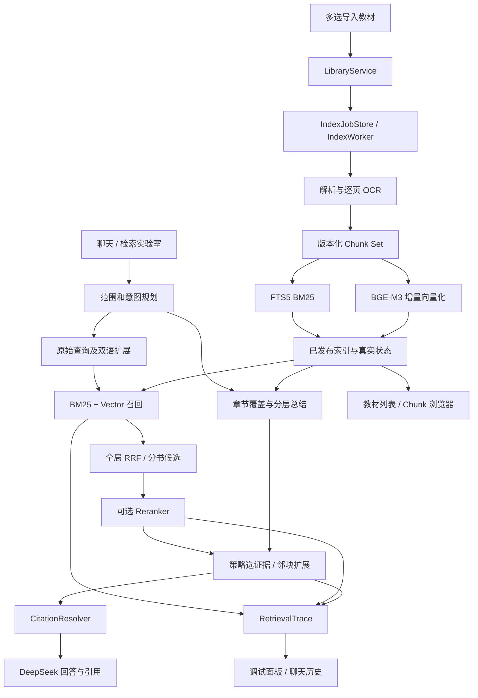

# KnowledgeAgent RAG 2.0 专项架构设计 v0.1

- 基线：已打包的 KnowledgeAgent v0.4.0
- 目标版本：v0.5.0（已交付）
- 阶段：P10.0–P10.4 已完成；P10.5 用户决定跳过；P10.6 已完成打包与冒烟验收并交付 v0.5.0；P11（Agent Observability & Evaluation）暂缓按需规划
- 依据：2026-11-25 P10.0 诊断报告（428 行）；项目此前 P6/P9 交付报告
- 定位：个人桌面学术助手；功能与真实检索效果优先，不过度防御

## 1. 诊断结论与实施边界

正式库 34 本 PDF，25 本完全未解析，7 本仅有 BM25，2 本完整混合索引；已有 3519 个 Chunk，90 个已向量化（约 2.6%，不含未解析文档）。导入不入队，聊天期兜底仅在全无索引时生成关键词索引。现有 IndexWorker、SiliconFlow BGE-M3 请求和两本手动索引均经报告实测正常。

现有 BM25 将自然语言整句包为 FTS5 精确短语；12 题原始 BM25 Hit@10 为 0，OR 拆词为 58.3%，完整向量索引下 Vector / Hybrid 为 100%。跨教材 per_document 在超过 8 本时抛出 ValueError；API 对 document_ids=null 未拦截，自动意图改写也会进入该分支。隔离复现与源码支持此根因，历史错误没有保存原始异常或完整请求，不声称历史调用已完全取证。每书独立 RRF 再按 chunk_set_id 排序导致无关书挤掉相关书。

报告还发现 PDF 数学字体映射缺失、扫描插页漏 OCR、OCR 页眉伪标题、英文 overlap 断词、整书总结仅取六块。隔离基准 7 本、1459 chunks；其余 24 本未索引 PDF 未完整解析验证。保留 SQLite/FTS5/NumPy、BAAI/bge-m3（1024 维）、现有 CitationResolver、IndexWorker、Tauri/React/FastAPI/LangGraph。复用现有 SiliconFlow Key（报告已实测 rerank 接口）；不增加必需的新 Key。不引入向量数据库、独立检索服务、消息中间件、多 Agent、复杂审批或全局上下文重构。MCP、Skills、Workspace、Runtime 及既有聊天能力不重构。

## 2. 目标架构



所有检索入口复用同一核心服务和可追踪参数。实验室默认不生成回答，也不默认调用 DeepSeek 改写；聊天可使用按需改写。教材原件和索引长期持久化，不在每轮聊天重建。

## 3. P10.1 自动索引流水线与教材状态

### 3.1 导入与后台入队

复用 `services/library.py`、`api/library.py`、`api/index_jobs.py`、`services/index_pipeline.py`、`services/index_worker.py`、`storage/index_jobs.py`（实际路径核对）。Tauri 文件选择支持多选，逐文件导入并显示成功/重复/失败，不因单文件失败中断批次。

- 提供全局“导入后自动建立索引”，默认开启。始终自动解析、切片和建立本地 BM25。
- 云端向量化使用一次性全局设置：已有明确授权可继承；否则首次设置中清楚说明 Chunk 文本发往 SiliconFlow，由用户一次开启后记住；不再逐本确认。自动索引开关与云端向量化偏好分开。首次明确开启后新导入自动完成混合索引。
- 云端关闭或 Key 缺失时本地索引仍完成；状态显示“仅关键词 / 等待配置”，不循环请求失败 API。
- 导入成功后对最新版本提交现有 job。导入与入队若非同一事务，启动时 reconcile 补齐漏入队的文档；取消/用户停用的任务不被自动无条件复活。
- 相同版本、解析配置、切片配置、Embedding 模型/输入格式的有效完整索引直接复用；重复导入不重新向量化。不要仅凭文件名判断重复。
- 旧文档提供“一键补全索引”：25 本未解析从头执行，7 本已有 BM25 复用现有 Chunk 补齐向量，2 本混合就绪跳过。执行前显示实际数量；不复制诊断时的静态计数作为产品逻辑。
- 修复 `versions[0]` 取旧版问题：按实际版本序号明确取最新，不依赖列表返回顺序。
- 废除聊天期同步临时建 BM25 的分支；聊天提示未就绪，必要时安排已有后台队列，不阻塞模型请求或偷偷做长时间 OCR。

### 3.2 作业、重试与发布

延续单 Worker，默认 Embedding batch=32；不为个人项目引入新的任务调度框架。
阶段 `queued → parsing → chunking → keyword_indexing → embedding → publishing → succeeded`；失败、取消、等待凭据分开表达。
按已有租约/断点机制恢复。网络超时/429/可重试 5xx 做有限退避，使用 Retry-After（若有且可用）；401/参数错误提示配置问题，不能无休止重试。
向量成功批次持久化，重试仅补缺失；100% 校验与发布前不声明完整向量可检索。BM25 可先发布。已有有效索引在同一原件重建时继续服务，重建完成原子切换；新文件版本尚未就绪时默认不静默检索旧版本，明确显示旧版本（若允许使用则显式标记）。
大型 OCR 使用按页进度与实际规模合适的超时，不以固定 300s 截断所有扫描书；P10.4 增强前先实测实际耗时，失败可继续其他书。

### 3.3 状态数据与界面

基于真实 DB 数据聚合，不从历史 job 的 succeeded 推断索引一定可用。
建议 `GET /api/v1/knowledge/documents` 增加可选 `index_status`，保留既有字段；或单一批量状态 GET 接口，避免每书轮询。
字段建议：
```json
{
  "document_id": "...",
  "version_id": "...",
  "parse_status": "ready",
  "page_count": 26,
  "parsed_pages": 26,
  "chunk_count": 116,
  "keyword_status": "ready",
  "embedding_status": "running",
  "embedded_count": 64,
  "vector_coverage_pct": 55.17,
  "vector_searchable": false,
  "embedding_model": "BAAI/bge-m3",
  "embedding_dimension": 1024,
  "latest_job": {"id": "...", "stage": "embedding", "done": 64, "total": 116, "error_code": null, "error_message": null}
}
```
上述为设计示例，非真实状态。分母为当前目标 Chunk Set 中应向量化块数，未切片时显示未知而非 100%。区分构建进度与已发布可检索状态。重建中的旧索引状态单独展示。

知识库顶部：总教材、混合就绪、仅关键词、待处理/失败；自动索引设置、一键补全。列表：书名、页数、Chunk 数、向量覆盖、当前阶段、失败原因、重试/重建/取消、详情。任务运行中轮询 2–3s，空闲停止高频轮询。所有管理写操作沿用已有 Host IPC，读操作沿用 UI API，不增复杂权限系统。

## 4. P10.2 召回修复与质量优化

### 4.1 BM25

复用 `keyword_search.py`、`keyword_terms.py`，保留现有 FTS5 索引结构，先修查询构造，不为更换分词器强制重建。
- 提取实词、术语、缩写、用户引号内短语，去除常见口语停用表达。
- 中文按现有索引 token 规则构造多字短语及有意义词组；英文保留完整词、大小写规范化；不要把所有汉字单字无差别 OR。
- 将独立关键词/短语用 OR 组合，保留短语匹配优势（可用独立短语通道或命中加分，不能伪造 FTS5 支持的加权语法）。正确转义 FTS 查询字符。
- BM25 通道无结果时独立执行关键词回退，不依赖 hybrid/partial 总体状态。用户显式选择精确短语才使用整句精确匹配。
- 返回原始 bm25 值及排名（SQLite FTS5 通常越小越相关），UI 不把它标为百分比或余弦相似度。

### 4.2 查询规划与中英文

`QueryPlan` 建议包含 original_query、resolved_query、query_variants、strategy、selected_document_ids、reason。
先进行确定性范围解析、多轮指代补全；用户选择的具体范围和策略优先。自动策略只作为默认入口。
保留原始查询，不让改写替代原意。对中文问题检索英文库、英文问题检索中文库、专业缩写、多概念对比和必要追问，按需调用现有 DeepSeek 输出短 JSON：独立问题、中文术语、英文术语、必要子问题。专有名词保留原拼写。无需每轮请求模型改写。
默认最多 3 个有效 query variants（原问题 + 精炼/双语扩展），向量查询批量计算并对重复文本去重；同一原始问题在多书检索中复用 query 向量。改写失败回退原问题/规则；展示实际改写与耗时。
示例：非结构网格生成 → unstructured mesh generation；前沿推进法 → advancing front method；Delaunay 保留英文原词。不要针对用户的 12 道题硬编码词典答案。

### 4.3 向量召回、融合与精排

- 保留 BGE-M3、1024 维 float32 存储、NumPy 精确余弦；不迁移向量数据库。复用现有 title-body-v1、缓存、发布校验。
- 默认 BM25 60、Vector 60 候选，现有 RRF k=60 等权为基线；多 query variants 先在各通道合并排序或以最大贡献去重，避免重复问法人为放大一个通道。
- 默认向量阈值仍为 0.45；实验室可对比 0.35 或关闭阈值。报告未观察到 0.45 误删 Gold，故不盲目下调。仅在真实评估证明有益时修改默认。
- 统一 RRF `sum(1/(k+rank))`，同一候选按 Chunk ID 去重。相邻高重叠去重沿用 0.65，并记录实际原因。
- Reranker 复用 SiliconFlow `POST /v1/rerank`，模型 `BAAI/bge-reranker-v2-m3`；用原始/消解指代后的问题与候选标题+正文输入，首版候选约 30 条，设置可调。报告已验证 Key 可调用，不代表免费不限量；在设置中说明 API 使用及文本发送。已有全局云端授权可以明确覆盖 rerank，用户可关闭。
- Reranker 分数仅作为同一查询、同一模型配置下的相关性排序信号，不是校准概率，不声称跨查询绝对可比。不得按跨书独立 RRF 裸分数排序。Rerank 超时/失败保留 RRF 结果，明确标注降级。显式 Vector 模式无向量时返回不可用，而非偷偷切成 BM25。
- 普通问答默认最终 8 条（可调），对比约 12 条；最终按上下文实际预算与证据多样性选择，不盲目扩大 top_k。

## 5. 四种任务策略

### 5.1 global / scoped
global：全部符合索引状态的最新版教材，统一召回和排序。scoped：用户指定的文档子集（可一至多本）；无索引则明确提示，不能拿别的教材替代指定书。
API 兼容旧 `coverage_mode=global/per_document` 和 `document_ids`；增加可选 strategy，旧 global+显式范围映射 scoped，旧 per_document 映射 compare。`auto` 由 planner 判定；显式 global 不因关键词“对比”强制变更。前端展示实际策略。

### 5.2 compare：跨教材对比
移除 `MAX_COMPARISON_DOCUMENTS=8` 导致全库报错的行为，不简单把 8 改成 34。
1. 解析用户指定范围。如果没有指定具体书，先在全部可检索文档内粗召回，按每书最强命中和多个子问题覆盖估计相关书，默认选 4–6 本；必要时保留关键词候选，避免仅有 BM25 的书被排除。
2. 对选中书分别获取候选（初始每书 6–10 条；不同算法/概念子问题可分别召回）。在总候选预算中确保每个明确指定且有相关证据的书有机会进入共同排序。
3. 对所有候选统一 Rerank（或全局 RRF/全局原始通道排序回退），淘汰不相关片段，再按书与概念分配证据。每本默认 2–3 条是软配额，不强行给无关书配额；未命中书要显示原因。
4. 显式指定 1–N 本时不偷偷缩减范围。超出单轮证据预算则按批次做证据汇总并显示覆盖情况；首版允许提示用户进一步缩小范围，但不得抛通用错误或无提示忽略指定书。
5. 最终回答按教材/观点/算法组织差异与共性，逐项引用。对 Delaunay、Advancing Front、Looping 等多概念，记录每个概念证据覆盖，而非只追求书数均匀。

### 5.3 book_summary：全文/章节总结
仅在用户明确要求总结一本书/指定章节或方法综述时使用；全局普通主题总结仍按相关性策略，必要时拆子问题。
读取所选最新版的目录、section_path、页范围和正文 Chunk，排除目录/参考文献噪声；依实际章节切分。无可靠目录的 PDF 按连续页组组织，不虚构章节标题。
小文档在预算内分章节读取全部相关正文；长书按章节分批生成有证据 ID 的摘要，再合并。优先覆盖所有主要章节，不能只抽章节第一段就声称全文总结。输出章节覆盖/跳过原因/未读页，区分抽样总结与完整阅读。
阶段一可先实现章节覆盖式抽取，阶段二在实际超预算时才使用已有模型分层总结；不引入多 Agent 或额外数据库。实验室仅展示章节计划及候选，不生成摘要。
《非结构网格生成技术调研.pdf》验收需覆盖正文中实际存在的 Delaunay、Advancing Front、Quad/Hex、Surface Meshing、Post-processing 等主要方法并带来源；具体章节以原文核对。

## 6. 证据上下文、引用及错误恢复

复用 `CitationResolver`，每条最终证据绑定 document_version / parse / chunk_set / chunk / evidence_id / 原文范围 / PDF 物理页。邻块扩展只从同一版本同一 Chunk Set 获取，避免重复文本；默认仅当命中缺上下文时取前/后 1 块，并按新增文本独立引用定位。不要生成伪页码。
设置集中可调的 RAG 证据预算：普通问答建议约 8–12k tokens，对比约 16k，按模型实际可用窗口扣除历史、工具、输出预算后截断；有 tokenizer 用 tokenizer，估算时明确是估算。不重构全局 Context Engine。不要把全部未索引书名写进系统 Prompt，仅传数量与相关指定书的状态；完整名单由 UI 展示。
证据不足时明确说明，禁止以常识回答冒充教材依据。解析质量警告随引用展示，特别是数学公式。历史引用仍可回查旧版本证据；重新构建时保留现有解析/块或历史引用快照机制，不因升级破坏历史引用。

错误至少区分：无可用索引、部分覆盖、Embedding 缺 Key/超时/限流/失败、Reranker 失败、无相关候选、范围无效、内部异常。复用现有错误契约，新增必要错误码即可。`runs.py` 不吞异常：日志记录异常类型、阶段、run_id、耗时与脱敏细节；UI 展示可理解原因。Hybrid 某通道失败而另一通道可用时继续回答，清楚标注降级；所有通道均不可用时不伪装检索成功。

## 7. P10.3 检索实验室和聊天追踪

### 7.1 同一管线
在既有 LibrarySearchPanel 上扩展，不另造第二套检索。建议 `POST /api/v1/knowledge/debug-search`（UI Token，查询操作）复用生产检索服务。
请求建议：
```json
{"query":"前沿推进法的原理","document_ids":null,"strategy":"global","mode":"hybrid","rerank":true,"rewrite":"off","top_k":8,"candidate_k":60,"min_vector_similarity":0.45}
```
`rewrite=off` 默认不调用 DeepSeek；`rules` 可选；`llm` 为明确启用的真实查询改写，仅不生成最终回答。模式 BM25 / Vector / Hybrid，Hybrid + Rerank 由开关组合。实验参数不影响聊天默认设置。

### 7.2 RetrievalTrace
建议统一结构（示例字段名，实际按项目命名适配）：
- trace_id, run_id, schema_version, original_query, resolved_query, query_variants, requested_strategy, actual_strategy, requested_mode, effective_channels
- 文档级：范围内/可用/实际执行检索/命中/最终引用分别计数；每本书版本、索引状态、跳过原因
- 每阶段：candidate_count, elapsed_ms, status, error_code, message
- 候选：chunk_id, document_id, page_range, section_path, bm25_raw, bm25_rank, cosine, vector_rank, rrf_score, rrf_rank, rerank_score, rerank_rank, selected, exclusion_reason
- final_evidence_ids, prompt_evidence_count, context_expansion, estimated_tokens, degraded, warnings
记录实际存在的分数，缺失为 null；Rerank 失败不得伪造分数。最终候选和解析后的实际送模证据分别记录，避免 resolver 丢弃后界面仍说已引用。
候选和排除原因可分页，至少保留实际采集的 Top-N 列表与未返回计数；不能声称知道从未被召回的所有 Chunk 的过滤原因。

### 7.3 前端
知识库搜索实验室：问题、策略、教材多选、检索模式、改写开关、Rerank 开关、Top-K、阈值；结果分页显示各阶段排名和原文、页码、章节、排除原因。
Chunk 浏览器：按教材最新版本、页范围/章节/关键词筛选，显示原文及向量是否存在、解析警告；复用证据定位。
聊天：检索过程卡片折叠展示原始/改写查询、策略、实际参检范围、BM25/Vector/Rerank 是否运行、最终证据数、降级原因；可展开查看历史 trace 与候选。历史失败 Run 也应能查看简要错误。旧 Run 没有 trace 就显示“历史版本未记录”，不重新跑检索冒充当时数据。
SSE 追加 `retrieval_trace` 事件或现有工具完成事件的可选字段，旧客户端可忽略。历史通过 RunSummary 或单独 run trace GET 返回；大型明细按需加载。

## 8. P10.4 PDF 解析与 Chunk 质量

先小范围修正可确定的质量缺陷，再评估公式恢复。不要因为完美 PDF 解析迟迟无法使用 RAG。
- 页眉页脚：使用跨页重复文本、位置、频次判断；在识别标题前处理，保留来源页/坐标，不删除真实章节标题。目录点线、页码和参考文献标注为特殊块，普通问答降权，用户问目录/引用时仍可检索。
- 英文换行连字符：谨慎合并确为断词的跨行文本，不破坏真实 compound word；保留原文到检索规范化文本的定位映射。修复明显字符间误空格，避免损伤公式。
- overlap：保留 1000/120 字符初始参数，改为词/句/段边界对齐，不能从英文单词中间切入。中文与英文长度差异通过真实样本观察再调整。
- 标题、定理、定义、证明、代码/表格：以结构边界优先，短标题附着正文；过长结构块仍按上限切并保留标题与上下文。不可将每个疑似标题都独立成块。
- OCR：优先文本层，检测局部无文本/高损坏页，按页或小批次 OCR，中文自然文字可比较语言纠错效果，数学区单独保留低置信警告。保留原页坐标。已有 Vision 可复用，必要时比较另一成熟 PDF 提取器，不立即引入付费 OCR。
- TeX 无 ToUnicode：先对样本页比较 pdfminer/pdfplumber、可选 PyMuPDF 和局部 OCR；无法可靠恢复则标注公式缺失/建议查看原页，禁止模型凭空补全原公式。
- 解析/切片版本号升级，按新配置产生新 Chunk Set。旧的已发布索引继续可用直到替换；用户可单本重建。仅重算文本内容/模型输入实际变化的向量，未变化缓存按原有哈希规则复用。不自动全库重建两次。
- 为避免 25 本新索引之后再次全量重算，将确定性且低成本的 overlap 与 BM25 查询修复尽早纳入 P10.1/P10.2；高成本 OCR 改进后仅重建确有质量问题的书。

## 9. 持久化与兼容性

现有 knowledge DB 与 business DB 分离（报告分别为知识库 schema V7、业务库 V7；实施前查当前实际 schema，不混淆编号）。
优先复用 parsed_documents/sections、chunk_sets、embeddings/embedding_sets、keyword index、index_jobs，不新增数据库。
若设置持久化与 trace 缺少合适位置，再做最小增量迁移：
- 设置：auto_index_on_import、cloud_embedding_enabled、cloud_rerank_enabled、默认检索参数；复用现有设置存储。
- 业务库：建议独立 `run_retrieval_traces(run_id PRIMARY KEY, trace_version, trace_json, created_at)`，复用 run 生命周期；不把大量调试明细塞到 checkpoints。Run 删除时清理 trace。
- trace 保存分数、引用 ID、摘要和必要候选 ID；正文按需通过已有源证据查询。保留历史快照契约，源文件已删时显示不可回查。
- 新版读旧 DB：使用已有增量迁移及测试；旧版不保证能打开迁移后的新 DB，发布说明提供备份/回退。不得直接修改用户正式库进行开发测试。

## 10. 模块接入清单（建议）

| 现有/新增模块 | 工作 |
|---|---|
| services/library.py + api/library.py + desktop/src/library.rs | 批量导入、提交索引、状态聚合 |
| index_pipeline.py / index_worker.py / index_jobs.py | 复用、补全、阶段进度、错误重试 |
| services/knowledge_qa.py | QueryPlan、四策略、证据预算、关闭聊天隐式索引 |
| services/keyword_search.py + storage/keyword_terms.py | OR 核心词查询与独立回退 |
| services/vector_retrieval.py + services/hybrid_retrieval.py | 候选、共享查询向量、统一排序、跨书证据 |
| models/siliconflow.py 或独立 reranker.py | 同 Key 的 rerank 请求、错误分类 |
| 建议 services/retrieval_trace.py | 统一追踪结构，避免散落 debug print |
| 建议 services/book_summary.py | 章节覆盖计划与分层总结 |
| api/knowledge_search.py / chat.py / services/runs.py | 兼容参数、调试接口、trace SSE/历史、错误分类 |
| parsing/pdf_layout.py / darwin_ocr.py / chunking/hybrid.py | 增量解析质量修复 |
| frontend/src/LibraryPanel.tsx / TextbookIndex.tsx | 列表状态、批量操作、Chunk 浏览器 |
| frontend/src/Chat.tsx / apiClient.ts / chatEvents.ts | 策略、诊断卡片与历史 |
| tests | 小范围单元测试、真实教材基准、受影响模块回归 |

上述路径基于报告，按当前项目实际布局调整，不为遵循表格机械拆分文件。

## 11. 评估方法与验收

### 11.1 指标修正
原报告 12 题使用规则标注 Gold，且所谓 Recall@K 分母为 min(K, |GT|)。不能直接将 0.607→0.685 当成标准 Recall@10 提升。保留该值作为旧版 capped-recall 指标；重新计算：
- Hit@K = 有至少一条相关证据的题目比例；
- Recall@K = |TopK ∩ Gold| / |Gold|；
- Precision@K = |TopK ∩ Gold| / K（不足 K 条按统一约定计并注明）；
- MRR = 首条相关结果排名倒数的题目平均；
- 比较任务增加 concept coverage / relevant document coverage；
- 总结增加主要章节覆盖率及回答引用正确性。

固定同一语料版本、题集、Gold 与检索参数，逐题记录。规则标注可用于快速筛查，但人工核查关键 Gold 及排名靠前的负例；切片变更用原文页/段落范围重新映射 Gold，不比较失效的旧 Chunk ID。12 题小样本不代表整个库，补少量新问题防止针对旧题调参。
先复现基线，再消融 BM25 修复、双语改写、Rerank、比较策略。关注真实用户体验和明显缺陷修复，不设无法解释的 MRR≥0.85 等硬门槛。优化目标是相同题集下明显改善关键词召回、关键证据排序和跨书/章节覆盖，同时避免普通查询明显回退。记录检索延迟、额外模型/API 调用及索引耗时，出现偏差报告原因，不因单个数字反复调参。

### 11.2 核心验收
- 新 PDF 多选导入后自动入队；开启云端向量化后无需逐本确认，真实向量化成功。关闭云端时本地 BM25 仍可用。
- 旧库隔离副本一键补全：未解析从头构建、仅 BM25 补向量、两本完整索引跳过；失败书给出原因而不阻塞其余任务。可实际重试。
- 列表覆盖率与 SQLite 一致；索引中/失败/暂停/就绪可辨，重启状态真实恢复。
- 34 本全局及 compare 请求不再因 8 本上限崩溃；显式 global 不被强切，指定书无索引时不冒用其他书。
- 真实网格三种算法对比包含核心调研 PDF 相关证据；不因导入顺序把统计教材放入无关配额。
- BM25 自然语言检索不再全空；双语改写对中文→英文、英文→中文至少各实测若干问题，BGE-M3 保持。
- 真实 rerank 成功、模拟/实际 API 失败可见降级；实验室默认无 LLM 回答调用。
- 指定调研 PDF 总结覆盖主要算法章节，核对实际原文及页码。
- Chunk 浏览与聊天 trace 显示真实候选及最终送模证据，跨重启可读；失败原因明确。
- 对英文断词、OCR 伪标题、缺公式页分别抽样前后对比；未恢复公式清楚标注，不强求所有数学 PDF 完美恢复。
- 普通聊天、RAG、MCP、Skills 组合及旧引用回归，实际 macOS 安装版运行。

## 12. 实施顺序与交付

| 阶段 | 内容 | 完成条件 |
|---|---|---|
| P10.0 | 诊断 | 已完成；本设计据此定稿 |
| P10.1 | 自动索引、真实状态、止血 | 导入/补全/进度闭环；修复 BM25 整句及旧版本选择，消除全库比较崩溃，先使用清晰的全局排序回退 |
| P10.2 | 召回质量、Reranker、双语、比较 | 统一排序、真实 API、相关教材与概念覆盖；复测基准 |
| P10.3 | 实验室与追踪 | 同一真实检索管线，候选与错误可见、历史恢复 |
| P10.4 | 解析/切片精修、章节总结 | 选定样本实测改善；章节覆盖总结；按需重建 |
| P10.5 | 全库实际验收 | 34 本隔离副本尝试补全，记录真实失败与原因；用户原问题、多轮、中英文及引用验收 |
| P10.6 | 版本收尾、打包 | v0.5.0 暂定；验证实际安装版及旧数据升级，更新文档 |

为加快节奏，P10.1 + P10.2 可连续开发；先实现最小 trace 数据结构，不等 P10.3 才开始记录检索阶段。P10.3 + P10.4 连续开发，最后实机验收和打包。实现顺序依现有代码调整，不重复架构评审。

## 13. 已知限制及开发原则

- 诊断依据为 Codex 的报告，并非本设计作者独立运行项目。报告中的 29 英/5 中及全库规模估计仍需实际语料确认，不能写死。
- BGE-M3 及 Reranker 在该样本表现良好；不保证每次命中、跨语言完全等效或服务免费。统一 Reranker 不等于绝对相关性判定。
- 24 本未解析 PDF 的实际兼容性、大扫描书耗时、全库向量化限流及 DOCX/Markdown 教材真实质量仍未充分验证。
- 优先完成可用索引、修复崩溃、让用户看见过程。公式恢复、长书复杂总结逐步改善，真实受影响再做针对性优化。
- 使用已有模型与 Embedding 配置进行明确授权的测试，不输出密钥明文；不引入额外复杂审批。开发测试使用隔离数据，不擅自覆盖正式版。
- 不重构 MCP/Skills，不追加长期记忆或多 Agent，不开展企业级专项安全审查。功能优先，必要回归即可，不以完美指标为交付前提。
- 不执行 Git commit/push；P10.6 前不打包。每阶段汇报实际修改、真实测试、未通过事项，避免用模拟数据冒充实际结果。
