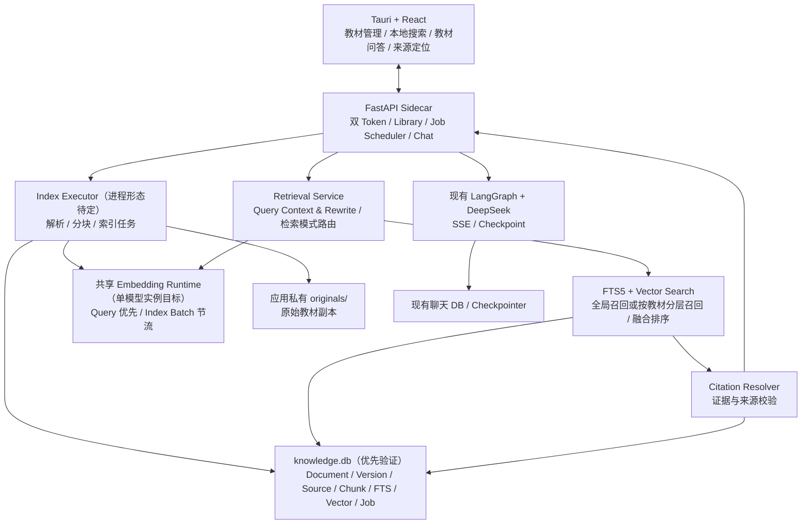

# KnowledgeAgent P7 — RAG 系统架构设计方案

> **文档版本**：v0.2（总体架构修订稿，未封版）  
> **编写／修订日期**：2026-11-23  
> **项目**：KnowledgeAgent  
> **本地项目路径**：`<PROJECT_ROOT>`  
> **阶段**：架构评审；**尚未进入 Codex 开发**  
> **说明**：基于用户提供的项目背景、v0.1 架构及后续评审意见修订；**未读取、审计或验证本地项目源码，也未进行任何性能或打包实测**。下文的技术选型、数据结构和流程均为设计候选，不代表已经实现。  
> **成本约束**：P7 首版不依赖新增必须付费的第三方服务；本地索引和检索不应产生 API 费用，DeepSeek 问答继续遵循现有按量计费机制。

---

## 0. 执行摘要

**目标**：为现有 macOS KnowledgeAgent 增加长期持久化的教材知识库，支持 PDF、DOCX、Markdown 的导入、跨教材知识点发现、对比学习与可验证出处。主要服务理工科学习资料场景，兼顾中英文内容，但**不能假设所有 PDF 均可准确提取公式与阅读顺序**。

**总体方向**：沿用 Tauri 2 + React + FastAPI Sidecar + LangGraph + SQLite；新增可独立运行的本地知识库检索业务和持久索引任务，不将 RAG 简化为 Agent Prompt。首版**优先验证 `knowledge.db` 内统一存储 Chunk、FTS、向量的方案**；若验证不通过，再考虑外部 FAISS 等索引及其跨存储恢复机制。

**核心原则**：

1. **先可查，再可答**：本地知识搜索不依赖 DeepSeek，云端生成只使用经选择的证据片段。
2. **出处先于分块**：PDF 物理页、DOCX 结构位置与 Markdown 行号从解析阶段保存；LLM 不得自造页码。
3. **导入一次、长期保存**：受控原文件副本和索引留在应用私有数据目录，重启不重复全量处理。
4. **普通检索追求相关性，跨教材比较追求覆盖**：两种召回策略，不让长教材在比较任务中霸占全部结果。
5. **多轮追问先消解上下文**：必要时改写当前查询，但保留用户原问及适用的教材范围。
6. **单库事务优先、版本发布必要**：先减少不必要的跨文件发布复杂度；保留不可变教材版本与可用版本切换。
7. **索引处理与模型加载分开考虑**：索引执行可以隔离，查询与批量 Embedding 应尽量复用同一份模型实例。
8. **不扩张权限、不过度付费**：维持 P4 文件权限及双 Token；不新增必须付费 API 服务。
9. **不虚构已验证结果**：性能、许可、打包、模型内存与一致性待技术验证和源码核对。

### 0.1 本轮修订结论

| 决策项 | 当前判断 | 说明 |
|---|---|---|
| 保留现有宿主、Agent 和安全架构 | **建议确立** | 不推翻 P1–P4、P8 已有成果 |
| RAG 与 Agent 解耦 | **建议确立** | 本地搜索独立运行，教材问答复用 LangGraph |
| 教材长期受控副本 + 文档版本 | **建议确立** | 哈希去重、显式更新、失败时旧版可用 |
| 准确位置优先于生成式引用 | **建议确立** | Citation Resolver 根据持久元数据校验 |
| 普通检索 / 跨教材比较两种召回策略 | **建议纳入首版设计** | 比较模式分教材配额，普通模式全局相关性 |
| 会话相关的 Query Rewrite | **建议纳入接口契约** | 按需消解追问，必须保留原问与范围；实现策略待测 |
| `knowledge.db` + FTS5 + sqlite-vec | **优先验证** | 事务语义、安装兼容性、性能均尚未验证 |
| FAISS / 外部索引及跨存储 staging | **后备路线** | 仅在单库方案不合适时引入发布指针与修复逻辑 |
| 本地 Embedding + 单实例推理 | **优先验证** | 模型放置位置、模型下载方式与资源开销待测 |
| 独立 Index Worker 进程 | **暂不锁定** | 先确定持久任务边界，再按 Sidecar 生命周期和隔离需求选进程拓扑 |
| PDF 解析器、中文 FTS、打包 | **技术验证项** | 理工科双栏、公式、短中文术语、许可证、DMG |
| 正式 P7 功能代码 | **不启动** | 完成关键架构决策与兼容性评审之后再进入 Codex |

### 0.2 v0.1 → v0.2 变更要点

- 新增**分教材覆盖召回**与**多轮查询改写**，调整检索数据流。
- 将“外部向量文件 + staging + `index_generations`”从默认架构降为**条件性后备方案**，优先验证单 SQLite 原子提交。
- 区分 Index Worker 和 Embedding 推理实例，防止索引／检索两个进程重复载入大模型。
- 补充 PyInstaller onedir、Apple Silicon、模型按需安装、进程退出与 SQLite 锁竞争的验证清单。
- 明确 PDF 双栏／扫描低文本密度诊断与中文 FTS 词长陷阱。
- 将单纯 A–I 串行评审调整为“结构契约 → 隔离技术探针 → 详细契约封版”，**不在本轮写业务代码**。

## 1. 业务背景与产品范围

### 1.1 已有系统（依据项目说明，未经源码核对）

- 桌面宿主：Tauri 2 + Rust；前端：React + TypeScript；后端：Python 3.12 + FastAPI Sidecar。
- Agent：LangGraph + DeepSeek；业务 SQLite 和 LangGraph SQLite Checkpointer 已存在。
- 工具：已有 `list_files`、`read_text`；权限为临时授权文件读取；凭据由 macOS Keychain 管理。
- 打包：PyInstaller onedir + Tauri DMG。
- P1、P2、P3、P4、P8.1 已 PASS；P8.2 核心验收 PASS；P8.3 正式签名与公证未完成；P5/P6 暂不推进。
- 当前尚无真正的 RAG、Embedding、PDF 解析和长期向量索引。

### 1.2 核心场景

1. **术语精确检索**：找出哪些教材提到「最大似然估计」「似然」「MLE」。
2. **语义检索**：根据「用样本数据估计模型参数的方法」找到相关章节。
3. **限定范围**：只检索指定教材或选定的一组教材。
4. **跨教材比较**：至少尝试从每本被选定且有相关证据的教材中召回代表内容，而不是被一本长教材霸榜。
5. **多轮追问**：先问最大似然估计，再问「它与贝叶斯估计有何区别」，维持相关检索上下文。
6. **准确定位**：提供文档名、版本、页／章节／段落／行号，逐步实现引用点击打开原文。
7. **持久管理**：导入、去重、更新、删除、增量索引和异常恢复。

### 1.3 P7 首版边界

**包括**：可提取文本的 PDF／DOCX／MD；受控原文副本；基本的布局顺序与低文本密度诊断；结构化提取与分块；关键词、向量和混合检索；文档范围限定；可追溯引用；后台任务与恢复；本地搜索及教材问答；可重复评测。

**不包括**：扫描 PDF OCR、复杂公式理解与重建、图像内容理解、PPT／Word 编辑、MCP、云端文档同步、多用户协作、重写现有聊天与权限架构。

**成本约束**：不新增必须付费的 Embedding、向量数据库或 OCR 服务。优先评估免费可本地运行的模型和工具；现有 DeepSeek 问答消耗 Token 的费用单独披露，按需发送最少证据片段。

**阶段约束**：本轮仅修改设计文档；后续如开展 Spike，应在明确批准后于**独立实验环境**执行，不把未定技术直接集成进现有仓库。

## 2. 主要技术挑战与优先级

| 挑战 | 具体风险 | 设计应对 |
|---|---|---|
| 异构文档及版面 | PDF 双栏错序、公式乱码、表格混排、扫描页无文字 | 统一中间表示 + 阅读顺序检测 + 低文本密度提示 |
| 来源可信 | PDF 物理页／印刷页不同，跨页 Chunk，DOCX 无固定页码 | 解析前后持续保留真实位置；引用由服务端校验 |
| 中英术语检索 | 中文二字词、英文缩写、符号混排 | FTS5 trigram 与 Python 预分词基准对比；语义检索补充 |
| 跨教材召回失衡 | 长教材词频高，Global Top-K 把其他教材挤出 | 按任务类型选择全局或分教材检索策略 |
| 多轮对话检索退化 | 「它」「这种方法」脱离上一轮上下文 | 查询上下文构造／可选 Rewrite，范围约束保持 |
| 索引一致性 | Chunk、FTS、向量提交不同步，更新暴露半成品 | 优先评估同库事务 + 原子切换可见版本 |
| macOS 应用交付 | 模型权重、原生库、签名公证、进程孤儿 | 测试实际包体积、依赖、启动退出和数据目录 |
| 模型内存与聊天抢资源 | 多进程重复加载 Embedding；长批次占用资源 | 单模型实例、查询优先、批量节流、任务隔离 |
| 长期运行与升级 | 崩溃恢复、SQLite busy、模型版本改变 | 持久队列、重试退避、schema／模型版本记录 |
| 隐私与费用 | 整本教材或未经告知的内容被发往云端 | 默认本地处理、选中证据最小化、明确云端边界 |

## 3. 系统逻辑架构与模块边界

**采用分层逻辑架构；进程数量待验证。** `Index Worker` 指独立执行单元，**不预先等同独立 OS 进程**。Embedding 推理是可复用的共享资源，避免查询和索引各自加载同一模型。



> 图中共享 Embedding Runtime 是**逻辑接口与单实例目标**。实际可为 Sidecar 内模型服务、受控本机子进程或其他方式，取决于内存、线程安全、调用队列与 P1/P8 生命周期验证。若选用外部向量索引，`DB` 的向量部分需替换并添加一致性协议。

### 3.1 核心模块

| 模块 | 解决的问题 | 输入／输出与边界 |
|---|---|---|
| **Library Manager** | 教材长期资产管理 | 用户授权文件 → 私有副本、哈希、不可变版本；不直接检索 |
| **Document Parser** | 异构格式与阅读顺序 | 文件版本 → 统一结构、真实来源位置、解析诊断；不负责向量 |
| **Chunk Manager** | 语义单元与来源映射 | 结构化文档 → Chunk、章节上下文、多个来源范围 |
| **Embedding Service / Runtime** | 单一向量空间与模型生命周期 | 文本／查询 → 模型指定版本的 Dense 向量；控制内存与优先级 |
| **Index Manager** | 已发布索引的一致性 | Chunk、向量、FTS → 可查询版本；单库优先，外部索引仅后备 |
| **Retrieval Service** | 查得准、覆盖多书、理解追问 | 问题 + 范围 + 会话摘要 → 查询表示、两路召回、融合与证据 ID |
| **Citation Resolver** | 不虚构出处 | 稳定证据 ID → 文档版本、真实页面／结构位置；只信持久化元数据 |
| **Index Job Manager** | 索引运行、取消和崩溃恢复 | 持久化 Job → 阶段进度、错误、重试状态；不阻塞主事件循环 |

### 3.2 必须守住的边界

- **Parser 与 Chunker 分开**，统一结构在分块前保存位置与章节。
- **Retrieval 与 Agent 分开**；没有 DeepSeek 仍可返回检索结果。
- **普通检索与跨教材检索分开**，不能为全部查询强制分配每本书配额。
- **查询改写与生成分开**：Rewrite 只产生检索用查询，不可放宽文档范围、不应更改用户原问题记录。
- **索引发布与构建分开**：失败的构建版本不进入可查询集合。
- **本机推理与索引进程隔离是两个维度**，避免“多 Worker = 多份模型”。

## 4. 核心数据流

### 4.1 数据流 A：教材导入与增量索引

```mermaid
flowchart TD
    A["用户选择 PDF / DOCX / MD"]<br/>    B["Tauri 受控授权与复制"]<br/>    C["私有 originals/ + SHA-256"]<br/>    D["文档/不可变版本登记 + IndexJob queued"]<br/>    E["Index Executor 解析
检测阅读顺序、低文本密度"]<br/>    F["结构分块与源位置映射"]<br/>    G["共享 Embedding Runtime
低优先级批处理"]<br/>    H["写入 Chunk / FTS / Vector"]<br/>    I{"完整性验证成功？"}<br/>    J["在事务中切换 active_version
文档 ready"]<br/>    K["记录失败／可重试
旧 published 版本继续可查"]

    A --> B --> C --> D --> E --> F --> G --> H --> I
    I -->|是| J
    I -->|否| K
```

**初选前提**：如果最终证实向量、FTS 与 Chunk 可统一存于 `knowledge.db`，则一个数据库事务可管理关联数据的原子提交；构建期可以分批写入未发布版本，**仅发布指针切换需要原子**。这不意味着所有构建必须在一个长事务中完成，且需验证 sqlite-vec 选用版本的事务行为。

如果测试后改用外部 FAISS／其他文件索引，才增加临时构建目录、外部文件持久化、发布清单、原子可见性与启动修复协议。**默认不设计跨文件的 `index_generations` 发布体系。**

原始文件的拷贝与 SQLite 事务也不是同一个原子域；推荐采用“临时文件写入 → 校验 → 安全落盘／重命名 → 数据库登记 → 失败垃圾回收”的可恢复导入流程，具体细节留在 A/F 评审。

### 4.2 数据流 B：普通检索／跨教材比较／追问

```mermaid
flowchart TD
    Q["当前问题 + 会话相关上下文 + 教材范围"]<br/>    CTX["识别是否需要 Query Rewrite
保留原问、限制作用域"]<br/>    T{"检索意图"}<br/>    GK["全局 FTS + Dense Top-K"]<br/>    DK["对指定教材分层检索
Per-Document Top-K"]<br/>    R["合并 / RRF / 去重
比较模式覆盖约束"]<br/>    CIT["Citation Resolver
校验来源版本与位置"]<br/>    S["本地搜索结果"]<br/>    L["LangGraph + DeepSeek
仅发送授权的必要证据片段"]<br/>    O["SSE 回答 + 结构化引用 ID
消息／证据一致持久化"]

    Q --> CTX --> T
    T -->|普通检索| GK
    T -->|跨教材比较| DK
    GK --> R
    DK --> R
    R --> CIT
    CIT --> S
    CIT --> L --> O
```

**普通检索**：全局召回优先相关性，按教材过滤由用户范围限定，不额外强迫每本书出现。

**跨教材比较**：对用户选择的教材，或在用户未明确指定时先发现候选教材，再对每个候选分别检索代表证据。每本教材只有在达到相关性条件时才占用覆盖配额；不足时明确标记“未找到可靠证据”，**不强行凑齐书数**。最后合并排序、去重，再交给模型比较。

**多轮追问**：优先使用已保存的会话焦点、教材筛选和最近用户问题构造检索上下文。只有当前问题存在明确指代或缺少核心术语时才执行 Query Rewrite；保留 `original_query`、`retrieval_query`、`rewrite_reason`，并禁止改写扩大已授权教材范围。Rewrite 是否使用规则、已有 DeepSeek 或本地模型需在 H 与隐私／费用约束下决定。

**两种出口**：本地搜索完全不需要云端生成；教材问答仅使用检索出的证据片段，并通过 Citation Resolver 返回证据 ID 和真实出处。

## 5. 统一文档结构、学术 PDF 与引用

**首要规则：解析时保存来源映射，分块后不得再猜页码。** 统一中间表示应包含 `document_id`、`document_version_id`、结构化元素（标题／段落／表格等）、规范化文本偏移、来源位置和可选的解析质量诊断。

| 格式 | 必需位置 | 边界与诊断 |
|---|---|---|
| **PDF** | 0/1 基准明确的真实物理页序号、原始 PDF 页标签（可得时）、页内块／文本范围（可靠时） | 印刷页码不可推测；双栏阅读顺序、公式乱码、低文本密度需提示 |
| **DOCX** | 标题层级、段落或表格单元结构位置 | 不生成虚构的排版页码；复杂浮动对象可降级处理 |
| **Markdown** | 标题路径、原始源行区间 | 不能因为 Markdown AST 解析而丢失行号；源内容版本要固定 |

一个 Chunk 可以关联**多个 `source_location` 区间**，如跨页／跨段，不能以单一 `page_number` 代替整个出处。

### 5.1 理工科 PDF 解析底线

- **阅读顺序**：对典型单栏／双栏／标题跨栏样本验证提取文字的顺序；检测明显串栏和倒序风险。首版不承诺所有布局自动修复，无法保证时标注“布局风险”，避免误导检索和引用。
- **公式与符号**：保留可解析的相邻文字、符号和原文位置；对乱码／缺失公式标注质量风险，**不自动把公式改写成自信的数学表达式**。
- **低文本密度**：按页统计可抽取字符数、覆盖比例等简单指标，提示“可能是扫描版或图片主导页面”；不得仅凭一个阈值断言扫描 PDF，亦不引入 OCR。
- **表格**：尽量保留表格边界与阅读顺序，复杂表格不保证第一版完美重建。
- **工具许可**：PyMuPDF 列为高能力候选，但 AGPL／商业许可须做正式合规判断；另比较 `pypdfium2`、`pdfplumber` 等备选，不能只看许可证还忽略来源定位质量和打包表现。

### 5.2 引用解析协议

`citation_id → chunk_id → document_version_id → source_location[] → 私有原文副本`。

服务端在返回引用前验证来源仍存在、版本匹配、位置有效。PDF 优先打开真实物理页；DOCX 和 MD 可给稳定结构／行号提示；**无法精确定位时必须降级显示，而非伪造准确跳转**。删除教材后历史对话中的引用可显示“来源已移除／引用已失效”，不应悄悄指向新版本。

## 6. 技术选型：优先级与验证条件

| 组件 | v0.2 首选候选 | 后备 / 注意事项 | 状态 |
|---|---|---|---|
| 受控导入 | Tauri/Rust 执行用户选择与安全复制 | 与既有 P4 工具权限严格隔离 | 待源码核对 |
| PDF | PyMuPDF、pypdfium2、pdfplumber 做同样例比较 | 比较布局、页码、许可、ARM64 打包 | 待 Spike |
| DOCX | python-docx | 标题、段落、表格顺序需测 | 待 Spike |
| Markdown | 可保留行号的 AST 解析器 | 代码块、公式块与表格需显式处理 | 待 Spike |
| Chunk | 标题／段落优先 + 最大长度 + 重叠 | 章节路径和跨页位置必须留下 | 待参数评测 |
| Embedding | 本地可运行 BGE-M3 作为质量基线 | 若内存／延迟不合格，评估轻量模型或用户选择的 API | 本地优先、非锁定 |
| 全文检索 | SQLite FTS5 | 比较内置 trigram 与 Python 预分词辅助列 | 待中文基准 |
| 向量检索 | **优先验证同库 sqlite-vec** | 若部署／性能不满足，再比较 FAISS | 待事务／打包测试 |
| 检索融合 | Dense + FTS + RRF | 普通搜索全局；比较搜索分教材召回 | 架构建议 |
| 多轮查询 | 会话焦点 + 按需 Rewrite | 改写成本、隐私和模型误改要测 | 契约先行 |
| Reranker | 插拔式接口，默认非必需 | 只有结果确有改善再启用 | 延后决定 |
| 索引任务 | SQLite 持久队列 + 有限资源执行器 | 执行器是否独立进程待生命周期验证 | 架构建议 |

### 6.1 中文 FTS5 特别约束

SQLite FTS5 的内置 `trigram` 基于连续三字符索引，对短于三个字符的中文查询及某些查询表达式**不能直接假定有稳定高效的索引命中**。另一候选是在 Python 侧使用预分词（如 `jieba`）写入辅助检索列，但需承担字典与 tokenizer 版本管理和构建开销。评测样例至少涵盖：`估计`、`似然`、`最大似然估计`、`MLE`、中英混合及数学符号；同时观察召回、P95 和索引体积。避免未验证就引入需编译的第三方 SQLite C 分词扩展。

### 6.2 Embedding 部署：同一模型实例优先

**目标**：索引批处理与用户 Query Embedding 调用同一模型版本和尽量同一驻留实例，避免 Sidecar 与 Index Worker 分别加载完整模型。查询请求优先，后台批处理支持限速、批量大小控制与暂停。

候选实现方式：

1. **Sidecar 内共享推理对象**：简单，但要验证解析／索引负载是否影响响应和崩溃隔离。
2. **一个受控推理子进程**：隔离原生推理依赖，双方复用；但增加 IPC、启动顺序、孤儿进程回收与 token/权限管理。
3. **云端 Embedding API**：部署更轻，但涉及费用、隐私和网络；不作为默认必选能力。

BGE-M3 仅作质量基线候选。需实测 Apple Silicon 内存／查询延迟／索引速度／模型加载时间；评估 ONNX Runtime、MLX 或其他轻量推理后端时，**先确认对应模型能实际转换并正确复现结果**，不能把框架名单当成可用证据。

**模型交付**：优先评估安装后首次使用按需下载到应用私有模型目录（显式提示体积、版本、校验值、失败重试），同时保留无网络环境的安装／导入模型考虑。下载方式不能绕过现有软件安全模型。模型和重型依赖打包进 DMG 并非必然不能公证；真正需要检测实际包体积、原生库签名、依赖兼容和首次使用体验。

**向量版本契约**：每条向量关联模型标识、具体版本或校验和、维度、归一化策略；不同模型的向量不能混进同一检索空间。模型升级需重建或显式多索引共存。

### 6.3 向量引擎：单 SQLite 优先验证

优先评估 `knowledge.db` 中 `documents / versions / chunks / FTS5 / vectors / jobs` 的同库组织：如果扩展支持所需事务语义，相关记录可由 SQLite 原子管理，构建时写入非活动版本，最后用短事务切换 `active_version_id`。这能显著降低多文件发布复杂度。

**仍需测**：sqlite-vec 在 macOS ARM64 + Python 3.12 + PyInstaller onedir 的装载；是否支持当前选定的删除／更新策略、事务性、KNN 性能与磁盘占用；WAL 模式下读写并发、`busy_timeout` 与忙锁退避。SQLite WAL 并非多写入者数据库，仍需控制写事务大小。

FAISS 作为性能或部署不达标时的候选；若选外部向量索引，则必须补全外部 ID 映射、删除／重建、崩溃发布和版本一致性设计，但**本阶段不提前实现**。

## 7. 数据库、版本发布与存储一致性

### 7.1 默认物理布局（以单库候选为中心）

```text
KnowledgeAgent 应用私有数据目录/
├── 现有业务／聊天数据（不修改现有约定）
└── knowledge/
    ├── knowledge.db             # 文档、版本、来源、Chunk、FTS5、向量、任务
    ├── originals/               # 用户导入的不可变教材副本
    ├── models/                  # 可选：按需安装且经校验的本地 Embedding 模型
    └── temporary/               # 可恢复的临时导入／解析产物；允许清理
```

仅在验证后确认必须使用 FAISS／外部索引时，才另外增加 `vectors/`、发布清单和 staging。上述路径是概念示例；**真实位置、升级策略必须以现有 Tauri/P8 实现为准**。

### 7.2 逻辑实体（尚非 SQL DDL）

| 实体 | 核心字段／语义 | 重要关系 |
|---|---|---|
| `documents` | 逻辑教材条目、展示名、`active_version_id`、管理状态 | 一份教材可有多个版本 |
| `document_versions` | 不可变内容 hash、原文副本、解析版本、构建状态 | 新版本准备完成前不影响 active 版本 |
| `source_locations` | 文档版本、页面／段落／行号、文本偏移与结构路径 | 一个 Chunk 对应一个或多个来源范围 |
| `chunks` | stable chunk ID、版本、内容、章节上下文、位置 | 与来源映射及向量保持对应 |
| `chunk_source_ranges` | Chunk 到多个 `source_locations` 的关联 | 为跨页／跨段引用服务 |
| `embedding_records` / `vec` | Chunk ID、模型标识、维度、向量和构建状态 | 同模型、同维度的有效查询空间 |
| `fts` | 检索字段及 FTS5 映射 | 关键词记录不得与版本可见性错位 |
| `index_jobs` | 幂等键、阶段、进度、尝试次数、lease、错误与恢复信息 | 调度器恢复依据 |
| `model_registry`（可选） | 模型版本、哈希、维度、推理配置 | 防止模型切换污染向量空间 |

**不默认创建 `index_generations` 表**：单库方案可优先通过 `active_version_id` 实现读者可见性切换；是否需要全局“索引代际”概念取决于未来模型迁移及一致性实测。

### 7.3 事务与发布策略

1. 新导入教材写成**未发布版本**，构建阶段允许分批写数据库；查询明确过滤非活动版本。
2. 同库方案下，Chunk、FTS、向量的结构关联由同一个 SQLite 数据库管理；**短事务切换活动版本指针**，避免查询读到半成品。
3. 不能将整个教材 Embedding 计算放在长时间 SQLite 写事务中；事务保持短小，处理 `SQLITE_BUSY`／等待与退避。
4. 更新失败时不替换旧版；成功后旧版进入待回收状态，清理可重试且不可破坏已提交元数据。
5. 原始文件与数据库仍存在文件系统跨域边界；使用安全写入和垃圾回收流程，不能声称 SQLite 事务覆盖文件拷贝。
6. WAL 模式需明确备份／升级策略，不能仅拷贝 `.db` 文件而忽略未 checkpoint 的 WAL 内容；由数据库 API 执行一致备份更稳妥。
7. 若最终改用外部向量索引，补写“准备 → 外部索引落盘 → 发布清单／数据库指针切换 → 启动对账”协议，并验证删除／重建语义。

### 7.4 删除与历史引用

删除教材需解除查询可见性、清除相关索引与私有文件，并允许中断后的清理恢复。历史消息保存的证据 ID 不得映射成其他教材／新版本；若原文已删除，前端展示引用失效状态。是否保留仅供审计的最小来源元数据，需要在 F/H 评审中确定。

## 8. 持久后台任务与 macOS 运行时

### 8.1 任务状态与调度

任务逻辑阶段：`queued → parsing → chunking → embedding → indexing → validating → ready`。失败／取消分支：`retry_waiting`、`failed`、`cancel_requested`、`cancelled`。实际表结构可以采用 `status + stage`，避免状态爆炸。

- 导入任务必须持久化并具备幂等键、输入文件 hash、重试次数及阶段进度。
- Sidecar 重启后对中断的 `running` 任务进行 lease/heartbeat 检查，再安全重试或继续；不承诺所有步骤逐字节续传。
- CPU 密集型解析与模型推理由资源限额调度；**用户 Query Embedding 高于后台批量 Embedding**，避免索引吞噬聊天资源。
- 取消在阶段边界或批处理检查点生效，不以立即杀掉原生库调用为保证。
- 原文已导入但索引未完成时，管理 UI 应能显示可继续索引／失败状态，而不是隐藏教材。

### 8.2 进程拓扑待验证

**候选 A：Sidecar 内调度 + 隔离执行池**。实施简单，但需验证原生解析／模型崩溃能否隔离、是否阻塞事件循环。

**候选 B：Sidecar 管控的 Index Worker 子进程 + 单一 Embedding Runtime**。可隔离解析负载；代价是进程回收、IPC、取消、升级、权限、资源占用。

**关键原则**：不预设一个 Worker 加一个 Sidecar 就必须各自加载模型；一个模型实例服务 Query 和批处理是首选性能目标。

### 8.3 P1/P8.2/P8.3 落地验证清单

1. Tauri / Sidecar 启停和异常退出时，Worker 是否由父进程或宿主监管回收，避免 orphan/zombie。
2. 独立进程如何取得仅限本地的通信通道与现有双 Token／本地权限兼容，不开放未鉴权 HTTP 服务。
3. 两个进程访问 SQLite 的连接策略、WAL、写入事务大小、`busy_timeout`、退避以及读写压测。
4. PyInstaller onedir 是否能打包 sqlite-vec、PDF 引擎与推理运行时的本机依赖。
5. 对 arm64、模型缓存目录、模型校验和升级时的兼容做实际验证。
6. DMG 体积、签名与公证路径受 P8.3 影响；**不能在签名、公证尚未执行前声称发布兼容性已验证**。
7. 导入／索引过程中用户正常聊天、取消回复、重新启动应用，均不能损坏已发布数据。

## 9. LangGraph、Query Rewrite、SSE 与引用一致性

### 9.1 首版产品路径

- **本地搜索**：检索 → 证据和来源验证 → 展示教材／章节／位置，无需调用 DeepSeek。
- **教材问答**：FastAPI 先检索 → 证据包传给现有 LangGraph → DeepSeek 解释／对比 → SSE 返回回答及结构化引用；不交由 Agent 自由决定是否检索。
- **普通聊天**：保留现有业务路径，P7 不影响 `list_files`／`read_text` 现有授权行为。

### 9.2 查询上下文契约

检索请求建议包含 `original_query`、`thread_id` 或经过裁剪的会话上下文、`scope_document_ids`、`retrieval_mode`（normal/compare）、可选 `retrieval_query`。

- 用户明确选中的教材范围具有最高约束力；Rewrite 和 Agent 不得扩张该范围。
- 对「它／这种方法／上面那个估计量」等追问，构造独立检索用完整查询；保留原问用于 UI 与审计。
- 仅当有必要时 Rewrite，避免每次额外调用云模型。若使用 DeepSeek 改写，需遵守片段最小化与费用提示；可先从规则和已有会话上下文拼接做基线。
- Rewrite 失败时回退到原始查询或显式使用上一轮检索主题，不得返回杜撰内容。

### 9.3 SSE 与证据一致性

- 每条回答持久保存使用的 `evidence_id / chunk_id / document_version_id`、本轮 `scope` 和检索模式；必要时记录嵌入模型版本和 Query Rewrite 版本。
- SSE 可能被取消或中断；遵循 P2/P3 已有提交/幂等契约，保证引用数据和最终消息提交语义一致。
- Chat 恢复不应重新检索并悄然替换历史引用；已删除来源显示失效或可用的历史元数据状态。
- 模型输出中的书名、页码、章节号不得直接作为权威来源字段；只用 Citation Resolver 的结构化结果。
- 对比时若某本指定教材没有可核验片段，应提示“未找到足够证据”，不能让 LLM 凭常识补齐。

`search_knowledge` Tool Calling 可以作为后续扩展接口，但不取代首版显式教材问答的稳定检索路径。

## 10. 安全、隐私、许可证与费用

1. **用户显式授权**：导入的源文件由 Tauri 受控选择并保存副本，不授予 Agent 任意路径枚举／读取能力。
2. **独立于 P4 文件工具**：RAG 通过文档 ID 访问受控私有教材，不复用临时文件授权为永久全盘访问。
3. **复用双 Token**：API 与本地 IPC 不能另开免鉴权入口；若拆出模型进程，设计本机身份及生命周期约束。
4. **文件安全**：处理符号链接、路径穿越、替换竞态、大文件／压缩炸弹风险；临时文件按任务回收。
5. **云端边界可见**：本地索引／检索默认不上传整本教材；DeepSeek 用于答案生成时仅传递必要已检索片段，界面需要明确披露。
6. **不新增必须付费依赖**：本地 FTS、向量索引、免费许可模型优先；云端 Embedding 属可选后备，不作为首版前提。
7. **许可证评审**：PDF 解析库、模型权重、推理后端、SQLite 扩展分别确认许可证与分发义务；尤其 PyMuPDF 的 AGPL／商业授权不能凭“个人使用免费”推导可闭源打包。
8. **模型供应链**：按需下载须有受信来源、版本 pin、文件 checksum、下载失败与离线策略；本地模型文件按应用数据保护要求管理。
9. **日志最小化**：不记录整本教材、Keychain 机密或明文 Token；错误报告仅留诊断所需信息。
10. **软件升级数据保护**：迁移、备份和卸载保留须与现有 P8.2 验收约束相容。

## 11. 质量与性能：指标、测试语料和反例

**不预设未经实测的检索吞吐、包大小、延迟或上千本容量。** 所有数字须注明测试机器、语料、模型、缓存、并发和索引配置。

### 11.1 理工科代表性小样本（技术探针）

建议从实际资料中选取约 **5 本代表性教材**（只是采样建议而非统计意义上的性能结论）：单栏 PDF、双栏论文／教材、公式密集 PDF、中文与英文混排教材，以及含表格／复杂标题的 DOCX 或 MD 作为补充样本。首版基线只用**可提取文本**的 PDF；低文本密度页仅用于检查提示准确性，不引入 OCR。

### 11.2 检索质量指标

| 目标 | 指标 | 必须包含的测试类型 |
|---|---|---|
| 基础知识点命中 | Recall@K / Hit@K | 同义表达、准确术语、英文缩写 |
| 排序质量 | MRR / nDCG@K（可选） | FTS-only、Dense-only、RRF 对比 |
| 跨教材覆盖 | 相关教材覆盖率、被漏掉的指定教材数 | 3–5 本均讨论某知识点，测试防霸榜 |
| 多轮指代消解 | 追问命中率、改写引入错误率 | “它与贝叶斯估计的区别” |
| 引用真实性 | 存在的 `citation_id` 占比、页/段/行位置正确率 | 跨页 Chunk、不同 PDF 页标签 |
| PDF 结构质量 | 双栏阅读顺序错误、公式附近乱码、低密度页提示 | 人工抽查可定位样本 |
| 无依据回答 | 虚构教材／页码数，找不到时正确拒答率 | 库外知识与空结果 |

### 11.3 运行与部署指标

- 索引：页/分钟、Chunk/分钟、每阶段耗时、重复文件避免计算的比例。
- 查询：FTS / 向量 / 混合 P50/P95，普通与跨教材比较分别报告；Query Rewrite 增量延迟单独计。
- 资源：Sidecar、Worker、Embedding 运行时分别测量峰值 RSS；**检查是否存在重复模型加载**。
- 存储：教材原文、SQLite/FTS/Vector、模型缓存分别统计；记录 WAL 与数据库清理影响。
- 并发：索引中继续聊天的 TTFT 或响应延迟、SQLite busy 次数、取消任务后的状态正确性。
- 可靠性：Sidecar 强制退出、Worker 异常、写事务中断、更新失败、软件重启的可恢复性。
- 交付：Apple Silicon + Python 3.12 的打包体积、依赖加载、模型首次安装、升级恢复及 P8.3 签名／公证实测状态。

### 11.4 决策用基准原则

每个候选方案都使用**同一语料、同一问题集、相同内存测量口径**。先取得小样本对比，再估算更大规模并说明估算假设，不把小样本线性外推当成已验证的千本容量。

## 12. 架构决策登记（ADR 候选）

以下沿用 v0.1 的 D-01～D-11 编号，新增 D-12～D-16。**标注“优先”不等于选型已通过**。

| ID | 决策问题 | 当前倾向 / 验证条件 | 阶段 |
|---|---|---|---|
| D-01 | 同哈希文件重复导入如何呈现？ | 物理去重，逻辑条目策略待定 | A |
| D-02 | 更新是手动导入还是监视原路径？ | 首版用户显式更新 | A |
| D-03 | 哪种 PDF 解析器可用于闭源 DMG？ | 比对 PyMuPDF/pypdfium2/pdfplumber 的许可、版面与打包 | B + Spike |
| D-04 | 章节／跨页／表格／公式保留粒度？ | 真实位置优先；复杂公式可降级 | B/C |
| D-05 | Chunk 的结构边界与长度参数？ | 章节感知 + 超长拆分 + 来源映射 | C + Spike |
| D-06 | Embedding 本地还是 API，运行在何处？ | 免费本地优先；单实例复用；测试模型／内存／包大小 | D + Spike |
| D-07 | 中文 FTS 与向量引擎组合？ | FTS5 trigram vs 预分词；单库 sqlite-vec 优先 | E + Spike |
| D-08 | 版本发布与跨存储一致性怎样解决？ | 单库事务 + 活动版本指针优先；外部索引另加恢复协议 | F/E |
| D-09 | Worker、模型进程如何受 Sidecar 管理？ | 依据实际源码、性能及异常退出实测 | G + Spike |
| D-10 | SSE / Checkpoint / 消息与证据怎样对齐？ | 结构化 evidence ID、版本和提交契约 | H |
| D-11 | P7 质量与性能验收如何量化？ | 自有语料、明确基线、后续再定门槛 | I |
| **D-12** | 跨教材比较如何避免长教材霸榜？ | compare 模式按文档候选召回，设置相关性门槛 | E/H |
| **D-13** | 多轮指代消解如何实现和计费？ | 会话焦点优先，必要时 Rewrite，禁止扩大 scope | H/E |
| **D-14** | 模型如何安装、更新和校验？ | 私有目录按需下载候选；离线回退、校验值、迁移 | D/G + Spike |
| **D-15** | Apple Silicon DMG/扩展装载/签名如何保证？ | PyInstaller + Tauri 端到端技术验证，P8.3 仍未 PASS | Spike + G |
| **D-16** | SQLite WAL 锁竞争与异常恢复边界？ | 短事务、busy timeout、受控重试、恢复矩阵 | F/G + Spike |

## 13. 调整后的评审与技术验证路线

**反对两种极端**：不为了纸面完美让九个模块无限串行评审，也不因有技术不确定性就把功能直接写进主项目。采用“设计先定接口、隔离探针以实测选型、最后封版工程契约”的顺序。

### 阶段 1：基础对象与引用契约（A → B → C）

- **A 文档导入管理**：私有副本、路径安全、哈希去重、版本、更新、删除与生命周期。
- **B 解析结构**：PDF / DOCX / MD 统一中间表示，真实位置、双栏和低文本密度诊断。
- **C 分块与位置**：章节感知、Chunk ID、跨页多个来源范围、标题上下文。

**退出条件**：文档／版本／来源／Chunk 的字段意义稳定；解析失败与位置不可用时的降级规则清楚。

### 阶段 2：隔离的最小技术探针（Spike，需用户同意后另行执行）

针对自己选的少量真实教材，在**不改 KnowledgeAgent 业务仓库**的实验环境完成：

1. PDF 候选解析器提取文字、真实页码、双栏顺序、公式／表格诊断；许可评估。
2. FTS5 trigram 与 Python 预分词对中文短词、专业术语、中英混排的召回和延迟比较。
3. sqlite-vec 与 FTS5 的同库事务、增量、删除、WAL busy 和打包验证；必要时与 FAISS 对照。
4. BGE-M3 或其他可本地运行候选的模型加载、峰值内存、索引速率、查询延迟，观察单实例部署可行性。
5. Python 3.12 + Apple Silicon + PyInstaller onedir 的最小封装测试；原生扩展加载、模型文件和签名／公证依赖列明。

**退出条件**：为 D-03、D-06、D-07、D-08、D-09、D-14、D-15、D-16 提供可复现的事实或明确阻碍；不能因为 Spike 成功就宣称现有 KnowledgeAgent 已集成。

### 阶段 3：详细工程设计与架构封版（D → E → F → G → H → I）

- **D Embedding**：模型、版本、Runtime 位置、升级与资源优先级。
- **E Retrieval**：普通／比较两种策略、FTS 中文、向量、融合与 Query Rewrite 契约。
- **F 数据库**：正式 schema、外键、事务、发布、回收、迁移与备份。
- **G 任务运行时**：持久队列、资源配额、Worker 生命周期、busy、失败恢复。
- **H Agent 集成**：教材问答、消息与证据、SSE、Checkpoint、云端告知。
- **I 质量验收**：指标、语料、测试方法、性能边界与回滚条件。

**最终门槛**：核对 P1/P2/P3/P4/P8 相关实现与实际应用数据目录；决策登记项逐条标为“已决／需验证／明确排除”；形成 P7 可执行路线和验收清单，**之后才让 Codex 写正式功能代码**。

### 评审记录模板

每个模块使用：`业务需求 → 输入输出契约 → 候选方案/代价 → 推荐取舍 → 安全/故障边界 → 实测依据 → ADR 状态 → 对后续模块的约束`。

## 14. 本轮结论、开放风险与下一步

### 14.1 可以继续沿用的架构方向

- 保留 Tauri / FastAPI / LangGraph / SQLite 现有主架构与认证。
- RAG 独立，导入一次长期保留原文与索引；本地搜索在 DeepSeek 不可用时也能使用。
- 先解析保留出处再分块；引用由系统校验而非大模型推测。
- 检索按目标区分普通全局相关性与跨教材覆盖；多轮追问需要受约束的查询上下文。
- 优先验证 `knowledge.db` 同库 FTS+向量与简化版本发布；外部向量索引复杂一致性只在必要时建设。
- 本地 Embedding 优先且模型单实例复用；索引执行与模型推理可以是不同逻辑模块，不预定必须有两个常驻模型进程。
- 无新增必须付费服务；PDF 许可、模型部署、打包和性能**仍待验证**。

### 14.2 不可误写成已定结论的事项

- 没有审计现有 Tauri capabilities、Sidecar 进程管理、P4 授权实现或 P8 安装升级源码。
- 没有证明 sqlite-vec、PDF 引擎、本地推理依赖已经能被 PyInstaller + DMG 正确打包、签名和公证。
- 没有基于真实教材测得 Top-K、召回、P95、内存、文件体积或“千本”承载能力。
- 没有决定使用何种 Query Rewrite 模型或默认开启 Reranker。

### 14.3 下一个评审主题：A. 文档导入与管理

重点确定导入授权与受控复制、重复文件语义、不可变教材版本、显式更新、删除和失败回收。然后进入 B/C 的统一位置与分块契约；不直接启动业务代码开发。

> **当前状态：v0.2 架构修订稿，供评审与持续迭代；并非封版实现规格。**
