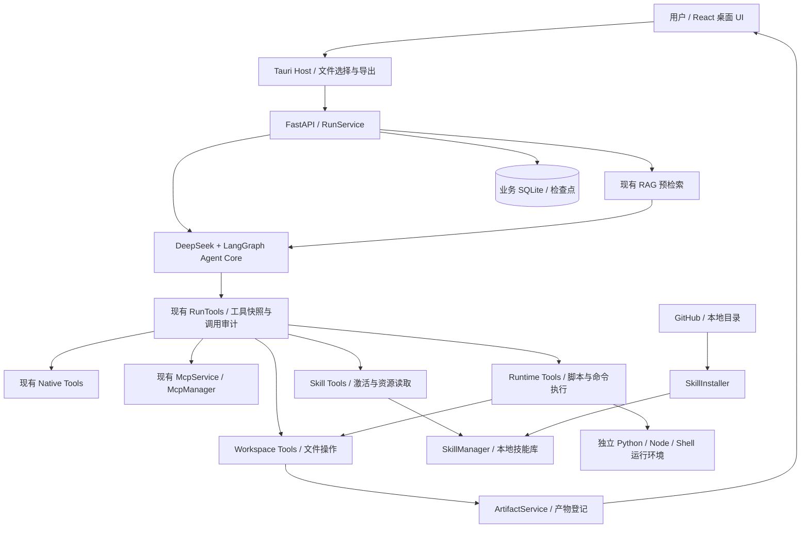
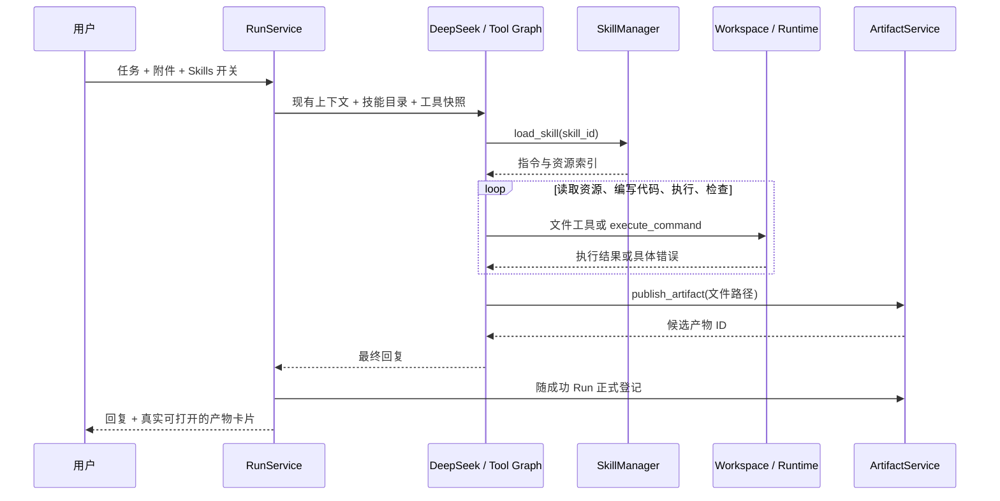

# KnowledgeAgent — Workspace、Runtime 与 Agent Skills 专项架构设计

> 版本：v0.1（设计稿，待源码核对）  
> 日期：2026-11-25  
> 阶段：P9  
> 产品定位：个人使用的通用桌面 Agent + 专业知识库  
> 开发原则：功能优先、复用现有架构、按实际问题修复，不做过度防御。

## 1. 建设目标与范围

### 1.1 产品目标

在已经具备聊天、教材 RAG、本地文件读取和 MCP 工具调用能力的 KnowledgeAgent 上，增加可执行的技能系统，让 Agent 能够处理用户文件、运行脚本并交付真实产物，而不只是输出操作建议。

首批完整场景：

- 思维导图：根据用户文本、教材问答或公开资料提炼层级结构，生成 Mermaid 源文件、SVG 图和可选 PNG。
- Word 格式调整：导入 DOCX，根据用户要求设置标题、正文、字体、段落、行距、页边距等，输出新的可编辑 DOCX。
- GitHub 技能导入：从公开仓库的技能目录安装兼容 Agent Skills 标准的技能，识别依赖、启用、自动选择并实际执行。
- 组合使用：RAG 或 MCP 提供知识和数据，Skill 提供任务方法，Runtime 执行，Artifact 交付结果。

首版以后可通过新增技能支持 PPT、Excel、PDF、科研绘图等；不为每种文件类型重新开发一个 Agent。

### 1.2 当前项目基线

依据此前 P6.1–P6.6 交付报告及用户确认，当前已有：

| 层 | 已有能力 | P9 策略 |
|---|---|---|
| 桌面 | Tauri/Rust、React/TypeScript、原生文件选择、Keychain | 复用，扩展 Skills 与附件/产物 UI |
| 后端 | FastAPI、Python Sidecar、SQLite | 扩展服务和少量接口 |
| Agent | DeepSeek、LangChain/LangGraph、普通聊天与工具图双路径 | 复用 RunTools 和现有工具图 |
| 会话 | RunService、SSE、检查点、安全提交、取消 | 保留，补充任务执行与产物记录 |
| 文件 | 会话级文件授权、list_files、read_text | 旧行为保留，新增工作区工具 |
| MCP | stdio/Streamable HTTP、服务管理、授权、工具快照 | 不重构、不重复实现 |
| RAG | 教材持久化、混合检索、引用与证据定位 | 不改索引和检索逻辑 |
| 安装 | macOS Apple Silicon、PyInstaller onedir、Tauri | 独立脚本运行环境，安装版实测 |

说明：用户确认 MCP 开发已完成；本文没有直接读取最新仓库或运行当前安装版，现有模块名、数据库版本和打包细节须在 P9.0 对照实际代码确认。P9 是新增专项，编号如与当前路线冲突，以实际路线调整，不重排旧任务。

### 1.3 非目标

首版不建设企业 RBAC、通用 DLP、独立守护进程、容器/虚拟机沙箱、技能商城、自动审核平台、长期记忆、多 Agent、复杂工作流平台、任意电脑 GUI 控制。也不要求兼容每一个第三方平台专有的 Skill 或工具。

## 2. 总体架构



关键决策：Skills 是 Agent 的知识与执行方法，不是新的 MCP 协议，也不是第二套 Agent。技能运行所需工具通过 RunTools 接入统一调用链。RAG 继续按当前方式提供证据；不将全部教材或技能文件放入 Prompt。普通聊天未启用 Skills 时不暴露新增执行工具。

## 3. 代码组织与模块职责

建议目录（逻辑边界，不强制照搬，P9.0 根据实际项目结构确认）：

```text
backend/app/
  skills/
    models.py          # SkillMetadata、SkillSnapshot、SkillStatus
    parser.py          # SKILL.md frontmatter 解析与基本校验
    manager.py         # 发现、注册、启停、激活、资源读取
    installer.py       # 本地目录 / GitHub 导入、更新
    dependencies.py    # 运行依赖检查与安装计划
  workspace/
    service.py         # 文件导入、任务工作目录、相对路径解析
    artifacts.py       # 产物登记、发布、回读
  runtime/
    manager.py         # 运行环境探测与准备
    executor.py        # 子进程执行、输出、超时、取消
  tools/
    registry.py        # 扩展现有 RunTools
    protocol.py        # 扩展工具结果/事件类型
    skill_tools.py     # load_skill 等
    workspace_tools.py # 工作区文件操作
    runtime_tools.py   # execute_command 等
  api/
    skills.py          # 技能管理查询与操作
    workspace.py       # 附件和产物查询
  storage/
    skills.py          # 技能安装记录
    artifacts.py       # 工作区附件和产物记录
  services/
    runs.py            # 现有 RunService 扩展
  agent/
    tool_graph.py      # 复用现有执行图，技能上下文与循环预算
frontend/src/
  SkillsPanel.tsx      # 技能管理
  Chat.tsx             # Skills 开关、附件、执行过程与产物卡片
  api/                 # 扩展统一 apiClient、SSE 解码
desktop/src/          # 原生目录选择、附件导入、文件打开/导出 IPC
```

不需要预先创建所有文件。优先实现清晰的小模块，避免将管理、执行和 UI 逻辑都堆到 RunService 或 Chat.tsx。

## 4. Workspace 工作空间

### 4.1 设计选择

首版采用每个会话一个持久工作区，每次 Run 一个独立工作目录。用户可以跨轮继续编辑上次生成的文件，但不同 Run 的临时文件不互相覆盖。原始输入以副本方式导入，不默认原地修改用户文件。

以现有 app_data_dir 为根目录（开发版、安装测试版与正式版沿用既有隔离机制）：

```text
<app_data_dir>/
  skills/<skill_id>/revisions/<revision>/skill-name/SKILL.md
  runtime/                       # 独立解释器/venv、缓存与运行状态
  workspaces/<session_id>/
    inputs/<file_id>/<filename>  # 用户导入的原件副本
    runs/<run_id>/
      work/                      # 当前任务的脚本、临时数据、工作副本
      output/                    # 生成候选产物
    artifacts/<artifact_id>/<filename>  # 已登记的版本化产物
```

- 原始附件与已发布产物在会话中可长期使用；不依赖某次临时目录是否存在。
- Skill 文件与应用代码分开存放；技能更新不会覆盖当前 Run 使用的修订。
- 读取用户文件采用显式选择或已授权附件；文件名冲突由 ID 隔离。
- Agent 默认在当前 Run 工作目录中读写。可从已授权附件、已发布产物和已激活技能复制或读取所需资源。
- 新产物默认生成新版本；覆盖或导出到用户目录由用户通过保存对话框完成。
- 工作区工具限制相对路径、避免 `..` 和符号链接误跳出工作目录；这是工具层边界，不是 OS 沙箱。
- 原有 read_text/list_files 授权机制保持不变。禁止把 RAG 教材存储目录当作任意可写工作目录。

### 4.2 附件与产物

附件通过 Tauri 原生选择并复制进入工作区；前端向聊天请求传 attachment_ids，不传可由模型随意修改的宿主绝对路径。每次 Run 绑定附件列表和可读产物 ID。

ArtifactService 将 output 下已生成文件验证为实际存在的普通文件，然后复制到持久产物目录并登记。保存原文件名、媒体类型、字节大小、来源 Run、创建时间；不需要把二进制全文写入 SQLite 或模型上下文。

成功 Run 的产物随业务提交正式发布；失败或取消保留可诊断的候选文件，但不冒充已完成结果。若文件复制成功而数据库提交失败，按未发布孤立文件处理，下次整理时清理即可，不引入跨文件系统分布式事务。

聊天界面提供产物卡片：文件名、类型、大小、打开、显示于 Finder、另存为；SVG/PNG 可选内嵌预览。历史会话恢复时依照持久记录显示，文件缺失显示明确错误。HTML/SVG 预览采用图片或安全渲染方式，不把任意文件内容直接作为 WebView HTML 执行。

## 5. Runtime 独立执行环境

### 5.1 必须解决的打包问题

PyInstaller 冻结后的 Python Sidecar 是应用可执行文件，不应假定 `sys.executable -c ...` 能充当通用解释器。运行技能需要独立的可调用 Python 环境，避免污染后端锁定依赖，也避免依赖开发源码目录中的 .venv。

首版面向本机 Apple Silicon：

- 优先探测本机已有的 uv、Python 3.12、Node.js/npm、git 与系统 Shell；以实际探测结果为准。
- 用 uv 建立 app_data_dir 下持久 Python venv，记录解释器绝对路径；启动应用时只探测，不自动安装大量依赖。
- 运行 Python Skill 时明确使用该解释器；执行 Node/Bash 时使用探测到的路径，不依赖 Finder 启动时的 PATH。
- 首版使用一套共享技能 venv；依赖冲突实际发生时再按技能建立独立环境，不预先做复杂环境调度。
- Mermaid 渲染依赖按需安装；检查 Node、CLI 和 Chromium/浏览器依赖，不能假定只有 npm 包就能输出 SVG/PNG。可用 Graphviz 或本地渲染器替代，但输出必须真实。
- python-docx、PyYAML 等按职责安装；解析器依赖属于后端，文档处理库属于 Runtime。若已有兼容库则复用。
- 用户通过技能管理页确认一次安装计划；Agent 不在普通聊天中偷偷执行 pip/npm 安装。缺依赖时明确提示并提供准备入口。
- 不默认把所有工具打入安装包；首版可复用本机环境。缺少工具时引导安装，后续才考虑自包含发行。

### 5.2 运行接口

建议内部模型：

```python
ExecutionRequest(
    run_id, executable, argv, cwd,
    timeout_seconds, env_overrides
)
ExecutionResult(
    execution_id, exit_code, stdout, stderr,
    duration_ms, timed_out, cancelled, output_truncated
)
```

Agent 侧可仅暴露一个 `execute_command`：参数为 command、args 数组、timeout_seconds。Python 由 Runtime 解析到独立解释器；Node、git、渲染器等按实际需要调用。`execute_python` 可以是便捷封装，不必重复实现执行器。首版不需要交互式终端或 PTY。

执行器用异步子进程真实执行，stdout/stderr 有界收集；长任务不阻塞 FastAPI 或 SSE。支持退出码、错误输出、任务取消、超时终止。macOS 使用独立进程组回收；优先复用已验证的 MCP 进程管理思路，但避免将两类任务耦合为一个复杂管理器。

默认执行采用 argv 而非字符串拼接。需要管道、Shell 语法时可以显式使用 Bash 或保存脚本执行。仅在用户明确开启本轮 Skills 执行能力时提供这些工具。脚本继承当前用户权限，工作目录限制并不能阻止脚本访问其他路径或网络；UI 简短说明即可，不加逐条审批。正常传递 PATH、HOME、locale 等运行所需环境，不把模型 Key、内部 Host/UI Token 主动注入脚本。

建议初始参数（根据首次真实验收调整）：

| 参数 | 默认值 |
|---|---:|
| 单次脚本/命令 | 120 秒 |
| 单次命令可见 stdout/stderr 合计 | 24 KiB，超出标记截断 |
| Skills Run 总时长 | 900 秒 |
| 同一会话活动 Run | 沿用现有单 Run 约束 |
| 全局并行执行任务 | 初始 2 |

不为毫无实际需求的超大任务预先设计分布式调度。长任务后续按需求扩展。

## 6. Skills 核心引擎

### 6.1 格式与兼容性

采用 [Agent Skills 开放规范](https://agentskills.io/specification)，不另造强制 manifest 格式。核心是 `SKILL.md`（YAML frontmatter + Markdown 指令），可附带 scripts、references、assets 与其他资源。读取 name、description 及可选 license、compatibility、metadata、allowed-tools。目录名与 name 一致；标准命名与长度规则由 parser 校验。未知字段可保留并提示，不为轻微第三方格式差异拒绝整个仓库；关键字段缺失或无法解析时标为不可用。

```text
word-formatting/
  SKILL.md
  scripts/format_docx.py
  scripts/validate_docx.py
  references/formatting-rules.md
  assets/template.docx
```

```markdown
---
name: word-formatting
description: 根据用户要求调整 DOCX 标题、正文、字体、行距与页边距，保留文档内容并生成可编辑副本。
---
# Workflow
读取附件与格式要求，检查现有样式，修改副本，验证内容与格式，发布 DOCX。
```

宿主特有配置（安装位置、依赖准备状态、启用状态、来源修订）保存在应用记录中，而不是强制修改第三方 SKILL.md。实验性 allowed-tools 仅作为兼容信息，不替代本地工具配置。不能声称解析格式成功就等于技能完整可运行。

### 6.2 技能注册与状态

SkillManager 提供 list、get、enable/disable、activate、read_resource、refresh_catalog 等操作。以稳定 skill_id 标识安装项，name 用于模型发现。同名技能在 UI 提示选择替换或保留不同来源；模型使用唯一 ID，避免歧义。

区分三个概念：已安装（文件存在）、已启用（允许进入目录）、可运行（依赖满足）。技能不带脚本时可以无需 Runtime 安装。更新采用先准备新版本、成功后切换，当前 Run 使用开始时的版本快照；删除时不影响旧产物。

### 6.3 渐进式加载（Progressive Disclosure）

参考 [Agent Skills 客户端接入指南](https://agentskills.io/client-implementation/adding-skills-support)。

1. 目录层：Run 开始时仅向模型提供已启用技能的名称、描述、唯一 ID。没有技能时不注入空目录；首版数量少直接列出，之后按规模优化。
2. 指令层：模型根据任务调用 `load_skill(skill_id)`，获得该版本的完整技能指令、资源索引。也支持用户手动指定技能。
3. 资源层：通过 `read_skill_file` 按需读取参考资料，或通过 Runtime 执行该技能中引用的脚本。

同一 Run 中激活结果缓存并去重；模型后续循环保留已激活指令，不反复把同一正文追加到上下文。不要默认加载所有脚本或模板内容。技能只提供操作方法，不能凭指令自行注册权限、获取内部 Token 或改变本轮工具开关。

初始目录建议不超过 20–30 个启用技能；超过时给出简单筛选或用户指定入口，不为少量技能专门建设向量索引。单份 SKILL.md 特别长时提示拆分参考资料，不静默截断关键步骤。

## 7. Agent 工具接口与任务执行

### 7.1 最小工具集合

| 工具 | 参数示例 | 结果/职责 |
|---|---|---|
| `load_skill` | skill_id | 当前修订的完整指令、资源索引 |
| `read_skill_file` | skill_id, relative_path | 已激活技能中的文本资源 |
| `list_workspace` | relative_path | 当前可见附件、工作文件、产物 |
| `read_workspace_file` | relative_path, offset/limit | 文本读取；二进制返回类型和路径信息 |
| `write_workspace_file` | relative_path, content | 创建文本、代码或 Mermaid 源文件 |
| `execute_command` | command, args, timeout_seconds | 真实执行、退出码、脱敏/有界输出 |
| `publish_artifact` | relative_path, title | 登记候选产物，返回 ID 与元数据 |

目录已经注入模型时不必另加 list_skills；复制、移动、目录创建等操作可由工作区工具或脚本实现，按真实需求增加，避免一次暴露大量重叠工具。Word/PPT 等二进制操作通过脚本库完成，不使用普通文本写入工具直接修改二进制。

### 7.2 Agent 执行流程



普通聊天路径不变。启用 Skills 且有可用技能/工具时进入既有工具图；没有文件授权也允许处理工作区附件。RAG 保留原预检索方式，MCP 仍由现有 McpService 管理。

用户可手动选择技能，也可让模型从描述中自主选择；不针对“思维导图”“Word”等关键词硬编码固定执行路线。允许一个 Run 激活多个技能，但只在任务实际需要时加载。

### 7.3 预算与失败恢复

已有 MCP/原生工具 8 次预算和 300 秒 Run 上限不适合复杂产物任务；但不能全局放开导致旧行为变化。

- 非 Skills Run：原有配置及错误语义不变。
- Skills Run：建议最多 40 次总工具调用、最多 32 次 Skills/工作区/Runtime 调用，既有原生文件与 MCP 调用仍保留 8 次合计限制；原有 MCP 单次超时和结果大小限制不变。模型单次超时沿用现有配置，Run 总超时切换至 900 秒。工具总数/Schema 预算仍检查，超限明确提示。
- 脚本退出码非零、缺依赖、格式校验失败等可恢复错误：返回真实错误结果，让模型调整命令或脚本后有限重试（同一失败重复 3 次则停止或提示用户）。不能把失败审计伪装为成功。
- MCP 或旧原生工具继续沿用现有失败语义；取消、Run 超时、无法继续的错误直接终止，不再自动重发可能已经执行的外部操作。
- 特别注意现有 complete_run() 可能要求所有 tool_calls 成功才提交。P9 必须支持“可恢复失败后成功完成”的合法 Skills Run：保留失败工具记录，使用明确 recoverable 状态/字段或等价机制，只允许已结算的可恢复失败进入成功 Run；旧工具失败仍阻止提交。不能简单删除全部提交检查。
- 与 P6 一致，模型网络重试不得重放已经执行的脚本或 MCP 请求；用户重新发起任务作为新 Run，可使用已经生成的工作区文件。

### 7.4 LangGraph、上下文与检查点

现有工具图采用摘要持久化设计。P9 要保证模型在当前运行中确实得到技能完整指令、脚本输出及必要文件内容，而不是只看到审计摘要；审计与模型可见正文分离。

建议利用 RunTools/Run 执行态保留当前轮完整临时工具结果和激活技能指令，在每次模型请求前构造上下文；SQLite 检查点持久化安全摘要、技能 ID/修订、产物 ID 与最终回答，不保存整个二进制文件或无界 stdout。当前 Run 中断不自动续跑任意脚本；下一轮可从已发布产物和稳定技能版本继续。

P9.0 必须核对实际 tool_graph 的消息重建方式，验证临时正文能跨多个 model/tools 节点正确传递，且不会因摘要化丢失脚本返回值。无需为了 P9 立即开发通用上下文压缩系统。

## 8. GitHub Skills 导入与依赖兼容

### 8.1 导入流程

支持本地技能目录与公开 GitHub 仓库 URL（仓库根、指定技能子目录、指定 ref）；必要时用 git clone 或下载仓库归档。不要依赖已有 DeepWiki MCP 获取实际脚本，DeepWiki 用于阅读仓库知识，不是安装器。


- 仓库包含多个技能时列出供选择，支持批量选择，不默认安装整个仓库的所有技能。
- 记录实际 commit SHA/ref、来源 URL、安装时间、版本和许可文件。下载归档时记录可验证的实际修订；无法得到时明确记录来源而非伪造 commit。
- 下载、解包与复制使用临时目录，避免路径逃逸、覆盖其他技能或导入错误目录；保留技能依赖的相对目录结构和许可证。
- GitHub tree URL 中含斜杠的分支名可能有歧义；无法可靠解析时提供 ref 与子目录输入，不猜路径。
- 安装只保存文件和元数据，不自动执行脚本。用户选择启用后，Agent 才能按需激活。更新由用户触发，不做后台自动更新。
- 遇到某个技能依赖 Claude Code 特定工具或其他宿主专有接口时，标记需要适配；不把工具名字简单替换后声称兼容。

### 8.2 依赖准备

识别 requirements.txt、pyproject.toml、package.json、技能 compatibility 字段及指令中明确的外部命令。只做实际可用的检查，不追求从任意自然语言自动推断完整依赖。缺依赖时显示准备方式与运行错误；依赖安装操作经用户一次确认后执行。

首批可参考 [anthropics/skills](https://github.com/anthropics/skills) 中 docx 等目录，检查实际版本、许可和脚本前提。允许安装后提供少量 KnowledgeAgent 适配说明，但保留原始技能；不强制要求所有外部技能都能在首版运行。

## 9. 持久化与 API 契约建议

### 9.1 存储

沿用现有业务 SQLite 与迁移机制，不新增多个数据库。若当前 V6 仍为最新，使用下一次增量迁移（预计 V7）；P9.0 确认版本后再确定编号。技能与产物文件本身保存在文件系统，数据库只保存元数据。

| 逻辑表 | 主要字段（建议） |
|---|---|
| skills | skill_id, name, description, source_type, source_url, revision, relative_dir, enabled, created_at, updated_at |
| workspace_files | file_id, session_id, original_name, relative_path, media_type, size_bytes, created_at |
| artifacts | artifact_id, session_id, run_id, filename, relative_path, media_type, size_bytes, status, created_at |
| run_skill_activations（可选） | run_id, skill_id, name_snapshot, revision, activated_at |

运行依赖状态可以探测并缓存，不强制建独立依赖表。会话工作区路径由 ID 派生，不重复存任意绝对路径。技能删除不级联删除历史产物。会话删除时按现有删除语义处理关联工作区，并明确提示用户；导出到用户目录的文件不删除。

现有 tool_calls.source 若仅允许 native/mcp，优先设计兼容的增量迁移支持 skill/workspace/runtime 或保持 native 加明确类别字段；P9.0 对照 SQLite CHECK 约束、历史查询和前端类型，选择改动最少的方案。不能在现有 CHECK 下直接写入新值。保留旧历史及字段含义。

### 9.2 对外接口（草案）

| 接口 | 用途 |
|---|---|
| GET /api/v1/skills | 技能列表、启用/依赖状态 |
| GET /api/v1/skills/{id} | 元数据、来源、资源、依赖说明 |
| POST /api/v1/_host/skills/import-preview | 导入预览、候选技能 |
| POST /api/v1/_host/skills/install | 安装选中技能 |
| PATCH /api/v1/_host/skills/{id} | 启用/停用 |
| POST /api/v1/_host/skills/{id}/update | 手动更新 |
| DELETE /api/v1/_host/skills/{id} | 移除安装记录和技能文件 |
| GET /api/v1/runtime/status | 环境探测与缺失依赖 |
| POST /api/v1/_host/runtime/prepare | 准备确认后的运行依赖 |
| GET /api/v1/sessions/{id}/workspace | 附件与产物列表 |
| GET /api/v1/sessions/{id}/artifacts/{artifact_id} | 产物元数据（按需提供受控内容读取） |

具体路由及 IPC 复用现有项目约定。特权安装、原生文件导入、打开、另存为通过 Tauri IPC/Host Token 转发；前端查询使用现有 UI Token。无需额外建立权限框架，也不开放任意 Shell HTTP 管理端点；命令执行由授权的 Agent Run 进入 Runtime。

### 9.3 聊天请求

保留现有知识库/MCP 字段，新增可选对象：

```json
{
  "client_request_id": "uuid",
  "message": "帮我调整这个 Word 文档的格式",
  "knowledge": {"enabled": false},
  "mcp": {"enabled": false, "allow_external_data_egress": false},
  "skills": {"enabled": true, "selected_skill_ids": []},
  "attachment_ids": ["file-id"],
  "artifact_ids": []
}
```

- 旧客户端不传 skills 时默认关闭。新 UI 默认关闭，用户主动开启后可记忆偏好，Run 开始时冻结选项。
- selected_skill_ids 为空表示模型在可用技能中自行选择；非空表示用户选定范围。
- 当前 Run 已使用的技能版本、附件列表和可用工具不可在运行中被新安装项替换。
- 幂等请求仍使用原 Run 执行选项，不因为网络重试生成重复文件或执行重复命令。

### 9.4 SSE 与历史恢复

沿用现有 SSE envelope/version 与工具事件；新增字段只对新工具来源生效，旧 native/mcp 事件保持兼容。建议新增 `skill_activated`、`artifact_created`（或在现有 Run 完成事件增加产物摘要），由 P9.0 核对事件解析器和 Run 恢复能力确定。

执行过程展示技能名、工具名、运行状态、耗时、必要错误摘要；不逐字向前端倾倒无限 stdout。Run 终态必须与审计/产物登记一致。历史恢复从持久化记录重建，不依赖前端内存事件。

## 10. 前端产品设计

### 10.1 Skills 管理页

在现有侧边栏增加 Skills，与聊天、教材知识库、MCP 服务并列。保持现有视觉风格。

- 顶部：已安装数量、添加本地技能、从 GitHub 导入。
- 每项：名称、描述、来源、版本/修订、启用开关、依赖就绪/缺失/不兼容状态。
- 展开：查看 SKILL.md、资源目录、依赖提示、更新、删除。
- 导入：粘贴 URL → 显示候选 → 选择 → 安装 → 准备依赖 → 启用。
- 不伪造技能卡片或安装状态，不做商城、评分、在线搜索推荐等额外功能。

### 10.2 聊天与附件

```text
┌─────────────────────────────────────────────┐
│ KnowledgeAgent                             │
│ [附件: 论文.docx]                           │
│ 帮我把正文统一为宋体小四，1.5倍行距……       │
│                                             │
│ [+ 附件] [RAG] [MCP] [Skills ✓]    [发送]  │
├─────────────────────────────────────────────┤
│ 已激活技能：Word 格式调整                  │
│ 读取文档 → 执行脚本 → 检查格式 → 已完成     │
│                                             │
│ 论文_排版后.docx   [打开] [另存为]           │
└─────────────────────────────────────────────┘
```

Skills 开关与 RAG、MCP 独立；本轮关闭 Skills 不影响原有聊天。可选简洁技能选择器，默认自动选择。附件可通过文件选择导入，拖拽可作为后续体验优化。产物点击打开系统默认应用。思维导图支持图像预览，同时保留源文件供用户后续编辑。

## 11. 首批技能落地设计

### 11.1 Mind Map

内置 `mind-map` 技能作为首个端到端样例。模型根据用户材料整理结构，生成 `mindmap.mmd` 或等价结构化源文件，通过可用渲染器产出 SVG；PNG 是可选输出。优先支持中文、可读布局、层级清晰；Mermaid 语法不合法时读取渲染错误并自动修正。字体使用本机可用字体，渲染失败不能仅以源代码冒充成品。

验收：用公开文本和一段教材问答分别生成导图；SVG 实际打开无乱码，源文件可编辑；用户要求修改某个节点后能从历史产物生成新版本。

### 11.2 Word Formatting

内置 `word-formatting` 技能作为第二个端到端样例，使用 python-docx/必要的 OOXML 操作。输入为 DOCX 附件与用户格式要求，输出同名加后缀的新 DOCX。

首版支持标题/正文样式、中文与西文字体、字号、段前段后、行距、页边距、基础表格格式；按需求处理分节。以用户明确要求为准，不擅自修改正文措辞。旧 `.doc`、加密文档、复杂域、修订、宏、图形及复杂分页不保证全面支持。复杂文档先明确实际可编辑范围，不必为了首版实现完整 Office 引擎。

验收：使用带标题、正文、表格和图片的实际测试 DOCX，修改指定格式后通过程序回读验证样式与文本内容，并用 Word/兼容查看器打开，原文件保持不变。避免仅凭文件后缀或脚本退出码判断成功。

### 11.3 第三方技能兼容验收

从真实 GitHub 仓库导入至少一个标准 Skill（例如公开的 docx 或其他轻量文档技能，以实际依赖可用情况选择）。验证下载、解析、依赖准备、启用、模型自动激活、真实执行和产物。若复杂第三方 docx Skill 依赖 LibreOffice、系统转换工具等，允许按需准备，不把平台专属全部能力作为 P9 阻塞条件。

## 12. 个人使用的最小工程边界

只保留直接影响可用性和用户文件完整性的约束：

- 原文件默认保留，产物生成新版本；用户自行选择覆盖或导出。
- 工作区文件工具做基本路径校验；脚本采用本机用户权限，不虚构沙箱保证。
- 安装外部技能、准备依赖以及开启 Skills 执行能力，由用户确认；正常任务中的每条脚本命令不反复弹窗。
- 执行任务有超时、取消、输出限制和退出回收；避免软件卡住。
- 继续使用现有 UI/Host Token 分离和 Keychain，不在脚本环境主动注入应用内部凭据。
- 新增工作区/技能读取能力可能使模型接触本地内容，若同时开启 MCP，应复用现有外发授权语义并把附件、工作区内容纳入同轮/历史风险判断。普通 Skills 执行本身不另建逐条外发审批；脚本联网能力如实说明。

不进行第三方技能逐行安全审计、不建设复杂审批流、不为低概率极端情形阻塞开发。路径校验和原文件保留主要用于避免误操作；不是承诺对任意脚本具备安全隔离。

## 13. 分阶段开发与验收

| 阶段 | 工作内容 | 可见交付/验收 |
|---|---|---|
| P9.0 | 源码核对、方案定稿 | 确认实际版本、模块、工具图提交约束、运行环境和迁移点；只对本设计追加必要修订 |
| P9.1 | Workspace + Artifact 基础 | 导入 DOCX/文本、工作区读写、输出文件、重新打开历史产物 |
| P9.2 | Runtime | 独立 Python、真实脚本/命令、失败输出、取消、超时；生成一个可打开的测试文件 |
| P9.3 | Skills 核心 | SKILL.md 发现、解析、启停、修订快照、按需资源读取；内置两项技能 |
| P9.4 | Agent 集成 | 模型自主激活、工具循环、可恢复脚本失败、产物交付；真实 DeepSeek + Word/导图闭环 |
| P9.5 | GitHub 导入 | 公开仓库、单技能/多技能选择、依赖准备、更新、重启恢复；至少一项真实外部 Skill |
| P9.6 | UI 交付 | Skills 管理页、聊天开关、附件、技能执行活动、文件打开/导出 |
| P9.7 | 实机及安装版 | 真实任务、RAG/MCP/Skills 组合、安装版独立 Runtime 与旧数据兼容 |

建议开发节奏：P9.0 完成后允许 P9.1–P9.2 连续完成，先建立可执行基础；P9.3–P9.4 连续打通两项真实能力；P9.5–P9.6 完成可用产品；P9.7 最终实机验收。每个大阶段汇报结果即可，不需要每个小函数确认。

阶段内优先运行新增功能测试与直接受影响的回归。最终交付前执行一次项目关键全量回归和生产构建。不要因为文档中未影响当前场景的可选功能而暂停整个阶段。

### 13.1 最终验收清单

- 普通聊天、原生文件工具、原有 RAG 和 MCP 不退化。
- 使用真实模型自动识别并加载技能，能看到真实执行过程，而不是硬编码问题匹配或假工具结果。
- 思维导图产生真实可打开的 SVG 与可编辑源文件。
- Word 格式调整产生真实可编辑 DOCX，文本和原附件保留。
- 可恢复的脚本错误能由 Agent 修正并继续；真正失败或取消不提交虚假成品。
- GitHub 导入的真实技能能够重启恢复并实际执行。
- 会话历史中产物可打开和另存为，跨轮能够基于旧产物继续修改。
- 组合 RAG 或 MCP 时仍能产生文件；外发行为与现有授权语义一致。
- 打包后的 `.app` 不依赖源码路径或把冻结 Sidecar 当解释器；运行环境缺失时提供可用提示。

## 14. P9.0 给 Codex 的启动提示词

将本文件放入项目根目录后发送以下任务。先核对实际源码，不急于重复设计整套架构。

```text
KnowledgeAgent 已完成 MCP 专项开发。下一阶段 P9：Workspace、Runtime 与 Agent Skills。
请阅读项目根目录 KnowledgeAgent_Skills_Architecture_v0.1.md、现有架构/接口/开发路线文档及实际源码。

本次只完成 P9.0 源码核对与方案定稿：
1. 核对当前版本、数据库 schema、RunService、RunTools、tool_graph、检查点、SSE、文件授权、Tauri IPC、打包流程。
2. 查明新增工作区/附件/产物所需最小改动；特别检查 tool_calls.source 约束和 complete_run 对失败工具的处理。
3. 核对 macOS 安装版如何定位独立 Python、uv、Node 等运行环境；不要把 PyInstaller Sidecar 当解释器。
4. 确定 Agent Skills 渐进式加载、真实脚本执行、失败后修正及产物发布的实际接入点。
5. 优先复用现有组件，保留 RAG/MCP，明确最少数据库迁移、API、IPC 和前端修改。
6. 确认首批 mind-map、word-formatting 与一个 GitHub 技能所需真实依赖及验收方式。
7. 在本设计末尾追加简短的源码核对记录与修订决策；不重写整篇文档，不新增无关设计。

原则：个人使用，功能优先；不做企业级沙箱、复杂审批、逐条安全审查或无关重构。首批能力以实际产物为验收目标。
本阶段不修改业务代码、不安装新依赖、不迁移用户正式数据库、不执行 git commit/push。
输出当前源码基线、必要修改点、设计冲突及解决方案、P9.1–P9.2 最小开发任务。完成后停止。
```

## 15. 参考与待确认事项

外部标准参考（2026-11-25 查询）：

- Agent Skills Specification: https://agentskills.io/specification
- Agent Skills 客户端实现指南: https://agentskills.io/client-implementation/adding-skills-support
- Anthropic Skills 示例仓库: https://github.com/anthropics/skills

本文中的 Workspace、Runtime、API、预算、迁移和分期是 KnowledgeAgent 的建议实现，不是标准强制规定。实际 SDK 接口、第三方技能版本及本机依赖尚未通过当前项目源码或真实运行核验。P9.0 只需修正具体冲突，不需要另起一份大规模设计文档。

**最终决策：先让 Agent 能处理文件、执行脚本、交付产物，再让 Skills 成为可插拔的专业工作方法。**

---

## 16. P9.0 源码核对记录与必要修订（2026-11-25 定稿）

> 说明：本节基于当前仓库实际源码与本机 Apple Silicon 环境核对结果追加，不重写正文；以下修订作为 P9.1–P9.7 的直接实现依据。

### 16.1 核对后的实际基线

- **项目版本与路线编号**：全仓当前版本 `0.3.0`（`backend/pyproject.toml`、`desktop/Cargo.toml`、`desktop/tauri.conf.json`、`frontend/package.json`、`desktop/packaging/build-macos.sh`）。`开发路线与验收.md` v0.4 覆盖 P0–P8（P0–P4、P6、P7 已 `PASS`，P5 未启用，P8 个人安装版 `PARTIAL`），**P9 编号无冲突**。
- **SQLite 数据库与版本**：业务库 `knowledgeagent.sqlite3` 当前 `SCHEMA_VERSION = 6`（`backend/app/storage/business.py`），V6 已引入 `mcp_servers`、`mcp_tools` 及 `tool_calls.source`；**P9 增量迁移编号确定为 V7**。`checkpoints.sqlite3`（LangGraph `AsyncSqliteSaver`）与 `knowledge.sqlite3`（`KnowledgeStore`）保持独立不变。
- **现有依赖与本机环境**：
  - 后端 `requires-python = ">=3.12,<3.13"`，`python-docx==1.2.0`、`httpx`、`pyyaml==6.0.4`（传递依赖，P9.3 须在 `pyproject.toml` 显式声明 `PyYAML>=6,<7`）已在 `backend/uv.lock`；
  - 桌面端 `desktop/Cargo.toml` 已启用 `objc2-app-kit` 的 `NSOpenPanel` 与 `NSSavePanel`；
  - 本机已具备 `uv 0.13.7`（已托管 `cpython-3.12.16`）、`node v22.23.4` / `npm` / `npx`、`git 2.54.0`、`/Applications/Google Chrome.app` 及系统中文简体字体；`mmdc`、`dot`、`soffice`、`pandoc` 尚未安装。

### 16.2 必须调整的设计与落地约定

1. **`tool_calls` 约束兼容与 `complete_run()` 可恢复失败语义（SQLite V7）**
   - 源码现状：`business.py` 中 `tool_calls.source` 已有 `CHECK (source IN ('native', 'mcp'))`（SQLite 不支持原位修改 CHECK），且 `complete_run()` 强校验 `status != 'completed'` 即抛出 `RuntimeError`。
   - 修订方案：**不重建 `tool_calls` 表**。保留 `source IN ('native', 'mcp')`（Skill/Workspace/Runtime 工具统一写入 `source = 'native'`），在 V7 迁移仅追加两列：
     - `tool_category TEXT CHECK (tool_category IS NULL OR tool_category IN ('skill', 'workspace', 'runtime'))`
     - `recoverable INTEGER NOT NULL DEFAULT 0 CHECK (recoverable IN (0, 1))`
   - `complete_run()` 校验调整为仅阻止 `NOT (status = 'completed' OR (status = 'failed' AND recoverable = 1))`。旧原生文件工具与 MCP 工具保持 `recoverable = 0`，原失败语义与审计不变；可恢复的脚本/工作区错误落库为 `status = 'failed', recoverable = 1`。
   - V7 同步新增 `skills`、`workspace_files`、`artifacts`（含 `status IN ('staged', 'published', 'discarded')`）、`run_skill_activations` 四表，并在 `BusinessStore.delete_session()` 事务中清理关联记录、由 `RunService.delete_session()` 清理对应 `<app_data_dir>/workspaces/<session_id>/`。

2. **LangGraph `tool_graph.py` / `answer.py` 与 `RunTools` 预算扩展**
   - 核对确认：`build_tool_graph()` 已将完整工具调用参数与结果保存在运行期内存（`calls` / `results`），`model_message()` 推理前动态注入完整正文，Checkpointer 仅持久化脱敏摘要并在最终回复时以 `RemoveMessage` 清理中间工具消息，可直接复用。
   - 必须调整 5 处实现细节：
     - **保留可恢复失败参数**：`tool_graph.py` 中 `model_message()` 目前在 `not results[id].ok` 时清空 `args={}`；修订为 `if results[id].ok or results[id].recoverable` 保留参数，使模型能基于上次参数和真实报错修正脚本。
     - **区分可恢复与致命错误**：`RunTools` 仅在致命错误（旧文件/MCP 工具失败、取消、超时、预算耗尽、同类可恢复错误连续达 3 次）时设置 `self.failure`；可恢复错误不触发短路，继续使用 `bound_model` 循环。
     - **显式提高 LangGraph `recursion_limit`**：`answer.py` 当前未设置 `recursion_limit`（默认 25，最多约 12 轮工具调用）；Skills Run 须显式传入 `recursion_limit = 90`（并将 `GraphRecursionError` 归一为 `RATE_LIMITED`）。
     - **放开 Skills Run 输出与工具/上下文预算**：`tool_graph.py` 在 `after_tool` 时固定 `max_tokens = 3072`，编写长脚本易截断报错；Skills Run 取消 3072 限制改用模型配置上限（8192）。`RunTools` 为 Skills Run 启用双桶预算（总计 40 次：Skills/Workspace/Runtime ≤ 32，原生文件 + MCP 仍 ≤ 8），上下文预算提升至 `200_000 chars / 300_000 bytes`；启用 Skills 时暴露工具上限提高至 40（保留 MCP 自身 ≤ 32 上限，避免已接入的 27 个 MCP 工具叠加 7 个 Skills 工具与 2 个文件工具触发 `MCP_TOOL_LIMIT_EXCEEDED`）。
     - **`require_active_authorizations()` 按工具类别放行**：`registry.py` 当前假定所有非 MCP 工具均属于 `TOOLS` 并含 `grant_id`；修订为仅对旧 `list_files`/`read_text` 复检 `grant_id`，对 `skill/workspace/runtime` 工具按会话归属放行。

3. **`RunService` 超时、产物两阶段提交与 SSE 兼容**
   - 非 Skills Run 保持 `300s` 总超时，Skills Run 切换为 `900s`。
   - `publish_artifact` 先校验文件并复制到 `workspaces/<session_id>/artifacts/<artifact_id>/<filename>`，写入 `artifacts(status='staged')`；在 `BusinessStore.complete_run()` 同一事务中原子升级为 `published`；`fail_run` / `confirm_cancel` / `recover_interrupted_runs` 将 `staged` 置为 `discarded`。`list_runs()` 的 `RunSummary` 同步返回 `artifacts`（仅 `published`）与 `skill_activations`，历史与刷新恢复零额外往返。
   - SSE 保持现有 `version = 1` 封装：旧 `list_files` / `read_text` 的 `tool_failed` 严格保持 `{"tool_call_id", "message", "code"}` 键集合（保障 `test_file_tools.py` 兼容）；新增 `skill_activated`、`artifact_created` 及 `run_completed` 附带 `artifacts` 摘要（前端 `chatEvents.ts` 默认忽略未知事件类型，完全向后兼容）。

4. **双通道 API、CORS 约束与 Tauri IPC / CSP 补齐**
   - 源码现状：`main.py` CORS 仅放行 `["GET", "POST"]`，`apiClient.ts` 仅使用 `GET`/`POST`；全部管理类写接口（含 `PATCH`/`DELETE`）沿用 MCP 模式置于 `/api/v1/_host/...` 由 Tauri Rust 持 `host_token` 转发，无需放宽 CORS。
   - 补充必要接口与 IPC：
     - `POST /api/v1/_host/sessions/{session_id}/workspace/files`：由 Tauri `NSOpenPanel` 选定文件并导入工作区 `inputs/<file_id>/<filename>`，返回元数据与 `file_id`（不向模型或 WebView 暴露任意宿主绝对路径）；
     - `GET /api/v1/sessions/{session_id}/artifacts/{artifact_id}/content`：受控返回 SVG/PNG 等预览字节流；
     - Tauri IPC：`select_and_import_workspace_file`、`open_artifact`（`/usr/bin/open`）、`reveal_artifact_in_finder`（`/usr/bin/open -R`）、`export_artifact`（复用已启用的 `NSSavePanel`）。
   - **CSP 修订（P9.6）**：`desktop/tauri.conf.json` 当前未声明 `img-src`（回退 `default-src 'self'`），会阻止 `blob:` 图片预览；需补充 `img-src 'self' blob: data:;`，前端使用 `` 安全展示 SVG/PNG（WebKit 下 `` 加载 SVG 不执行内嵌脚本）。

5. **Runtime 目录共生与 PyInstaller 隔离细节**
   - 源码现状：`<app_data_dir>/runtime/mcp-procs/` 已由 `McpProcessRegistry` 与 `desktop/src/mcp_process.rs` 占用。
   - 修订目录：`<app_data_dir>/runtime/` 下新增 `venv/`（独立 Python venv）、`npm-tools/`（本地 `mermaid-cli` 等）、`cache/`，与 `mcp-procs/` 平级共存。
   - 解释器与环境变量：开发版与 PyInstaller 打包版统一使用独立探测与托管 venv（`uv` 优先，`python3` 兜底，避免误触发 macOS `/usr/bin/python3` CLT 弹窗，绝不使用冻结态 `sys.executable` 或 `backend/.venv`）。子进程环境复用 `app/mcp/policy.py` 白名单思路，额外剔除 `DYLD_*`、`LD_*`、`PYTHONHOME`、`PYTHONPATH`、`_MEIPASS*`、`PYINSTALLER_*` 及模型/内部凭证前缀，并构造不依赖 Finder 的确定性 `PATH`。执行器采用 `asyncio.create_subprocess_exec(..., start_new_session=True)`、有界异步输出收集（24 KiB）、`os.killpg` 进程组超时/取消回收及全局并发限制 `Semaphore(2)`。

6. **MCP 外发边界联动与首批产物真实渲染定稿**
   - **外发边界**：`RunTools.build_snapshot()` 的 `has_current_risk` 纳入 `attachment_ids` / `artifact_ids` / `skills_enabled`；`inspect_session_egress_risk()` 自动覆盖 `source='native'` 的新工具调用并补充检查 `workspace_files`，与现有 `MCP_EGRESS_AUTHORIZATION_REQUIRED` 弹窗完全复用，不另建审批系统。
   - **Mind Map**：首选 `@mermaid-js/mermaid-cli`（`npm install --prefix <app_data_dir>/runtime/npm-tools @mermaid-js/mermaid-cli`），检测本机 `/Applications/Google Chrome.app` 时通过 `PUPPETEER_SKIP_DOWNLOAD=1` 与 `puppeteer-config.json` 复用本机 Chrome（避免重复下载 Chromium），配置中文字体栈并在 P9.2/P9.3 实测 macOS 预览与 WebView `` 渲染效果（若 `<foreignObject>` 出现裁切则配合 PNG 预览或关闭 `htmlLabels`）。
   - **Word Formatting**：在 `runtime/venv` 安装 `python-docx`（含 `lxml`），内置脚本显式设置 OOXML `w:ascii`/`w:hAnsi` 与 `w:eastAsia` 双字体及中文字号映射，执行回读校验（正文无丢失、样式/行距/页边距生效、包结构有效）后再发布产物。
