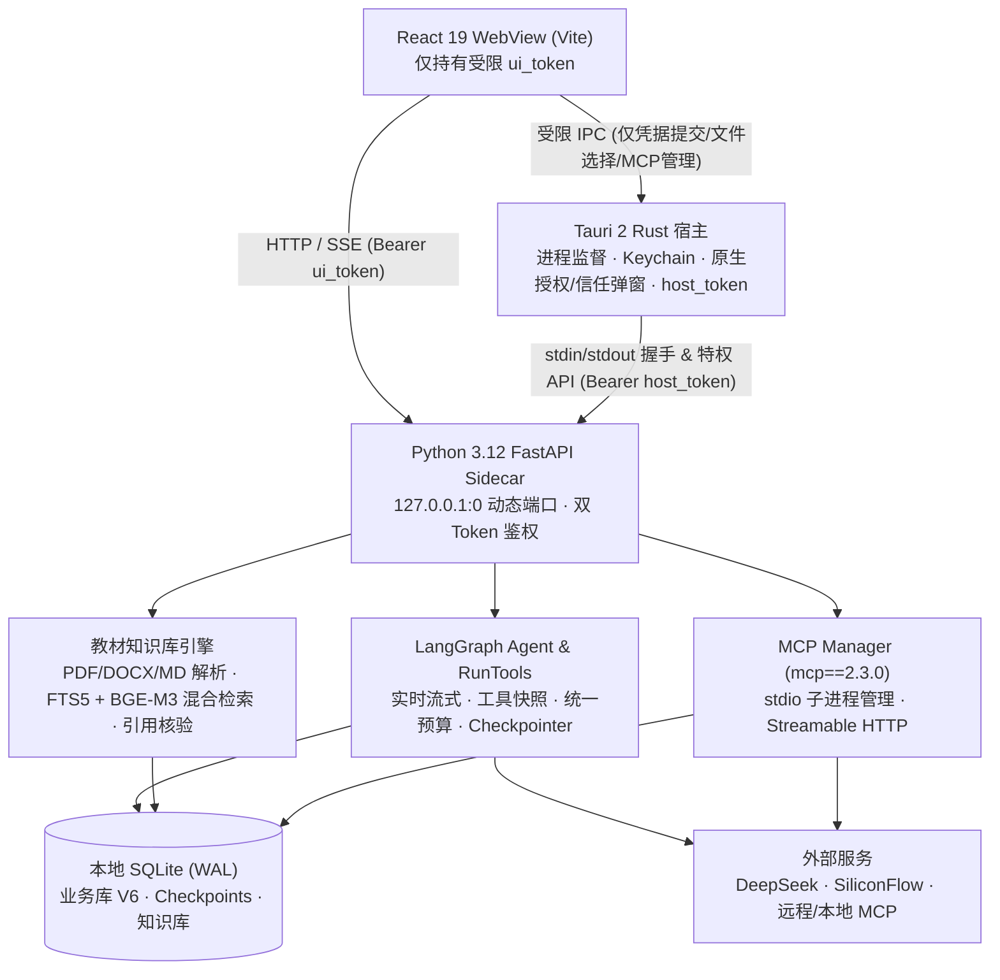

# KnowledgeAgent

<p align="center">
  <strong>面向 macOS Apple Silicon 的本地优先 AI Agent 桌面助手</strong><br />
  集成 DeepSeek 实时流式对话、理工科教材知识库（RAG + 原文级引用溯源）、受控只读本地文件工具与 MCP 外部工具生态
</p>

<p align="center">
  
  
  
  
  
  
  
</p>

---

## 目录

- [项目简介](#项目简介)
- [核心功能](#核心功能)
- [系统架构与安全边界](#系统架构与安全边界)
- [目录结构](#目录结构)
- [环境要求与开发启动](#环境要求与开发启动)
- [构建 macOS 安装版（.app / .dmg）](#构建-macos-安装版app--dmg)
- [配置指南（模型与 MCP 服务）](#配置指南模型与-mcp-服务)
- [自动化测试](#自动化测试)
- [版本升级与数据迁移](#版本升级与数据迁移)
- [已知限制与注意事项](#已知限制与注意事项)
- [架构与设计文档](#架构与设计文档)

---

## 项目简介

**KnowledgeAgent** 是一款强调**本地优先、权限最小化、来源可追溯**的桌面级 AI Agent 应用，无需 Docker、外部数据库或额外后台服务，安装后即可在本地运行。

系统采用 **Tauri 2（Rust 宿主）+ React 19 / TypeScript（前端界面）+ Python 3.12 FastAPI Sidecar（LangGraph Agent / RAG / MCP 运行时）+ SQLite (WAL)** 三层架构：

- **Rust 宿主**独占进程监督、macOS 原生钥匙串（Keychain）、原生文件/目录授权选择器、原生 MCP 信任确认弹窗与子进程回收；
- **React WebView** 仅持有受限 `ui_token`，绝不接触真实 API Key、宿主特权通道或未授权文件系统路径；
- **Python Sidecar** 绑定本机随机回环端口（`127.0.0.1:0`），通过 stdin/stdout 握手启动并在宿主断开时自动退出，零孤儿进程残留。

---

## 核心功能

### 1. DeepSeek 多轮对话、实时流式输出与安全恢复
- **实时打字机流式输出**：普通对话与工具调用（本地文件 / MCP）后的回复均支持实时 SSE 流式推送（工具会话采用 1-chunk 前瞻流式策略，兼顾工具规划前导过滤与断流重试不重跑工具）。
- **Markdown 与理工科数学公式渲染**：内置安全 Markdown 与 **KaTeX**（行内 `$...$` / 块级 `$$...$$`）及结构化引用角标渲染。
- **幂等与主动取消**：支持同会话 `client_request_id` 幂等防重、随时停止生成；取消或异常的半截草稿不会污染正式消息历史。
- **LangGraph Checkpointer 安全基线**：仅在图执行与业务 SQLite 事务同时提交成功后推进 `last_safe_checkpoint_id`，故障或取消自动隔离。

### 2. 理工科教材知识库（RAG）与原文级引用溯源
- **受控导入与去重**：支持 **PDF、DOCX、Markdown**（单文件 $\le 100\text{ MiB}$），基于内容 SHA-256 去重与版本管理，独立解析子进程防内存溢出。
- **双通道混合检索**：本地 SQLite FTS5（逐汉字预处理，优化中文术语召回）+ SiliconFlow `BAAI/bge-m3`（1024 维）精确余弦向量检索 + RRF 融合；未配置 SiliconFlow Key 时自动优雅降级为纯本地关键词检索。
- **多模式检索与跨教材对比**：支持「全局相关性」与「跨教材对比」覆盖策略、多轮追问指代消解及「本地教材检索」面板（无需配置 DeepSeek 即可检索教材原文）。
- **可核验引用卡片与公式护栏**：精确溯源至 PDF 物理页/页标签、Markdown 行号、DOCX 段落与表格；对 PDF 缺失数学字形（`PDF_UNMAPPED_GLYPHS`）注入安全提示并持久化历史引用卡片。

### 3. MCP 外部工具生态（`mcp==2.3.0`）
- **双传输协议**：同时支持本地 **stdio** 与远程 **Streamable HTTP** 协议。
- **可视化管理与一键导入**：支持表单配置及标准 `mcpServers` JSON 粘贴预览与批量导入。
- **分层安全信任模型**：
  - 新增/修改/导入的 MCP 服务默认停用且未信任，必须经 **macOS 原生信任弹窗**确认后方可连接；
  - 发现的工具默认拒绝，按工具粒度单独授权，工具定义变更自动失效重审；
  - 敏感环境变量与请求头隔离存入独立 macOS Keychain 服务，前端绝不回显明文；
  - 跨轮历史外发保护：当会话涉及本地文件授权或教材 RAG 内容时，开启外部 MCP 默认触发显式外发风险确认；
  - 统一工具调用预算、超时控制、中途取消与退出零残留进程清理。
- **自动重连与状态同步**：应用重启后自动在后台重连已启用且已信任的 MCP 服务，前端侧栏徽章与聊天区开关自动同步；面板同时提供「全部连接」一键操作。

### 4. 受控只读本地文件工具
- 通过 macOS 原生文件/目录选择器按会话登记临时授权（应用重启即失效，可随时撤销）。
- 提供 `list_files`（目录发现、分页、过滤隐藏项与软链）与 `read_text`（分段读取、UTF-8/GBK 兼容、严格大小限制），底层使用 macOS `O_NOFOLLOW_ANY` 防软链逃逸与 TOCTOU 攻击。

---

## 系统架构与安全边界



**核心安全不变量**：
1. `host_token` 仅存在于 Rust 宿主与 Sidecar 内存之间，永不进入前端、日志或数据库。
2. API Key 与 MCP 密钥采用单向提交至宿主 Keychain，Sidecar 崩溃重启后由宿主自动回灌内存。
3. 第三方工具描述、文件内容、网页正文均视为不可信外部数据，无法提升权限或修改系统配置。

---

## 目录结构

```text
.
├── desktop/                          # Tauri 2 Rust 宿主与 macOS 打包脚本
│   ├── src/                          # Sidecar 监督、Keychain、文件授权、MCP 宿主 IPC 与进程清理
│   ├── packaging/
│   │   ├── build-macos.sh            # Apple Silicon onedir/onefile .app & .dmg 构建脚本
│   │   ├── sidecar_entry.py          # 独立 PyInstaller 入口（隔离 app/mcp 与官方 mcp SDK）
│   │   ├── onedir.json / onefile.json
│   │   └── INSTALL-GUIDE.txt         # 安装与升级说明
│   ├── tauri.conf.json
│   └── Cargo.toml
├── frontend/                         # React 19 + TypeScript + Vite 前端
│   ├── src/
│   │   ├── App.tsx                   # 侧栏导航、连接状态、MCP 摘要自动同步
│   │   ├── Chat.tsx                  # 流式对话、工具卡片、RAG 范围控制、外发确认、引用展示
│   │   ├── LibraryPanel.tsx          # 教材导入、后台索引监控、本地检索面板
│   │   ├── McpPanel.tsx              # MCP 服务管理、JSON 导入预览、信任与逐工具授权、全部连接
│   │   ├── MarkdownAnswer.tsx        # Markdown + KaTeX 公式 + 引用角标渲染
│   │   └── api/                      # apiClient、SSE 解析器、Tauri IPC 封装
│   └── package.json
├── backend/                          # Python 3.12 FastAPI Sidecar 后端
│   ├── app/
│   │   ├── agent/                    # LangGraph 问答、实时流式工具图（tool_graph.py）
│   │   ├── api/                      # 对话、授权、教材库、索引任务、检索、MCP 路由
│   │   ├── mcp/                      # MCP 2.3.0 客户端、安全策略、Schema 适配、管理器
│   │   ├── models/                   # DeepSeek & SiliconFlow 适配器
│   │   ├── parsing/ & chunking/      # PDF/DOCX/MD 解析与章节感知分块
│   │   ├── services/                 # RunService、Library、IndexWorker、HybridRetrieval、Citation、MCP
│   │   ├── storage/                  # SQLite 业务库（Schema V6）、Checkpoints、知识库存储
│   │   └── tools/                    # 统一工具注册中心与安全文件工具
│   ├── tests/                        # 400 项 pytest 自动化测试
│   └── pyproject.toml
├── mcp-servers.json                  # 已验证的 5 个 MCP 服务导入配置（导入前请核对本地路径）
├── 架构.md                           # 系统主体架构设计（v0.3）
├── 接口.md                           # API / SSE / IPC 接口契约（v0.2）
├── 开发路线与验收.md                 # P0–P8 里程碑与验收状态（v0.4）
├── KnowledgeAgent_RAG_Architecture_v0.2.md
├── KnowledgeAgent_MCP_Architecture_v0.2.md
└── 项目进度与缺陷分析及后续开发计划.md
```

---

## 环境要求与开发启动

### 运行与构建环境
- **操作系统**：macOS（Apple Silicon `arm64`，macOS 11.0+）
- **Python**：3.12 + [`uv`](https://docs.astral.sh/uv/)
- **Node.js**：20+ + [`pnpm`](https://pnpm.io/)
- **Rust**：稳定版 toolchain（`cargo` / `rustc`）

### 安装依赖并启动开发版

```sh
# 1. 安装前端锁定依赖
pnpm --dir frontend install --frozen-lockfile

# 2. 同步后端 Python 3.12 锁定虚拟环境
uv sync --project backend --python 3.12 --locked

# 3. 启动 Tauri 桌面开发版（自动拉起 Vite 与 Python Sidecar）
(cd desktop && ../frontend/node_modules/.bin/tauri dev)
```

> 若本机已有正在运行的已安装版 KnowledgeAgent，开发调试时建议先退出正式版，或使用隔离的 Tauri `identifier` 与数据目录避免数据库锁竞争。

---

## 构建 macOS 安装版（`.app` / `.dmg`）

打包脚本使用独立的 PyInstaller 构建虚拟环境，将 Python 3.12 运行时及 `mcp==2.3.0`、`anyio`、`jsonschema_specifications`、`certifi` 等全部后端依赖随应用一起打入 `KnowledgeAgent.app`（`onedir` 模式）：

```sh
pnpm --dir frontend install --frozen-lockfile
./desktop/packaging/build-macos.sh onedir
```

构建产物位置：
- **桌面应用包**：`desktop/target/packaging/apps/onedir/KnowledgeAgent.app`（约 128 MB）
- **安装镜像**：`desktop/target/packaging/dmg/KnowledgeAgent_0.3.0_aarch64-test.dmg`（约 70 MB）

> 当前打包脚本采用个人使用版 **ad-hoc 签名**（`signingIdentity: "-"`），未进行 Apple Developer ID 商业签名与 Apple 公证。首次打开如遇系统拦截，可右键 `KnowledgeAgent.app` 选择「打开」，或在「系统设置 → 隐私与安全性」中点击「仍要打开」。

---

## 配置指南（模型与 MCP 服务）

### 1. 配置模型 API Key
在应用左下角设置面板输入并保存：
- **DeepSeek API Key**：用于对话与自主工具调用，默认模型可通过环境变量 `KNOWLEDGEAGENT_DEEPSEEK_MODEL` 覆盖。
- **SiliconFlow API Key**（可选）：用于教材知识库 `BAAI/bge-m3` 向量索引与混合检索；不配置时教材库仍可使用纯本地 FTS5 关键词检索。

两个凭据分别保存在独立的 macOS 钥匙串条目中，应用重启或 Sidecar 异常恢复后自动重新注入内存。

### 2. 接入推荐的 5 个真实 MCP 服务（无需新增付费 API Key）

以下 5 个服务（共 **27 个工具**）已在 `mcp==2.3.0` 与真实 DeepSeek 自主工具调用中完成实机共存验证：

| 服务名 | 传输方式 | 核心能力 | 工具数 | 费用 / 凭据 |
|---|---|---|---:|---|
| **Exa** | Streamable HTTP (`https://mcp.exa.ai/mcp`) | 联网实时搜索与网页正文提取 | 2 | 免费匿名可用 |
| **MCP Fetch** | 本地 stdio (`mcp-server-fetch`) | 网页 Markdown 正文抓取 | 1 | 开源免费，无需 Key |
| **arXiv** | 本地 stdio (`arxiv-mcp-server`) | 学术论文检索、下载与全文阅读 | 19 | 开源免费，无需 Key |
| **Context7** | Streamable HTTP (`https://mcp.context7.com/mcp`) | 开源框架与技术库最新文档查询 | 2 | 免费匿名可用 |
| **DeepWiki** | Streamable HTTP (`https://mcp.deepwiki.com/mcp`) | GitHub 公开仓库架构分析与问答 | 3 | 免费匿名可用 |

#### 安装本地 stdio 工具（非随 `.app` 打包）
`mcp-server-fetch` 与 `arxiv-mcp-server` 属于本机独立安装的外部 CLI 工具，**不包含在 `KnowledgeAgent.app` 安装包中**。在新设备上使用前请先安装：

```sh
uv tool install mcp-server-fetch
uv tool install arxiv-mcp-server
# 查看实际可执行文件绝对路径
which mcp-server-fetch arxiv-mcp-server
```

#### 导入 JSON 配置
打开左侧 **「MCP 服务 → 导入 JSON」**，粘贴如下配置（或修改仓库根目录的 [mcp-servers.json](mcp-servers.json)，将 `<YOUR_HOME>` 替换为你的本机用户目录，例如 `/Users/yourname`）：

```json
{
  "mcpServers": {
    "exa": {
      "type": "streamable-http",
      "url": "https://mcp.exa.ai/mcp",
      "allow_private_network": true
    },
    "mcp-fetch": {
      "command": "<YOUR_HOME>/.local/bin/mcp-server-fetch",
      "args": ["--allow-private-ips"]
    },
    "arxiv": {
      "command": "<YOUR_HOME>/.local/bin/arxiv-mcp-server",
      "args": []
    },
    "context7": {
      "type": "streamable-http",
      "url": "https://mcp.context7.com/mcp",
      "allow_private_network": true
    },
    "deepwiki": {
      "type": "streamable-http",
      "url": "https://mcp.deepwiki.com/mcp",
      "allow_private_network": true
    }
  }
}
```

> **代理环境提示**：若本机使用 TUN / Fake-IP 透明代理（解析出 `198.18.0.0/15` 等保留地址），请保留远程服务的 `"allow_private_network": true` 及 `mcp-fetch` 的 `"--allow-private-ips"` 参数；直连网络环境可按需关闭。

导入后，依次完成各服务的 **「信任并启用」（确认 macOS 原生弹窗）→「连接」→ 勾选所需工具授权**。此后每次打开软件都会自动重连，并在聊天框勾选 MCP 开关即可由 Agent 自主调用。

---

## 自动化测试

当前测试基线：**466 项自动化测试全部通过**（后端 `pytest` **400** 项 + 前端 `Vitest` **41** 项 + Rust `cargo test` **25** 项）：

```sh
# 后端全量测试与字节码检查（400 passed）
(cd backend && uv run --locked pytest && uv run --locked python -m compileall -q app tests)

# 前端类型检查、单元测试与生产构建（41 passed）
pnpm --dir frontend exec tsc --noEmit
pnpm --dir frontend test
pnpm --dir frontend build

# Rust 宿主格式、单元测试与发布检查（25 passed）
(cd desktop && cargo fmt --check && cargo test --locked)
(cd desktop && cargo check --locked --release --features custom-protocol)
```

---

## 版本升级与数据迁移

应用数据默认保存在：
```text
~/Library/Application Support/local.knowledgeagent.desktop/
```

从旧版本（如 `v0.2.x`，Schema V5）升级至 `v0.3.0`（Schema V6）时：
1. 完全退出正在运行的旧版应用；
2. 强烈建议先备份数据目录（V5 → V6 为单向架构升级）：
   ```sh
   cp -R "$HOME/Library/Application Support/local.knowledgeagent.desktop" \
     "$HOME/Library/Application Support/local.knowledgeagent.desktop.backup-$(date +%Y%m%d-%H%M%S)"
   ```
3. 覆盖安装新版 `KnowledgeAgent.app` 至 `/Applications/` 并启动，软件会自动新增 `mcp_servers` 与 `mcp_tools` 表，完整保留所有历史会话、消息、引用卡片与教材索引；
4. 因个人版为 ad-hoc 签名，覆盖更新后首次启动若弹出 macOS 钥匙串授权框，点击「始终允许」即可自动恢复已保存的 API Key。

---

## 已知限制与注意事项

- **平台支持**：当前仅针对 macOS Apple Silicon 深度实现（强依赖 `Security.framework`、macOS 原生对话框与 `O_NOFOLLOW_ANY`），Windows 适配尚在远期规划中。
- **DeepWiki 大仓库整库读取**：对超大型 GitHub 仓库直接调用 `read_wiki_contents` 可能触发 2 MiB 响应体积上限（`MCP_RESPONSE_TOO_LARGE`），推荐让 Agent 优先调用 `read_wiki_structure` + `ask_wiki_question`；高频突发调用偶发上游流中断，正常对话节奏下稳定。
- **Exa 免费端点限流**：匿名免费端点在短时间高频请求下可能触发限流，如需更高配额可在服务设置中添加自定义 Header/API Key。
- **外部 stdio 工具独立分发**：`mcp-server-fetch` 与 `arxiv-mcp-server` 需在本机通过 `uv tool install` 单独安装，不随 `.app` 分发。

---

## 架构与设计文档

- [系统架构设计（v0.3）](架构.md)
- [API / SSE / IPC 接口契约（v0.2）](接口.md)
- [开发路线与阶段验收标准（v0.4）](开发路线与验收.md)
- [教材知识库 RAG 架构方案（v0.2）](KnowledgeAgent_RAG_Architecture_v0.2.md)
- [MCP 集成架构与安全方案（v0.2）](KnowledgeAgent_MCP_Architecture_v0.2.md)
- [项目进度、缺陷分析与后续开发计划](项目进度与缺陷分析及后续开发计划.md)
