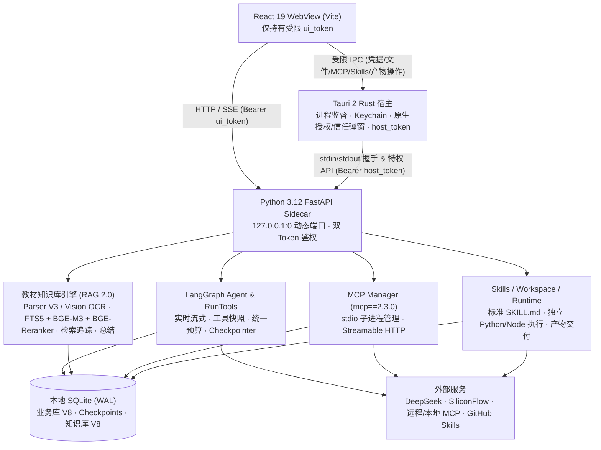

# KnowledgeAgent

<p align="center">
  <strong>面向 macOS Apple Silicon 的本地优先 AI Agent 桌面助手</strong><br />
  集成 DeepSeek 实时流式对话、理工科教材知识库（RAG 2.0 + 检索实验室 + 原文级引用溯源）、受控只读本地文件工具、MCP 外部工具生态与 Agent Skills / Workspace / Runtime 真实文件交付能力
</p>

<p align="center">
  
  
  
  
  
  
  
  
</p>

---

## 目录

- [项目简介](#项目简介)
- [核心功能](#核心功能)
- [系统架构与安全边界](#系统架构与安全边界)
- [目录结构](#目录结构)
- [环境要求与开发启动](#环境要求与开发启动)
- [构建 macOS 安装版（.app / .dmg）](#构建-macos-安装版app--dmg)
- [配置指南（模型与 MCP 服务）](#配置指南模型与-mcp-服务)
- [自动化测试](#自动化测试)
- [版本升级与数据迁移](#版本升级与数据迁移)
- [已知限制与注意事项](#已知限制与注意事项)
- [架构与设计文档](#架构与设计文档)

---

## 项目简介

**KnowledgeAgent** 是一款强调**本地优先、权限最小化、来源可追溯**的桌面级 AI Agent 应用，无需 Docker、外部数据库或额外后台服务，安装后即可在本地运行。

系统采用 **Tauri 2（Rust 宿主）+ React 19 / TypeScript（前端界面）+ Python 3.12 FastAPI Sidecar（LangGraph Agent / RAG / MCP 运行时）+ SQLite (WAL)** 三层架构：

- **Rust 宿主**独占进程监督、macOS 原生钥匙串（Keychain）、原生文件/目录授权选择器、原生 MCP 信任确认弹窗与子进程回收；
- **React WebView** 仅持有受限 `ui_token`，绝不接触真实 API Key、宿主特权通道或未授权文件系统路径；
- **Python Sidecar** 绑定本机随机回环端口（`127.0.0.1:0`），通过 stdin/stdout 握手启动并在宿主断开时自动退出，零孤儿进程残留。

---

## 核心功能

### 1. DeepSeek 多轮对话、实时流式输出与安全恢复
- **实时打字机流式输出**：普通对话与工具调用（本地文件 / MCP）后的回复均支持实时 SSE 流式推送（工具会话采用 1-chunk 前瞻流式策略，兼顾工具规划前导过滤与断流重试不重跑工具）。
- **Markdown 与理工科数学公式渲染**：内置安全 Markdown 与 **KaTeX**（行内 `$...$` / 块级 `$$...$$`）及结构化引用角标渲染。
- **幂等与主动取消**：支持同会话 `client_request_id` 幂等防重、随时停止生成；取消或异常的半截草稿不会污染正式消息历史。
- **LangGraph Checkpointer 安全基线**：仅在图执行与业务 SQLite 事务同时提交成功后推进 `last_safe_checkpoint_id`，故障或取消自动隔离。

### 2. 理工科教材知识库（RAG 2.0）与全链路检索可观测（`v0.5.0` 重大升级）
- **多选导入与自动后台索引**：支持单选/多选批量导入 **PDF、DOCX、Markdown**（单文件 $\le 100\text{ MiB}$），导入后由后台 `IndexWorker` 自动完成解析、分块、BM25 与 BGE-M3 向量化；支持一次性全局云端向量授权、知识库真实状态总览与「一键补全索引 / 重建待升级索引」（已完整教材跳过、未变化切片自动复用 Embedding 缓存）。
- **混合检索 + 语义精排 + 双语扩展**：自然语言拆词 BM25（FTS5）+ SiliconFlow `BAAI/bge-m3`（1024 维）余弦召回 + RRF 融合 + **`BAAI/bge-reranker-v2-m3`** 精排；支持中英文轻量查询改写与跨语言术语优先扩展、References 软降权与按需相邻 Chunk 上下文扩展；向量或精排不可用时自动优雅降级并明确展示原因。
- **PDF 解析 V3、Chunk V2 与全文/章节总结**：内置 macOS 原生 Vision OCR（扫描书与稀疏扫描插页局部 OCR）、页眉/页脚抑制、英文断行连字符合并、`CMMI`/`CMSY` 数学与希腊符号恢复、词句边界对齐切片（消除英文断词）；新增 **`book_summary` 全文与章节总结策略**，按章节结构覆盖并输出已覆盖/跳过范围。
- **RAG 检索实验室、聊天检索追踪与 Chunk 浏览器**：
  - **检索实验室**：直接复用生产检索链路（支持 BM25 / Vector / Hybrid / Hybrid+Reranker、Top-K、候选数、相似度阈值、双语改写开关），关闭 LLM 改写时完全独立于 DeepSeek 运行；
  - **聊天检索过程卡片**：每轮 RAG 问答上方提供可折叠检索轨迹卡片（持久化至 SQLite V8 `run_retrieval_traces`，支持重启回看与失败留痕）；
  - **Chunk 原文浏览器**：按页码/章节/关键词浏览切片原文、字符数、向量状态、解析警告、相邻切片并一键打开原 PDF。

### 3. MCP 外部工具生态（`mcp==2.3.0`）
- **双传输协议**：同时支持本地 **stdio** 与远程 **Streamable HTTP** 协议。
- **可视化管理与一键导入**：支持表单配置及标准 `mcpServers` JSON 粘贴预览与批量导入。
- **分层安全信任模型**：
  - 新增/修改/导入的 MCP 服务默认停用且未信任，必须经 **macOS 原生信任弹窗**确认后方可连接；
  - 发现的工具默认拒绝，按工具粒度单独授权，工具定义变更自动失效重审；
  - 敏感环境变量与请求头隔离存入独立 macOS Keychain 服务，前端绝不回显明文；
  - 跨轮历史外发保护：当会话涉及本地文件授权或教材 RAG 内容时，开启外部 MCP 默认触发显式外发风险确认；
  - 统一工具调用预算、超时控制、中途取消与退出零残留进程清理。
- **自动重连与状态同步**：应用重启后自动在后台重连已启用且已信任的 MCP 服务，前端侧栏徽章与聊天区开关自动同步；面板同时提供「全部连接」一键操作。

### 4. 受控只读本地文件工具
- 通过 macOS 原生文件/目录选择器按会话登记临时授权（应用重启即失效，可随时撤销）。
- 提供 `list_files`（目录发现、分页、过滤隐藏项与软链）与 `read_text`（分段读取、UTF-8/GBK 兼容、严格大小限制），底层使用 macOS `O_NOFOLLOW_ANY` 防软链逃逸与 TOCTOU 攻击。

### 5. Agent Skills、会话工作空间（Workspace）与独立运行环境（Runtime）（`v0.4.0` 新增）
- **兼容标准 `SKILL.md` 与渐进式加载**：支持 Agent Skills 开放标准（YAML frontmatter + `scripts/`、`references/`、`assets/`），默认仅向模型披露已启用技能摘要，命中任务后再通过 `load_skill` 与 `read_skill_file` 按需加载。
- **开箱即用内置技能**：
  - `mind-map`：生成可编辑 Mermaid 源文件（`.mmd`）并渲染为高清中文 `.png` 与 `.svg` 矢量图，支持聊天内联预览与基于历史 `.mmd` 连续修改；
  - `word-formatting`：按用户要求调整 `.docx` 标题、中西文字体、字号、行距、段间距、首行缩进、页边距与表格样式（原生支持全 `Normal` 样式真实中文文档的段落索引映射），自动回读校验正文无损后交付新版本。
- **第三方 GitHub / 本地 / ZIP 技能导入**：支持公开 GitHub 仓库根 URL（如 `https://github.com/anthropics/skills`）、子目录 URL、本地文件夹与 ZIP 压缩包预览、选择性安装、依赖自动检测与一键准备、版本更新与删除（已实测导入并执行 `anthropics/skills` 中的 `xlsx` 技能生成含公式与条件格式的真实 Excel 工作簿）。
- **会话级持久化工作空间与产物交付**：支持多文件导入与原生拖拽导入附件（自动保存原件副本不覆盖源文件）；每轮任务拥有独立 `work/`、`output/` 工作目录，通过 `publish_artifact` 原子发布至版本化 `artifacts/`，支持图片内联 Blob 预览、系统打开、Finder 定位、另存为、跨轮引用继续编辑及重启恢复。
- **独立执行 Runtime 与执行稳定性保障**：脚本在 `<app_data_dir>/runtime/`（独立 Python `venv` 与 `npm-tools`）中执行，自动探测本机 `uv`、`node`、`git` 与 `Google Chrome`（兼容 Finder 极简 `PATH`），绝不污染后端 Sidecar；集中预算控制（Skills 单轮总上限 100 次 / Skills 子预算 80 次 / `recursion_limit=250` / 1800s 超时）、可恢复工具失败自动修正、临时网络/限流最多 3 次退避重试（不重复执行已完成工具）及单次 8192-token 输出截断自动恢复。

---

## 系统架构与安全边界



**核心安全不变量**：
1. `host_token` 仅存在于 Rust 宿主与 Sidecar 内存之间，永不进入前端、日志或数据库。
2. API Key 与 MCP 密钥采用单向提交至宿主 Keychain，Sidecar 崩溃重启后由宿主自动回灌内存。
3. 第三方工具描述、文件内容、网页正文均视为不可信外部数据，无法提升权限或修改系统配置。

---

## 目录结构

```text
.
├── desktop/                          # Tauri 2 Rust 宿主与 macOS 打包脚本
│   ├── src/                          # Sidecar 监督、Keychain、文件授权、MCP 宿主 IPC 与进程清理
│   ├── packaging/
│   │   ├── build-macos.sh            # Apple Silicon onedir/onefile .app & .dmg 构建脚本
│   │   ├── sidecar_entry.py          # 独立 PyInstaller 入口（隔离 app/mcp 与官方 mcp SDK）
│   │   ├── onedir.json / onefile.json
│   │   └── INSTALL-GUIDE.txt         # 安装与升级说明
│   ├── tauri.conf.json
│   └── Cargo.toml
├── frontend/                         # React 19 + TypeScript + Vite 前端
│   ├── src/
│   │   ├── App.tsx                   # 侧栏导航、连接状态、MCP 摘要自动同步
│   │   ├── Chat.tsx                  # 流式对话、工具卡片、RAG 范围控制、外发确认、引用展示
│   │   ├── LibraryPanel.tsx          # 教材导入、后台索引监控、本地检索面板
│   │   ├── McpPanel.tsx              # MCP 服务管理、JSON 导入预览、信任与逐工具授权、全部连接
│   │   ├── MarkdownAnswer.tsx        # Markdown + KaTeX 公式 + 引用角标渲染
│   │   └── api/                      # apiClient、SSE 解析器、Tauri IPC 封装
│   └── package.json
├── backend/                          # Python 3.12 FastAPI Sidecar 后端
│   ├── app/
│   │   ├── agent/                    # LangGraph 问答、实时流式工具图（tool_graph.py）
│   │   ├── api/                      # 对话、授权、教材库、索引任务、检索、MCP 路由
│   │   ├── mcp/                      # MCP 2.3.0 客户端、安全策略、Schema 适配、管理器
│   │   ├── models/                   # DeepSeek & SiliconFlow 适配器
│   │   ├── parsing/ & chunking/      # PDF/DOCX/MD 解析与章节感知分块
│   │   ├── services/                 # RunService、Library、IndexWorker、HybridRetrieval、Citation、MCP
│   │   ├── storage/                  # SQLite 业务库（Schema V6）、Checkpoints、知识库存储
│   │   └── tools/                    # 统一工具注册中心与安全文件工具
│   ├── tests/                        # 400 项 pytest 自动化测试
│   └── pyproject.toml
├── mcp-servers.json                  # 已验证的 5 个 MCP 服务导入配置（导入前请核对本地路径）
├── 架构.md                           # 系统主体架构设计（v0.3）
├── 接口.md                           # API / SSE / IPC 接口契约（v0.2）
├── 开发路线与验收.md                 # P0–P8 里程碑与验收状态（v0.4）
├── KnowledgeAgent_RAG_Architecture_v0.2.md
├── KnowledgeAgent_MCP_Architecture_v0.2.md
└── 项目进度与缺陷分析及后续开发计划.md
```

---

## 环境要求与开发启动

### 运行与构建环境
- **操作系统**：macOS（Apple Silicon `arm64`，macOS 11.0+）
- **Python**：3.12 + [`uv`](https://docs.astral.sh/uv/)
- **Node.js**：20+ + [`pnpm`](https://pnpm.io/)
- **Rust**：稳定版 toolchain（`cargo` / `rustc`）

### 安装依赖并启动开发版

```sh
# 1. 安装前端锁定依赖
pnpm --dir frontend install --frozen-lockfile

# 2. 同步后端 Python 3.12 锁定虚拟环境
uv sync --project backend --python 3.12 --locked

# 3. 启动 Tauri 桌面开发版（自动拉起 Vite 与 Python Sidecar）
(cd desktop && ../frontend/node_modules/.bin/tauri dev)
```

> 若本机已有正在运行的已安装版 KnowledgeAgent，开发调试时建议先退出正式版，或使用隔离的 Tauri `identifier` 与数据目录避免数据库锁竞争。

---

## 构建 macOS 安装版（`.app` / `.dmg`）

打包脚本使用独立的 PyInstaller 构建虚拟环境，将 Python 3.12 运行时及 `mcp==2.3.0`、`anyio`、`jsonschema_specifications`、`certifi` 等全部后端依赖随应用一起打入 `KnowledgeAgent.app`（`onedir` 模式）：

```sh
pnpm --dir frontend install --frozen-lockfile
./desktop/packaging/build-macos.sh onedir
```

构建产物位置：
- **桌面应用包**：`desktop/target/packaging/apps/onedir/KnowledgeAgent.app`（约 129 MB）
- **安装镜像**：
  - `desktop/target/aarch64-apple-darwin/release/bundle/dmg/KnowledgeAgent_0.5.0_aarch64.dmg`（约 73 MB）
  - `desktop/target/packaging/dmg/KnowledgeAgent_0.5.0_aarch64-test.dmg`（约 73 MB，同镜像副本）

> 当前打包脚本采用个人使用版 **ad-hoc 签名**（`signingIdentity: "-"`），未进行 Apple Developer ID 商业签名与 Apple 公证。首次打开如遇系统拦截，可右键 `KnowledgeAgent.app` 选择「打开」，或在「系统设置 → 隐私与安全性」中点击「仍要打开」。

---

## 配置指南（模型、Agent Skills 与 MCP 服务）

### 1. 配置模型 API Key
在应用左下角设置面板输入并保存：
- **DeepSeek API Key**：用于对话与自主工具调用，默认模型可通过环境变量 `KNOWLEDGEAGENT_DEEPSEEK_MODEL` 覆盖。
- **SiliconFlow API Key**（可选）：用于教材知识库 `BAAI/bge-m3` 向量索引与混合检索；不配置时教材库仍可使用纯本地 FTS5 关键词检索。

两个凭据分别保存在独立的 macOS 钥匙串条目中，应用重启或 Sidecar 异常恢复后自动重新注入内存。

### 2. 使用 Agent Skills 与导入 GitHub 技能
- 打开左侧 **「🧩 Skills」** 页面，查看本机独立运行环境状态（自动探测 `uv`、`Node.js`、`Git`、`Google Chrome`），点击 **「准备基础依赖」** 即可一键初始化独立 Python 虚拟环境（`python-docx`）与 `Mermaid CLI`。
- **导入 GitHub 第三方技能**：在「导入第三方技能」输入框粘贴公开 GitHub 仓库或子目录 URL（例如 `https://github.com/anthropics/skills`），点击 **「获取技能列表」** → 勾选所需技能（如 `xlsx`）→ **「安装并启用」** → 若提示缺少依赖点击 **「安装依赖」** 即可。同样支持「导入本地文件夹」与「导入 ZIP」。
- **在聊天中使用**：点击输入框工具栏 **「📎 附件」** 或直接将本地文档拖拽进聊天窗口导入工作空间，保持 **「🧩 Skills」** 为开启（自动匹配或手动指定），即可执行排版、思维导图、表格生成与基于历史产物的连续修改。

### 2. 接入推荐的 5 个真实 MCP 服务（无需新增付费 API Key）

以下 5 个服务（共 **27 个工具**）已在 `mcp==2.3.0` 与真实 DeepSeek 自主工具调用中完成实机共存验证：

| 服务名 | 传输方式 | 核心能力 | 工具数 | 费用 / 凭据 |
|---|---|---|---:|---|
| **Exa** | Streamable HTTP (`https://mcp.exa.ai/mcp`) | 联网实时搜索与网页正文提取 | 2 | 免费匿名可用 |
| **MCP Fetch** | 本地 stdio (`mcp-server-fetch`) | 网页 Markdown 正文抓取 | 1 | 开源免费，无需 Key |
| **arXiv** | 本地 stdio (`arxiv-mcp-server`) | 学术论文检索、下载与全文阅读 | 19 | 开源免费，无需 Key |
| **Context7** | Streamable HTTP (`https://mcp.context7.com/mcp`) | 开源框架与技术库最新文档查询 | 2 | 免费匿名可用 |
| **DeepWiki** | Streamable HTTP (`https://mcp.deepwiki.com/mcp`) | GitHub 公开仓库架构分析与问答 | 3 | 免费匿名可用 |

#### 安装本地 stdio 工具（非随 `.app` 打包）
`mcp-server-fetch` 与 `arxiv-mcp-server` 属于本机独立安装的外部 CLI 工具，**不包含在 `KnowledgeAgent.app` 安装包中**。在新设备上使用前请先安装：

```sh
uv tool install mcp-server-fetch
uv tool install arxiv-mcp-server
# 查看实际可执行文件绝对路径
which mcp-server-fetch arxiv-mcp-server
```

#### 导入 JSON 配置
打开左侧 **「MCP 服务 → 导入 JSON」**，粘贴如下配置（或修改仓库根目录的 [mcp-servers.json](mcp-servers.json)，将 `<YOUR_HOME>` 替换为你的本机用户目录，例如 `/Users/yourname`）：

```json
{
  "mcpServers": {
    "exa": {
      "type": "streamable-http",
      "url": "https://mcp.exa.ai/mcp",
      "allow_private_network": true
    },
    "mcp-fetch": {
      "command": "<YOUR_HOME>/.local/bin/mcp-server-fetch",
      "args": ["--allow-private-ips"]
    },
    "arxiv": {
      "command": "<YOUR_HOME>/.local/bin/arxiv-mcp-server",
      "args": []
    },
    "context7": {
      "type": "streamable-http",
      "url": "https://mcp.context7.com/mcp",
      "allow_private_network": true
    },
    "deepwiki": {
      "type": "streamable-http",
      "url": "https://mcp.deepwiki.com/mcp",
      "allow_private_network": true
    }
  }
}
```

> **代理环境提示**：若本机使用 TUN / Fake-IP 透明代理（解析出 `198.18.0.0/15` 等保留地址），请保留远程服务的 `"allow_private_network": true` 及 `mcp-fetch` 的 `"--allow-private-ips"` 参数；直连网络环境可按需关闭。

导入后，依次完成各服务的 **「信任并启用」（确认 macOS 原生弹窗）→「连接」→ 勾选所需工具授权**。此后每次打开软件都会自动重连，并在聊天框勾选 MCP 开关即可由 Agent 自主调用。

---

## 自动化测试

```sh
# 后端全量测试与字节码检查（433 passed，含 RAG 2.0 / Skills / MCP / Workspace 回归）
(cd backend && uv run --locked pytest && uv run --locked python -m compileall -q app tests)

# 前端类型检查、单元测试与生产构建（42 passed）
pnpm --dir frontend exec tsc --noEmit
pnpm --dir frontend test
pnpm --dir frontend build

# Rust 宿主格式、单元测试与发布检查（26 passed）
(cd desktop && cargo fmt --check && cargo test --locked)
(cd desktop && cargo check --locked --release --features custom-protocol)
```

---

## 版本升级与数据迁移

应用数据默认保存在：
```text
~/Library/Application Support/local.knowledgeagent.desktop/
```

从旧版本（如 `v0.4.0`，业务库 V7 / 知识库 V7）升级至 `v0.5.0`（业务库 V8 / 知识库 V8）时：
1. 完全退出正在运行的旧版应用（菜单栏 `KnowledgeAgent → 退出` 或 `Cmd+Q`）；
2. 强烈建议先备份数据目录（V7 → V8 为单向架构升级）：
   ```sh
   cp -R "$HOME/Library/Application Support/local.knowledgeagent.desktop" \
     "$HOME/Library/Application Support/local.knowledgeagent.desktop.backup-$(date +%Y%m%d-%H%M%S)"
   ```
3. 打开新版 `KnowledgeAgent_0.5.0_aarch64.dmg`，将 `KnowledgeAgent.app` 拖入 `/Applications/` 覆盖旧版后启动：
   - 业务数据库自动执行 V7 → V8 迁移（新增 `run_retrieval_traces` 表），知识库数据库自动执行 V7 → V8 迁移（新增 `knowledge_settings` 表）；
   - 完整保留全部历史会话与消息、全部教材原件、已建立的 BM25 与向量索引、历史引用、MCP 服务配置与授权、已安装 Skills、Workspace 与历史 Artifact；
   - **不会删除已有索引或强制重新向量化全部教材**：旧版解析/切片索引升级后保持可直接检索，并在教材列表显示「待升级」状态，可由用户按需点击「一键补全索引」或「重建待升级索引」升级（未变化切片自动复用 Embedding 缓存）；
4. 因个人版为 ad-hoc 签名，覆盖更新后首次启动若弹出 macOS 钥匙串授权框，点击「始终允许」即可自动恢复已保存的 DeepSeek / SiliconFlow API Key 与 MCP 密钥。

---

## 已知限制与注意事项

- **平台与签名**：当前仅面向 macOS Apple Silicon；个人版采用 ad-hoc 签名、未接入 Apple Developer 公证（Notarization），首次覆盖更新可能弹出钥匙串访问确认或需在「隐私与安全性」中点击「仍要打开」。
- **Runtime 执行模型与依赖**：Skills 的 Python / Shell / Node.js 执行继承本机当前用户权限（非 Docker/VM 沙箱）；独立 Python 依赖与 Mermaid CLI 按需在线安装，首次安装需本机具备 `uv`、`node`/`npm` 与 Chrome/Chromium（系统级依赖不随 `.app` 内置）。
- **可选重型文档校验工具**：第三方 `xlsx` 技能自带的可选 `recalc.py` 公式重算脚本依赖 LibreOffice（`soffice`）；若本机未安装 LibreOffice，Excel 文件的生成、样式、条件格式与公式写入仍完全可用，仅跳过 LibreOffice 静态重算校验。
- **DeepWiki 大仓库整库读取**：对超大型 GitHub 仓库直接调用 `read_wiki_contents` 可能触发 2 MiB 响应体积上限（`MCP_RESPONSE_TOO_LARGE`），推荐让 Agent 优先调用 `read_wiki_structure` + `ask_wiki_question`；高频突发调用偶发上游流中断，正常对话节奏下稳定。
- **Exa 免费端点限流**：匿名免费端点在短时间高频请求下可能触发限流，如需更高配额可在服务设置中添加自定义 Header/API Key。
- **外部 stdio 工具独立分发**：`mcp-server-fetch` 与 `arxiv-mcp-server` 需在本机通过 `uv tool install` 单独安装，不随 `.app` 分发。

---

## 架构与设计文档

- [系统架构设计（v0.5）](架构.md)
- [API / SSE / IPC 接口契约（v0.2）](接口.md)
- [开发路线与阶段验收标准（v0.6）](开发路线与验收.md)
- [教材知识库 RAG 架构方案（v0.2）](KnowledgeAgent_RAG_Architecture_v0.2.md)
- [RAG 2.0 专项架构与检索优化方案（v0.1 · 已交付 v0.5.0）](KnowledgeAgent_RAG_2.0_Architecture_v0.1.md)
- [MCP 集成架构与安全方案（v0.2）](KnowledgeAgent_MCP_Architecture_v0.2.md)
- [Workspace、Runtime 与 Agent Skills 架构方案（v0.1 + 第16节修订）](KnowledgeAgent_Skills_Architecture_v0.1.md)
- [项目进度、缺陷分析与后续开发计划](项目进度与缺陷分析及后续开发计划.md)
