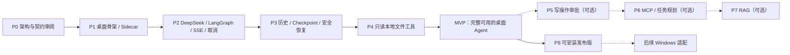

# KnowledgeAgent — 开发路线与验收标准

> 文档版本：v0.3（与架构 v0.3、接口契约 v0.2 对齐；P1/P2 落地细节修订）  
> 日期：2026-11-22  
> 项目：**本地优先的通用 AI Agent 桌面助手**，macOS Apple Silicon 优先，后续支持 Windows  
> 当前状态：**设计阶段，尚未开始编写项目代码**  
> 上位约束：[`ARCHITECTURE.md` v0.3](./ARCHITECTURE.md)、[`CONTRACTS.md` v0.2](./CONTRACTS.md)

## 0. 本文怎么使用

这份文档回答四个问题：**先做什么、它依赖什么、怎样证明真的做成了、什么情况下禁止进入下一阶段**。

- `ARCHITECTURE.md` 管**技术架构与信任边界**；`CONTRACTS.md` 管**协议和数据语义**；本文管**顺序、交付物和验收**。
- 本文不授权 Codex 一次性实现全项目。一次只领取一个**子里程碑**，做完、验收通过、记录结果，再领取下一项。
- **已设计 ≠ 已开发 ≠ 已验证**。本文的项目目前全部是计划状态；示例命令、预期结果不构成已通过的证明。
- 组件内的实现细节可以演进；破坏 API/SSE/权限/持久化契约，必须先写兼容性影响、迁移方案，经确认再修改。
- 不为“架构完整”提前创建空模块、占位 API 或虚假的成功结果。没有实现的功能不暴露，或明确返回 `501 NOT_IMPLEMENTED`。

### 0.1 统一验收结论

| 标记 | 含义 | 能否进入下一子里程碑 |
|---|---|---|
| `PASS` | 有真实命令、输入、输出或截图/日志证据，核心路径及关键失败场景通过 | 可以 |
| `PARTIAL` | 核心路径有效，但仍有明确未完成或未验证部分 | 非阻塞项可以记录后继续；阻塞项不可 |
| `FAIL` | 真实复现了不符合契约的行为 | 不可以（阻塞项） |
| `NOT_TESTED` | 尚无实际验证证据 | 核心功能不可视为通过 |

**全阶段阻塞条件：** 鉴权绕过、密钥或未授权文件泄露、危险工具无审批、同会话 run 状态混乱、正式消息和 Checkpoint 安全基线不一致、崩溃后长期遗留 Sidecar、重复执行有副作用操作、关键错误被伪装成成功。

### 0.2 版本与交付纪律

1. 先读三份文档及本阶段相关源码，列出**本次目标、现有依赖、预计修改文件、接口影响、数据迁移影响**。
2. 实现范围仅限当前子里程碑；优先新增适配器、服务、工具，尽量不修改已验收的 API 和状态机。
3. Codex 可以运行必要的构建与验证命令，但不能自动提交 Git、删除用户数据、改动真实凭据或擅自开发下一阶段。
4. 阶段结束必须提供**可复现验收报告**，不能只说“代码已完成”；保留失败案例和未决事项。
5. 建议每个子里程碑验收后由用户主动创建 Git commit，以便回滚；不强制公开仓库。

---

## 1. 全局依赖与里程碑地图



**两个交付点：**

- **MVP 功能闭环在 P4 完成**：桌面窗口 + DeepSeek 多轮对话 + 安全只读文件工具 + 历史持久化 + 可停止生成。
- **可交付的 macOS 安装包在 P8 完成**：P8 可以紧接 P4 实施；P5、P6、P7 是能力增强，不是发布 MVP 的前置条件。未来新增能力不得要求推翻 MVP 架构。

| 阶段 | 新增核心能力 | 依赖 | 交付门槛 |
|---|---|---|---|
| P0 | 三份文档一致性、工程决策记录 | 无 | 架构与契约可执行、风险已列出 |
| P1 | Tauri + React + FastAPI + 受控 Sidecar | P0 | 真正 `.app` 原型，动态端口、双 Token、异常退出通过 |
| P2 | 模型适配器、LangGraph、SSE、运行与取消 | P1 | 真实 DeepSeek 对话；SSE 心跳/跨 chunk、取消、冲突优先级与单向密钥提交通过 |
| P3 | SQLite 会话与 Checkpointer、安全基线 | P2 | 重启恢复、刷新后活动 run/历史终态可查、Checkpoint 对账通过 |
| P4 | Tauri 原生授权、`list_files` + `read_text`、Tool Calling | P3 | 授权目录发现文件→读取完整闭环；越权/大文件/软链接拒绝 |
| P5 | 写操作审批与恢复（可选） | P4 | 审批暂停首流结束、决策新流恢复；拒绝零副作用、重复审批不重复写入 |
| P6 | MCP、受控多步任务（可选） | P4 或 P5（涉及写操作必须先 P5） | 工具可插拔、预算和权限可控 |
| P7 | RAG 知识库（可选） | P4 | 来源可追溯，入库重启可检索，作为工具接入 |
| P8 | 可安装发布版、Keychain、升级和诊断 | P4；若增强功能要随首发则同时依赖对应阶段 | 干净 Mac 无开发环境可运行，签名/升级路径验证 |

---

## 2. P0：设计冻结与 Codex 工作约束

**目标：不写业务代码，确认三个文档没有冲突。**

### P0.1 校准设计文档

- 确认 `ARCHITECTURE.md` v0.3 的职责边界不变：Tauri 管宿主权限和生命周期，React 管展示，FastAPI 管 API，应用服务管理 run，LangGraph 管执行，SQLite 管业务及 Checkpoint（逻辑上分开）。
- 确认 `CONTRACTS.md` v0.2 的标识与协议：`session_id / run_id / client_request_id / tool_call_id`、`/api/v1`、`ui_token / host_token`、SSE JSON v1、取消和最终状态；核对重复请求优先级、授权发现、刷新恢复和审批续流。
- 把尚待原型验证的内容列为“**实现决策待验证**”，特别是 stdin EOF、socket 交接、Sidecar 打包、LangGraph `checkpoint_id` 恢复。
- **固定 P1 脚手架约定**：顶层目录为 `desktop/`（Tauri 2 Rust 宿主与配置）、`frontend/`（React/TypeScript + Vite）、`backend/`（Python 3.12 + FastAPI）；Python 使用 `uv + pyproject.toml`，前端使用 `pnpm + Vite`；后端基础测试用 `pytest + httpx`，前端基础测试用 `Vitest`。这些是实现期统一约定，不需要现在安装或创建空测试。
- 记录初期功能边界：**只读 TXT/Markdown**，无任意命令执行、无浏览器自动化、无默认写权限；RAG/MCP/Neo4j 不在 MVP。

**交付物：** 三份文档互相引用正确；未定技术细节有验证阶段；无互相矛盾的“已实现”陈述。

**验收：** 用户和 Codex 能清晰回答：谁有 Keychain 权限？React 能否新增目录授权？Agent 如何列出授权目录的文件？断流是否取消任务？刷新后如何查找活动 run 和失败状态？审批暂停后如何续流？失败后使用哪个 Checkpoint？若答案与契约冲突，P0 未通过。

---

## 3. P1：桌面骨架与 Sidecar 生命周期（必须尽早验证）

**目标：用户打开真实 Tauri 桌面窗口，宿主能安全启动、识别和关闭本地 FastAPI。此阶段不接大模型。**

### P1.1 最小三层通信

- 建立 `desktop/`（Tauri 2 宿主）、`frontend/`（React + TypeScript）、`backend/`（Python 3.12 + FastAPI）的最小真实文件；不要提前创建空的 `rag/` 等模块。`desktop/` 直接存放 Tauri 配置与 Rust 代码，**不要**生成 `frontend/src-tauri/`；若 `tauri.conf.json` 直接位于 `desktop/`，其 `frontendDist` 按该配置文件位置设为 `../frontend/dist`，`devUrl` 指向真实的 Vite 开发地址（以实际构建验证为准）。
- 固定 Python `uv + pyproject.toml`、前端 `pnpm + Vite`；添加最小 `pytest + httpx` API 鉴权测试和 `Vitest` 基础前端测试，不提前创建无用途的测试工程。
- FastAPI 提供受 `ui_token` 保护的 `GET /api/v1/status`，React 通过唯一 `apiClient` 展示 `starting_sidecar / connecting_backend / ready / connection_error`。
- **P1.1 即采用最终形态的连接获取边界**：开发期由 **Tauri Rust 宿主在运行时**读取显式的本地开发配置 `base_url + ui_token`（`host_token` 仅供宿主 / 后端开发认证使用）；Rust 暴露受限 IPC `get_backend_connection`，只返回 `base_url + ui_token` 给 React。React 的 `apiClient` 只能通过该 IPC 获取连接，不允许将 Token 塞入 `VITE_*`、前端构建产物、localStorage 或 URL。P1.2 仅替换 Rust 内部连接来源为 Sidecar 握手结果，**不重写 React 的 apiClient**。
- 开发期允许独立启动后端，但必须显式注入**两套测试凭证**，并让宿主开发配置中的 `ui_token` 与后端配置匹配；发布模式缺凭证直接启动失败或拒绝请求。不得用编译期 `env!` / `option_env!` 将开发密钥嵌入客户端二进制。

**验收：** 真正的 Tauri 窗口能通过 `get_backend_connection → apiClient → FastAPI` 显示后端状态；无/错 `ui_token` 为 `401`，错误信任等级不能越权；后端停机可见错误并可重试；没有前端 `VITE_*` Token、硬编码密钥或“开发模式跳过认证”路径；后端/前端最小测试及构建结果有实际证据。

### P1.2 启动握手与权限隔离

- Tauri 每次启动生成独立的 `ui_token` 与 `host_token`，`host_token` 不进入 React、URL、日志或数据库。
- 原型验证 Python 绑定 `127.0.0.1:0` 的动态端口，再通过明确的就绪帧报告实际端口；stdout 只用于结构化握手。
- 宿主检查 Sidecar 就绪，受限 IPC `get_backend_connection` 仅提供 `base_url + ui_token`；**对 React 保持 P1.1 的 IPC 返回结构不变**，只将 Rust 内部连接来源从开发配置切换为握手帧；宿主特权接口只接受 `host_token`。
- 将“每次完成新 Sidecar 握手并通过 `GET /api/v1/_host/ready` 后运行宿主重新配置钩子”纳入生命周期设计；P1 暂无模型凭据，仅验证钩子时序和异常重启场景。P2.1 再接入模型密钥回灌。
- 正常关闭、宿主强制退出和 Sidecar 自身崩溃须分别有处理策略；不得粗暴清理“占用端口的任意进程”。

**验收：** 不带/错 Token 失败；`ui_token` 请求 `/_host/*` 被拒绝；`host_token` 不能冒用普通 UI 身份；强制退出后无长期遗留的本应用 Sidecar；端口不固定也能连通；Sidecar 重启时 Rust 更新连接信息但 React `apiClient` 无需改造，宿主重新配置钩子能在 ready 后触发。

### P1.3 真实打包风险原型

- **路线 A：** 实测 PyInstaller `--onedir` + Tauri `bundle.resources` 分发目录，验证资源查找、`_internal`、可执行权限、依赖加载。
- **路线 B：** 实测单文件可执行方案（如 PyInstaller `--onefile`）+ Tauri `externalBin`，验证平台命名、依赖加载、启动与关闭。
- 对比至少：构建产物布局、启动体验、运行错误、可执行权限、打包依赖；记录后续签名/公证风险。
- **两条候选都要实际尝试并记录**，但不要求两条都成功；至少确认一条可在真实 `.app` 原型中工作，才能选择后续发布路线。正式签名、公证、安装升级放在 P8。

**验收：** 不是只运行 `tauri dev`；至少一个真实 `.app` 能自动拉起 Python、成功握手、健康检查、正常/异常退出；测试结论与实际日志一致。

### P1 文件修改边界

可以修改桌面入口、Tauri Rust 宿主、受限 IPC、前端 `apiClient`、后端启动与鉴权模块及构建脚本。**不得**加入 RAG、Agent、持久会话、通用“任意特权 HTTP 代理”或临时关闭鉴权的开关。

---

## 4. P2：模型对话、LangGraph、SSE 与基础取消

**目标：真正调用 DeepSeek，在 Tauri 中流式聊天；一轮运行有独立身份、终态和主动取消。**

### P2.1 模型通道与最小 LangGraph Agent

- 引入可替换模型适配器；先支持一个 DeepSeek 聊天模型。具体模型 ID、接口兼容参数接入时验证，不把模型名散落在业务代码里。
- 宿主通过 `host_token` 向 Python 注入**内存中的** API Key；开发期 `.env` 可作为明确的本地凭据来源，不提供给 React。发布版 Keychain 的完整闭环在 P8 验收。
- **Sidecar 重新启动后的密钥回灌**：每次握手成功且宿主用 `host_token` 验证 `GET /api/v1/_host/ready` 后，若宿主已持有该供应商凭据（开发期宿主内存；发布版 Keychain 读取），自动调用 `PUT /api/v1/_host/model-credentials/{provider}` 重新注入新 Python 进程；仅完成回灌才向 UI 报告该模型已配置。回灌失败显示安全错误和未配置状态，绝不把 Key 通过 React、普通业务 API 或日志重新传送。
- P2 同时验证密钥的**单向提交边界**：React 设置页可以用临时密码输入框接收明文，调用专用 Tauri IPC（如 `save_provider_credential`）交给宿主处理；提交后清空输入值及临时引用，不进入 React 全局状态、localStorage、日志或普通 HTTP API。开发阶段可以仅注入宿主内存凭据；P8 才验收 Keychain 持久保存与重启读取。不得为此增加任意宿主命令代理或绕开双 Token。
- 建立 LangGraph 最小 Agent（暂时零工具），通过应用服务统一调用；Agent 不直接生成 HTTP 响应、不修改 React 状态。
- 明确 API 入口、Prompt / 消息构造、模型调用、流事件映射和异常归一化。

**验收：** 真实 API 提问得到可用回答；配置缺失返回 `MODEL_NOT_CONFIGURED`，上游失败/超时不表现为正常完成；日志不含 Key。React 输入的 Key 只能单向交给 Tauri 宿主，提交后表单清空；后端只获取受保护宿主通道注入的凭据；**模拟 Sidecar 崩溃/重启，验证 ready 后再次注入宿主已保存的 Key，并能恢复模型调用**；P2 不假称已完成发布版 Keychain 持久化。

### P2.2 最小业务 SQLite、SSE 与前端状态

- **必须先建库，再做 SSE / 幂等**：先实现最小业务 SQLite（`sessions / runs / messages` 必需字段、状态枚举、事务与同会话 `client_request_id` 唯一约束），从第一次建库就开启 WAL、`busy_timeout` 和 Schema 版本号。`run_completed` 关联的正式 `message_id` 必须由数据库事务真实提交产生，不能由内存对象伪造。P3 才补齐完整历史 API、LangGraph Checkpointer 与崩溃安全基线。
- 统一 `POST /api/v1/sessions/{session_id}/runs/stream`；React 使用 `fetch + ReadableStream` 消费 SSE。按**完整 `data: ...\n\n` 帧**解析，不能假定一个网络 chunk 就是一条事件；支持 `\n` / `\r\n`、跨 chunk 缓冲、以 `:` 开头的注释行；如 `: keepalive\n\n` 必须被忽略，不能当作错误 JSON 或业务事件。
- 先发 `run_started`；再发 `message_delta`（MVP 只用 `channel=text`）；终态严格三选一：`run_completed / run_cancelled / error`。
- 按 `session_id + run_id` 隔离草稿与状态；切换会话时，旧 run 的流不得写入新会话。
- `client_request_id` 在同一会话唯一，由数据库约束和事务保证；**先判定 `(session_id, client_request_id)` 重复，再判定其他活动 run**。重复 ID（包括旧 run 仍活动时）必须返回 `409 DUPLICATE_CLIENT_REQUEST` 且 `error.run_id` 为原 run，不新建也不重执行；仅新 ID 遇已有活动 run 时返回 `409 RUN_ALREADY_ACTIVE`。鉴权、输入校验和冲突检查应在 SSE 响应头发出前完成。

**验收：** SQLite 表、WAL、`busy_timeout`、版本号及唯一索引确实存在；正常完成时 `message_id` 与正式消息可查。正常流顺序可观察；错误在头部发送后使用 `error` 事件；前端中途切换会话不串消息；拆成多个网络 chunk 的 JSON 帧仍能重组，混入 `: keepalive` 心跳不会触发解析错误或 UI 状态迁移；**使用真实 SQLite 并发提交测试**重复 ID 与新 ID 的两类 409，分别验证错误码、`error.run_id` 和“没有重复执行”。

### P2.3 基础取消、断流对账与运行恢复边界

**前置依赖：** P2.2 已建立最小业务 SQLite 和幂等唯一约束。本子阶段只实现主动取消、竞态收口、断流查询及重启识别，**不得退回内存模拟 run 状态，或重新创建一套运行记录**。P3 继续完成完整会话历史、LangGraph Checkpointer、恢复和迁移测试。

- 实现 `GET /api/v1/runs/{run_id}`、`GET /api/v1/runs/lookup?session_id=...&client_request_id=...`、`POST /api/v1/runs/{run_id}/cancel`；run 生命周期归应用服务，而非 SSE 生成器。
- `AbortController` 仅结束前端流消费；用户点击停止时必须发后端取消并确认业务终态。断网/断流**不能自动取消，也不能自动重试执行**。
- 取消或失败的 assistant 草稿不写入正式消息；`completed` 必须在同一业务事务中提交正式消息与 run 终态，才允许发送 `run_completed`。
- 超时/取消/模型错误分别映射为可查询状态；采用受控任务注册与清理，确保没有无限悬挂的任务。

**验收：** 正常完成后从 SQLite 可查正式 assistant 消息；取消后没有正式半截回复；取消接口幂等；同会话 409；丢失首事件可按 `client_request_id` 定位 run；断开 SSE 后仍可查询 run；重启时未完成 run 至少能识别并标记异常，深度对账在 P3。

### P2 文件修改边界

可新增 `models/`、`agent/`、`services/`、最小 `storage/`、聊天 API、SSE parser 和前端 UI。**不得**在 Agent 内硬编码 HTTP/SSE、在 React 内调用 DeepSeek 或把内部 `reasoning_content` 默认发送给前端；不得提前实现写文件工具或 RAG。

---

## 5. P3：多轮对话、Checkpointer、SQLite 安全恢复

**目标：重启后历史可见、Agent 能记住已提交对话；失败或取消不污染下一轮状态。**

### P3.1 业务记录与历史

- 完善 SQLite 业务模型和会话列表/历史 API；正式消息和 run 终态由业务 SQLite 提供，UI 不直接读取 LangGraph Checkpoint。
- 实现 `GET /api/v1/sessions`：每个会话返回可空的 `active_run_id`、`active_run_status`（运行中/待审批/取消中等）；实现 `GET /api/v1/sessions/{session_id}/messages` 返回已提交消息并关联 `run_id`；实现 `GET /api/v1/sessions/{session_id}/runs` 返回分页 run 摘要（`run_id`、`user_message_id`、`status`、`error_code`、时间戳、`next_cursor`）。避免 UI 为每条消息都调用一次 `GET /runs/{run_id}`。
- WebView 刷新后，先由会话列表找回活动 run，再并行查询当前会话消息和 run 摘要并按 `run_id`/`user_message_id` 合并显示失败或取消；必要时查询活动 run 详情与 `pending_approval`（P5 才实现审批）。允许有限频率轮询，但**不自动重发任务、不声称可重放丢失的 SSE 草稿**。
- 保留 `session_id`、`run_id`、`client_request_id` 及消息归属关系；实现明确的数据库迁移，不删除现有数据重建。
- 初始化并验证 WAL、等待锁超时和短事务；不要跨模型网络请求持有 SQLite 写事务。
- 日志保存在应用数据目录，宿主和 Python 分别记录但用 `request_id/run_id` 关联，按需轮转、脱敏。

**验收：** 多会话历史重启后保留；历史只包含已正式提交消息；旧库结构能迁移；多并发读写下不出现长期 `database is locked` 或静默丢数据。专门模拟 WebView 刷新丢失 React 内存中的 `run_id`：`GET /sessions` 可找回活动 ID，`messages + runs` 能将取消/失败及错误码关联到用户问题，且不会重复发起 run 或将已丢失的草稿伪装为正式回答。

### P3.2 LangGraph Checkpointer

- 引入持久化 Checkpointer（建议业务库与 Checkpoint 文件分离）。`thread_id` 与 `session_id` 的映射固定，`run_id` 表示一次运行，不可混用。
- 会话记录维护 `last_safe_checkpoint_id`，run 维护 `base_checkpoint_id`、`final_checkpoint_id` 逻辑字段。
- 只有**图执行成功且业务事务提交成功**才推进安全基线；失败或取消不推进。
- 下一轮从上一安全基线继续/分叉，**不无条件使用最新 Checkpoint**；没有安全基线的初始会话从空状态开始。

### P3.3 专门的故障恢复实验

必须对所使用版本的 LangGraph 做原型，不凭文档猜测：

1. 构造包含 `tool_calls` 但尚无 `ToolMessage` 的中间状态（可使用测试用虚拟工具，不提前开放生产文件工具）。
2. 在此处模拟取消/异常，确认新一轮不会沿用残缺 Tool Calling 历史造成模型 400。
3. 模拟“Checkpoint 已写入，业务正式消息尚未提交”后崩溃：重启对账不得自动标记为完成，也不能自动重做有副作用的工作。
4. 重复恢复、重复发送、并发取消，不得使同一 run 出现两个不同终态。

**P3 阶段验收：** 多轮 Agent 上下文只包含成功提交的历史；故障隔离、从安全基线恢复、对账均有可复现证据。若某版本 LangGraph 的 `checkpoint_id` 分叉行为与设计不一致，应先提出局部兼容方案并修订实现决策，不可改成“继续最新快照”绕过问题。

### P3 文件修改边界

允许扩展 `storage/`、`services/`、`agent/` 的状态适配层及历史 UI。**不得**改变已有 SSE 事件含义、放弃双 Token、让前端直接解析 LangGraph 内部状态或将本地 SQLite 偷换为必须独立部署的 MySQL/Redis。

---

## 6. P4：安全只读文件工具（MVP 功能闭环）

**目标：Agent 可以在用户明确授权后，真正调用 Python 工具读取 TXT/Markdown，并给出有依据的回答。**

### P4.1 宿主授权与撤销

- 用户在 Tauri **原生文件/目录选择器**中选择资源；宿主经 `host_token` 登记会话级 grant，React 只能查看授权列表，不能提交任意绝对路径扩权。
- grant 关联 `session_id` 和本次应用进程；重启即失效，撤销后不得继续进行新的读取。
- 宿主 IPC 白名单只允许明确的文件选择/撤销操作，不提供 React 可调用的任意宿主管理请求代理。

### P4.2 工具注册与执行

- 建立统一工具注册/执行接口。Agent 生成 `tool_name + arguments`，工具系统负责参数校验、权限、执行、结构化返回；模型意图本身**不授予权限**。
- 每轮执行前，应用服务读取当前 `session_id` 与本次应用实例的有效授权，将 `{grant_id, scope, display_name, operations}` 作为**不含绝对路径**的可信授权元数据注入 Agent 运行上下文；撤权后工具调用时再次查验。模型不能自造 `grant_id`。
- 实现 `list_files`（仅目录授权）：模型传 `grant_id`、可选 `relative_dir`、`offset`、`limit`；默认 `offset=0`、`limit=50`、最大 `100`，只列当前相对目录中的 `.txt`、`.md` 和普通子目录，按稳定顺序分页，不递归全盘。过滤隐藏项、软链接和越权路径，返回相对路径/类型及 `has_more`、`next_offset`；不能返回绝对路径或正文，并约束目录项数量、工具调用次数和结果字符预算。
- 实现 `read_text`：目录授权时模型传 `grant_id + relative_path`（可先用 `list_files` 发现）；单文件授权时 `relative_path` 必须为空；`offset_line`、`limit_lines` 控制分段读取，绝对路径由后端可信 grant 计算。
- 文件限制按契约执行：TXT/MD、UTF-8 优先/GBK 兜底、默认 200 行、最多 500 行、单次最多 20,000 字符、源文件字节上限首版建议 1 MiB；拒绝二进制及未知文件。
- 路径先规范化并按真实路径父子关系验证；对 `../`、软链接逃逸和 TOCTOU 设计专项验证，必要时缩小可支持的目录类型。
- 工具完整内容按预算提供给 Agent，前端只展示 `tool_started/tool_completed/tool_failed` 的**脱敏摘要**，不默认推送完整文件正文。

### P4.3 端到端演示与验收

**必须演示两条路径：** ① 单文件：选择 TXT/MD → 授权当前会话 → Agent 使用 `read_text`（`relative_path` 为空）→ 有依据地回答；② 授权目录：选择包含 `chapter1.md` 的目录 → Agent 获得不含绝对路径的授权元数据 → `list_files` 找到该相对路径 → `read_text` 读取 → 有依据地回答。两者都要验证关闭重开后授权失效、历史仍在。

**必须拒绝：** 未授权路径、React 伪造授权请求、`../` 路径穿越、目录内软链接跳转到未授权敏感位置、超大文件、二进制文件；`list_files` 必须过滤隐藏项、软链接、不支持扩展名，验证目录分页、非递归行为、输出预算；工具失败应返回安全错误，不在日志泄露原文。撤销授权时的并发读取行为要有明确策略和实际测试结果。

### P4 文件修改边界

只增加原生选择器、授权服务、权限校验、工具注册和只读工具。**不得**顺手实现写文件、任意 Shell 命令、浏览器自动化、全盘扫描或 MCP 扩展。

**MVP 通过标志：** P1—P4 全部阻塞性验收 PASS，用户能够不借助终端完成“聊天 → 授权文件 → Agent 读取 → 回答 → 查看历史 → 停止生成”。此时只是**开发环境内可用 MVP**；可安装发布版还需 P8。

---

## 7. P5：文件写入与人工审批（可选增强）

**目标：在 P4 安全能力上增加严格受控的文件写操作。**

- 先设计允许的写操作白名单和最小权限，不做任意 Shell。
- Agent 提出操作后先持久化 LangGraph 中断 Checkpoint、`approvals` 和 `run.status=awaiting_approval`，**之后**发送含 `approval_id`、`tool_call_id`、`operation_digest` 和安全操作摘要的 `approval_required`；发送后**正常结束当前 SSE 响应**，但不发 `run_completed`/`run_cancelled`/`error`，run 仍是活动状态。
- 用户在前端明确同意或拒绝；在 WebView 刷新后应能用 `GET /api/v1/runs/{run_id}` 的 `pending_approval` 重建待审批 UI，不依赖旧 React 内存。
- 审批决定使用 `POST /api/v1/runs/{run_id}/approvals/{approval_id}/decision`（`decision` + `operation_digest`），后端在响应头发出前以事务校验并原子认领 `run/session/grant/摘要`。成功返回**新的 SSE**，首个业务事件为 `run_resumed`，仍沿用原 `run_id`；之后才执行获批准操作或把拒绝结果交给 Agent。
- 已处理的审批返回 `409 APPROVAL_ALREADY_RESOLVED`，无效状态返回 `409 INVALID_RUN_STATE`；断流时先查状态，不自动重复提交决定。审批 API 的去重**不能代替**写工具副作用幂等，需对工具重复调用和崩溃恢复单独防重。
- 区分取消“等待审批”与取消“已经开始有副作用的操作”；不能承诺网络取消会撤销已写文件。

**验收：** 首流 `run_started → approval_required → EOF` 且 `run=awaiting_approval`，无终态事件；批准/拒绝时新流以 `run_resumed` 开始并最终正确终止；审批等待时刷新 UI 能恢复 `pending_approval`；拒绝后零副作用；未授权即使同意也不得写；重复批准至多执行一次；关闭重启后的审批状态一致；取消与错误有确定的审计结果。

**修改边界：** 扩展权限/工具/审批服务，不修改前端旧 SSE 事件语义；不直接把本地文件写权限交给模型客户端。

---

## 8. P6：MCP 与受控多步骤任务（可选增强）

**目标：新工具接入不需要重写 Agent 主循环。**

- 将外部 MCP 工具适配成内部工具描述、参数校验、执行结果；工具注册中心仍是统一权限入口。
- 规定工具来源、用户授权、超时、调用总次数、返回字符预算和错误映射；默认不信任第三方工具内容和描述。
- 增加受控多步骤任务：任务拆分、执行、失败处理、进度事件；循环次数、时间/Token 预算必须有上界。
- 只读 MCP 能先接；涉及写入或不可逆外部动作时，必须先完成 P5 的审批/幂等保障，再针对该工具增加权限规则。

**验收：** 至少接入一个真实、低风险 MCP 工具并完成调用；禁用或移除该工具后，现有对话/文件工具仍可正常工作；超限和失败能够终止任务，不无限循环。

---

## 9. P7：RAG 知识库（可选增强）

**目标：把“检索资料”作为 Agent 的新增能力，而不是替换原有工具系统。**

- 文件/文档解析与分段、Embedding、向量存储/检索接口分层；首版可选轻量本地向量库，不直接依赖 Neo4j/MySQL/Redis。
- 检索结果必须携带来源标识，做内容长度/Token 预算控制；不能让文档中的提示注入改变工具权限或系统指令。
- 先完成基础向量 RAG 的上传—入库—检索—回答，再逐步选配 BM25/混合检索、RRF、Reranker、Planner 与可答性评估。
- 通过独立 `search_knowledge` 工具暴露给 Agent，既有 API、SSE 和 `read_text` 工具不必改变协议。
- 允许后续考虑长期记忆/知识图谱，但必须证明实际需求；不为扩展而提前安装重型服务。

**验收：** 真实资料入库，重启后可检索；问题能召回正确片段并提供可追溯来源；检索失败有清晰降级，不伪造资料；高级检索在同一固定问题集上做质量与延迟对照，不虚构提升百分比。

---

## 10. P8：macOS 正式可安装版（MVP 后可直接执行）

**目标：用户无需 Python、Node、Docker 或终端操作，安装后即可使用。**

- 以 P1 验证成功的打包路线为基础整合完整 Sidecar；再次检查 Python 依赖、资源目录、权限、冷启动和退出。
- macOS 的 Keychain 由 Tauri 宿主独占读写，发布版不使用 `.env` 持久化 API Key；前端只显示配置状态，不拿到真实密钥。验收 React 临时密码框 → 专用单向 Tauri IPC → Keychain → 宿主特权注入 Sidecar 内存的闭环，以及重启读取、删除/轮换凭据与日志脱敏。
- 数据目录在系统应用数据目录，包含业务库、Checkpoint 库、必要缓存与 `logs/`；软件更新不覆盖用户数据，数据库迁移可回滚或安全失败。
- 复核 P2.1 已实现的 **Sidecar 每次重启后凭据重新注入**，正式版改用宿主从 Keychain 提取密钥，再经 `host_token` 通道回灌；模拟 Sidecar 重启、凭据不存在与凭据轮换，不能把旧进程内存视为可靠持久源。
- 统一错误报告、日志脱敏/轮转与“打开日志目录”入口；不上传私有日志或文件内容，除非用户另行明确同意。
- 真实签名/公证及 Gatekeeper 行为按预期发行方式验证；未做的不要宣称已完成。后续 Windows 使用独立构建、凭据存储和验收清单。

**发布验收：** 在没有开发工具的干净 macOS Apple Silicon 环境完成安装、启动、模型配置、聊天、Stop、授权 TXT/MD、重启历史恢复、正常退出、Force Quit 后恢复、版本升级保留数据；对双 Token/宿主权限做最终检查。未完成签名或公证时，清楚标注构建是开发/测试包。

---

## 11. 每个阶段必须交付的证据

Codex 每个子里程碑结束时，按以下格式反馈，不接受只有“实现好了”的描述：

```markdown
### 本轮：P?.? — 子里程碑名称
- 状态：PASS / PARTIAL / FAIL / NOT_TESTED
- 实现范围：本次实现了什么；明确没有实现什么
- 新增/修改文件：按文件列出用途
- 调用链：UI / API / 应用服务 / Agent / 工具 / 存储如何流转
- 契约影响：API、SSE、Token、状态、数据库有无变化；若有，附兼容说明
- 实际验证：运行命令、输入数据、输出/HTTP 状态、日志或截图（脱敏）
- 异常验证：至少一个本阶段真实关键失败案例
- 遗留问题：严重程度、复现办法、是否阻塞下一步
- 下一步建议：只建议，不自行开发
```

### 11.1 阶段验收总表（初始均未执行）

| 阶段 | 当前状态 | 本阶段关键证据 |
|---|---|---|
| P0 | NOT_TESTED | 三份设计文档一致性审阅 |
| P1 | NOT_TESTED | 真正 `.app` 握手、双 Token、异常退出、打包实验 |
| P2 | NOT_TESTED | DeepSeek 真实流、SSE 心跳/分帧、`DUPLICATE_CLIENT_REQUEST` 与 `RUN_ALREADY_ACTIVE`、取消、最小 SQLite、密钥单向提交 |
| P3 | NOT_TESTED | 多轮与历史、刷新后 `active_run_id` + 消息/run 摘要恢复、Checkpoint 安全基线、崩溃对账 |
| P4 | NOT_TESTED | 原生授权、`list_files` 目录发现与 `read_text`、路径越权/软链接/分页/大小限制 |
| P5 | NOT_TESTED | `approval_required` 首流 EOF、`run_resumed` 续流、刷新待审批、拒绝/重放/取消/幂等 |
| P6 | NOT_TESTED | MCP 接入、工具权限与预算 |
| P7 | NOT_TESTED | 文档入库/检索/引用与评测 |
| P8 | NOT_TESTED | 干净 Mac 安装、Keychain、迁移、签名/发行检查 |

### 11.2 不阻塞与必须阻塞的区别

**通常可记录后继续：** UI 视觉细节、非核心提示语、无安全影响的代码整理、未来插件的功能未实现、未声称实现的高级性能目标。

**必须先修复：** 未授权的文件或密钥访问、发布代码含认证绕过、SSE 错误被报成功、run 完成/失败/取消竞态导致矛盾终态、重复执行写操作、丢失已提交历史、复用不安全 Checkpoint、发布版 Sidecar 长期残留或安装不可用。

---

## 12. Codex 开发前的固定提示词

将以下内容作为每次下达具体功能任务的前置约束，不要直接让 Codex“从头生成整个 Agent 桌面软件”。

> 先阅读 `docs/ARCHITECTURE.md`、`docs/CONTRACTS.md`、`docs/ROADMAP.md`，确定当前处于 P? 的哪个子里程碑。本次只实现我明确指定的子里程碑。开始编码前，先列出：目标、涉及文件、依赖、数据流、与 API/SSE/权限/SQLite 契约的关系，以及可能影响已验收功能的风险。禁止擅自改变架构边界、绕过双 Token/文件授权、泄露真实密钥、创建虚假成功接口、重写已验收模块、自动提交 Git 或自动进入下一阶段。完成后依据 ROADMAP 的验收清单真实验证，并按第 11 节格式输出结果。若发现现有约定无法安全实现，先报告技术证据和最小变更方案，不得自行放宽要求。

### 开始开发的第一条任务（仅在 P0 审阅通过后发送）

> **执行 P1.1**：先阅读上述三份设计文档；固定 `desktop/`（直接放 Tauri 2 Rust 与配置，不创建 `frontend/src-tauri/`）、`frontend/`（React/TypeScript/Vite）和 `backend/`（Python 3.12/FastAPI），技术工具固定 `uv + pyproject.toml`、`pnpm`、`pytest + httpx`、`Vitest`。只实现最小骨架、`GET /api/v1/status` 及双 Token 校验。**开发期 Tauri Rust 宿主在运行时读取 `base_url + ui_token` 并通过受限 `get_backend_connection` IPC 交给 React 的唯一 `apiClient`**；前端不得读取 `VITE_*` 中的 Token，宿主不得向前端交付 `host_token`。`tauri.conf.json` 路径和 `frontendDist`/`devUrl` 须与三层目录匹配并实际验证。此阶段暂不实现真实 Sidecar 动态握手与打包（P1.2/P1.3），不得加入 Agent、RAG 或数据库。运行桌面窗口、认证、后端和前端测试并输出真实验收证据；完成后停止。

---

## 13. 变更控制与技术决策记录

若 Codex 提议“大规模推翻旧代码”，先填写：

| 问题 | 必须说明 |
|---|---|
| 原设计是什么 | 对应文档章节、已实现接口、已有测试 |
| 为什么无法增量扩展 | 具体失败证据，而不是“这样写更好” |
| 最小可行变更 | 首选适配器、兼容层、数据库迁移 |
| 破坏性影响 | 哪些 API/SSE/状态/数据/安全边界会变化 |
| 回滚方案 | 如何回到最近一个已验收版本 |
| 是否需批准 | 破坏主体信任边界、运行终态或存储语义必须先获确认 |

**冻结边界不是冻结所有代码**：允许内部重构和依赖升级，但必须提供不破坏既有契约的证据。原型证明不可实现时，可以用技术决策记录（ADR）更正具体方案，不能悄悄放松安全要求。

## 14. 修订记录

- **v0.3（2026-11-22）**：修订 P1/P2 衔接细节：P1.1 开发模式也由 Rust 宿主的 `get_backend_connection` IPC 下发 `base_url + ui_token`，不得用前端 `VITE_*` 注入；固定 `desktop/`/`frontend/`/`backend/`、`uv + pyproject.toml`、`pnpm`、`pytest + httpx`、`Vitest`；P2.2 开头前移最小 SQLite 与唯一约束，使幂等/并发验收建立在真实事务上；P2.3 专注取消、断流与恢复；P1.2 预留 Sidecar 每次 ready 后的宿主重配置钩子，P2.1 执行 API Key 安全回灌，P8 验证 Keychain 版本。同步修改第一条 Codex 任务约束。**主体架构、契约 v0.2 和 P0–P8 阶段顺序保持不变；项目仍未编码。**
- **v0.2（2026-11-22）**：同步 `CONTRACTS.md` v0.2 的 P2–P5 落地与验收：P2 重复 `client_request_id` 优先级、独立 409 错误码、SSE `: keepalive`/跨 chunk 解码及 API Key 单向宿主提交；P3 刷新后活动 run、消息与 run 历史状态合并；P4 会话授权元数据注入、目录 `list_files` 与 `read_text` 闭环；P5 `approval_required` 首流暂停 EOF、决策接口 `run_resumed` 新流及重复审批防护；P8 增加 Keychain 端到端验证。保留 P0–P8 既有依赖与阶段顺序，未开始编码。
- **v0.1（2026-11-22）**：依据主体架构 v0.3 与契约 v0.1，制定 P0–P8 开发顺序、MVP 交付节点、范围边界和真实验收要求；明确 P2 必须有最小业务 SQLite 提交，P3 完成 LangGraph Checkpoint 安全基线；P8 可在 P4 后直接进行，不依赖全部可选扩展。
