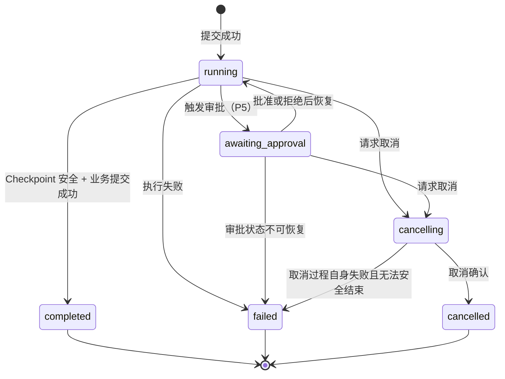

# KnowledgeAgent — 跨模块接口与数据契约

> **文档版本：v0.2（接口契约冻结基线；实现仍待阶段原型验收）**  
> **依据：`ARCHITECTURE.md` v0.3（主体架构冻结基线）**  
> **日期：2026-11-22**  
> **状态：尚未编码；契约已完成设计审阅并作为编码基线，具体机制仍需按阶段验证。**

## 0. 本文的作用与约束范围

本文件只规定**跨组件沟通时不能随意改变的内容**：Tauri 宿主与 Python Sidecar 的握手、双 Token 权限、HTTP API、SSE 事件、Agent/工具协议、运行状态与持久化边界。具体类名、函数写法、UI 组件布局、ORM 选型细节和模型 SDK 版本不在本文件中锁死。

优先级：**安全边界与数据一致性原则（`ARCHITECTURE.md` v0.3） > 本文件的具体契约 > 具体实现代码**。发现冲突，先修改设计并记录原因，禁止让 Codex 静默修改接口。本文列出的后续阶段 API 是**预留契约**，不能因为写在这里就提前实现。

### 0.1 术语和标识

| 名称 | 含义 | 生成与使用规则 |
|---|---|---|
| `instance_id` | 本次桌面应用启动实例 | Sidecar 启动时生成；重启变化；仅用于诊断，不作为认证依据 |
| `session_id` | 一个聊天会话 | 服务端生成 UUID 字符串；重启后仍保持 |
| `thread_id` | LangGraph 线程标识 | 应用层与 `session_id` 建立稳定映射；MVP 可直接相同，不暴露 LangGraph 内部格式给 UI |
| `run_id` | 用户一次提交触发的一轮执行 | 服务端生成 UUID；每轮不同；用于状态、取消、SSE、审计 |
| `client_request_id` | 前端一次提交的幂等标识 | React 生成 UUID；同一提交重试时不变；用于断流后定位运行 |
| `tool_call_id` | 单次工具调用 | Agent/执行层生成或保留框架 ID；结果、审计、审批使用同一 ID |
| `approval_id` | 一次待审批动作 | 服务端生成、单次有效；只用于后续审批阶段 |
| `grant_id` | 宿主授予的文件权限 | 由后端登记生成，属于某会话与本次应用实例；不能由前端自造 |
| `checkpoint_id` | LangGraph 持久执行快照 ID | 仅应用服务和 Checkpointer 使用；UI 不直接接触 |

所有业务时间戳采用 UTC 的 RFC 3339 字符串（例：`2026-11-22T08:30:00Z`）。所有接口传输使用 UTF-8 JSON；字段使用 `snake_case`。除明确允许 `null` 的字段外，不以省略和 `null` 混用表示两种不同状态。

## 1. 信任边界与双 Token 契约

### 1.1 凭证拥有者与能力

| 通道 | 持有者 | 凭证 | 权限边界 |
|---|---|---|---|
| 宿主私有通道 | Tauri Rust 宿主 ↔ Python Sidecar | `host_token` | 注入/轮换 API Key、授予/撤销文件访问、请求优雅停机、就绪检查 |
| 普通业务通道 | React ↔ Python Sidecar | `ui_token` | 创建/读取会话、发起与取消运行、看运行状态、提交合法审批、查看既有授权的展示信息 |
| 受限 Tauri IPC | React → Tauri Rust 宿主 | 不暴露 `host_token` | 获取 `base_url + ui_token`、打开原生文件选择器、请求安全的宿主界面动作；**不能**执行任意 HTTP 代理或任意系统命令 |

- 两个 Token **每次启动独立生成**，使用足够强的操作系统随机数；生产版不落盘、不出现在 URL、日志、stdout、命令行参数或数据库中。
- 普通业务 API **只接受** `ui_token`；`/api/v1/_host/*` **只接受** `host_token`。不能用“验证任意一个有效 Token”替代权限区分。服务端使用恒定时间比较等适当方式比对 Token。
- HTTP 统一使用 `Authorization: Bearer <token>`。无凭证或凭证无效返回 `401`；有效凭证但信任等级错误返回 `403`（实现可统一对外模糊错误细节，但绝不能放行）。
- 本机 API 仅绑定 `127.0.0.1`，采用动态端口；按打包平台允许的**精确 Origin 列表**限制 CORS、验证 `Host`，禁止 `*` 配合凭证。**CORS/loopback 不构成认证**。
- React 只能把 `ui_token` 放在运行时内存中，不能写入 localStorage、URL、日志、IndexedDB、Crash Report 或导出的诊断包。即使渲染层 XSS 盗取 `ui_token`，也不能扩展文件白名单、读取 API Key 或关闭 Sidecar。
- 开发和测试模式仍执行相同的鉴权与权限校验；仅允许通过显式的本地启动配置/测试夹具提供测试 Token。发布构建不得存在缺失 Token 即免认证的分支。

### 1.2 API Key 的归属

发布版仅由 Tauri 宿主访问 macOS Keychain / 对应平台安全凭据存储。**允许用户在 React 设置页的密码输入框中直接键入 API Key**，但这意味着渲染进程在输入和提交瞬间能够接触明文；不得声称渲染层永远不可能看到密钥。必须尽量缩短暴露时间：使用仅提交时读取的临时表单值，直接调用**专用、单向的 Tauri IPC 命令**（如 `save_provider_credential`，限定允许的 `provider`），提交后立即清空输入框及临时引用；不将明文存入持久存储、全局状态管理、HTTP 业务请求、日志或诊断包。

Rust 宿主收到密钥后写入 Keychain，再通过 `host_token` 专用接口把密钥注入 Python **进程内存**，Python 模型适配器只读取受控的临时凭据。IPC 和宿主 API 都只返回 `configured: true/false` 或脱敏错误，**绝不提供回读明文的接口**。禁止暴露任意宿主请求代理、通用 Keychain 读取或任意系统命令。React 输入时潜在的 XSS 风险仍然存在，需以界面安全约束、内容安全策略和依赖审核降低风险，不能用“提交后清空”替代 XSS 防护。开发版 `.env` 只作为显式开发配置，不作为发布版备用密钥仓库。

## 2. Tauri ↔ Sidecar 启动与关闭协议

### 2.1 启动握手（候选线协议，阶段 1 必须原型验证）

1. Tauri 宿主生成 `ui_token`、`host_token`，定位本应用的数据目录和 Sidecar 可执行文件。
2. 宿主启动 Python 后保持 stdin 管道打开；向其写入一行 JSON 启动帧，**不以命令行参数传 Token**：

```json
{"type":"bootstrap","protocol_version":1,"ui_token":"<runtime-ui-secret>","host_token":"<runtime-host-secret>","app_data_dir":"<system-app-data-path>","parent_pid":12345}
```

3. Python 验证启动帧与目录，绑定系统分配的 `127.0.0.1:0` socket，在 HTTP 服务真正可接受请求后，经 stdout 输出**一行**不含秘密的就绪帧：

```json
{"type":"ready","protocol_version":1,"instance_id":"d2ab1e6d-3f55-485e-bfab-14ece5424c0b","port":54321}
```

4. 宿主检查协议版本、端口范围及子进程存活，再以 `host_token` 调用 `GET /api/v1/_host/ready` 验证，成功后才经受限 IPC 向 React 返回：

```json
{"base_url":"http://127.0.0.1:54321","ui_token":"<runtime-ui-secret>"}
```

5. 若超时、子进程退出、帧无效或健康检查失败：不向 UI 发布可用连接，显示启动失败并允许重试。**stdout 只允许结构化握手帧**；业务日志写 stderr 或系统日志目录。

> `stdin` 传递及持续打开、EOF 可靠性、`127.0.0.1:0` 与 ASGI Server 的 socket 交接均属**待原型验证的实现细节**。验证不通过时可以改实现方式，但不能降低双 Token 与动态端口边界。

### 2.2 运行、关闭与异常退出

- 正常关闭：宿主停止接收新的 UI 操作 → 用 `host_token` 请求 `POST /api/v1/_host/shutdown` → Sidecar 停止接新任务、保存/对账运行状态、关闭数据库及模型客户端 → 宿主等待子进程退出，超时后按平台安全策略终止**自己启动**的子进程。
- 强制退出：Sidecar 监听父进程 stdin EOF；必要时结合父 PID 存活检测。确认宿主已失联后停止监听并退出；不承诺固定的 1 秒期限。
- 不得通过“杀占用某端口的进程”清理旧实例。重启时按 `instance_id`/受控进程归属处理残留。
- Tauri `externalBin` 单文件和 PyInstaller `--onedir + bundle.resources` 是**两条候选发布方案**，都要在真实 `.app` 中验证，不能只因开发模式能运行就验收。

## 3. HTTP 通用格式与错误契约

**Base URL**：由启动握手动态提供；所有业务路由统一前缀 `/api/v1`。所有业务请求经统一 `apiClient`，附 `Authorization`，默认 `Accept: application/json`，JSON 请求附 `Content-Type: application/json`。SSE 请求改用 `Accept: text/event-stream`，前端使用 `fetch + ReadableStream`，**不使用原生 `EventSource`**。

非流式成功响应直接返回类型化 JSON，不强制给每个成功响应再包一层 `data`；错误统一为：

```json
{
  "error": {
    "code": "RUN_ALREADY_ACTIVE",
    "message": "此会话有正在执行的任务",
    "request_id": "e7457183-48f9-4c02-bace-c2ab252736bc",
    "run_id": "8d99b38d-f6c3-4c58-93b9-90aa0e7bf4c4",
    "details": null
  }
}
```

`message` 可展示给用户；`code` 稳定供前端分支判断；`details` 默认不含堆栈、模型原文、授权绝对路径或密钥。`request_id` 用于日志关联。具体业务错误码如下：

| HTTP | 错误码 | 含义 |
|---|---|---|
| 400 | `INVALID_REQUEST` | 请求在业务规则下无效 |
| 401 | `AUTH_REQUIRED` | 缺少或无效的相应通道 Token |
| 403 | `FORBIDDEN` / `FILE_PERMISSION_DENIED` | 信任等级错误、资源越权、文件未授权 |
| 404 | `NOT_FOUND` | 会话、运行或审批不存在；可避免暴露是否存在其他实例资源 |
| 409 | `RUN_ALREADY_ACTIVE` | 同一会话已有进行中或待审批运行 |
| 409 | `DUPLICATE_CLIENT_REQUEST` | 同一会话的 `client_request_id` 已被登记；返回既有 `error.run_id`，不得重新执行 |
| 409 | `INVALID_RUN_STATE` / `APPROVAL_ALREADY_RESOLVED` | 当前状态不允许该操作或审批已处理 |
| 413 | `FILE_TOO_LARGE` | 文件读取超过限制 |
| 422 | `VALIDATION_ERROR` | Pydantic 参数校验失败 |
| 429 | `RATE_LIMITED` | 后续启用限流时使用 |
| 502 | `MODEL_UPSTREAM_ERROR` | 模型供应商失败（安全归一化） |
| 503 | `SIDECAR_NOT_READY` / `MODEL_NOT_CONFIGURED` | 服务或模型暂不可用 |
| 504 | `MODEL_TIMEOUT` | 模型调用超时 |
| 500 | `INTERNAL_ERROR` | 未预期的服务端错误 |

**幂等冲突的判定优先级**：`POST /sessions/{session_id}/runs/stream` 完成身份、会话及请求体合法性校验后，**先检查 `(session_id, client_request_id)` 是否已存在，再检查会话是否有其他活动 run**。若为重复提交，即使旧 run 仍在运行，也统一返回 `409 DUPLICATE_CLIENT_REQUEST`，在既有统一错误结构的顶层 `error.run_id` 填原运行 ID（`details` 不重复塞 `existing_run_id`）；相同请求 ID 携带不同消息也不得创建新 run。若请求 ID 是新的而会话已有活动 run，才返回 `409 RUN_ALREADY_ACTIVE`。唯一约束与状态检查须由数据库事务保障，避免并发竞态。SSE 响应头发送前必须完成这些检查。

**流式异常**：在 HTTP 头已发送后不能依靠更改状态码来表示错误，必须发 `error` 事件、标记 `run=failed`；连接丢失导致 `error` 事件无法送达时，前端用状态查询确认。禁止把失败静默报告为 `run_completed`。

## 4. 普通前端 API（使用 `ui_token`）

表中 **P1 / P2 / P3 / P4 / P5** 分别对应架构第 1/2/3/4/5 阶段；阶段信息是上线门槛，不是要求现在全部实现。

| 阶段 | 方法与路径 | 作用 | 关键规则 |
|---|---|---|---|
| P1 | `GET /api/v1/status` | UI 查询运行状态 | 返回 API/数据库/模型配置的非敏感状态；不能泄露密钥 |
| P2/P3 | `POST /api/v1/sessions` | 新建会话 | 服务端生成 `session_id` |
| P3 | `GET /api/v1/sessions` | 查询会话列表及活动 run 摘要 | 每项含可空 `active_run_id`、`active_run_status`，供重载后恢复运行状态 |
| P3 | `GET /api/v1/sessions/{session_id}/messages` | 获取正式聊天历史 | 以业务 SQLite 为唯一事实源；消息包含 `run_id` 关联字段 |
| P3 | `GET /api/v1/sessions/{session_id}/runs` | 分页查询该会话 run 摘要 | 返回 `run_id`、关联用户消息、状态和 `error_code`；解决历史消息 N+1 查询 |
| P2 | `POST /api/v1/sessions/{session_id}/runs/stream` | 提交一条消息并开始 SSE | 一轮运行生成唯一 `run_id`；同会话冲突返回 409 |
| P2 | `GET /api/v1/runs/{run_id}` | 查询运行状态 | 用于断线、取消后对账 |
| P2 | `GET /api/v1/runs/lookup?session_id=...&client_request_id=...` | 丢失首个 SSE 事件时查找运行 | Query 只传标识，仍必须在请求头携带 `ui_token`；无匹配返回 404 |
| P2 | `POST /api/v1/runs/{run_id}/cancel` | 请求取消 | 幂等；不是单纯关闭 SSE |
| P4 | `GET /api/v1/sessions/{session_id}/grants` | 查看该会话已有授权 | 只读展示，不允许新增/扩大授权 |
| P5 | `POST /api/v1/runs/{run_id}/approvals/{approval_id}/decision` | 审批或拒绝后恢复本轮运行 | 返回新的 SSE 流；必须检查 run、会话、审批与操作摘要是否匹配 |

### 4.1 会话创建与历史

请求：`POST /api/v1/sessions`，正文 `{}` 或 `{"title":"新对话"}`。成功：`201 Created`。

```json
{"session_id":"79bd20a7-4942-4867-9b99-f69159a8c441","title":"新对话","created_at":"2026-11-22T08:30:00Z"}
```

历史接口只返回 `status=committed` 的正式消息（每条含所属 `run_id`）；失败/取消的运行状态另在 `runs` 中体现，不将流式草稿冒充正式 assistant 消息。

**会话列表（P3）**：`GET /api/v1/sessions` 的每项包含 `session_id`、`title`、`updated_at` 和可空的 `active_run_id`、`active_run_status`。示例为一个正在运行的会话；无活动 run 时两个字段均为 `null`：

```json
{"session_id":"79bd20a7-4942-4867-9b99-f69159a8c441","title":"新对话","updated_at":"2026-11-22T08:30:01Z","active_run_id":"8d99b38d-f6c3-4c58-93b9-90aa0e7bf4c4","active_run_status":"running"}
```

**会话运行列表（P3）**：`GET /api/v1/sessions/{session_id}/runs?limit=50&cursor=...` 返回按时间倒序分页的摘要，`limit` 服务端设上限；每条关联 `user_message_id`，使前端能将失败/取消状态贴到对应问题上，不需要对每条消息单独请求 `GET /runs/{run_id}`。使用不透明 `next_cursor`；已完成的 assistant 内容仍只来自消息接口。

```json
{
  "items": [
    {"run_id":"8d99b38d-f6c3-4c58-93b9-90aa0e7bf4c4","session_id":"79bd20a7-4942-4867-9b99-f69159a8c441","user_message_id":"b5d4e5e2-13fb-4501-98ad-6bc9a14e6d20","status":"failed","error_code":"MODEL_TIMEOUT","started_at":"2026-11-22T08:30:01Z","finished_at":"2026-11-22T08:30:05Z"}
  ],
  "next_cursor": null
}
```

### 4.2 发起运行（SSE）

`POST /api/v1/sessions/{session_id}/runs/stream`，请求体：

```json
{
  "client_request_id": "b8b7c8ab-b790-4c17-b52c-1e1e2a87e9e9",
  "message": "请总结我授权的笔记文件"
}
```

- `message`：必填、非空、长度有上限（具体数值在实现时配置，前后端一致）；文件内容不通过此字段上传。
- `client_request_id`：必须有；在同一 `session_id` 下唯一。服务端以 `(session_id, client_request_id)` 幂等登记；重复请求不得创建第二个 run 或重新执行工具，统一返回 `409 DUPLICATE_CLIENT_REQUEST`，复用标准错误字段 `error.run_id` 表示原 run。优先检查重复 ID，再检查其他活动 run，详见第 3 节。
- 校验通过后立即登记 run，响应 `Content-Type: text/event-stream`，尽早发 `run_started`。**HTTP 连接关闭不等于取消 run。** 后台运行生命周期由应用服务管理，不能把 SSE 生成器的取消自动当作任务取消。
- 同一个 `session_id` 只允许一个处于 `running / awaiting_approval / cancelling` 状态的 run；同时提交返回 `409 RUN_ALREADY_ACTIVE`。不同会话可并发。

### 4.3 查询、取消与断流恢复

`GET /api/v1/runs/{run_id}` 最小响应（P5 存在待审批动作时，`pending_approval` 才为对象）：

```json
{
  "run_id":"8d99b38d-f6c3-4c58-93b9-90aa0e7bf4c4",
  "session_id":"79bd20a7-4942-4867-9b99-f69159a8c441",
  "status":"running",
  "started_at":"2026-11-22T08:30:01Z",
  "finished_at":null,
  "error_code":null,
  "pending_approval":null
}
```

- 取消：`POST /api/v1/runs/{run_id}/cancel`。正在运行时返回 `202 Accepted`，`{"run_id":"...","status":"cancelling"}`；已经终态时返回 `200 OK`，`{"run_id":"...","status":"completed|failed|cancelled","already_finished":true}`，不反向改变终态。
- “停止生成”：React 发取消请求 → 后端设置取消意图、尝试中断模型和工具 → 最终 `cancelled`；若发生完成/取消竞态，须以数据库最终状态为准，不得声称一定成功取消。React 可以随后 `AbortController.abort()` 停止本地流消费，但应查询状态以确认后端终态。
- SSE 无断线重放。网络断开后，React 使用 `client_request_id` 查询已有 run，再通过 `GET /runs/{run_id}` 取得状态；不能自动重新提交同一任务造成重复工具调用。运行中切换会话时事件按双 ID 隔离，不往当前其他会话拼接文本。
- **刷新 / WebView 重载恢复（P3）**：启动后读取 `GET /sessions` 得到各会话活动 run；进入会话时**同时**读取 `GET /sessions/{session_id}/messages` 和 `GET /sessions/{session_id}/runs`，以 `run_id` 合并正式消息和失败/取消状态。对 `active_run_id` 再查询 `GET /runs/{run_id}` 获取实时状态及可能的待审批摘要；运行中可有限频率轮询直至终态。若流式草稿因刷新丢失，只展示可查的正式消息及 run 状态，不伪造已丢失的增量，也不自动重放任务。

### 4.4 后续审批 API（P5 才实现）

`POST /api/v1/runs/{run_id}/approvals/{approval_id}/decision`：

```json
{"decision":"approve","operation_digest":"sha256:<server-issued-digest>"}
```

`decision` 仅允许 `approve` 或 `reject`；摘要由服务端生成并在审批事件中展示对应操作，客户端不得自行修改工具目标和参数。重复审批不得再次执行副作用。审批 `approve` **也不能扩大宿主文件授权范围**；未授权写入必须拒绝。`awaiting_approval` 恢复使用专门逻辑，不等同于普通新消息。

**审批的 SSE 生命周期（P5，冻结契约）**：

1. Agent 遇到待审批操作，先将 Checkpoint 中断状态、`approvals` 记录及 `run.status=awaiting_approval` 持久化到可恢复状态；随后向**当前**运行流发送 `approval_required` 事件并**正常关闭该 HTTP SSE 响应**。这是**暂停边界，不是 run 终态**：本次流不发送 `run_completed`、`run_cancelled` 或 `error`，run 仍占用会话活动名额。
2. 前端展示操作摘要。WebView 刷新后通过 `GET /runs/{run_id}` 获取 `pending_approval`：`{approval_id,tool_call_id,operation_digest,summary}`；不得要求 React 在内存中保存唯一的审批信息。此处只给展示与决策必需字段，不暴露文件绝对路径或敏感完整参数。
3. 用户提交上述 `POST .../decision`，服务端**在返回流之前**以事务原子校验并认领有效审批，防止重复决定和重复执行。成功返回 HTTP `200`、`Content-Type: text/event-stream`，开启**新的** SSE 响应；首个业务事件是 `run_resumed`（不是新的 `run_started`），之后继续发送工具 / 文本事件，直至新的审批暂停或本轮终态。前端沿用同一个 SSE 解析器与 `(session_id, run_id)` 事件路由。
4. 已被处理的 `approval_id` 返回 `409 APPROVAL_ALREADY_RESOLVED`；失效状态返回 `409 INVALID_RUN_STATE`。断流后不自动重发审批决定：先查询 run 状态，确认是否已经接受决定。被拒绝的审批同样从中断点恢复，让 Agent 收到拒绝结果，不能把拒绝误当成已执行写操作。
5. 连接断开不等于取消正在恢复的 run。重复操作的**副作用幂等性**仍由工具执行层保证，不能只靠审批 API 的原子判定。

## 5. 宿主特权 API（仅 `host_token`）

| 阶段 | 方法与路径 | 请求 / 返回约定 |
|---|---|---|
| P1 | `GET /api/v1/_host/ready` | HTTP 200 表示当前实例 API 与必要本地存储已经可服务；不代表 DeepSeek 网络可用 |
| P1 | `POST /api/v1/_host/shutdown` | 请求优雅停机；只允许宿主调用 |
| P2 | `PUT /api/v1/_host/model-credentials/{provider}` | 宿主向 Python 内存注入或轮换 API Key；响应仅返回 `configured: true/false` |
| P4 | `POST /api/v1/_host/sessions/{session_id}/grants` | 宿主把原生选择器确认的文件/目录授权交给后端登记 |
| P4 | `DELETE /api/v1/_host/grants/{grant_id}` | 宿主撤销授权；后端立即阻止后续使用 |

模型凭据请求示例（**示意占位符，不要使用真实 Key 写日志或样例**）：

```json
{"api_key":"<secret-delivered-only-by-host>","base_url":"https://api.deepseek.com"}
```

文件授权请求示例：

```json
{
  "scope":"directory",
  "path":"<host-selected-absolute-path>",
  "operations":["read"],
  "lifetime":"application_session"
}
```

成功后返回 `{ "grant_id": "<uuid>", "session_id": "<uuid>", "scope": "directory", "display_name": "Notes", "operations": ["read"] }`。后端自行规范化路径和检查权限。React 不能调用该路由，也不能通过 Tauri 的通用 IPC 代理该路由。

## 6. SSE 事件契约

### 6.1 统一封装

业务事件由一个完整的 `data: <JSON>\n\n` 帧组成；不依赖浏览器原生 `EventSource`，前端使用支持跨 chunk 拼帧的 SSE 解析器。一个 TCP chunk **不一定**等于一条 SSE 事件。

为避免长时间无数据导致连接被中间层断开，后端**允许**定期发送标准 SSE 注释心跳帧（例如每 15–30 秒无业务事件时发送一次；间隔作为可配置实现参数）：

```text
: keepalive

```

心跳**不是业务事件**，不含 `run_id`、不触发 UI 状态迁移，也不计入终态事件数。前端解析器必须：跨 chunk 缓冲、按空行拆帧、忽略以 `:` 开头的注释行、容忍 `\n` 或 `\r\n` 换行，并且只把合法 `data:` JSON 交给事件分发。遇到无 `data:` 的纯注释帧不能报“非法 JSON”。

```text
data: {"version":1,"type":"message_delta","session_id":"79bd20a7-4942-4867-9b99-f69159a8c441","run_id":"8d99b38d-f6c3-4c58-93b9-90aa0e7bf4c4","ts":"2026-11-22T08:30:02Z","data":{"channel":"text","delta":"你好"}}

```

统一 JSON 字段：`version`（数字，初始为 `1`）、`type`（事件类型）、`session_id`、`run_id`、`ts`、`data`（对象）。扩展字段只能**追加可选字段**，不能在同一版本里更改旧字段含义。前端按 `(session_id, run_id)` 路由事件；未知事件类型应安全忽略并留诊断记录，不能导致界面崩溃。

### 6.2 事件类型及 `data` 最小字段

| 事件 `type` | 最小 `data` | 语义 |
|---|---|---|
| `run_started` | `{"client_request_id":"..."}` | 新运行流的第一个业务事件：服务端已登记 `run_id` 并开始执行 |
| `run_resumed` | `{"approval_id":"...","decision":"approve"}` | 审批决策后的**新 SSE 流**首个业务事件；`decision` 也可为 `reject`，沿用原 run |
| `message_delta` | `{"channel":"text","delta":"..."}` | 面向用户的回答文本增量，仅作为**UI 草稿** |
| `tool_started` | `{"tool_call_id":"...","tool_name":"read_text"}` | 工具开始执行，不能当作已成功 |
| `tool_completed` | `{"tool_call_id":"...","summary":"读取了 120 行"}` | 工具执行完毕；仅发送可展示摘要，默认不推完整敏感正文 |
| `tool_failed` | `{"tool_call_id":"...","code":"FILE_PERMISSION_DENIED","message":"文件未授权"}` | 工具失败；Agent 是否继续由执行层决定 |
| `approval_required` | `{"approval_id":"...","tool_call_id":"...","operation_digest":"sha256:...","summary":"..."}` | 审批已持久化；发出后**关闭当前 SSE 连接**，但 `run` 保持 `awaiting_approval`，不是终态 |
| `run_cancelled` | `{"reason":"user_requested"}` | 后端已确认运行转为 `cancelled` |
| `error` | `{"code":"MODEL_TIMEOUT","message":"模型响应超时"}` | 本轮已失败；不得再发完成事件 |
| `run_completed` | `{"message_id":"..."}` | 正式 assistant 消息与 `run=completed` 已成功提交，刷新后可查 |

`message_delta.channel` 的 MVP 允许值只有 `text`。预留 `reasoning` 字段值仅供未来对**明确允许展示的用户可见摘要**做评估；不默认传递原始隐藏推理链或供应商返回的内部 `reasoning_content`。步骤进度以后可添加 `run_progress`，但不能把内部推理当成进度。

事件顺序约定：**新运行流**以 `run_started` 为首个业务事件；**审批恢复流**以 `run_resumed` 为首个业务事件。两者之后均可有多个消息和工具事件。**同一条流最多一个终态事件**（`run_completed`、`run_cancelled`、`error` 三者之一）。若发送 `approval_required` 并暂停，该连接正常结束且**没有终态事件**；后续决策接口开启新流。网络中断时终态事件可能无法送达，状态查询以业务数据库为准。没有 SSE 重放/`Last-Event-ID` 的保证；`: keepalive` 注释帧不改变业务事件顺序。

**审批续流示例（示意）**：首次运行流 `run_started → approval_required → [当前 HTTP 流 EOF]`；用户批准后，决策接口的新流 `run_resumed → tool_started → tool_completed → message_delta* → run_completed → [HTTP 流 EOF]`。只有完整业务提交成功才能产生 `run_completed`。

## 7. Agent / 工具 / 模型内部契约

### 7.1 Agent 执行接口（逻辑协议）

应用服务只通过稳定的 Agent 入口传入 `run_id`、`session_id`、用户消息、基线检查点引用、取消信号及事件回调；Agent 返回执行终态与最终消息，不直接创建 HTTP `StreamingResponse`，也不直接更新 React 状态。Agent 工具循环可以调用 LangGraph，但 LangGraph 专有消息类型应留在 `backend/app/agent/` 内部。

**会话授权元数据注入（P4）**：每轮执行前，应用服务从后端受控授权记录读取**当前 `session_id` 且当前应用实例内有效**的授权，并将 `{grant_id,scope,display_name,operations}` 列表作为运行时上下文或可信工具提示提供给 Agent；**不得**注入宿主绝对路径，也不得让模型自行创建 `grant_id`。模型如需知道某目录的文件名，只能调用 `list_files`；这些元数据和工具返回的文件名仍是资料，不改变后端授权。授权撤销后工具执行前必须再次检查实际授权状态。

模型适配器统一负责供应商 `base_url`、模型 ID、超时/重试、流式模型调用与异常映射。第一家是 DeepSeek，日后更换供应商不应要求修改 API/SSE 或文件工具。**真实 API Key 不作为普通业务 API 参数**。

### 7.2 工具调用协议（逻辑字段）

```json
{
  "tool_call_id":"53f3140f-a3d3-46d0-b890-9396263c9322",
  "tool_name":"read_text",
  "arguments":{"grant_id":"<uuid>","relative_path":"chapter1.md","offset_line":0,"limit_lines":200},
  "run_id":"8d99b38d-f6c3-4c58-93b9-90aa0e7bf4c4",
  "session_id":"79bd20a7-4942-4867-9b99-f69159a8c441"
}
```

执行层必须按顺序检查：工具已注册 → 参数合法 → 工具允许的操作类型 → 授权属于当前 `session_id` 且未撤销 → 目标路径/文件类型/大小符合规则 → 若有副作用则审批和幂等检查 → 执行。模型生成的 `tool_name + arguments` **只是请求意图，不自带权限**。

工具结果逻辑结构：

```json
{
  "tool_call_id":"53f3140f-a3d3-46d0-b890-9396263c9322",
  "ok":true,
  "content":"<bounded-text-returned-to-agent>",
  "display_summary":"已读取 chapter1.md 的前 200 行",
  "truncated":false,
  "error_code":null
}
```

`content` 只发送给 Agent 所需上下文，**不等于** SSE 的 `tool_completed.summary`；后者不能默认包含完整文件正文。工具异常结构化返回 `ok=false` 与稳定 `error_code`，不泄露系统敏感路径或堆栈。

### 7.3 MVP 只读工具边界（P4）

P4 提供两个只读工具：`list_files` 负责**发现目录内允许读取的文件**，`read_text` 负责按行读取文件正文。二者都只能使用宿主生成的 `grant_id`，不接受模型提供的绝对路径。

**`list_files`（仅适用于 `scope: "directory"`）入参示例**：

```json
{"grant_id":"<uuid>","relative_dir":"","offset":0,"limit":50}
```

- `relative_dir` 可选，默认为授权目录根；只允许授权目录内部的相对子目录，不接受绝对路径或 `..` 逃逸。
- `offset` 默认 `0`、`limit` 默认 `50`、最大 `100`；只列出当前目录内可读取的 `.txt`、`.md` 文件及可进入的普通子目录，稳定排序、分页，不递归扫描整棵目录。
- 自动过滤隐藏项、软链接、二进制/不支持的文件类型；逐项遵守授权和真实路径边界。返回最多 `limit` 条，字段如 `relative_path`、`name`、`kind=file|directory`；附 `next_offset`（无下一页为 `null`）和 `has_more`，不返回绝对路径或文件正文。
- 示例返回：

```json
{"items":[{"name":"chapter1.md","relative_path":"chapter1.md","kind":"file"},{"name":"drafts","relative_path":"drafts","kind":"directory"}],"next_offset":null,"has_more":false}
```

- 目录内容可能在分页间变化；`offset` 不代表稳定快照。工具应有可测试的目录项数量、调用次数与输出字符上限，避免无限列表或上下文膨胀。`list_files` 返回的名字不能直接作为越权授权依据，`read_text` 必须独立二次校验。

**`read_text`**：

- 工具 `read_text` 只处理获授权的 TXT/Markdown；文件授权由原生选择器、宿主特权 API 产生，**不能**由模型/前端自报任意绝对路径。
- 对目录授权，模型只传 `grant_id + relative_path`（可先用 `list_files` 发现）；对单文件授权，`relative_path` 必须为空。后端从受控授权记录推导绝对路径。
- 默认 `offset_line=0`、`limit_lines=200`，上限 `limit_lines<=500`；单次返回最多 **20,000 字符**，超限截断并提供 `truncated`、`next_offset_line`。打开前对文件**字节大小**再设置独立上限（首版建议 1 MiB），避免一次读入超大文件。
- UTF-8 优先，GBK 仅作为明确兜底；拒绝二进制、未知格式和越权文件。必须限制 Token 预算，文件内容当作不可信资料，不能当作系统指令。
- 后端使用规范化路径和真实路径包含关系；禁止仅用 `startswith`。不得允许授权目录中的软链接逃逸；TOCTOU 防护应在 P4 通过真实对抗性案例验证，发现难以安全开放的目录场景时应缩小能力而非放宽检查。
- 授权生存期：**当前会话 + 本次应用进程**，重启全部清空，撤销后立即失效。已开始的读取在撤销竞态下如何中断，需在工具实现中提供可测试的取消/重复授权语义。

## 8. Run 状态机、并发和取消

### 8.1 状态定义



终态为 `completed / failed / cancelled`；**一旦终态不得变更为其他终态**。`approval_required` 是暂停边界，先持久化 `awaiting_approval` 后结束当前 SSE 连接，不是终态。只有一个活动 run 可占据同一会话（`running / awaiting_approval / cancelling`），应用服务和数据库必须共同保证（不能只靠前端禁用按钮）。取消、完成可能竞态：用数据库条件更新/事务保证最多一个终态获胜。

### 8.2 业务可见消息原则

- 用户已提交的问题在创建 run 时记录为一条正式 `user` 消息，关联本轮 `run_id`。
- 生成中的 assistant `message_delta` 是前端内存草稿，**不写为正式 assistant 消息**。
- 只有模型/工具流程正常结束、LangGraph 状态确认安全、且业务提交成功后，才写完整 assistant 消息，设置 `completed` 并发送 `run_completed`。
- 失败或取消：正式 assistant 消息不写；UI 根据 run 显示“失败/取消”，避免出现“UI 不记得，但模型状态还记得”的错位。若将来要保存半截回答，需要显式扩展状态和迁移，不可静默改变规则。

### 8.3 断线、切换会话和进程退出

前端丢失 SSE 只是**观察者离线**，不意味着任务自动取消。run 由应用服务的任务管理器负责，取消通过独立 API 提交。切换会话不得把旧 `run_id` 的增量写入新会话。WebView 重载后从会话列表与 run 摘要重建可见状态；不能自动重发消息或审批决定。Sidecar 异常退出后按下节的恢复规则处理未完成 run，不自动重跑有副作用的工具。

## 9. SQLite 与 Checkpoint 的一致性契约

### 9.1 单一事实源

| 数据 | 权威来源 | 是否直接展示给 React |
|---|---|---|
| 会话列表、正式聊天消息、run 终态、工具审计摘要 | **业务 SQLite** | 是，经业务 API |
| LangGraph 节点状态、工具消息、中断恢复点 | **Checkpointer** | 否，应用层转换后展示 |
| 当前会话授权文件/目录白名单 | **后端内存中的宿主授权记录** | 仅可读展示；重启清空 |
| 模型 API Key | **宿主 Keychain**；Sidecar 临时内存副本 | 否 |
| UI 尚未提交的流式草稿 | React 内存 | 当前页面临时显示，刷新不视为正式消息 |

建议分别使用业务数据库文件和 Checkpointer 数据库文件，避免误把两种持久化当作一个事务；最终文件布局由存储模块确定。两个库均启用 SQLite WAL 与合理的 `busy_timeout`，拒绝跨长时间模型调用持有数据库事务。首次建立表结构就配置数据库 Schema 版本和向前迁移；升级失败不得覆盖用户原数据。

### 9.2 运行及安全基线（逻辑字段）

最小业务实体及字段要求：

- `sessions`：`session_id`、`title`、`last_safe_checkpoint_id`（可空）、`created_at`、`updated_at`。
- `runs`：`run_id`、`session_id`、`client_request_id`、`status`、`base_checkpoint_id`（可空）、`final_checkpoint_id`（仅成功时有效）、`started_at`、`finished_at`、`error_code`（可空）。同会话 `client_request_id` 唯一。
- `messages`：`message_id`、`session_id`、`run_id`、`role`（`user|assistant`）、`content`、`created_at`；只保存正式消息。
- `tool_calls`（P4）：`tool_call_id`、`run_id`、`tool_name`、`status`、脱敏的执行摘要、时间戳；不保存完整敏感文件内容。
- `approvals`（P5）：`approval_id`、`run_id`、`tool_call_id`、`operation_digest`、`decision/status`；审批结果不可重复应用。

以上是**逻辑模型**，具体 ORM 类型、外键和索引可以在数据模块首次实现时细化，但必须保证唯一性、关联关系和状态条件更新。

### 9.3 成功提交与失败隔离

1. 创建 run 时，记录 `base_checkpoint_id = sessions.last_safe_checkpoint_id`（初次会话允许 `null`）。
2. Agent 从**这一安全基线**开始；普通新消息**不能无条件采用当前 `thread_id` 的最新检查点**。
3. Agent 运行中 Checkpointer 可能写入多个中间快照。业务表仍只显示已正式提交的消息。
4. 成功结束时，确认最终图状态完整、安全、没有未配对工具调用后获得 `final_checkpoint_id`；在业务 SQLite **同一个事务**中写正式 assistant 消息、设置 `run=completed`、将 `sessions.last_safe_checkpoint_id` 前进到 `final_checkpoint_id`。
5. 失败或取消只把 `run` 转为对应终态，不推进 `last_safe_checkpoint_id`。下一轮由应用服务从前一安全基线继续/分叉；废弃中间快照可留作诊断，不能自动变成对话上下文。
6. 若 Checkpoint 已完成但业务提交前崩溃，重启时不得擅自把 UI 置为完成，也不得自动重跑可能有副作用的工具；需要可识别的对账与人工诊断规则。

> **关键待验证项**：LangGraph 所采用的实际版本，是否以及如何支持指定 `checkpoint_id` 的恢复/分叉、与 `thread_id` 的组合、ToolMessage 配对及中断恢复。P3 必须用“工具调用已写快照但工具结果未写”“用户取消”“Checkpoint 写后业务提交前崩溃”的真实原型验证；失败则在保留安全基线原则下调整实现，**不能直接把最新检查点作为安全状态**。

## 10. 前端状态与展示契约

- `apiClient` 是 React 唯一 HTTP/SSE 入口，持有运行时 `base_url + ui_token`。页面组件不自行拼接认证头、供应商 API 地址或模型密钥。
- 状态至少按 `session_id -> run_id` 隔离；聊天窗口切换时不销毁后台 run，不自动把旧会话事件追加到新会话。刷新后先拉会话 `active_run_id`，再批量获取消息与 run 摘要；审批恢复界面从 `GET /runs/{run_id}` 的 `pending_approval` 重建。
- `run_started` 后显示运行中；审批恢复流的 `run_resumed` 沿用原 run；`message_delta` 更新**草稿**；`tool_*` 展示调用进度；`approval_required` 显示待审批并容许该 SSE 连接正常结束；`run_completed` 后从业务记录确认正式结果；`error`/`run_cancelled` 展示明确终态。
- `Stop Generating` 必须调用取消 API；`AbortController` 仅用于停止读取 SSE 和释放 UI 资源。
- 加载态应区分 `starting_sidecar`、`connecting_backend`、`ready`、`connection_error`；就绪 ≠ 模型配置已完成。密钥设置页允许临时输入明文，仅单向 IPC 提交给宿主；提交后清空，之后只显示已配置/未配置，绝不支持回读原文。
- 默认不显示模型内部隐藏推理链；工具摘要中不显示完整敏感文件正文。

## 11. 跨阶段最小契约验收用例

| 场景 | 必须观察到的结果 | 何时验收 |
|---|---|---|
| 不带 Token / 错 Token 请求业务 API | `401`，无数据泄露 | P1 |
| `ui_token` 调用 `/_host/*` | `403` 或同样安全的拒绝；不能完成特权操作 | P1 |
| `host_token` 用于普通 UI API | 不能冒用 `ui_token` | P1 |
| 强制退出 Tauri 宿主 | Sidecar 能检测失联并安全退出，无长期僵尸进程 | P1 |
| 真实 macOS `.app` 启动 | 动态端口、握手、打包依赖目录、关闭正常 | P1 |
| 模型流式回答 | `run_started → message_delta* → run_completed`，正式回答可查询 | P2/P3 |
| 同会话重复发消息 | 第二个请求 `409 RUN_ALREADY_ACTIVE` | P2 |
| 首事件未收到、连接断开 | 可按 `client_request_id` 找到唯一 run；不重复执行 | P2 |
| 重复提交同一 `client_request_id`（无论原 run 是否活动） | 返回 `409 DUPLICATE_CLIENT_REQUEST`，`error.run_id` 等于原 run；不重复执行 | P2 |
| SSE 心跳注释跨 TCP chunk 到达 | `: keepalive` 被忽略，不当 JSON 解码；业务事件继续正常拼帧 | P2 |
| 点击停止生成 | 发取消 API，最终 `cancelled`，不出现正式半截 assistant 消息 | P2/P3 |
| SSE 流断开但没有取消 | run 状态可查询；不会自动重复运行 | P2 |
| 模型超时/失败 | `error` 或可查询到 `failed`，不误报 `completed` | P2 |
| Checkpoint 已写工具调用，缺少 ToolMessage | 失败后下一轮从安全基线执行，不因残缺历史导致 400 | P3 |
| 进程在写 Checkpoint 与业务提交之间退出 | 重启对账不把半轮误判为已完成 | P3 |
| WebView 重载丢失运行时 ID | 会话列表展示 `active_run_id`；消息 + run 摘要能标注失败/取消；不重复启动 | P3 |
| 普通 UI 请求新增授权目录 | 必须拒绝；只有宿主原生选取能产生 grant | P4 |
| 授权目录的 `../` / 软链接逃逸 | 文件工具拒绝访问授权范围之外的资源 | P4 |
| 未授权、超大、二进制文件 | 结构化安全错误，不把全文写入日志 | P4 |
| 授权目录后让 Agent 发现 `chapter1.md` | 注入安全授权元数据 → `list_files` 发现相对路径 → `read_text` 成功；不出现绝对路径 | P4 |
| `list_files` 遇隐藏文件、软链接、越界目录、超量目录项 | 过滤或拒绝并分页，不暴露文件正文、密钥或越权路径 | P4 |
| 同一审批重复提交 | 写工具至多执行一次，最终状态一致 | P5 |
| 审批暂停并在另一条 SSE 流恢复 | `approval_required` 后首流正常 EOF，run 保持 `awaiting_approval`；决策接口新流以 `run_resumed` 开始 | P5 |
| 审批等待时刷新桌面窗口 | `GET /runs/{run_id}` 能提供 `pending_approval` 摘要，继续审批不依赖旧 React 内存 | P5 |
| 在 React 设置页输入 API Key | 经单向 Tauri IPC 写入宿主 Keychain，表单清空；HTTP 业务 API、日志、持久状态均不出现明文 | P2/P8 |

## 12. Codex 落地约束与变更规则

1. 每次开发前阅读 `docs/ARCHITECTURE.md`、`docs/CONTRACTS.md`、`docs/ROADMAP.md`（存在时），先说明受影响的契约和模块，再改代码。
2. 仅实现当前阶段需要的接口；**未实现的预留接口不得返回“假成功”**。允许返回明确的 `501 NOT_IMPLEMENTED`（或根本不注册路由），不能偷偷调用空实现。
3. 新增组件优先增加 adapter/tool/service，不允许无理由改动已验收的 API、SSE 事件或状态语义。需要破坏性变更必须先给出差异、迁移路径及受影响测试。
4. 真实验证才能标记“通过”；合同字段/错误码必须与前后端、自动化测试保持一致。不要硬编码 API Key、测试绕过、模拟成功的生产分支；不要自动提交 Git。
5. 对密钥、文件授权、run 终态和 Checkpoint 安全基线的验收失败属于阻塞项，不能为赶进度跳过。

## 13. 待原型决定的实现细节（不得凭文档假定已跑通）

- **P1**：Tauri Rust Sidecar 持有 stdin 并检测 EOF 的实际可靠性；不同打包路线下 stdout 握手和动态 socket 交接；macOS 签名/公证与冷启动；精确 WebView Origin/Host 组合。
- **P2**：LangGraph 与 DeepSeek 的流式增量/工具事件映射；取消是否能及时中止底层 HTTP 模型调用；断线后任务存活模式；SSE 心跳与跨 chunk 解析、单向凭据提交 IPC。
- **P3**：指定安全 `checkpoint_id` 的恢复/分叉；业务 SQLite 和 Checkpointer 的异常窗口；检查点保留/清理策略。
- **P4**：受约束文件打开策略，尤其符号链接和 TOCTOU；文件撤权时正在读取的任务如何停止；`list_files` 的分页、隐藏文件/软链接过滤及受限列表开销。
- **P5**：人工审批重复恢复、`approval_required` 首流收尾与 `run_resumed` 续流、写工具幂等键与实际副作用的 exactly-once 近似实现及失败补偿策略。

## 14. 修订记录

- **v0.2（2026-11-22）**：补全会话授权元数据与目录 `list_files`；补齐刷新后活动 run / 历史终态查询；定义审批暂停 SSE 关闭与决策接口续流；规范 `DUPLICATE_CLIENT_REQUEST`、SSE 心跳解析和 API Key 单向输入；补充 P2–P5 验收用例。
- **v0.1（2026-11-22）**：依据 `ARCHITECTURE.md` v0.3，首次固定双 Token、启动握手、API、SSE、run 终态、取消、授权工具与 SQLite/Checkpoint 安全基线；实现细节以阶段原型验收为准。

## 参考

- [`ARCHITECTURE.md` v0.3](./ARCHITECTURE.md)（本项目内部，权威架构基线）
- [Tauri 2：Embedding External Binaries / Sidecar](https://v2.tauri.app/develop/sidecar/)
- [Tauri 2：Embedding Additional Files](https://v2.tauri.app/develop/resources/)
- [LangGraph：Time travel / checkpoint_id](https://docs.langchain.com/oss/python/langgraph/use-time-travel)

---

**后续步骤：** 将本 v0.2 契约同步到现有 `ROADMAP.md` 的 P2（重复请求与 SSE 心跳 / 密钥提交）、P3（刷新后会话运行恢复）、P4（授权目录与 `list_files`）、P5（审批暂停和续流）验收条目。正式编码仍按阶段进行，不得一次实现全部预留 API。
