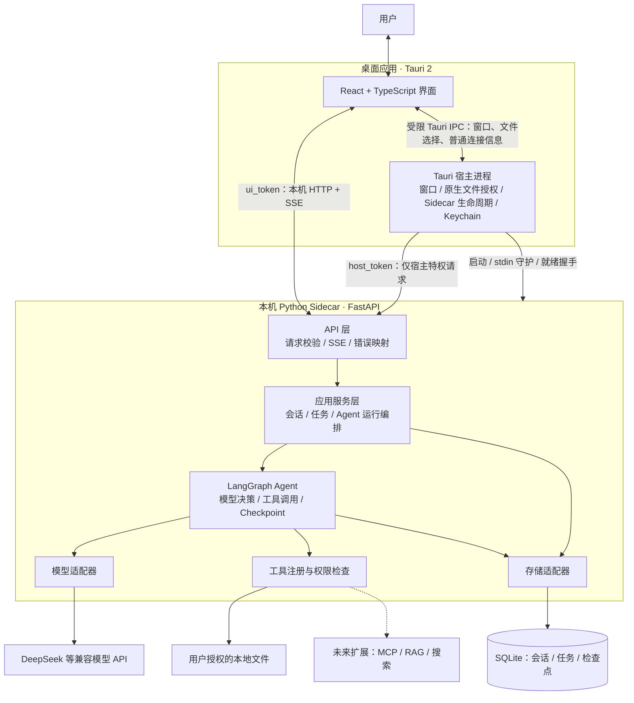

# KnowledgeAgent — 主体架构设计

> 文档版本：v0.3（主体架构冻结基线）  
> 阶段：设计阶段，**尚未开始编码；架构原则冻结，接口契约待细化**  
> 产品定位：**本地优先的通用 AI Agent 桌面助手**，先支持 macOS（Apple Silicon），后续适配 Windows。  
> 核心原则：**先确定边界，再逐步实现；新增能力优先扩展，不轻易推翻已有模块。**  v0.3 在 v0.2 基础上固定双信任通道、成功检查点基线、打包路径实验和开发/生产隔离；详细字段留给 `CONTRACTS.md`。

## 1. 我们要做的软件

用户在桌面聊天窗口中用自然语言提出任务，Agent 可以理解需求、调用授权工具、展示执行过程并给出结果。

**第一个可用版本（MVP）只实现：**

1. 双击桌面应用，进入聊天界面。
2. 与 DeepSeek 多轮对话，逐步显示模型回答。
3. Agent 能调用一个**只读、经用户选择授权**的本地文件工具（先支持 TXT/Markdown，PDF 后续加入）。
4. 显示工具调用进度与结果；聊天记录重启后保留。
5. 软件能启动并关闭自己的 Python 后端，不要求最终用户手动安装 Python 或 Docker。

**后续扩展，而非 MVP 必需：** MCP 工具、文件写入与人工审批、复杂任务规划、RAG、联网、PDF/Office 解析、长期记忆、知识图谱、多平台安装包。

**不做：** 第一版不提供任意终端命令执行、无限制文件系统访问、自动修改/删除文件、浏览器自动化或无人监管的高风险操作。

## 2. 总体架构



一句话理解：**Tauri 管桌面，React 管界面，FastAPI 管接口，LangGraph 管 Agent，Python 工具执行实际操作，SQLite 保存状态。**

## 3. 组件职责与“不要越界”规则

| 组件 | 职责 | 不负责 |
|---|---|---|
| Tauri 宿主 | 窗口、原生文件选择、后端进程启动/退出、系统 Keychain、授权授予 | Prompt、工具业务逻辑 |
| React 前端 | 输入任务、显示消息/SSE 事件、展示审批按钮、请求原生选择器 | 直接访问模型密钥、直接操作数据库、单方面扩大文件授权 |
| FastAPI API | 校验请求、鉴权本地通信、转发流、错误处理 | 自己决定工具选择、直接写 Agent 推理逻辑 |
| 应用服务 | 管理会话/任务、调用 Agent、保存最终结果 | 绑定某一家模型或某一种数据库实现 |
| LangGraph Agent | 组织模型和工具调用、维护运行状态、可恢复执行 | 直接绕过权限执行本地操作 |
| 模型适配器 | 统一模型客户端、配置和调用异常 | 把模型名称硬编码进业务代码 |
| 工具系统 | 统一注册、参数校验、权限审批与执行 | 假设“模型想用”就自动拥有系统权限 |
| 存储适配器 | 分离业务记录与 LangGraph Checkpoint；控制事务、迁移和恢复 | 将 SQL 散落到 API/Agent 代码里 |

**关键依赖方向：** UI → API → 应用服务 → Agent / 工具 / 存储。底层实现不能反过来依赖 React 页面；新模型、新工具、新存储优先通过适配器接入。**普通 UI 能访问的 API 权限，不等于宿主拥有的系统特权。**

## 4. 三条核心数据流

### 4.1 普通对话

1. 用户在 React 输入消息，前端提交 `session_id`、消息内容。
2. FastAPI 校验请求，创建本轮 `run_id`。
3. 应用服务加载此会话状态，调用 LangGraph Agent。
4. Agent 通过模型适配器请求 DeepSeek，按事件流返回生成内容。
5. API 将模型增量包装为 SSE；React 逐步显示。
6. 业务服务将本轮状态及最终消息写入 SQLite；Checkpointer 单独记录执行状态，UI 以业务记录为准。

### 4.2 工具调用

1. Agent 判断需要工具，生成**工具名 + 结构化参数**。
2. 工具注册中心检查：是否存在、参数是否合法、路径是否在当前会话的**宿主授予范围**内、是否需要审批。
3. 只读授权工具执行后，返回结构化结果给 Agent。
4. Agent 基于工具结果继续生成回答。
5. UI 显示工具开始、完成或失败，而不仅是最终答案。

**约束：模型只提出调用意图，不能直接获得操作系统权限。**

### 4.3 需要人工审批的任务（后续阶段）

1. Agent 发起可能修改文件的工具调用。
2. 后端保存当前 LangGraph 状态并发出 `approval_required` 事件。
3. React 显示将要执行的具体操作，由用户允许或拒绝。
4. 后端验证审批与会话归属，恢复原运行；拒绝时不产生文件副作用。

## 5. 从一开始保持稳定的协议原则

下面只固定**跨模块必须一致的约定**。具体请求/响应 Schema、事件字段和错误码由下一份 `CONTRACTS.md` 落地。当前不实现全部接口。

### 5.1 标识与 API 边界

- `session_id`：一个聊天会话；LangGraph `thread_id` 与其稳定映射，二者的关联由应用服务管理。
- `run_id`：一次用户提交后触发的 Agent 运行，**与 `session_id` 不同**；每次执行有可追踪状态。
- `tool_call_id`：一次具体工具调用的标识，用来关联结果、审批和审计。
- 所有服务 API 使用 `/api/v1/...`；UI 不依赖 LangGraph 内部消息类或 Checkpoint 格式。
- **同会话并发**：MVP 同一 `session_id` 最多一个未结束的 `run`。重复发送返回 `409 Conflict`；前端相应禁用发送。不同会话可以并发，事件严格按 `session_id` + `run_id` 路由，不混到当前可见会话。

### 5.2 HTTP / SSE 与认证

- 前端向本地 API 发起 `POST` 请求，后端以 `text/event-stream` 返回增量事件；使用 `fetch + ReadableStream` 消费 SSE，支持请求体、`Authorization` 头和 `AbortController`。
- **不使用原生 `EventSource` 携带认证**，也不把本机随机凭证放进 URL 查询参数、日志或持久化存储。
- React 的所有业务调用（包括取消、历史、审批、文件读取请求）均使用 `ui_token` 认证；宿主特权路由仅接受 `host_token`，不接受 `ui_token`。严格限制来源，不能将 CORS 当作权限控制。
- 事件至少预留 `run_started`、`message_delta`、`tool_started`、`tool_completed`、`approval_required`、`run_cancelled`、`error`、`run_completed`；统一带 `session_id`、`run_id` 和可扩展 `data`。实现阶段只开放当前需要的类型。
- `message_delta` 预留 `channel` 字段（例如 `text` 与可选 `reasoning`）。**不承诺或强制展示模型内部推理链**；仅在供应商允许且产品明确需要时传递适合展示的内容，普通执行状态由单独事件表达。
- SSE 在本版**不提供断线重放保证**；客户端中断后不应假定任务已自动取消或完成，需向后端查询 `run` 状态。将来如需重放，再引入事件序号与恢复游标。

### 5.3 取消与终态（MVP 就预留）

- 预留 `POST /api/v1/runs/{run_id}/cancel`，只有归属会话的当前连接可取消；重复取消是幂等操作。
- 取消分为：前端 `AbortController` 停止接收数据，以及后端取消运行/工具执行；**二者不能混为一谈**。界面“停止生成”要明确请求后端取消。
- 每个 `run` 最终只能落入 `completed`、`failed`、`cancelled` 之一，且终态不应互相覆盖；取消成功时发送 `run_cancelled`（若流仍连接）。工具副作用无法保证被网络取消撤销，写工具后续必须结合审批和幂等设计。
- **MVP 部分回答策略**：流式中的半截助手文本仅是 UI 草稿，取消/失败时不写入正式 assistant 消息；业务表记录 `run` 终态与错误信息。刷新后显示“已取消/失败”，而不是把草稿当成完整回答。后期如需保存部分结果，必须引入明确的 `partial` 状态及迁移。
- 超时、模型错误和取消必须区分；不允许把错误流静默当作 `run_completed`。
- **阶段 2 提前实现“停止生成”的最小闭环**：`AbortController` 只管前端断流，必须另发受鉴权的取消请求并令后端任务转入 `cancelled`；阶段 5 再验证审批中断、写工具副作用与取消的交互。

### 5.4 双信任等级：普通前端与桌面宿主

**从架构层锁定双 Token，不能在编码时合并：**

| 通道 | 持有方 | 可以执行 | 严格禁止 |
|---|---|---|---|
| `ui_token`（普通会话） | Tauri 宿主通过受限 IPC 交给 React，前端仅存内存 | 发消息、读会话与运行状态、取消运行、提交受校验的审批决定、按既有授权读取文件 | 读取/设置模型 API Key、增删授权目录、要求后端停机、调用任何宿主特权操作 |
| `host_token`（宿主特权） | 仅 Tauri 宿主与 Python Sidecar 进程内持有 | 注入或轮换模型密钥、同步/撤销原生文件授权、发起优雅停机等受控管理动作 | 经 IPC / React / URL / 日志 / 数据库泄露给渲染层 |

- 后端在**路由或依赖层执行两套独立的权限校验**，不能只验证“有一个合法 Token”；服务端还须校验授权操作的 `session_id`、资源归属和可执行动作。
- 特权请求只由宿主本地代码发出，React 不能通过通用 IPC、任意 URL / 方法代理等方式代宿主发起。原生选择器的结果由宿主确认并通过特权路径下发，不能接受前端自报的路径作为新授权。
- 两种 Token 每次启动重新生成，仅在内存中存在；两条通道都仅走 loopback。localhost 本身、CORS 或仅靠隐藏端口**都不能替代认证**。
- 此处固定**权限模型**，具体鉴权 Header、管理路由、握手消息与失效策略在 `CONTRACTS.md` 中定义。

> 这些是契约设计基线，**不是说当前已经实现**。详细请求字段、状态机及前端展示逻辑在 `CONTRACTS.md` 中确定。

## 6. Sidecar 生命周期、启动握手和密钥归属

### 6.1 桌面进程生命周期

- 开发时 React 与 FastAPI 可分别启动。发布时由 Tauri 宿主启动、监督并关闭打包的 Python Sidecar，用户不需安装 Python 或 Docker。
- **正常关闭**：宿主先阻止新任务，向后端请求优雅停止（或使用受控退出协议），等待必要资源释放，然后终止子进程并回收句柄。
- **异常关闭**：宿主崩溃或被 macOS Force Quit 时，不能依赖退出钩子。Sidecar 应有父进程失联检测：优先评估宿主持有的 stdin 控制管道 EOF，并验证 EOF 在目标打包/启动方式下可靠；必要时补父 PID 检测作为后备。发现失联后应尽快停止监听、关闭 SQLite 连接并退出，而非保证硬性的“1 秒内退出”。
- 重启时要检测端口冲突、旧进程与未完成任务。不得通过扫描端口后随意杀死其他进程；识别旧实例必须基于本应用的进程归属和受控握手。
- stdin 在发布模式下主要负责启动握手与 EOF 守护；不把它扩展成与 HTTP 平行的通用管理协议。

### 6.2 本机通信握手

1. **Tauri 宿主**每次启动分别生成两份独立的强随机凭证 `ui_token` 和 `host_token`（例如各 256-bit），都不落盘；`host_token` 绝不传给 React。
2. 宿主通过受控启动通道把两份凭证交付 Sidecar（优先原型验证 stdin 一次性握手 + 持续保持管道用于 EOF 守护；环境变量仅作兼容备选，需评估暴露面）。**不得**通过命令行参数、stdout、URL、数据库或日志传递密钥。
3. Python 直接绑定 `127.0.0.1:0` 让系统分配端口，并让 Web Server 使用已绑定 socket；避免“先找空闲端口、再绑定”的竞态。
4. Python 完成**真正可服务的**初始化后，stdout 仅输出带类型的结构化就绪行，例如 `{"type":"ready","port":54321}`；业务日志写 stderr 或日志文件，stdout 不输出任何 Token 或 API Key。
5. 宿主核验 Sidecar 就绪及本机健康接口后，通过**受限 Tauri IPC Command 仅向前端**提供 `baseUrl + ui_token`，统一交给 `apiClient` 使用。`host_token` 仅供宿主原生代码调用特权管理 API。
6. React 请求携带 `ui_token`，所有特权管理请求携带 `host_token`；后端分别校验，任一 Token 不能冒用另一等级。启动失败、握手超时或 Sidecar 退出时显示“启动中/连接失败/重试”，不无限等待。

> 安全边界：渲染层 XSS 可能滥用 `ui_token` 已有能力，但不能因此获得扩展文件白名单、读取/设置 API Key、停止后端等宿主特权。宿主 IPC 必须限制可调用命令、参数和来源，不能提供任意管理请求代理。

### 6.3 API Key 唯一归属

- **发布版：系统凭据只由 Tauri 宿主读写**（macOS Keychain，Windows 使用相应平台安全存储）；React 不持久化密钥，也不直接调用模型供应商。
- Python Sidecar 只在运行时通过**需要 `host_token` 的宿主特权接口**接收启动或轮换的模型密钥，**仅驻留内存**，不写 SQLite、日志和诊断包。该接口只接受宿主主动注入；**不提供让前端或普通 HTTP 客户端读取原始密钥的 API**。
- 发布版的模型 API 请求仅从 Python 发出，普通前端接口不接受或返回真实 API Key；宿主 IPC 不提供“读取密钥并返回给 React”的能力。
- 开发期可用 `.env`（加入 `.gitignore`），正式版迁移到系统凭据后不要留下双重持久化渠道。

### 6.4 打包策略与阶段 1 风险验证

- 保留 PyInstaller 作为候选，但**阶段 1 就验证 Sidecar 自动启动、动态端口、握手、正常/异常退出**。
- 优先比较 `--onedir` 与 `--onefile` 的冷启动、文件体积、签名/公证、Gatekeeper 和更新行为。**不得假定** `--onedir` 的可执行文件直接登记为 `externalBin` 后，其旁边的 `_internal/` 依赖目录会自动被正确分发。
- 阶段 1 必须分别验证：**路线 A：`--onedir` + `bundle.resources` 打包整个目录，再由 Tauri 宿主使用资源路径启动可执行文件**（验证可执行权限、`_internal/` 路径、内嵌动态库签名）；**路线 B：`--onefile` 或其他单可执行方案 + `externalBin`**（验证平台后缀、冷启动、Gatekeeper、签名与停止行为）。必要时再比较 Nuitka，但不提前锁定工具。
- 以上两条均须在真正构建出的 `.app`/安装包中验证，不能只凭开发模式启动成功就宣布发布方案可行。
- UI 设计“后端启动中”状态；不预设 4–8 秒等未实测启动时间。macOS Apple Silicon 优先，Windows 作为后续独立构建与验收目标。

### 6.5 开发、自动化测试与发布模式隔离

- **生产模式始终 fail closed**：缺少 `ui_token` / `host_token`、授权记录无效或连接身份不符时直接拒绝；绝不编写 `if not token: pass`、未认证 `/admin` 路由或“仅 localhost 所以免鉴权”的捷径。
- **本地开发**允许独立启动 React / FastAPI，但必须通过**显式本地启动器或仅开发环境的配置注入**两套测试 Token；模型密钥可从本地 `.env` 读取，文件始终按授权机制检查。不得将开发默认凭证编入发布构建。
- **自动化测试**用独立临时数据库与临时目录，模拟 Tauri 宿主携带 `host_token` 发起授权/密钥注入，再由 `ui_token` 请求普通业务路由；不因测试而禁用鉴权依赖和路径校验。
- 启动时对模式及必要凭证做**明确校验**；发布构建不允许开启可绕过安全边界的调试入口。模式差异只能影响凭证来源和测试依赖，不改变业务路由的权限定义。
- 开发启动方式、测试夹具和发布构建环境注入写进 `ROADMAP.md`，相关鉴权失败和授权撤销用例写进 `CONTRACTS.md`。

## 7. 文件权限、数据一致性与可观测性

### 7.1 文件授权（默认拒绝）

- **授权只能由 Tauri 宿主完成**：用户通过原生文件/目录选择器明确选择目标，宿主记录授予，并通过带 `host_token` 的宿主 → Sidecar 特权请求更新访问白名单。React 仅展示授权列表，不能使用 `ui_token` 自行上报任意路径并提升为有效授权。
- **MVP 授权作用域：会话级、仅在本次应用运行期间有效**；重启后需要重新授权。不默认全局扫描用户目录。后期如需“固定工作区”，单独设计持久授权与撤销功能。
- 工具真正打开文件前，后端重新检查 `session_id`、工具权限、授权范围及操作类型。对授权目录和目标文件使用 `Path.resolve(strict=True)` 解析软链接及 `..`，用路径分段/`relative_to` 等语义判断父子关系，**禁止字符串 `startswith` 校验路径前缀**。
- 防止检查与实际打开之间的文件被替换（TOCTOU）：初期对外拒绝不可信软链接并做前后校验，最终安全加固时对可变目录使用文件描述符级受约束打开策略；**不能把一次 `resolve()` 当成所有场景都安全**。
- 第一版只提供 TXT/Markdown 只读工具；限制最大读取字节数、字符数和行数，支持分段读取（`offset` + `limit`），识别 UTF-8 并提供明确的编码兜底方案，拒绝二进制文件。文件内容是**不可信数据**，不能当作系统指令。
- 文件写入/覆盖/删除均不在 MVP 中；后续引入时必须强制人工审批、路径校验和幂等保护。

### 7.2 SQLite：业务记录与 LangGraph Checkpoint 分工

- **业务记录是 UI 的唯一事实源**：保存会话、最终展示消息、`run` 状态、工具调用摘要与可脱敏的审计信息；前端列表、历史搜索和刷新恢复都由应用服务读取业务记录。
- **LangGraph Checkpointer 只保存执行恢复状态**：包含中断/审批所需的图状态，不作为前端消息列表的第二份权威来源。应用服务负责将 Checkpoint 状态与业务 `run` 状态对应，不能要求前端直接解析 Checkpoint。
- **写入时序**：创建 `run` 记录（running）→ 记下本次运行的安全起点 → 启动 Agent / Checkpoint → 流式草稿 → 成功时确认完整安全检查点，再由应用服务在业务事务中提交正式 assistant 消息、`run=completed` 及会话最新安全检查点引用；失败/取消时只登记终态与原因，**不推进安全基线**。业务表与 Checkpointer 不能假定存在跨两者的原子事务。
- **安全检查点基线**：应用服务概念上维护 `runs.base_checkpoint_id`（本轮起点）、`runs.final_checkpoint_id`（若成功则为完成点）与 `sessions.last_safe_checkpoint_id`（最后一轮**完成且业务提交成功**的检查点）；这是建议的最小模型，实际字段名和事务细节在 `CONTRACTS.md` / 数据模型阶段确定。
- **下一轮如何启动**：正常新消息必须从 `last_safe_checkpoint_id` 对应的状态继续（初始会话无基线时从空状态开始），**不能无条件使用该 `thread_id` 的最新检查点**。若上轮 `failed/cancelled`，将废弃的中间检查点保留作诊断但不得成为下一轮上下文；避免残留未配对的工具调用消息或 UI 不显示但模型仍记得的草稿。具体使用 LangGraph `checkpoint_id` 读取/分叉的方式必须按固定版本做真实验证。
- **审批与副作用例外**：`approval_required` 属于受控待恢复状态，必须走审批专用恢复逻辑，不等同于普通新消息；已执行的写工具不能靠回退 Checkpoint 撤销，需用工具级幂等标识与审计记录避免重复执行。
- **恢复对账**：启动时扫描非终态运行，结合 Checkpointer 和业务表判定可恢复/待审批/失败；如果 Checkpoint 已成功但业务提交未完成，不得擅自推进可见状态或重跑副作用。必须验证“模型工具调用已写入检查点但 ToolMessage 未完成”、模型失败、用户取消及进程崩溃等窗口。具体状态机在 `CONTRACTS.md` 定义。
- 第一版开始使用**WAL（`PRAGMA journal_mode=WAL`）+ 每连接合理的 `busy_timeout`**，明确会话/Checkpoint 的连接访问与写事务管理；避免长事务和共享跨线程连接。
- 从**首次引入持久化表结构（阶段 3）**就使用 schema 版本号与向前迁移方案，不依赖上线后手工改用户数据库；保留升级失败后的备份与错误提示策略。

### 7.3 日志与排障

- Tauri 宿主与 Python Sidecar 分别产生结构化日志，统一归入**系统应用数据目录**下的 `logs/`（区分来源），采用轮转和保留策略，不写在源码目录。
- 记录 `session_id`、`run_id`、阶段耗时、错误码和必要的工具状态；默认不记录 API Key、随机凭证、模型原始 Prompt、敏感文件正文和完整工具入参。
- 前端预留“打开日志目录”入口，诊断信息导出须明确告知用户并先脱敏；没有用户操作不自动上传任何日志。
- 错误分为前端可读的稳定错误码/说明与内部详细堆栈，模型超时、工具权限拒绝、Sidecar 失联和取消各自区分。

## 8. 规划中的目录结构（不是要求现在全部创建）

```text
KnowledgeAgent/
├── desktop/                # Tauri 宿主配置与生命周期管理
├── frontend/               # React / TypeScript
│   └── src/
│       ├── pages/          # 页面
│       ├── components/     # UI 组件
│       ├── api/            # 统一 HTTP / SSE 客户端
│       └── stores/         # 前端显示状态
├── backend/
│   ├── app/
│   │   ├── main.py        # FastAPI 入口
│   │   ├── api/           # 路由和请求/响应模型
│   │   ├── core/          # 配置、日志、安全、启动
│   │   ├── services/      # 会话、任务、Agent 调度
│   │   ├── agent/         # LangGraph 构建、状态和运行
│   │   ├── models/        # 模型服务适配器
│   │   ├── tools/         # 工具注册、权限与实现
│   │   ├── storage/       # SQLite、Checkpoint 访问层
│   │   └── rag/           # 后期新增，不在 MVP 建空模块
│   └── pyproject.toml
├── docs/
│   ├── ARCHITECTURE.md    # 本文档
│   ├── CONTRACTS.md       # 下一步明确接口契约
│   └── ROADMAP.md         # 下一步明确里程碑及验收
└── README.md
```

> 目录是**逻辑分层草案**：同一层可以先只有一两个真实文件，禁止为了“看起来完整”生成几十个空文件。

## 9. 分阶段开发与验收门槛

| 阶段 | 实现内容 | 本阶段最低验收 |
|---|---|---|
| 0. 设计 | `ARCHITECTURE.md` + `CONTRACTS.md` + `ROADMAP.md` | 模块边界、启动握手、文件权限、状态归属、SSE/取消约定一致 |
| 1. 桌面骨架 | Tauri + React + FastAPI + 最小 Sidecar 实验 | 双 Token 权限隔离、动态端口握手、启动加载态、正常/异常退出无长期残留；**真实打包**验证 `onedir+resources` 与单文件 `externalBin` 路线 |
| 2. Agent 对话 | 模型适配器 + LangGraph + SSE + 基础取消 | 真实 DeepSeek 对话流式显示；消息/状态事件分离；同会话 409；**停止生成能取消后端运行并正确落终态** |
| 3. 状态持久化 | SQLite + Checkpointer + 会话服务 | 重启历史恢复；WAL、迁移、run 对账；**完成/失败/取消后安全检查点基线正确，不复用残缺执行状态** |
| 4. 安全只读工具 | 原生文件授权 + 工具注册和校验 | Agent 调用已授权 TXT/Markdown；越权/软链接绕过/过大文件拒绝；重启授权失效 |
| 5. 权限与审批 | 写操作审批、状态恢复与副作用控制 | 拒绝不写文件、重复审批无副作用；**审批态取消和恢复**与基础取消协议兼容 |
| 6. 能力扩展 | MCP + 受控多步骤任务 | 新增工具不改写前端协议与 Agent 主循环；超时和调用次数受控 |
| 7. 可选知识库 | RAG（解析/Chunk/Embedding/检索/Rerank） | 真实文档可检索并给出来源，作为新工具接入而不影响原 Agent |
| 8. 发布 | 正式 Sidecar 打包、平台凭据、签名/公证与安装 | 无开发环境的 Mac 可安装运行，权限可管理，数据升级安全，异常退出可恢复 |

**阶段划分是开发顺序，不代表相关边界到那一阶段才开始设计。** 例如取消 API 与事件结构在第 0 阶段定契约，完整 Stop 功能在阶段 5 验收；阶段 1 应先验证基础进程停止能力。

原则：每阶段核心路径真实运行通过才进入下一阶段；不因为格式小问题阻塞项目，但安全、状态一致性、权限绕过和进程泄漏属于必须修复的阻塞项。阶段 1/2 的开发模式也必须验证双 Token 鉴权失败场景，不得以跳过认证换取调试便利。

## 10. Codex 修改代码前必须遵守的规则

1. **每次先阅读 `ARCHITECTURE.md` 和已经存在的 `CONTRACTS.md`、`ROADMAP.md`**，明确当前任务位于哪个阶段、哪一层；v0.3 已冻结的信任边界和状态规则不得擅自简化。
2. 先给出影响分析：新增/修改的文件、跨模块调用、是否改变 API、SSE、状态或数据库结构。
3. 优先**新增模块或适配器**；不得为了实现一个小功能擅自重写已验收的 Agent、前端、权限或持久化层。
4. 涉及端口/握手、密钥归属、文件授权、终态与消息来源等核心契约的改动，先提交设计差异与迁移方案，经确认后再编码。
5. 区分设计、已实现、已验证；每次只实现一个里程碑，并报告真实运行命令、输入输出、异常场景和未验证项。
6. 不读取、输出或提交真实密钥；不自动提交 Git；不主动扩展下一个阶段；不因追求“优雅”提前加入无用抽象。**禁止以 `dev`/`test` 为名添加可被发布构建触发的鉴权绕过逻辑。**
7. 文档记录稳定的架构边界，类名、依赖小版本和具体表字段在对应阶段定义；新的模块必须遵守既有接口。
8. 任何涉及文件系统或有副作用的工具，首先证明最小权限、授权来源与故障恢复，再放开能力。

## 11. 已决定、暂缓决定与待验证

**架构已决定：**

- Mac Apple Silicon 优先，Tauri 2 + React/TypeScript + FastAPI Python Sidecar；LangGraph 作为 Agent 执行层，DeepSeek 是首个对话模型。
- Tauri 宿主独占原生文件授权与系统凭据操作；Python 只使用短期内存密钥，UI 无法单方面授予新路径。
- Sidecar 仅监听 loopback，动态端口、每次启动独立随机 `ui_token` 与 `host_token`、受控握手、正常/异常退出守护；React 通过统一 `apiClient` 访问，**仅宿主持有特权 Token**。
- HTTP + `fetch/ReadableStream` 消费 SSE；同会话串行执行；`run_id` 独立于 `session_id`；明确取消与终态。
- 业务 SQLite 是 UI 的状态事实源，Checkpoint 负责 Agent 恢复；仅成功且业务提交完整的运行能推进会话安全检查点；引入数据库时即启用 WAL、锁等待及迁移。
- 首版只读授权工具；MCP/RAG/高级规划为插件式扩展，不要求初期全部实现。

**具体实现待在契约/开发阶段决定：** 启动控制帧字段、双 Token 校验 Header / 管理路由、SSE JSON 精确定义、错误码映射、SQLite 表结构及安全检查点字段、迁移脚本格式、Keychain 访问实现和审批消息 Schema。

**必须通过原型验证，不能仅凭设计断言：** Tauri Shell Sidecar 的 stdin EOF 能否稳定感知父进程退出；动态端口与 socket 交接；双 Token 在发布包和开发模式中是否真实隔离；`--onedir + bundle.resources` 的目录与动态库分发、`--onefile + externalBin` 的平台命名/冷启动/签名；LangGraph 对已完成安全检查点的恢复/分叉语义及故障窗口；系统 Keychain 在实际签名发布路径的权限行为。

## 12. 修订记录

### v0.4 → v0.5（2026-11-25，P10 RAG 2.0 扩展与 v0.5.0 交付）

在完整保留双信任通道、Checkpointer 安全基线、MCP 与 Skills/Workspace/Runtime 架构的前提下，按 [`KnowledgeAgent_RAG_2.0_Architecture_v0.1.md`](./KnowledgeAgent_RAG_2.0_Architecture_v0.1.md) 增量落地 **P10.0–P10.4 & P10.6** 并随 **v0.5.0** 交付（P10.5 由用户决定跳过；P11 Agent Observability & Evaluation 暂缓按需规划）：

| 分类 | 新增/扩展内容 |
|---|---|
| 自动索引与状态 | 知识库升级至 **SQLite V8**（新增 `knowledge_settings` 全局索引与精排策略表）；多选导入自动入队 `IndexWorker`，提供一键补全与待升级重建（未变化切片复用 Embedding 缓存），旧索引保持可检索并标记「待升级」 |
| 检索与重排序 | 修复自然语言 BM25 与跨教材排序（移除 8 本上限崩溃）；复用 SiliconFlow Key 接入 **`BAAI/bge-reranker-v2-m3`**；新增轻量中英文查询改写与跨语言术语优先排序、References 软降权与按需相邻 Chunk 上下文扩展 |
| 检索可观测性 | 业务库升级至 **SQLite V8**（新增 `run_retrieval_traces`）；新增 `POST /api/v1/knowledge/debug-search` 检索实验室、聊天可折叠检索过程卡片与 Chunk 原文浏览器（支持桌面 IPC `open_textbook_original` 打开原 PDF） |
| 解析、切片与总结 | PDF Parser 升至 `v3`（页眉抑制、连字符合并、`CMMI`/`CMSY` 符号恢复、稀疏扫描插页 Vision OCR）、Chunker 升至 `v2`（消除英文断词与碎片合并）；新增 `book_summary` 全文与章节覆盖总结策略 |

### v0.3 → v0.4（2026-11-25，P9 Workspace / Runtime / Agent Skills 扩展）

在完整保留 v0.3 双信任通道、Checkpointer 安全基线、RAG 与 MCP 架构的前提下，按 [`KnowledgeAgent_Skills_Architecture_v0.1.md`](./KnowledgeAgent_Skills_Architecture_v0.1.md) 增量扩展以下子系统并随 **v0.4.0** 交付：

| 分类 | 新增/扩展内容 |
|---|---|
| 会话工作空间 & 产物 | 新增会话级持久化目录（`inputs/`、`runs/<run_id>/{work,output}/`、`artifacts/`）与 `staged / published / discarded` 产物状态机；业务库升级至 **SQLite V7**（新增 `skills`、`workspace_files`、`artifacts`、`run_skill_activations`，扩展 `tool_calls.tool_category` 与 `recoverable`） |
| 独立执行 Runtime | 在 `<app_data_dir>/runtime/` 维护独立 Python `venv` 与 `npm-tools`，与 PyInstaller Sidecar 严格解耦；支持 Finder 极简 `PATH` 下的 `uv/Node/Git/Chrome` 探测 |
| Agent Skills 引擎 | 兼容标准 `SKILL.md` 与 Progressive Disclosure；内置 `mind-map` 与 `word-formatting`，支持 GitHub 仓库/子目录、本地目录与 ZIP 选择性导入、更新与依赖按需准备 |
| 执行预算与稳定性 | 集中配置 `backend/app/agent/budgets.py`（Skills 单轮 100 次总预算 / 80 次 Skills 子预算 / 20 次传统工具子预算 / `recursion_limit=250` / 1800s 超时）；支持可恢复工具错误自修复、临时上游错误最多 3 次退避重试（不重复执行已完成工具）与 8192-token 截断恢复 |

### v0.2 → v0.3（主体架构冻结）

| 分类 | 补充约束 |
|---|---|
| 信任通道 | `ui_token` 与 `host_token` 双 Token 隔离；宿主特权 API 不接受 UI Token，React 不可代理任意特权请求 |
| Checkpoint | `base / final / last_safe_checkpoint` 逻辑基线；完成时推进，失败/取消时保留原基线；审批恢复单独处理并通过 LangGraph 原型验证 |
| Sidecar 打包 | 区分 `--onedir + bundle.resources` 与单文件 `externalBin`；阶段 1 测真实 `.app`、资源路径及动态库签名 |
| 启动模式 | 开发/测试显式注入双 Token，发布始终强制认证；禁止测试代码引入正式路由后门 |
| 排期 | 阶段 2 提前验收基础取消，阶段 5 只处理审批态与工具副作用取消 |

### v0.1 → v0.2

| 分类 | 新增/调整内容 |
|---|---|
| 桌面进程 | 正常与强制退出的 Sidecar 监控、动态端口握手、加载态、打包前置验证 |
| 安全归属 | Keychain 由 Tauri 宿主管理；文件授权必须来自原生选择器和宿主控制通道 |
| API 协议 | `fetch + ReadableStream`、认证方式、同会话 409、事件 channel、主动取消和终态策略 |
| 文件工具 | 真实路径校验、软链接/路径穿越、文件大小和分页读取限制 |
| 数据一致性 | 业务表/Checkpoint 单一事实源、运行对账、WAL、busy_timeout、迁移 |
| 可观测性 | 宿主/Sidecar 日志目录、脱敏、轮转、用户自主打开日志 |

## 参考

- [Tauri 2 官方：Embedding External Binaries / Sidecar](https://v2.tauri.app/develop/sidecar/)
- [Tauri 2 官方：Shell Plugin 与权限配置](https://v2.tauri.app/plugin/shell/)
- [Tauri 2 官方：Embedding Additional Files / bundle.resources](https://v2.tauri.app/develop/resources/)
- [LangGraph 官方：Time travel / checkpoint_id](https://docs.langchain.com/oss/python/langgraph/use-time-travel)
- [Tauri 2 官方：安全设计](https://v2.tauri.app/security/)

---

**下一步：** v0.3 的**模块边界与安全原则冻结**，依据本基线制定 `CONTRACTS.md` 中的双 Token 权限矩阵、API/SSE、取消/终态、安全 Checkpoint 规则和原生授权协议；完成契约审查后再让 Codex 编写阶段 1 的最小原型。**原型验证失败允许针对具体技术实现提出有证据的修订，但不得静默放宽架构安全边界。**

