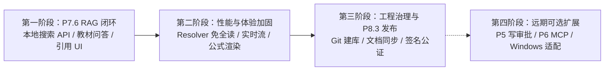

# KnowledgeAgent 项目当前进度、缺陷分析与后续开发计划报告

> **报告生成日期**：2026-11-24  
> **审计与开发范围**：`/Users/lanyan/Documents/项目/agent_1` 全量源码（`desktop/`、`frontend/`、`backend/`）与自动化测试集  
> **最新状态**：**已按计划完成 P7 RAG 全链路闭环开发、前端视觉美化与项目无关文件清理**

---

## 零、本轮完善与 RAG 闭环落地总结（已完成）

在完成项目进度审计与缺陷定位后，已按计划完成了以下全部核心开发与清理工作：

1. **打通 P7.6 教材检索、问答与引用溯源完整闭环**：
   - **原件指纹缓存加速（修复缺陷 4）**：在 [`backend/app/services/citation_resolver.py`](backend/app/services/citation_resolver.py) 中引入基于文件 `(st_dev, st_ino, st_size, st_mtime_ns, st_mode)` 的修订缓存，首次 SHA-256 流式核验通过后，后续同实例查询通过 `fstat` 毫秒级放行，消除重复全量读盘 I/O 瓶颈，并新增 `CitationView` 与位置摘要格式化器。
   - **高阶 RAG 编排服务（修复缺陷 2、3、7）**：新增 [`backend/app/services/knowledge_qa.py`](backend/app/services/knowledge_qa.py)（`KnowledgeQAService`），统一封装混合检索、引用解析、多轮追问指代消解（`rewrite_followup_query`）、跨教材对比意图识别、自然语言关键词提取兜底（`extract_key_terms`）以及带 `PDF_UNMAPPED_GLYPHS` 公式失真预警和“无证据拒答”护栏的系统提示词组装。
   - **本地检索与引用核验 HTTP API（修复缺陷 1）**：新增 [`backend/app/api/knowledge_search.py`](backend/app/api/knowledge_search.py)，暴露受 `ui_token` 保护的 `POST /api/v1/knowledge/search` 与 `POST /api/v1/knowledge/citations/validate` 路由，并挂载至 [`backend/app/main.py`](backend/app/main.py)。
   - **业务库 Schema v5 引用原子持久化与历史回显（修复缺陷 3、13、15）**：在 [`backend/app/storage/business.py`](backend/app/storage/business.py) 新增 v5 迁移（`run_citations` 表），在 `complete_run` 事务内将正式回答与结构化引用原子落盘；`list_runs` 同步返回每轮持久化的 `tool_calls` 与经 `CitationResolver` 实时复核状态的 `citations`（自动区分 `resolved`、`historical` 与 `source_removed`）；并在 [`backend/app/api/chat.py`](backend/app/api/chat.py) 新增会话重命名（`POST /api/v1/sessions/{id}/rename`）与删除（`POST /api/v1/sessions/{id}/delete`）接口。
2. **前端 RAG 界面开发与现代 macOS 视觉美化（修复缺陷 12、13、14）**：
   - **Markdown / 代码 / 数学公式 / 引用角标渲染**：新增 [`frontend/src/MarkdownAnswer.tsx`](frontend/src/MarkdownAnswer.tsx)，安全渲染 Markdown 标题、列表、代码块、行内与块级公式（`$...$` / `$$...$$`）及 `[引用 N]` 徽章。
   - **教材知识库本地检索面板**：在 [`frontend/src/LibraryPanel.tsx`](frontend/src/LibraryPanel.tsx) 新增「本地教材检索」区块，无需配置 DeepSeek 即可按混合/关键词/向量模式及全局/跨教材对比策略搜索教材，展示通道状态、耗时、跨教材覆盖统计及带页码/行号/公式警告的原文证据卡片。
   - **聊天页 RAG 问答控制与引用卡片**：在 [`frontend/src/Chat.tsx`](frontend/src/Chat.tsx) 新增「结合教材知识库回答」开关、策略/模式选择与教材范围过滤芯片；支持实时 SSE `run_citations` 与历史持久化引用的卡片展示及证据原文展开；合并展示历史持久化的 `tool_calls`。
   - **全局样式美化与凭据体验优化**：在 [`frontend/src/App.tsx`](frontend/src/App.tsx) 让「教材知识库」标签页直接显示 SiliconFlow 凭据配置；全面重构 [`frontend/src/styles.css`](frontend/src/styles.css)，采用现代 macOS 桌面级卡片、阴影、徽章与排版层次。
3. **清理项目无关文件（修复缺陷 17、18）**：
   - 删除了 `desktop/target/p1.3` ～ `p8.2` 共 12 个历史阶段临时构建目录（释放约 **3.7 GiB** 磁盘空间），并将 [`desktop/packaging/build-macos.sh`](desktop/packaging/build-macos.sh)、[`onedir.json`](desktop/packaging/onedir.json)、[`onefile.json`](desktop/packaging/onefile.json) 统一收敛至 `target/packaging`。
   - 删除了散落在 `backend/P7.*.md`、`desktop/packaging/P1.3.md` 的 16 份过程临时验收文件，以及 `backend/scripts/` 一次性验证脚本、`desktop/packaging/check-sidecar.py` 与 `verify-deepseek.json`。

---

## 一、执行摘要（Executive Summary）

**KnowledgeAgent** 是一款面向 macOS Apple Silicon 的本地优先 AI Agent 桌面助手与理工科教材知识库系统，采用 **Tauri 2 (Rust 宿主) + React 19 / TypeScript (Vite) + Python 3.12 (FastAPI Sidecar) + LangGraph + DeepSeek / SiliconFlow (`BAAI/bge-m3`) + SQLite (WAL)** 架构。

### 1.1 核心进度结论

尽管项目根目录下的四份设计基线文档（`架构.md`、`接口.md`、`开发路线与验收.md`、`KnowledgeAgent_RAG_Architecture_v0.2.md`）顶部仍标注为*“设计阶段，尚未开始编写项目代码”*，但**实际代码库已完成高强度的工程落地与实机验证**：

1. **MVP 核心主线（P0 → P1 → P2 → P3 → P4）已 100% 完成并验收通过**：桌面宿主与 Sidecar 动态端口握手、双 Token（`ui_token` / `host_token`）隔离、DeepSeek 流式对话、主动取消、SQLite 业务库与 LangGraph Checkpointer 安全基线对账、macOS 原生文件授权与防 TOCTOU 的只读工具（`list_files`、`read_text`）均已闭环。
2. **发布级基础设施（P8.1、P8.2）已完成**：macOS 原生 `Security.framework` 钥匙串凭据管理、Sidecar 崩溃重启自动回灌密钥、双端 JSONL 结构化脱敏日志轮转、PyInstaller `onedir` / `onefile` 打包脚本及测试 DMG 构建均已落地（仅差 P8.3 Apple Developer ID 正式签名与公证）。
3. **P7（RAG 教材知识库）已完成约 80%（P7.1 → P7.6.1 全部通过）**：
   - 已完成：原生教材受控导入与 SHA-256 去重（P7.1）、PDF/DOCX/Markdown 多格式结构化解析与物理页/坐标/行号定位（P7.2）、章节感知混合分块与 SiliconFlow 向量增量持久化（P7.3）、SQLite FTS5 逐汉字预处理检索 + NumPy 精确余弦向量检索 + RRF 混合检索与跨教材配额覆盖（P7.4）、持久化索引队列与后台 `IndexWorker` 及前端索引控制面板（P7.5）、以及刚完成的 `CitationResolver` 来源证据校验器（P7.6.1）。
   - **当前所处精确节点**：刚完成 **P7.6.1（Citation Resolver 验收）**，正处于 **P7.6.2+（将本地检索、引用解析器与 HTTP API、LangGraph 问答链路、前端聊天及搜索 UI 打通）** 的临门一脚阶段。
4. **全栈测试覆盖度极高**：当前代码库共有 **409 项自动化测试**（后端 Python `pytest` **363 项**、前端 `Vitest` **28 项**、桌面端 Rust `cargo test` **18 项**），工程底盘非常扎实。

### 1.2 核心问题摘要

当前项目最大的矛盾是**“底层检索与安全引擎极其完备，但面向用户的最后一公里尚未接通，且存在若干影响实际体验的性能与交互短板”**：
- **功能断点**：`HybridRetrievalService` 和 `CitationResolver` 目前仅作为后端内部 Python 类存在，**既没有暴露给前端的搜索 HTTP 接口，也没有接入 `RunService` / LangGraph 聊天链路**，用户导入并索引教材后，尚无法在界面中搜索教材或基于教材进行带引用的 AI 问答。
- **性能与可用性隐患**：`CitationResolver` 每次解析证据都会对私有原件执行**全量流式读取并重算 SHA-256**（且单批次限制 200 MiB），遇到大体积 PDF 教材会产生严重磁盘 I/O 并触发 `limit_exceeded`；此外，一旦会话授权了本地文件，`tool_graph.py` 会**缓冲整轮回复直至生成结束才一次性输出**，导致流式打字机体验消失。
- **理工科场景体验短板**：PDF 公式提取存在字形丢失导致语义反转风险（如 `b ≠ 0` 变成 `b = 0`），而前端聊天界面仅用纯文本 `
` 标签渲染回复，**不支持 Markdown 与 LaTeX 数学公式渲染**。

---

## 二、项目当前进度全景梳理

### 2.1 全局里程碑完成度矩阵

| 阶段 | 里程碑名称 | 当前状态 | 已落地的核心代码与能力 | 缺失或待完成项 |
|---|---|---|---|---|
| **P0** | 架构与接口契约冻结 | **已完成 (`PASS`)** | `架构.md` v0.3、`接口.md` v0.2、`开发路线与验收.md` v0.3 | 文档内的进度状态表未随开发同步更新 |
| **P1** | 桌面骨架与 Sidecar 生命周期 | **已完成 (`PASS`)** | `desktop/src/sidecar.rs`、`backend/app/sidecar.py`：stdin 启动帧与 EOF 守护、动态端口、`ui_token`/`host_token` 隔离、`onedir` 与 `onefile` 打包原型（`P1.3.md`） | 无 |
| **P2** | DeepSeek / LangGraph / SSE / 取消 | **已完成 (`PASS`)** | `app/models/deepseek.py`、`app/api/chat.py`、`app/services/runs.py`、`frontend/src/api/sse.ts`：单向密钥提交、流式分帧、`: keepalive`、幂等 `409`、主动取消 | 无 |
| **P3** | 历史 / Checkpointer / 安全恢复 | **已完成 (`PASS`)** | `app/storage/business.py` (v4)、`app/storage/checkpoints.py`、`app/agent/answer.py`：`last_safe_checkpoint_id` 安全基线、崩溃重启 `RUN_INTERRUPTED` 对账、WebView 刷新恢复 | 历史接口未返回已持久化的 `tool_calls` 列表 |
| **P4** | 安全只读本地文件工具 (MVP) | **已完成 (`PASS`)** | `desktop/src/grants.rs`、`app/tools/files.py`、`app/agent/tool_graph.py`：原生文件/目录授权、`list_files`、`read_text`、`O_NOFOLLOW_ANY` 防软链/TOCTOU、Checkpoint 脱敏 | 启用工具时流式输出退化为整段缓冲输出 |
| **P5** | 文件写操作与人工审批（可选） | **未启动 (`SKIPPED`)** | 仅在状态机和 Schema 中预留了 `awaiting_approval` 状态与 `pending_approval: null` 字段 | 写文件工具、`approvals` 表、`approval_required` / `run_resumed` 续流（路线图中属可选） |
| **P6** | MCP 与受控多步任务（可选） | **未启动 (`SKIPPED`)** | 工具注册表 `RunTools` 已具备调用次数与字符预算控制 | MCP 客户端适配器与任务规划器（路线图中属可选） |
| **P7** | **RAG 教材知识库** | **进行中 (~80%)** | **P7.1～P7.6.1 已全部完成并验收**（详见 2.2 节） | **P7.6.2+ 检索 API、Agent 问答集成、多轮指代消解、前端搜索与引用 UI** |
| **P8** | macOS 正式可安装版 | **大部分完成 (P8.1/P8.2 `PASS`)** | `desktop/src/keychain.rs`（macOS 钥匙串）、`diagnostics.rs` / `diagnostics.py`（日志脱敏轮转）、`build-macos.sh`（测试 `.app` 与 `.dmg` 构建、跨版本升级保留数据） | **P8.3**：Apple Developer ID 正式签名、Notarization 公证、干净 Mac Gatekeeper 验收 |

---

### 2.2 P7（RAG 教材知识库）子阶段完成度盘点

项目在 P4 与 P8.1/P8.2 完成后，重点推进了 P7 教材知识库，目前已完成 15 个子里程碑的扎实建设：

| 子阶段 | 验收报告 | 状态 | 核心实现文件 | 关键成果与实测指标 |
|---|---|---|---|---|
| **P7.1.1–P7.1.3** | `target/p7.1.3` | **已完成** | `desktop/src/library.rs`、`library/staging.rs`、`app/services/library.py`、`app/storage/library.py`、`LibraryPanel.tsx` | 原生选择器受控拷贝、格式魔数校验（PDF/DOCX/MD，$\le 100\text{ MiB}$）、`knowledge/originals/<sha256>` 内容寻址去重、多版本记录、孤儿文件定时清理 |
| **P7.2.1–P7.2.5** | `P7.2.2-PDF.md` `P7.2.5-Source-Verification.md` | **已完成** | `app/parsing/markdown.py`、`pdf.py`、`pdf_layout.py`、`docx.py`、`worker.py`、`app/storage/parsed_documents.py` | MD 精确行区间；PDF 独立子进程解析（120s/512MiB 限制）、双栏阅读顺序识别、未旋转 MediaBox 坐标框、页标签与扫描/缺字形警告；DOCX 独立子进程解析、标题层级与合并表格跨度 |
| **P7.3.1–P7.3.4** | `P7.3.1-Chunking-Verification.md` `P7.3.2-Chunk-Storage-Verification.md` `P7.3.3-Embedding-API-Spike.md` `P7.3.4-Embedding-Storage-Verification.md` | **已完成** | `app/chunking/hybrid.py`、`app/storage/chunks.py`、`app/models/siliconflow.py`、`app/storage/embeddings.py`、`app/services/document_embeddings.py` | 章节感知混合分块（默认 `1000/120`）、`ChunkSourceSpan` 双向 Unicode 码点偏移映射；SiliconFlow `BAAI/bge-m3` (1024 维) 接入与独立 Keychain 项；按内容与配置哈希去重的向量缓存与批次租约 |
| **P7.4.1–P7.4.4** | `P7.4.1-FTS-Verification.md` `P7.4.2-Vector-Verification.md` `P7.4.3-Hybrid-Retrieval-Verification.md` `P7.4.4-Retrieval-Quality-Verification.md` | **已完成** | `app/storage/keywords.py`、`keyword_terms.py`、`app/services/keyword_search.py`、`vector_retrieval.py`、`hybrid_retrieval.py` | 逐汉字预处理 + FTS5 解决中文二字词（如“概率”“似然”）召回；SQLite + NumPy float64 精确余弦检索；RRF 融合、相邻重叠去重（65%）、`global` 与 `per_document` 跨教材配额（默认每书 2 条，阈值 0.45）；40,000 Chunk 压测优化将 FTS p95 降低 88%（至 ~119ms） |
| **P7.5.1–P7.5.4** | `P7.5.1-Index-Jobs-Verification.md` `P7.5.2-Index-Pipeline-Verification.md` `P7.5.3-Background-Worker-Verification.md` `P7.5.4-Index-UI-Verification.md` | **已完成** | `app/storage/index_jobs.py` (schema v7)、`app/services/index_pipeline.py`、`index_worker.py`、`app/api/index_jobs.py`、`TextbookIndex.tsx` | 持久化任务状态机与租约续期；五阶段流水线（解析→分块→关键词→向量→发布）；无 Key 或 401 时优雅降级为 `ready_keyword`；等待宿主回灌凭据后再启动调度；解析子进程存活管道防孤儿进程；前端云端发送确认弹窗与进度轮询 |
| **P7.6.1** | `P7.6.1-Citation-Verification.md` | **已完成** | `app/services/citation_resolver.py`、`app/storage/citations.py` | 将 `chunk_id` 或检索命中解析为带版本摘要的 `Evidence`（`ev1:...`），重算 Chunk ID 校验块切片一致性，校验私有原件并输出精确页码/坐标/段落/行号及解析警告 |

---

## 三、现有缺陷与技术债深度剖析

通过对 `backend/`、`frontend/` 和 `desktop/` 源码的逐模块审计，当前项目存在以下 **19 项具体缺陷与技术债**，按优先级分为四类：

### 3.1 P0 级核心功能断点（阻塞 RAG 端到端业务闭环）

#### 缺陷 1：检索与引用服务未暴露 HTTP API，无法从前端发起本地教材搜索
- **现状定位**：`backend/app/main.py` 在启动生命周期中初始化了 `app.state.keyword_search`、`app.state.vector_retrieval` 和 `app.state.hybrid_retrieval`，`app/services/citation_resolver.py` 也已实现 `CitationResolver`；但在 `backend/app/api/` 下只有 `chat.py`、`grants.py`、`library.py` 和 `index_jobs.py`，**没有任何检索或引用查询路由**。
- **影响**：《RAG 架构设计方案 v0.2》确立的首要原则“先可查，再可答（不配置 DeepSeek 也能在本地搜索教材章节与页码）”尚无法在桌面端使用。

#### 缺陷 2：聊天主链路（`RunService` / `answer_with_agent`）尚未接入 RAG 教材知识库
- **现状定位**：`backend/app/services/runs.py` 的 `_answer()` 方法仅构造了 P4 的 `RunTools`（`list_files`、`read_text`），既没有在问答前调用 `HybridRetrievalService` + `CitationResolver` 注入教材证据，也没有将 `search_knowledge` 注册为 Agent 工具。
- **影响**：用户在「教材知识库」中完成教材导入和混合索引后，切回「聊天」界面提问教材内容时，Agent 完全不知道教材库的存在。

#### 缺陷 3：缺少多轮对话检索上下文（Query Rewrite）、教材范围限定与引用持久化契约
- **现状定位**：
  1. `POST /api/v1/sessions/{session_id}/runs/stream` 的请求体 `StartRun`（`app/api/chat.py`）仅接收 `client_request_id` 和 `message`，不支持传入选定的教材范围 `document_ids` 或检索模式（普通检索 `global` vs 跨教材对比 `per_document`）。
  2. 缺少多轮追问的指代消解（如上一轮问“最大似然估计”，下一轮问“它与贝叶斯估计有什么区别”时，直接用原句检索会导致召回退化）。
  3. 业务数据库 `app/storage/business.py`（当前 schema v4）的 `messages` 表仅有 `message_id, session_id, run_id, role, content, created_at`，没有持久化该条回答所引用的 `evidence_id` 列表与检索范围，SSE 事件流也尚未定义引用证据的传输字段。

---

### 3.2 P1 级后端性能、准确性与架构缺陷

#### 缺陷 4：`CitationResolver._check_originals` 每次解析均全量流式读取原件计算 SHA-256，存在严重 I/O 瓶颈与 200 MiB 批次硬限制
- **代码位置**：`backend/app/services/citation_resolver.py` 第 28 行（`MAX_ORIGINAL_BYTES_PER_BATCH = 2 * MAX_FILE_BYTES` = 200 MiB）、第 298–327 行（`_verify_original`）、第 478–495 行（`_check_originals`）。
- **问题机理**：每次调用 `CitationResolver.resolve_results()` 或 `validate_evidence()` 时，`_check_originals` 都会打开 `knowledge/originals/<sha256>` 中的私有原文件，**从头到尾读取整个文件字节流以计算 SHA-256**。
  - 若单本 PDF 教材为 85 MiB，每次检索返回引用都要同步读取 85 MiB 磁盘数据（耗时数百毫秒）。
  - 更严重的是，`_check_originals` 对单批次设置了 `read_budget = 200 MiB` 上限：如果一次跨教材对比检索命中了 3 本各 75 MiB 的 PDF 教材（合计 225 MiB > 200 MiB），第 3 本教材的所有引用会被直接判定为 `status = "limit_exceeded"`（`evidence = None`），导致合法引用无故丢失！
- **修复建议**：私有原件在导入落盘时已设为只读私有文件（`0o400`）并校验过 SHA-256。在 `CitationResolver` 高频查询路径上，应优先通过 `os.fstat` 快速校验文件的 `(st_dev, st_ino, st_size, st_mtime_ns, st_mode)` 指纹缓存（耗时 `< 0.1 ms`），仅在文件元数据指纹未命中缓存或用户显式请求深度校验时才流式重算 SHA-256。

#### 缺陷 5：会话一旦存在文件授权（P4 工具激活），聊天回复即丧失实时流式打字机体验
- **代码位置**：`backend/app/agent/tool_graph.py` 第 72–81 行与第 125–127 行；`backend/app/agent/answer.py` 第 80 行。
- **问题机理**：
  - 当会话没有任何文件授权（`tools is None`）时，`answer.py` 使用 `stream_mode=["messages", "checkpoints"]` 边接收 DeepSeek chunk 边调用 `on_delta` 推送 SSE `message_delta`。
  - 但只要用户在当前会话授权了哪怕一个文件（`tools is not None`），`tool_graph.py` 的 `model_node` 在 `selected.astream()` 循环中将所有文本块存入局部变量 `buffered: list[str] = []`，**直到模型整轮生成完全结束**且确认没有 `tool_calls` 和 `finish_reason == "length"` 后，才在 第 126 行通过 `for delta in buffered: on_delta(delta)` 一次性瞬间发出！
- **影响**：用户在授权文件后进行长文总结或多轮问答时，界面会长时间停留在“生成中”无任何文字出现，数秒至十余秒后整篇回答突然一次性弹出，流式体验大幅倒退。

#### 缺陷 6：工具调用容错机制过于刚性（`tools.failure` 一票否决，禁止模型自我修正）
- **代码位置**：`backend/app/tools/registry.py` 第 114 行（`self.failure = self.failure or result`）、`backend/app/agent/tool_graph.py` 第 68–96 行、`backend/app/agent/answer.py` 第 90–91 行。
- **问题机理**：当模型发起的某次工具调用返回失败（例如：对单文件授权误传了非空的 `relative_path` 触发 `VALIDATION_ERROR`，或首次猜测的相对文件名不存在）时，`tools.failure` 被标记。尽管 `tools_node` 构造了带错误摘要的 `ToolMessage` 传回图状态，但紧接着进入 `model_node` 时：
  1. 第 68 行强制解绑了所有工具（`selected = model`）；
  2. 第 80 行因 `tools.failure is not None` 丢弃了模型生成的全部解释文本；
  3. 第 95–96 行直接 `return {"messages": []}` 结束图执行，随后 `answer.py` 第 91 行直接抛出 `ModelError(tools.failure.error_code, ...)` 将整轮 Run 标为 `failed`！
- **影响**：第一，模型明明在 `model_node` 被再次调用了一次（消耗了 DeepSeek Token 和延迟），其生成的解释输出却在 第 96 行被无条件丢弃；第二，Agent 失去了根据 `ToolMessage` 错误提示自我修正参数（如改用 `list_files` 或清空 `relative_path`）的能力。

#### 缺陷 7：理工科 PDF 公式提取失真缺乏 Prompt 层面的安全防护
- **现状定位**：在 `P7.2.2`、`P7.4.4` 和 `P7.6.1` 验收中已证实，基于 PDF 文本层的提取对数学公式存在固有限制。例如王崇政《线性代数》物理第 46 页的 `b ≠ 0` 在 SQLite `chunks.body_text` 中被提取为 `b = 0`（不等号斜杠字形丢失），相对论论文中根号、分数与上下标被拆散并产生 `PDF_UNMAPPED_GLYPHS` 警告。
- **风险**：虽然 `CitationResolver` 如实返回了 `text_fidelity="parsed_text_unverified"` 和 `PDF_UNMAPPED_GLYPHS` 警告，但如果后续接入 RAG 问答时只把 `body_text` 喂给 DeepSeek，模型会基于 `b = 0` 进行错误的数学推导。必须在构建 RAG Prompt 时将 `warnings`（如存在未映射字形、疑似扫描页）显式注入给模型，并要求模型提示用户核对原件对应物理页的公式。

#### 缺陷 8：大规模向量库（40,000+ Chunk）下 `retrieval_scope` 每次查询重复执行全表关联计数
- **代码位置**：`backend/app/storage/retrieval_scope.py` 与 `P7.4.4` 第 5 节性能表。
- **问题机理**：在 40,000 Chunk 规模下，每次执行向量或混合检索时，`Version & Index Scope` 阶段耗时高达 **96.5 ms ～ 110.8 ms**（占纯向量检索总耗时的 35% 以上）。原因是在选取可用 `embedding_sets` 时，SQL 每次都会动态统计 `chunk_embeddings` 和 `embeddings` 的完整关联行数以校验其等于 `chunk_count`。
- **修复建议**：`embedding_sets.published_at` 仅在事务内核验计数完整后才写入，且外键与触发器已保护已发布集合。可通过触发器维护或信任已发布状态标记（将深度行数核对留给后台维护或 `check_integrity`），从而将 40k 规模下的作用域查询从 ~100 ms 降至 `< 2 ms`。

#### 缺陷 9：近主题无答案查询的语义误召回与 `per_document` 模式下的弱证据占位
- **现状定位**：`P7.4.4` 留出集评测显示：
  1. 在 `0.45` 静态余弦阈值下，2 条近主题无答案查询（如在电子表格指南中问“数据透视表”、在 MLE 章节中问“正态分布无偏方差估计”）均产生了 5 条误召回（最高余弦达 `0.479–0.527`）。
  2. 在 `per_document` 模式下，由于每本达到 `0.45` 门槛的教材优先获得 2 条配额，当用户问题实际上只涉及其中一本教材时，其他教材中 `0.46–0.48` 的弱相关片段会挤占 Top-5 席位，导致 `hybrid/per_document` 的 `Recall@5`（`0.683`）明显低于 `hybrid/global`（`0.784`）。
- **修复建议**：默认问答应采用 `global` 模式，仅在用户明确开启「跨教材对比」或问题具有对比意图时启用 `per_document`；同时在 `per_document` 模式下引入相对于全局最高分（top-1 similarity）的相对分差门槛，避免低分教材强占配额。

#### 缺陷 10：教材多版本更新后的旧版本产物缺乏垃圾回收（GC）
- **代码位置**：`backend/app/services/library.py`（`cleanup_orphans`）与 `backend/app/storage/library.py`。
- **问题机理**：当用户对某本教材多次点击「更新」导入新版本时，`document_versions` 会保留所有历史版本记录。`cleanup_orphans` 仅清理不被**任何** `document_versions` 引用的 `originals/<sha256>` 文件。因此，已被取代的旧版本对应的原件副本、`parsed_documents`、` parsed_blocks`、`chunk_sets`、`keyword_fts` 倒排索引和 `chunk_embeddings` 永远不会被清理，长期迭代大教材会导致 `knowledge/` 目录持续膨胀。

#### 缺陷 11：后台索引阶段进度固定为 `0 / 1`，大教材向量化期间缺乏细粒度进度反馈
- **代码位置**：`backend/app/services/index_pipeline.py` 与 `frontend/src/TextbookIndex.tsx`。
- **问题机理**：流水线的 5 个阶段均采用 `0 / 1` 的二元完成度模型。当一本 300 页教材切分为 600 个 Chunk、需要分 19 批请求 SiliconFlow Embedding API 时，界面在长达数十秒的 `embedding` 阶段始终停留在 `当前阶段 0 / 1`，用户无法判断任务是在正常推进还是卡死。

---

### 3.3 P2 级前端交互与用户体验缺陷

#### 缺陷 12：聊天回答不支持 Markdown 与 LaTeX 数学公式渲染
- **代码位置**：`frontend/src/Chat.tsx` 第 436 行（`
{assistant.content}
`）与第 439、450 行。
- **影响**：DeepSeek 输出的 Markdown 标题、代码块、表格、列表以及理工科高频使用的 LaTeX 公式（`$...$`、`$$...$$`）全部被当作纯文本渲染在一个 `
` 段落内，严重影响理工科学习与代码/公式阅读体验。

#### 缺陷 13：刷新或重启应用后，历史消息中的工具调用轨迹（`ToolActivity`）全部丢失
- **代码位置**：`backend/app/storage/business.py`（`list_messages` / `list_runs`）与 `frontend/src/Chat.tsx`（`toolsByRun`）。
- **问题机理**：后端 `BusinessStore` 已经在 `tool_calls` 表中完整持久化了每次工具调用的 `tool_call_id, run_id, tool_name, status, summary, error_code`，但 `GET /api/v1/sessions/{session_id}/messages` 和 `GET /api/v1/sessions/{session_id}/runs` 均未关联返回 `tool_calls` 数据。前端 `active.toolsByRun` 仅靠实时 SSE 事件填充内存，一旦按 `Cmd+R` 刷新窗口或重启应用，所有历史回合的“已读取 chapter1.md 的前 200 行”等工具执行记录全部消失。

#### 缺陷 14：SiliconFlow Embedding 密钥设置框仅在「聊天」页显示，「教材知识库」页无法直接配置
- **代码位置**：`frontend/src/App.tsx` 第 148–163 行（`{panel === 'chat' && (<ModelSettings provider="deepseek" .../><ModelSettings provider="siliconflow" .../>)}`）。
- **影响**：SiliconFlow API Key 是为「教材知识库」建立向量索引与混合检索服务的，但当用户切换到「教材知识库」页看到“SiliconFlow Key 未配置”提示时，顶部状态栏却把 `ModelSettings` 隐藏了，用户必须切回「聊天」页才能输入 SiliconFlow Key。

#### 缺陷 15：会话管理功能过于简陋
- **代码位置**：`frontend/src/Chat.tsx` 第 259 行、第 398–408 行。
- **影响**：新建会话固定命名为 `会话 1`、`会话 2`，既不会根据用户第一条提问自动生成会话标题，也不提供会话重命名和删除功能；当历史会话增多时，顶部的原生 `<select>` 下拉框难以检索和管理。

---

### 3.4 P2/P3 级工程治理、文档与跨平台技术债

#### 缺陷 16：项目未初始化 Git 版本控制仓库
- **现状定位**：在项目根目录执行 `git status` 返回 `fatal: not a git repository`。
- **风险**：项目体量已达数万行代码与 409 个测试用例，缺乏 Git 提交历史与分支/Tag 保护。后续在开发 P7.6 跨层集成时，一旦引发回归错误将难以快速对比 diff 或一键回滚。

#### 缺陷 17：顶层设计文档与散落的验收报告缺少统一整理
- **现状定位**：
  1. 根目录 `架构.md`、`接口.md`、`开发路线与验收.md`、`KnowledgeAgent_RAG_Architecture_v0.2.md` 仍停留在编码前的状态描述，`开发路线与验收.md` 第 11.1 节总表所有阶段仍写着 `NOT_TESTED`。
  2. 15 份 `P7.*.md` 验收报告直接散落在 `backend/` 代码根目录下，与 `pyproject.toml`、`uv.lock` 混放。

#### 缺陷 18：`desktop/target/` 积压大量历史里程碑构建产物
- **现状定位**：`desktop/target/` 下保留了 `p1.3`、`p2.1`、`p2.2`、`p2.3`、`p3.1`、`p3.2`、`p4.1`、`p4.3`、`p7.1.3`、`p7.2.3`、`p8.1`、`p8.2` 共 12 个历史阶段目录，包含多套重复的 PyInstaller `build-venv`、`.app` 和 `.dmg` 镜像，占用数 GiB 磁盘空间。

#### 缺陷 19：关键安全模块与 macOS 系统 API 强绑定，尚不具备 Windows 移植条件
- **现状定位**：`backend/app/tools/files.py` 第 140 行直接判断 `if sys.platform != "darwin" or not hasattr(os, "O_NOFOLLOW_ANY"): raise ToolError("FILE_PERMISSION_DENIED")`，且使用 `ctypes` 调用 macOS 64-bit `statfs` ABI 与 `fcntl.F_GETPATH`；Rust 侧 `file_picker.rs`、`library.rs`、`keychain.rs` 均仅实现了 `#[cfg(target_os = "macos")]`。这符合当前“macOS Apple Silicon 优先”的路线图策略，但在后续启动 Windows 适配前需要设计平台抽象层。

---

## 四、后续开发计划（Development Plan）

基于上述进度审计与缺陷分析，建议按照 **“先打通 P7 RAG 业务闭环 → 再做性能与体验加固 → 最后完成工程整理与正式签发”** 的顺序，分四个阶段推进后续开发：

---

### 第一阶段（当前最高优先级）：完成 P7.6 教材检索、问答与引用展示闭环

**目标**：把已经建好的 P7.1–P7.6.1 底层引擎彻底接通到 FastAPI 路由、LangGraph 问答服务与 React 界面，实现完整的教材搜索与带出处问答。

#### 里程碑 P7.6.2：本地教材检索与证据回查 HTTP API + 知识库搜索界面
1. **优化 `CitationResolver` 原件校验（先行解决缺陷 4）**：
   - 为 `_verify_original` 增加基于文件身份指纹 `(st_dev, st_ino, st_size, st_mtime_ns, st_mode)` 的内存校验缓存，正常检索路径通过 `fstat` 比对指纹即可放行，消除每次检索 100–200 MiB 的全量磁盘重读与单批 200 MiB 上限瓶颈。
2. **新增知识库检索与引用 API（`backend/app/api/knowledge_search.py` 或扩展 `library.py`）**：
   - `POST /api/v1/knowledge/search`（`ui_token` 保护）：支持 `query`、`document_ids`（可选范围）、`retrieval_mode`（`keyword` | `vector` | `hybrid`）、`coverage_mode`（`global` | `per_document`）、`top_k`。内部串联 `HybridRetrievalService.search()` 与 `CitationResolver.resolve_results()`，返回检索命中、经过校验的 `Evidence` 列表（含物理页、行号、章节路径、质量警告）、各教材覆盖状态与降级诊断（如 `keyword_only`）。
   - `GET /api/v1/knowledge/evidence/{evidence_id}`（或批量校验接口）：供历史消息回查引用状态（区分 `resolved`、`historical`、`source_removed`）。
3. **前端「教材知识库」本地搜索面板（扩展 `LibraryPanel.tsx`）**：
   - 在教材列表上方或独立子面板提供**本地教材搜索栏**（无需配置 DeepSeek Key 即可使用）。
   - 支持勾选指定教材范围、切换「混合检索 / 仅关键词」与「全局相关 / 跨教材覆盖」，展示命中正文片段、章节路径、物理页码/行号以及解析质量提示（如“此页含未映射数学字形，请核对原件”）。

#### 里程碑 P7.6.3：教材问答（RAG + LangGraph）与引用持久化集成
1. **业务数据库 Schema v5 迁移（`backend/app/storage/business.py`）**：
   - 新增 `run_retrieval_contexts` 或在 `runs` / `messages` 关联表中持久化本轮问答的 `scope_document_ids`、`coverage_mode`、`retrieval_query`、`channel_status` 以及关联的有序 `evidence_id` 列表。
   - 同时在 `GET /api/v1/sessions/{session_id}/messages`（或 `/runs`）中一并返回每轮持久化的 `citations` 摘要及历史 `tool_calls`（顺带修复**缺陷 13**）。
2. **多轮追问上下文构造与受控 Query Rewrite**：
   - 当用户在选定教材范围内发起多轮追问（检测指代词或短句）时，结合当前会话最近 1–2 轮已提交的用户问题构造 `retrieval_query`，保留 `original_query`，且严格锁定用户指定的 `document_ids` 范围不越权。
3. **问答检索编排与安全 Prompt 注入（`RunService` + `agent/`）**：
   - 扩展 `POST /api/v1/sessions/{session_id}/runs/stream` 请求体，支持可选的 `knowledge_scope: { document_ids: [...], coverage_mode: "global" | "per_document" }`。
   - 在发起模型生成前，先调用 `HybridRetrievalService` + `CitationResolver` 获取已核验的 `Evidence` 列表：
     - 将每条证据的 `[evidence_id]`、教材名、章节路径、物理页/行号、正文以及**解析警告（如 `PDF_UNMAPPED_GLYPHS`、`parsed_text_unverified`，解决缺陷 7）**结构化注入系统上下文。
     - 明确指示模型：只依据所给证据回答并标注引用编号；不得自行编造页码；若某本被对比教材状态为 `no_evidence`，必须如实说明“在《xxx》中未检索到可靠证据”；若证据带有公式字形警告，提醒用户核对原书对应页。
   - 通过 SSE 事件（如在 `run_started` / 新增 `citations_resolved` 或 `run_completed` 中）下发本轮结构化引用元数据，并在 Run `completed` 事务中与正式 assistant 消息一同原子提交。

#### 里程碑 P7.6.4：前端聊天教材范围选择器、引用角标卡片与原件查看
1. **聊天区教材选择器（`Chat.tsx`）**：
   - 在聊天输入框上方（与 `GrantPanel` 并列或整合）增加「启用教材知识库问答」开关、教材多选过滤器和「普通检索 / 跨教材对比」模式选择。
2. **结构化引用卡片与失效降级展示**：
   - 在回答下方展示本轮引用的教材出处列表（教材名、版本、章节路径、PDF 物理页/页标签、Markdown 行区间、DOCX 段落/表格位置）。
   - 点击引用可展开核验后的证据原文片段与质量警告；若教材已被删除或更新，分别清晰展示「来源已移除」或「历史版本引用」。
3. **受控打开原件定位（可选增强）**：
   - 通过受限 Tauri IPC 调用 macOS 原生预览（如 `NSWorkspace` / QuickLook 或系统默认 PDF 阅读器只读打开私有副本/定位页码），不向前端暴露宿主文件系统绝对路径。

---

### 第二阶段（中期质量加固）：核心性能、流式体验与理工科交互优化

**目标**：消除目前已识别的 P1/P2 级性能与体验缺陷，使软件达到日常高频使用的流畅度。

| 专项编号 | 任务名称 | 解决的缺陷 | 具体实施要点 |
|---|---|---|---|
| **专项 2.1** | **恢复文件工具会话的实时流式输出与工具自我修正** | 缺陷 5、缺陷 6 | 1. 改造 `app/agent/tool_graph.py`：在 `astream` 中实时检测 chunk 是否包含 `tool_call_chunks`；对于纯文本回答帧直接流式触发 `on_delta`，无需等到整轮结束。 2. 将参数校验类错误（`VALIDATION_ERROR`、`FILE_NOT_FOUND` 等）作为 `ToolMessage(status="error")` 交还给模型，允许模型在剩余调用预算（`remaining_calls`）内自我修正，仅在连续失败或不可恢复权限错误时终止。 |
| **专项 2.2** | **后台索引细粒度进度与旧版本索引垃圾回收** | 缺陷 10、缺陷 11 | 1. 在 `IndexPipeline` 的分块、FTS 和 Embedding 阶段将 `total_work` 更新为实际批次数或 Chunk 数（如 `12 / 32` 批），让 `TextbookIndex.tsx` `<progress>` 显示真实推进百分比。 2. 在 `LibraryService` 维护任务中增加版本回收策略：当某教材的新版本已达到 `ready_hybrid`（或 `ready_keyword`）且无活跃任务时，自动清理非最新的旧未引用解析/Chunk/FTS/向量集合（或提供手动「清理历史旧版本」按钮）。 |
| **专项 2.3** | **向量检索 40k+ 规模作用域查询提速与对比配额优化** | 缺陷 8、缺陷 9 | 1. 优化 `app/storage/retrieval_scope.py`：利用 `embedding_sets.published_at` 事务不变量替代每次查询时的 `COUNT(chunk_embeddings)` 聚合扫描，将 40k Chunk 下的作用域检查从 ~100ms 降至 `< 2ms`。 2. 在 `HybridRetrievalService` 的 `per_document` 模式下增加相对分差过滤（如候选余弦不得低于全局 Top-1 余弦减去 `0.12`），减少无关教材弱候选抢占配额。 |
| **专项 2.4** | **前端 Markdown + LaTeX 公式渲染与界面体验打磨** | 缺陷 12、缺陷 14、缺陷 15 | 1. 在 `frontend/` 引入轻量安全的 Markdown + KaTeX 数学公式渲染组件（禁用原始 HTML 防 XSS），支持代码高亮、表格和行内/块级公式。 2. 将 SiliconFlow `ModelSettings` 在「教材知识库」面板同步展示或提取为全局顶部抽屉。 3. 支持根据首条用户消息自动更新会话标题，并补充会话重命名与删除接口及 UI。 |

---

### 第三阶段（发布与治理）：工程规范化与 P8.3 正式发行验收

**目标**：消除工程管理风险，完成 macOS 正式发行闭环。

1. **Git 版本控制初始化与构建缓存清理（解决缺陷 16、18）**：
   - 配置完善的 `.gitignore`（排除 `frontend/node_modules/`、`frontend/dist/`、`backend/.venv/`、`desktop/target/`、`*.pyc`、`.DS_Store`）。
   - 初始化 Git 仓库，将当前通过 409 项测试的稳定状态提交为基线 Commit 并打上 `v0.1.0-p7.6.1` Tag。
   - 清理 `desktop/target/p1.3` ～ `p8.1` 中不再需要的历史临时构建虚拟环境与旧 `.app` 副本，释放磁盘空间。
2. **文档体系统一与归档（解决缺陷 17）**：
   - 将 `backend/P7.*.md` 与 `desktop/packaging/P1.3.md` 统一归档至 `docs/verifications/`（保留清晰索引）。
   - 更新根目录 `架构.md`、`接口.md`、`开发路线与验收.md` 及 `KnowledgeAgent_RAG_Architecture_v0.2.md` 的阶段状态表，使文档与实际代码契约 100% 同步。
3. **P8.3 macOS Developer ID 正式签名、公证与干净环境验收**：
   - 在 `desktop/packaging/build-macos.sh` 中接入 Apple Developer ID Application 证书签名（替换测试用的 `--sign -` ad-hoc 签名）。
   - 使用 `xcrun notarytool submit --wait` 完成 Apple 官方公证，并对 `.app` 与 `.dmg` 执行 `xcrun stapler staple`。
   - 在无 Python/Node/Xcode 的干净 macOS Apple Silicon 机器上验证 Gatekeeper 双击打开、Keychain 授权弹窗、教材导入索引、RAG 问答及跨版本覆盖升级。

---

### 第四阶段（远期可选扩展）：P5 写操作审批、P6 MCP 与 Windows 适配

在 P7 与 P8 全部收官后，可根据实际产品演进需求选做：
1. **P5 受控文件写入与人工审批**：实现 `approvals` 表、`approval_required` 首流暂停 EOF、`POST /api/v1/runs/{run_id}/approvals/{approval_id}/decision` 原子认领与 `run_resumed` 续流。
2. **P6 MCP 插件与受控多步规划**：在 `RunTools` 注册中心接入低风险 MCP Server 工具，复用现有超时与 Token 预算控制。
3. **Windows 平台适配**：在 `backend/app/tools/files.py` 和 `desktop/src/` 中抽象操作系统安全文件打开层（Win32 `CreateFileW` + `FILE_FLAG_OPEN_REPARSE_POINT` / `GetFinalPathNameByHandleW`）与凭据存储层（Windows Credential Manager）。

---

## 五、下一步行动建议（立即可执行的开发顺序）

如果您准备继续推进开发，建议按以下**最小颗粒度顺序**逐个领取任务：

1. **第一步（建议立即执行）**：先初始化 Git 仓库并做一次基线提交（耗时 1 分钟，零代码风险，防止后续改动无法回滚）。
2. **第二步（核心功能冲刺）**：启动 **P7.6.2（本地教材检索 API + `CitationResolver` 原件指纹缓存优化 + 知识库搜索 UI）**，让已建好索引的教材库立刻可以在界面上搜索并查看带页码/行号的出处。
3. **第三步（核心功能收官）**：启动 **P7.6.3 & P7.6.4（教材问答 LangGraph 集成 + 聊天页教材范围选择与引用卡片展示）**，正式完成整个 P7 RAG 知识库的闭环验收。
4. **第四步（体验升级）**：执行 **第二阶段专项（Markdown/LaTeX 公式渲染、工具会话实时流式输出恢复、索引细粒度进度条）**。
